# Market Atlas

An illustrated technical analysis textbook for readers who know investing basics. **Draft manuscript · October 2026.** Teaching examples are fictional unless labelled historical. Historical observations are learning cases, not a strategy performance estimate.

Read the core chapters in order. Fibonacci and classical frameworks are optional branches; statistical inference is marked as an optional extension. Start with the execution/risk primer in Chapter 1. Exercises hide their worked solutions so you can attempt them first.

## Part 01: Start with the foundations

Meet the market. Learn the language of price, time, and participation.

### Chapter 1: The language of the market

Learn to distinguish a recorded transaction, an explanation, and a decision.

> A chart describes past transactions. A useful interpretation states its assumptions and what would change your mind.

**Version 0.4 · AI editorial review recorded 2026-10-02 (/root).**

Review scope: Scoped chapter editorial acceptance: prose, material source claims, tasks, numerical reproduction and compact/wide figures; release QA and human learning are separate.

**Learning outcomes**

- Separate an observation, an interpretation, and an action.
- Calculate a price return with the correct denominator.
- Distinguish transaction price from a quote and planned loss from actual loss.
- Explain why payoff size and win frequency both matter.

#### Your route through a stocks-first book

You already know what owning a stock means and why valuation, diversification, and investment horizon matter. You do not need chart-reading experience. This book starts with those existing investing ideas and adds a second vocabulary: how prices and trading activity are represented, how to describe structure, and how to evaluate a proposed decision. Its primary examples are ordinary, unleveraged long positions in fictional US stocks using completed daily or weekly regular-session data. Intraday observations help explain what the summaries hide; they are not an assumption that you want to day trade.

The core path is chart literacy, price structure, a small set of indicators, market context, then risk and review. At the end of each of the first two parts, a case asks you to combine the skills you have learned. Read the chapter, attempt its exercise, then reveal the solution. The guided practice supplies a method to follow; independent practice changes the numbers or chart so you can check whether the method transfers. The searchable reference is useful when a word interrupts the narrative. You may later treat advanced inference, Fibonacci, and historical frameworks as optional branches; their details are not prerequisites for reading a candle or budgeting a position.

Charts can complement an investing process by locating a recent move, checking a contemplated transaction, or writing an explicit monitoring condition. They do not replace an assessment of business value, the portfolio’s diversification, or money needed for a particular date. The concrete aim is a short analysis that another reader can reproduce: settings, observations, defensible interpretation, alternatives, and the information or action required next.

#### A company and its quoted price

A stock represents an ownership interest in a business, but its chart is a record of transactions in that interest. The two are connected without being interchangeable. A factory, a patent, and a customer relationship do not appear as separate marks on a price chart. Their perceived importance can influence the prices people accept. That influence still does not make the latest traded price a complete measurement of business quality or a definitive estimate of fair value.

Technical analysis examines market-generated information such as prices and trading activity. Fundamental analysis investigates a business and its value. Imagine the fictional company Harbor Instruments. Its financial statements might help you assess whether its products can earn durable profits. Its chart might help you describe how its shares have recently behaved. Before choosing a tool, name your question. A tool suited to describing recent transactions may be poorly suited to deciding whether a company has a competitive advantage.

#### The last price is one transaction

A displayed stock price often refers to the latest eligible trade, subject to the platform’s data conventions. It is useful to think of this as a historical receipt rather than an offer addressed to you. If Harbor last traded at $40, that tells you someone exchanged shares at $40. It does not establish that you can immediately buy ten thousand shares at that price. A quoted market also has a bid, the price a buyer currently offers, and an ask, the price a seller currently requests.

Suppose an illustrative quote shows a $39.98 bid and a $40.02 ask. The spread is $0.04. Buying at the ask and immediately selling at the unchanged bid would lose four cents per share before other costs. The last trade could still display $40. A chart may therefore look quiet while trading across the spread incurs a cost. Later chapters examine depth and execution; for now, remember that a visible historical price and an executable transaction are different objects.

#### Count change before telling a story

Price change is the difference between two prices. Percentage return divides that change by the starting price. If Harbor rises from $40 to $46, the gain is $6 and the price return is $6 ÷ $40 = 15%. If it then falls from $46 to $40, the decline is $6 ÷ $46, approximately 13.04%. Equal dollar moves in opposite directions need not be equal percentage moves because the starting values differ.

This is why a loss and an equal percentage gain do not cancel. A fictional $100 investment that loses 20% becomes $80; a subsequent 20% gain makes it $96. Recovering from $80 to $100 requires 25%. These are arithmetic facts, independent of any chart pattern. Also distinguish price return from total return, which includes distributions under an explicit reinvestment convention. A price-only chart omits part of an investor’s experience when dividends matter.

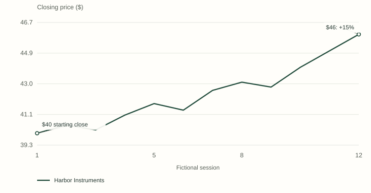

*Separate fictional illustration: twelve closes move from $40 to $46, a 15% price increase. The line reveals no participant identities or business valuation.*

#### Observation, interpretation, rule

An observation is a statement another reader can check from the same data: the last close is $46, the first close is $40, or three successive weekly closes rose. An interpretation proposes meaning: demand may be strengthening, or a former trading area may attract interest again. A rule specifies an action under defined conditions: record a signal after a completed daily close above $46, then evaluate the next session’s opening price. These layers serve different purposes.

Confusing them creates false confidence. “The close exceeded the previous ten closes” can be objectively checked once the comparison window is fixed. “Institutions are accumulating” adds a claim about participant identity that ordinary daily prices cannot establish. “Therefore buy” introduces a decision requiring costs, risk, alternatives, and evidence. You can accept the observation, doubt the explanation, and reject the trade without contradicting yourself. Clear notes preserve all three judgments instead of compressing them into a single bullish label.

#### A first execution and loss-budget primer

Before chart patterns ask you to propose an entry or exit, here is the vocabulary they will use. A market order seeks execution at available prices; a limit order accepts only a stated price or better and can remain unfilled. An ordinary sell stop generally activates a market order at its trigger. The trigger is not a promised fill. A stop-limit instead activates a price-constrained order, creating the possibility that you continue holding while the price moves away. The later execution chapter develops these distinctions; here they explain why an attractive mark on a chart is not yet an attainable transaction.

At Harbor’s first $40 close in the illustration, imagine a paper plan that assumes a $40 entry and a $38 exit if the idea fails. A $100 planned loss budget divided by the $2 price distance allows 50 shares before costs. Those shares require $2,000 of capital, not $100. If the scenario allows $0.10 per share for the combined entry and exit expense, modeled loss per share becomes $2.10. Whole-share sizing becomes floor(100/2.10) = 47 shares: $1,880 notional and $98.70 modeled loss. The expense is an invented teaching assumption; actual expense and available capital require their own records.

If the next feasible exit after adverse news is $35, those 47 shares lose 47 × $5 = $235 in price and $4.70 in the assumed expenses, totaling $239.70. This is the same quantity, with a different path and exit. Reading a candle correctly cannot prevent that difference. The risk chapter will add account and concentration limits; for now, keep entry capital, modeled loss, and a larger-loss scenario as separate numbers.

**One quantity, three different amounts**

| Item | Calculation | Amount ($) |
| --- | --- | --- |
| Entry notional | 47 × 40 | 1880 |
| Modeled ordinary loss | 47 × (40 − 38 + 0.10) | 98.7 |
| Gap-scenario loss | 47 × (40 − 35 + 0.10) | 239.7 |

#### An attractive target needs a frequency

Suppose an illustrative one-share plan has a $4 gain when it succeeds and a $2 loss when it fails, before the same $0.10 combined expense. The possible net outcomes are +$3.90 and −$2.10. A two-to-one gross payoff ratio is a comparison of distances; it is not an average result. If exactly 40% of a hypothetical outcome distribution earns the first amount and 60% loses the second, the weighted mean is 0.40 × 3.90 − 0.60 × 2.10 = +$0.30 per share. At 25% winners it becomes 0.25 × 3.90 − 0.75 × 2.10 = −$0.60.

These invented frequencies let you reproduce expectancy arithmetic; the twelve closes in the illustration do not estimate either frequency. A later $46 close tells you nothing about how often a defined entry and exit would have earned the $4 target across a complete opportunity set. Chapters on testing and statistics will explain how outcomes are sampled and compared. Until then, separate three questions: what is visible, what action is feasible, and what evidence would make the action economically useful.

**Same payoffs, different assumed frequencies**

| Assumed winners | Net win ($/share) | Net loss magnitude ($/share) | Weighted mean ($/share) |
| --- | --- | --- | --- |
| 40% | 3.9 | 2.1 | 0.3 |
| 25% | 3.9 | 2.1 | -0.6 |

#### A useful first analysis note

At the last shown session, Harbor has moved from $40 to $46: a $6 increase and 15% price return. Write that first. Next write a possible explanation, such as continued willingness to transact at higher prices, and a competing explanation, such as a temporary response to news. The line cannot choose between them. Finally choose an observation time for any next step: “After the next regular close, compare that close with $46.” That is a monitoring condition, not a purchase instruction.

The book uses fictional data so you can verify every supplied calculation and distinguish what is known at each step. It will label invented thresholds as teaching rules and keep exact execution assumptions visible. Rather than repeat those conventions in every paragraph, carry them forward. When a later example fails, ask which layer changed: the observed event, the interpretation, the executable opportunity, or the average economic result.

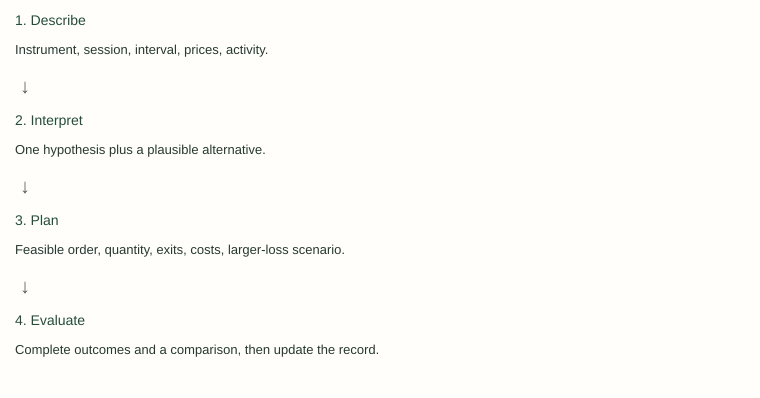

*The output of one stage is an input to the next; a price observation alone does not supply the decisions in later stages.*

#### Ask what the evidence actually measured

Start with the evidence appendix when a claim sounds like “technical analysis works.” It compares a stock portfolio, a futures strategy, pattern-conditioned distributions and adverse rule-selection results. Ask which experiment would test the precise rule being proposed. A familiar chart label is not enough to identify it.

#### Worked example: The persuasive explanation that failed

Harbor closes from $40 to $46 across twelve fictional sessions. One reader writes that buyers have discovered exceptional business value. Another says a temporary repricing followed a rumor. Both explanations fit the same visible rise. A later $41 close does not tell us which original story was true. It does show that an unconditional prediction of continued gains failed. The defensible original note was the 15% observed price increase, followed by a conditional hypothesis with a stated horizon.

#### Exercise

Write three sentences about the illustration: one verifiable observation, one possible interpretation, and one rule with a precise observation time. Underline every assumption that needs information beyond the chart.

Reveal the worked solution

One checkable observation is: “At session 12, the $46 close is 15% above session 1’s $40 close: (46 − 40)/40 × 100.” The chart supplies both prices and the denominator.

An interpretation is: “The advance may reflect increased willingness to transact at higher prices.” A competing explanation remains possible. Claims about institutions, business value, or the cause of the move require evidence beyond this chart.

An example monitoring rule is: “After the next completed regular-session close, record whether it is above $46.” The next close is not yet known. A trade rule would additionally need execution, quantity, exit, costs, and available capital; underline those missing decisions rather than pretending the monitoring condition supplies them.

#### guided practice: Guided: separate the three money amounts

Use the $40 entry, $38 modeled exit, $0.10 combined expense and $100 budget. Fill in quantity, entry notional, ordinary modeled loss, and loss at a $35 gap exit.

Reveal the worked solution

Modeled ordinary loss is $2.10 per share. floor(100/2.10) gives 47 shares. Notional is 47 × 40 = $1,880; ordinary modeled loss is 47 × 2.10 = $98.70.

At $35, price loss is 47 × 5 = $235, and assumed combined expense is $4.70. Total scenario loss is $239.70. The budget governed quantity under an ordinary-exit assumption; it did not cap every path.

#### independent practice: Independent: keep the denominator and the payoffs straight

A second paper observation falls from $80 to $64 and then returns to $80. Calculate both percentage changes. A separate hypothetical plan wins $6 or loses $3 per share before $0.20 expense, with 30% winners. Calculate its mean net result.

Reveal the worked solution

The decline is (64 − 80)/80 = −20%. The recovery is (80 − 64)/64 = +25%; the starting denominator changed.

Net outcomes are +$5.80 and −$3.20. The hypothetical mean is 0.30 × 5.80 − 0.70 × 3.20 = −$0.50 per share. Neither equal dollar recovery nor a two-to-one gross payoff establishes a positive average.

#### Knowledge check

Harbor rises from $40 to $46. Which calculation gives its price return?

1. (46 − 40)/40 = 15%
2. (46 − 40)/46 = approximately 13.04%
3. 46/40 = 115% return

Reveal the worked solution

Answer: 1. Price return uses the starting value as denominator and subtracts the original amount.

Option 1: Correct: the $6 gain is 15% of the $40 starting price.

Option 2: This uses the ending price as denominator. It instead gives the size of a $6 decline measured from $46.

Option 3: 1.15 is the ending-to-starting wealth ratio. Subtract 1 to obtain the 15% return.

#### Sources

- [Fidelity · What is technical analysis?](https://www.fidelity.com/learning-center/trading-investing/technical-analysis/what-is-technical-analysis) — Technical analysis studies market-generated data; distinction from fundamental analysis. Educational description, not validation of the fictional examples.
- [SEC / Investor.gov · Bid price / ask price](https://www.investor.gov/introduction-investing/investing-basics/glossary/ask-price) — Bid, ask, and bid–ask spread definitions. All quote arithmetic examples are fictional.
- [SEC / Investor.gov · Understanding Order Types](https://www.investor.gov/introduction-investing/general-resources/news-alerts/alerts-bulletins/investor-bulletins-14) — Market/limit/stop/stop-limit execution, nonfills, trigger conventions, IOC cancellation; definitions only, not assumed fill probabilities.

---

### Chapter 2: Anatomy of a stock chart

Read four prices accurately before asking what a candle means.

> OHLC is a compact summary of an interval; it preserves extremes and endpoints but loses the order of transactions.

**Version 0.4 · AI editorial review recorded 2026-10-02 (/root).**

Review scope: Scoped chapter editorial acceptance: prose, material source claims, tasks, numerical reproduction and compact/wide figures; release QA and human learning are separate.

**Learning outcomes**

- Locate open, high, low and close on an actual candle.
- Calculate body, shadows, range, and close-location fraction.
- Distinguish open-to-close change from close-to-close return.
- Construct two routes with the same OHLC and different first exits.

Builds on: The language of the market.

#### Read the frame before the picture

Every chart has a contract with the reader. It identifies an instrument, a time interval, a price unit, and a selection of observations. Before interpreting a shape, check that contract. A daily chart of Harbor Instruments in dollars and a five-minute chart of another instrument may have similar outlines while describing entirely different situations. Even two daily charts of Harbor can disagree if one includes extended trading or adjusts historical prices differently.

Time ordinarily advances from left to right and price is plotted vertically. The horizontal spacing may count trading intervals rather than elapsed clock time, so a weekend can occupy no visible width. The rightmost mark may be incomplete while the session is still running. Read its timestamp, not merely its position. A candle representing a day that has not ended cannot yet have a final daily close, although a platform may temporarily place the latest transaction in the close field.

#### Four numbers and one interval

OHLC stands for open, high, low, and close. Under the chosen data convention, the open is the first eligible price, the high and low are the extremes, and the close is the final eligible price of the interval. A candlestick’s body joins open to close. Its upper and lower shadows, also called wicks, extend toward the high and low. Bar charts encode the same four values with a vertical range and small opening and closing ticks.

Consider a fictional daily candle with open $100, high $108, low $98, and close $105. Its range is $108 − $98 = $10. Its body length is |$105 − $100| = $5. The upper shadow measures $108 − $105 = $3; the lower shadow measures $100 − $98 = $2. The body and shadows sum to $10. This simple check can catch a mistaken reading: an upper shadow is measured from the higher body endpoint, not always from the close.

#### Measure the candle one piece at a time

Look at the single candle, then reproduce it on paper. First mark $98 and $108 as the extremes. Next put the body’s lower edge at the $100 open and its upper edge at the $105 close. The body occupies five dollars of the ten-dollar range. The remaining five dollars are split between the $3 upper shadow and $2 lower shadow. A body is a span, not an additional price: its size is $5, while its endpoints remain $100 and $105.

Use the table as a reading order rather than memorizing a picture. For a down body the high endpoint of the body is the open, so the max/min formulas work for either direction. If high equals low, all four prices must match in valid OHLC, and the close-location fraction has a zero denominator. In that special case describe a zero range instead of reporting a percentage location.

Our example closes seven dollars above the low inside a ten-dollar range, giving (105 − 98)/(108 − 98) = 0.70. “The close is 70% of the way up the range” is verifiable. It does not mean 70% of the shares were bought near the high or that the next candle has a 70% chance of rising.

**Exact O100 / H108 / L98 / C105 measurements**

| Component | Calculation | Result |
| --- | --- | --- |
| Range ($) | 108 − 98 | 10 |
| Body ($) | \|105 − 100\| | 5 |
| Upper shadow ($) | 108 − max(100,105) | 3 |
| Lower shadow ($) | min(100,105) − 98 | 2 |
| Check ($) | 5 + 3 + 2 | 10 |
| Close location | (105 − 98)/10 | 70% |

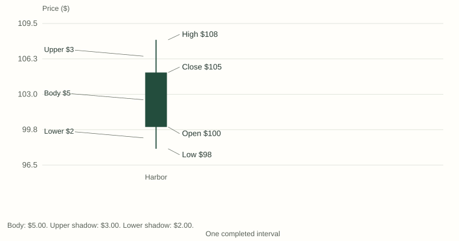

*Fictional candle used in every measurement in this chapter. Body $5; upper shadow $3; lower shadow $2; total range $10. The body rises from the open even though the previous close in the return example is $110.*

#### Color compares particular prices

For the filled-color convention used in this book, an up candle closes above its open and a down candle closes below it. Platforms may instead use hollow bodies or combine filling and color to represent different comparisons. Consult the legend whenever a familiar-looking chart behaves unexpectedly. Colors are visual encodings chosen by software; the underlying numbers settle the meaning.

Imagine yesterday closed at $110, today opened at $100, and today closed at $105. Today’s body is an up body because $105 exceeds $100. The close-to-close price change is nevertheless −$5, or approximately −4.55% relative to $110. The opening gap was −$10, approximately −9.09%. A novice who calls every green candle a gain for the day misses this distinction. State whether you are measuring open-to-close movement, close-to-close return, or an overnight opening change.

#### Two routes, one summary

The paired diagrams show eight schematic observations through the same interval. Route A is 100 → 99 → 98 → 100 → 104 → 107 → 108 → 105. Route B is 100 → 104 → 107 → 108 → 104 → 100 → 98 → 105. Read each from left to right. Both begin at $100, finish at $105, reach $108, and visit $98. If you erase the intermediate observations, they become the identical candle already measured.

The marks in these route panels are a supplied ordering for teaching, not equal-duration bars or a record of every transaction. Their purpose is to show what OHLC discards. In A the low precedes the high; in B the high precedes the low. A candle cannot tell you how often each price traded, how long it lasted, or which intermediate route actually occurred. It retains endpoints and extremes, which are valuable but insufficient for those questions.

**Same summary, different available sequence**

| Field | Route A ($) | Route B ($) |
| --- | --- | --- |
| Open | 100 | 100 |
| High | 108 | 108 |
| Low | 98 | 98 |
| Close | 105 | 105 |
| Extreme order | Low, then high | High, then low |

#### Follow an assumed entry through both routes

Carry the chapter 1 vocabulary into a one-share paper example. An entry at the first $100 observation is already assumed. A sell-stop trigger is $99, and a target is $107. To isolate ordering, this exercise assumes immediate fills exactly at the first reached exit level and ignores expenses. Those assumptions are deliberately separate from the real order mechanics you learned earlier.

In A, the second plotted observation is $99. The assumed stop exits first for 99 − 100 = −$1. The later $107 and $108 observations occur after that one-share position is closed. In B, the third observation is $107. The assumed target exits first for 107 − 100 = +$7. The later decline to $98 does not reopen the position. A green final candle and the same $105 close coexist with these different outcomes.

Now remove the route panels and keep only OHLC. You can establish that both exit levels lie inside the range, but you cannot assign either route’s outcome. A daily-data study can flag the bar as unresolved, obtain finer information, or use a declared convention. The useful habit is to record exactly what is missing instead of allowing the favorable sequence to fill the gap.

**Exit order under the supplied route and exact-fill assumptions**

| Route | First exit | Observation within route | Price result ($/share) |
| --- | --- | --- | --- |
| A | Stop at $99 | 2 | -1 |
| B | Target at $107 | 3 | 7 |

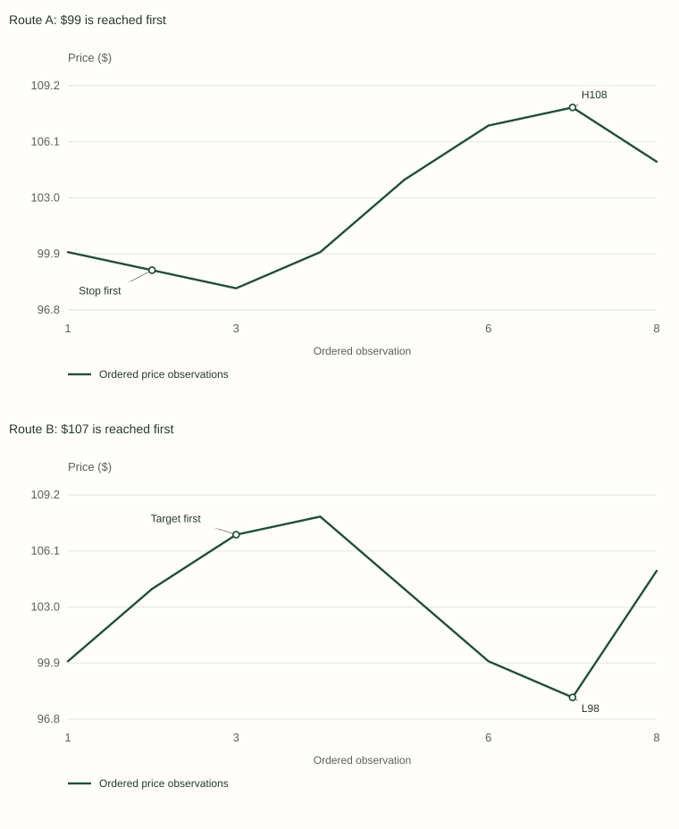

*Both routes have exactly O100/H108/L98/C105. Horizontal positions are schematic ordered observations, not equal-duration trading bars. $99 and $107 exits are exact-fill teaching assumptions.*

#### Choose a representation for a real reading question

A close-only representation of this interval contains the endpoint $105. Its body direction, extremes, and opening gap disappear. An OHLC bar and a candle both retain 100, 108, 98, and 105; their encodings differ. The bar uses a vertical low-to-high line with an opening tick to the left and closing tick to the right. The candle uses the same range plus the body. You can reconstruct either from the supplied table; neither reconstructs the route.

For broad progress across years, closing endpoints may answer your question with less visual clutter. For the location of the close within a session, OHLC answers more. For competing intraday orders, even OHLC may be insufficient. A careful reader chooses the representation according to the information needed, not according to how sophisticated the chart looks. Aggregation in the next chapters repeats this tradeoff at longer intervals.

**What each representation retains**

| Representation | Supplied values retained | Question it cannot settle |
| --- | --- | --- |
| Close-only point | $105 | Open, range, or route |
| OHLC bar | 100 / 108 / 98 / 105 | Whether $99 or $107 came first |
| Candlestick | 100 / 108 / 98 / 105 | Whether $99 or $107 came first |
| Ordered route panel | Eight specified prices | Unshown trades, actual liquidity, or participant motives |

#### Worked example: Resolve the two route outcomes, then remove the route

The measured candle is identical for A and B. With a $100 assumed entry, a $99 stop and $107 target, A exits at $99 for −$1 and B at $107 for +$7 under the specified exact-fill model. Removing the ordered prices makes the exit result unresolved, while preserving the same $10 range and $5 up body. This is a loss of information through aggregation, not an arithmetic disagreement.

#### Exercise

Sketch two transaction sequences with identical OHLC of 100, 108, 98, and 105. Mark a $107 exit and a $99 stop on each. Explain why a daily-only simulation could reach different outcomes.

Reveal the worked solution

A valid sketch is the supplied route A: 100, 99, 98, 100, 104, 107, 108, 105. It starts at 100, reaches a minimum 98 and maximum 108, and finishes 105. The $99 stop occurs before $107 under the exact-fill assumption, so the one-share result is −$1.

Route B is 100, 104, 107, 108, 104, 100, 98, 105, with the same four summary prices. Here $107 occurs first, giving +$7. Both routes close above their open.

Other sketches are acceptable if all four OHLC values are exact and the competing levels have the intended different first-reach order after entry. Daily OHLC alone does not choose between them. A high/low check can confirm coverage but not sequencing.

#### guided practice: Guided: read a down body

A candle has O105/H108/L98/C100. Use the max/min method to calculate body, upper shadow, lower shadow, range and close location. Explain which measurement differs from the main example.

Reveal the worked solution

Body = |100 − 105| = $5. Upper shadow = 108 − max(105,100) = $3. Lower shadow = min(105,100) − 98 = $2. Range remains $10.

Close location = (100 − 98)/10 = 20%. Body direction and close location change; lengths of the body and two shadows do not. This demonstrates why location and direction are distinct readings.

#### independent practice: Independent: diagnose a convincing color error

Yesterday closes at $75. Today has O70/H74/L68/C73. Calculate open-to-close change, close-to-close return, upper/lower shadows, and close location. A note calls it a 4.29% daily gain. Find the error.

Reveal the worked solution

Open-to-close change is +$3; relative to the $70 open that is approximately +4.29%. Close-to-close return is (73 − 75)/75 = approximately −2.67%. The note used the open denominator while calling the result daily close-to-close performance.

Body $3; upper shadow 74 − 73 = $1; lower shadow 70 − 68 = $2; range $6. Close location (73 − 68)/6 = approximately 83.33%. The up body does not undo the opening gap.

#### Knowledge check

For O100/H108/L98/C105, what are the upper shadow and close-location fraction?

1. Upper shadow $8; close location 50%
2. Upper shadow $5; close location 30%
3. Upper shadow $3; close location 70%

Reveal the worked solution

Answer: 3. Measure upper shadow from the higher body endpoint; measure close location from the low across the full range.

Option 1: $8 measures high minus open, including the body. 50% is the body/range ratio, not close location.

Option 2: The $5 body is not the upper shadow. 30% measures the remaining distance from the close to the high.

Option 3: Correct: 108 − 105 = $3, and (105 − 98)/(108 − 98) = 70%.

#### Sources

- [Fidelity · What are charts?](https://www.fidelity.com/learning-center/trading-investing/technical-analysis/what-are-charts) — Line, OHLC, and candlestick chart conventions.
- [StockCharts ChartSchool · Introduction to candlesticks](https://chartschool.stockcharts.com/table-of-contents/chart-analysis/candlestick-charts/introduction-to-candlesticks) — Doji and long-shadow pattern terminology, prior-trend context, and the inability of OHLC to reveal transaction sequence. Numerical thresholds here are original teaching conventions.
- [SEC / Investor.gov · Understanding Order Types](https://www.investor.gov/introduction-investing/general-resources/news-alerts/alerts-bulletins/investor-bulletins-14) — Market/limit/stop/stop-limit execution, nonfills, trigger conventions, IOC cancellation; definitions only, not assumed fill probabilities.

---

### Chapter 3: Volume: participation behind price

Count what changed hands, choose a fair comparison, and resist reading minds.

> Volume measures trading activity. It does not by itself identify participants, motivations, or future direction.

**Version 0.4 · AI editorial review recorded 2026-10-03 (claude-code-main).**

Review scope: Chapter 3 re-accepted after the batch 4 figure change; earlier substantive review retained. Later changed figures rechecked as recorded below.

**Learning outcomes**

- Count share volume without doubling buyer and seller quantities.
- Reproduce relative-volume and dollar-volume calculations.
- Read aligned price/volume panels with a fixed baseline.
- Compare an unfinished session with the same elapsed time.

Builds on: Anatomy of a stock chart.

#### What volume actually counts

For a stock, share volume counts shares traded during the specified interval. One transaction of 200 shares contributes 200 shares, even though it has both a buyer and a seller. Volume is not the number of distinct investors, the number of companies, or the amount of cash held by participants. A single share can change hands repeatedly, so daily volume can be large without implying that an equivalent fraction of long-term owners changed their investment views.

Suppose Harbor records trades of 100 shares at $40, 200 at $40.10, and 50 at $40.20. Share volume is 350. The associated transaction value is $4,000 + $8,020 + $2,010 = $14,030. Multiplying the last price, $40.20, by 350 gives $14,070 instead, a convenient approximation rather than the exact sum. Distinguish share volume from dollar volume, and identify whether a displayed dollar-volume statistic uses actual transactions or an approximation.

#### Every transaction has two sides

The phrase “more buyers than sellers” is often a loose explanation for rising prices. For executed shares, the quantities bought and sold match. A more careful statement concerns aggressiveness and available offers: buyers may be willing to transact at progressively higher prices, or sellers may withdraw lower offers. Conversely, falling prices can reflect transactions occurring against lower bids. Ordinary volume bars do not separately count bullish people and bearish people.

Bar color usually borrows a price comparison, such as whether the interval closed above its open or above the previous close. It does not mean every share in a green bar was purchased by an optimistic investor. A seller might be taking profits, reducing risk, or selling reluctantly; a buyer might be covering a short. All these motives can produce the same transaction. Describe a green volume bar as volume associated with an up-price interval under the platform’s convention.

#### Build the denominator from completed observations

The aligned panels follow Harbor across seven fictional daily closes. D1–D5 have volumes 0.8, 1.0, 0.9, 1.1, and 1.2 million shares. Their sum is 5.0 million and their mean is 1.0 million per completed regular session. Freeze that denominator after D5 for this comparison. D6 then trades 1.8 million and D7 trades 2.0 million. Their relative volumes are 1.8 and 2.0 against the same stated baseline.

Why use five preceding observations? It is short enough to calculate by hand, not a claim that five is the most useful lookback. The important choices are what counts as an eligible session and whether the session being evaluated enters its own denominator. Including D6 in a six-session mean gives 6.8/6 = 1.133333 million and relative volume 1.8/1.133333 ≈ 1.588. This calculation is valid but answers a different comparison. You can now see the difference instead of merely being asked to specify it.

**Completed-session case shared with the panels**

| Session | Close ($) | Volume (million shares) | Reading at that time |
| --- | --- | --- | --- |
| D1 | 40 | 0.8 | Baseline observation |
| D2 | 40.5 | 1 | Baseline observation |
| D3 | 40.2 | 0.9 | Baseline observation |
| D4 | 41 | 1.1 | Baseline observation |
| D5 | 40 | 1.2 | Five-session mean now 1.0 |
| D6 | 42 | 1.8 | +5% price; relative volume 1.8 |
| D7 | 39.5 | 2 | −5.952% price; relative volume 2.0 |

#### Read the panels together without translating color into identity

On D6, close changes from $40 to $42: a $2 gain, or 5%. Volume is 80% above the completed-session baseline. A concise note is: “A higher close occurred with greater activity than the preceding five-session mean.” That does not require guessing who traded. The data could fit continued repricing, a temporary announcement response, or other interpretations.

On D7, close changes from $42 to $39.50: −$2.50, approximately −5.95%. Volume increases to twice the same baseline. Increased activity accompanies both the rise and the decline. This is the chapter’s counterexample: high volume measures participation, while the price panel supplies the direction. The fixed reference line is deliberately not called a rolling average; allowing it to move during the comparison would change the ratios.

If your rule required a close above $41.50 with relative volume at least 1.5, D6 would qualify and D7 would not. Both facts are straightforward once the conditions are written. Whether that rule is useful over many opportunities is a later evidence question. For now, you can classify the supplied event and recognize that increased activity did not ensure persistence.

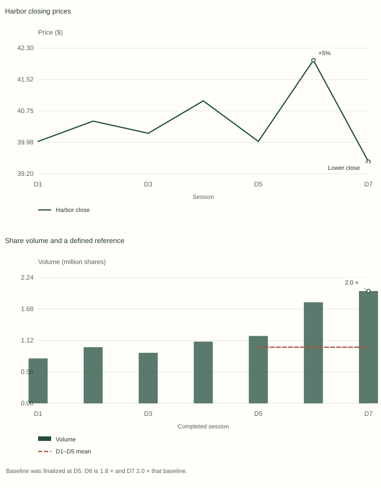

*Seven fictional completed sessions from the chapter table. The volume baseline is the mean of D1–D5, frozen at 1.0 million; use it to compare D6 and D7.*

#### Volume and liquidity are related but different

Liquidity concerns your ability to transact at acceptable cost and with limited impact. A day’s aggregate volume is only part of that picture. Two fictional stocks can each trade a million shares while having different spreads, available quote sizes, and responses to a new order. Historical volume also cannot promise that comparable trading interest will be available at the particular moment you need to exit.

Consider a $40.00 bid and a $40.20 ask, with only 100 shares shown at each. A 5,000-share order is larger than the displayed quantity. Yesterday’s heavy turnover cannot establish its fill price today. Likewise, a daily volume spike concentrated in an opening transaction might say little about depth several hours later. Use volume to contextualize activity; examine spreads, order size, venue coverage, and conditions when evaluating execution. Extended sessions deserve special care because their trading environment can differ from the regular session.

#### A morning is not a full session

Now inspect the separate matched-time panel. This is a purposeful different view of the same five baseline sessions: cumulative shares traded through noon were 0.32, 0.38, 0.34, 0.40, and 0.36 million. Their sum is 1.80 million and mean is 0.36 million through noon. Today has traded 0.70 million by the same cutoff. The matched-time ratio is 0.70/0.36 ≈ 1.94.

Dividing 0.70 by the full-session mean of 1.0 instead gives 0.70. That calculation compares a partial numerator with full-session denominators and does not justify calling today quiet. Equally, multiplying noon volume by a fraction of the clock is not a demonstrated forecast of the final total. The matched-time method answers how activity so far compares with activity through that same cutoff; the rest of today has not occurred.

Keep the feed, sessions, corrections and share-unit policy consistent. A chart containing only selected venues may not have the same total as a consolidated feed. A stock split changes the share unit, so a before/after comparison needs a documented adjustment. These data conventions explain discrepancies that a colored bar cannot resolve. In your note, record the cutoff and denominator before the interpretation.

**Matched noon totals, not forecasts of the close**

| Session | Through-noon volume (million shares) | Coverage |
| --- | --- | --- |
| D1 | 0.32 | Regular session through noon |
| D2 | 0.38 | Same cutoff |
| D3 | 0.34 | Same cutoff |
| D4 | 0.4 | Same cutoff |
| D5 | 0.36 | Same cutoff |
| Baseline mean | 0.36 | Five completed historical noon totals |
| Today | 0.7 | Session remains unfinished |
| Today / baseline | 1.9444 | Matched elapsed time |

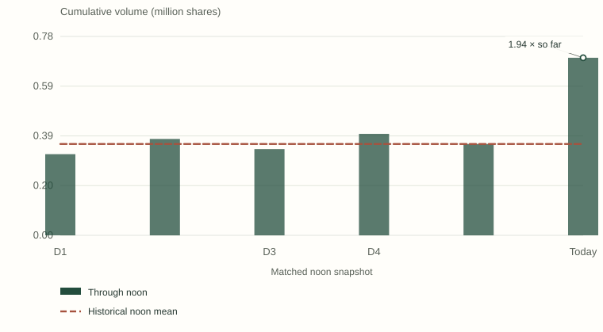

*Same elapsed regular-session time in every column. Today’s 0.70 million is about 1.94 times the five-session noon mean of 0.36 million. It is not a prediction of final volume.*

#### Worked example: A complete two-day reading

D6 gains 5% on 1.8 million shares, 1.8 times the D1–D5 mean. D7 loses approximately 5.95% on two million shares, twice the same mean. The direction comes from price; the activity comparison comes from the fixed volume denominator. Calling both days active is consistent with calling only the first day an advance.

#### Exercise

Using the five baseline volumes in the chapter, calculate relative volume for 600,000 shares and two million shares. Then write what each ratio measures and two questions it cannot answer.

Reveal the worked solution

The five completed volumes sum to 5,000,000 shares; dividing by five gives a 1,000,000-share baseline. At 600,000 shares, relative volume is 0.6: 40% below that mean. At 2,000,000 it is 2.0: 100% above it.

Both ratios measure an amount traded compared with an explicitly chosen amount. Neither determines direction or identifies participant motives. The D7 example demonstrates that a 2.0 reading can accompany a price decline. Quotes and depth would be needed to assess a particular order’s execution.

#### guided practice: Guided: finish the matched-time comparison

Add the five supplied noon totals and calculate their mean. Compare today’s 0.70 million with that mean and the one-million full-session mean. Which answers the matched-time question?

Reveal the worked solution

0.32 + 0.38 + 0.34 + 0.40 + 0.36 = 1.80 million. Mean = 1.80/5 = 0.36 million. Today / matched baseline = 0.70/0.36 = approximately 1.94.

0.70/1.0 = 0.70 compares an unfinished session with full sessions. It is a computable ratio but not the intended matched-time comparison. Neither ratio predicts the final close’s total.

#### independent practice: Independent: exact dollar volume versus an approximation

Three fictional trades are 100 shares at $20, 200 at $20.20, and 50 at $19.80. Calculate share volume and exact traded dollar value. Compare with last price × total shares.

Reveal the worked solution

Share volume = 100 + 200 + 50 = 350; count each transaction once, not once for each side. Dollar value = 2,000 + 4,040 + 990 = $7,030.

Last price × shares = 19.80 × 350 = $6,930, a $100 difference. That approximation treats every share as though it traded at the last price; the transaction list shows otherwise.

#### Knowledge check

Today has traded 0.70 million shares by noon; prior noon totals average 0.36 million and full sessions average 1.0 million. What is matched-time relative volume?

1. 0.70, using the completed full-session mean
2. 1.94, using the historical noon mean
3. 1.68, including today in the noon baseline

Reveal the worked solution

Answer: 2. The comparison must cover the same elapsed time; 0.70/0.36 ≈ 1.94.

Option 1: This denominator covers more time than the numerator. It does not answer the matched-noon question.

Option 2: Correct: both numerator and denominator count regular-session volume through noon.

Option 3: Including today changes the baseline to (5 × 0.36 + 0.70)/6 = 0.4167 million, giving 1.68. The stated historical baseline excludes the current session.

#### Sources

- [Fidelity · Why to consider stock volume](https://www.fidelity.com/viewpoints/active-investor/stock-volume) — Share-volume definition and comparison with historical activity.
- [SEC / Investor.gov · Extended-hours trading: investor bulletin](https://www.investor.gov/introduction-investing/general-resources/news-alerts/alerts-bulletins/investor-bulletins-42) — Regular versus extended trading sessions; differences in liquidity, spreads, and available trading data.
- [FINRA · Corporate actions by public companies](https://www.finra.org/investors/insights/corporate-actions-public-companies-what-you-should-know) — Stock-split mechanics and distinction between share count and proportionate ownership.
- [SEC / Investor.gov · Understanding Order Types](https://www.investor.gov/introduction-investing/general-resources/news-alerts/alerts-bulletins/investor-bulletins-14) — Market/limit/stop/stop-limit execution, nonfills, trigger conventions, IOC cancellation; definitions only, not assumed fill probabilities.

---

### Chapter 4: Timeframes, sessions & chart scales

A chart’s settings change the question its picture can answer.

> Fix interval, session, scale, and adjustment conventions before comparing charts or testing a rule.

**Version 0.4 · AI editorial review recorded 2026-10-02 (/root).**

Review scope: Scoped chapter editorial acceptance: prose, material source claims, tasks, numerical reproduction and compact/wide figures; release QA and human learning are separate.

**Learning outcomes**

- Distinguish bar interval from displayed history and intended holding horizon.
- Aggregate daily OHLC and volume without averaging the wrong fields.
- Read identical values on linear and log axes.
- Explain a raw split-price jump using share units rather than treating it as a loss.

Builds on: Anatomy of a stock chart; Volume: participation behind price.

#### An interval is different from a horizon

The bar interval tells you how observations are grouped: one minute, one day, one week, or another specified unit. The displayed horizon tells you how much history appears on screen. A one-year daily chart and a five-year daily chart use the same interval but different horizons. A one-year weekly chart uses the same displayed horizon as the first while summarizing the data more coarsely. Keep both settings in your notes.

This distinction makes “the trend is up” an incomplete statement. You may mean a rise over several recent daily bars or a rise over years of monthly bars. Neither description necessarily resolves the other. Choose a horizon that matches the question you are investigating, then choose a bar interval that retains the relevant details. Adding smaller bars can reveal structure, but it also increases the number of visual fluctuations you might mistake for a meaningful signal.

#### Aggregate the daily bars yourself

To combine consecutive eligible daily bars into a weekly bar, take the first day’s open, highest daily high, lowest daily low, and final day’s close. Sum the daily volumes. Do not average the daily opens or closes. The week’s first and last observations play different roles from its extremes, so the aggregation deliberately preserves different parts of the input.

The three-session teaching week below has exactly the daily values used in your exercise. Day two supplies the $108 high; day three supplies the $98 low and $101 final close. The weekly body rises only $1 from its $100 opening, while its range spans $10. The 370,000 shares are the sum of 100,000, 150,000, and 120,000. An almost unchanged endpoint can conceal a large advance and decline within the week.

Inspect the daily and weekly candle panels side by side. The weekly candle cannot tell you that the high came on day two, or that day three opened below day two’s close. The input table can. This is the same information-loss principle as chapter 2, applied to several sessions instead of one. It explains why a weekly question about broad progress and a daily question about a recent setback can receive different descriptions.

**Three daily inputs and their aggregate**

| Interval | Open ($) | High ($) | Low ($) | Close ($) | Volume (shares) |
| --- | --- | --- | --- | --- | --- |
| D1 | 100 | 104 | 99 | 103 | 100000 |
| D2 | 103 | 108 | 102 | 107 | 150000 |
| D3 | 106 | 107 | 98 | 101 | 120000 |
| Combined week | 100 | 108 | 98 | 101 | 370000 |

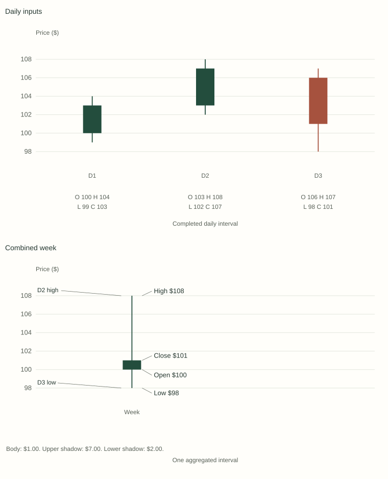

*Same daily OHLC as the aggregation table. Weekly high comes from D2; weekly low and close from D3. Volume is summed in the table rather than plotted on the price axis.*

#### The session defines the input

For conventional US listed-stock regular sessions, the familiar window is 9:30 a.m. to 4:00 p.m. Eastern Time on ordinary trading days. Holidays and shortened sessions require calendar handling. Trading outside that window can occur on additional venues and under different broker rules. A chart that includes those observations may show a high or low absent from a regular-session-only chart. Confirm the session definition rather than assuming that daily means identical inputs everywhere.

Suppose Harbor trades at $45 before the regular open, then opens its regular session at $42, ranges between $41 and $43, and closes at $42.50. A regular-session bar has a $43 high; a broader-session bar may have a $45 high. A rule asking whether price exceeded $44 produces different answers depending on coverage. The discrepancy is not a mysterious indicator failure. It is a different measurement. For live use, check the venue, feed, exchange calendar, and time zone behind the chart.

#### Same four prices, two honest pictures

The paired scale diagrams contain the identical sequence $10, $20, $40, $80 at four equally spaced observations. On an arithmetic axis, the first vertical move spans $10, the next $20, and the last $40. On a logarithmic axis, all three occupy the same vertical distance because each doubles. Read the axis labels before judging whether the rate of progress appears to accelerate.

For positive values, a log display is based on differences in logarithms, which depend on price ratios: log(20) − log(10) = log(2), just as log(80) − log(40) = log(2). You need not calculate those logarithms to see the repeated doubling. The percentage change is 100% for all three steps. The display transformation changes distances while leaving the supplied prices and returns unchanged.

A straight trendline on a linear chart implies a constant dollar-rate slope across equally spaced observations; a straight line on a log chart implies a constant proportional-rate slope. These are different fitted descriptions. State the scale when drawing a sloping line. This matters much less for a horizontal price boundary, whose value remains a particular price, than for projecting a sloping line over a long history.

**Distances you should recognize on both axes**

| Move ($) | Dollar change ($) | Percentage change | Price ratio |
| --- | --- | --- | --- |
| 10 → 20 | 10 | 100% | 2 |
| 20 → 40 | 20 | 100% | 2 |
| 40 → 80 | 40 | 100% | 2 |

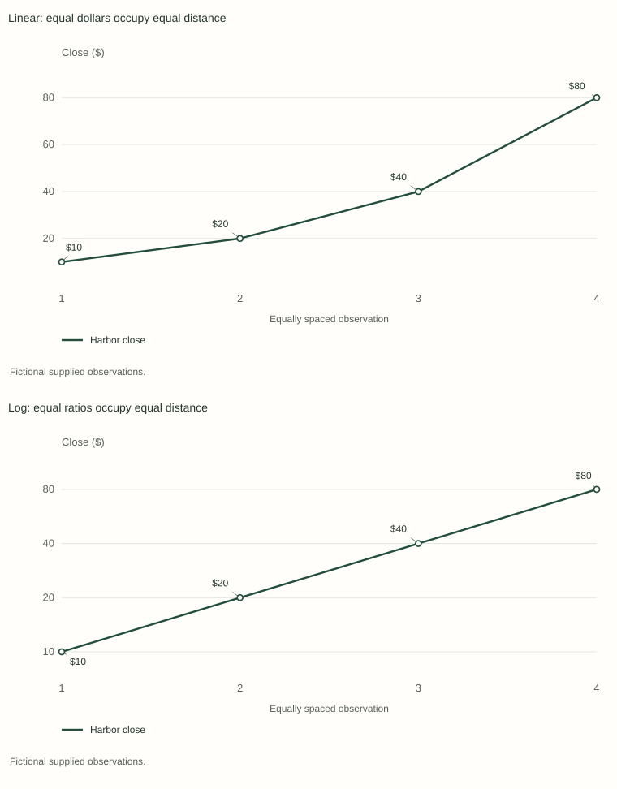

*The same four fictional values, in the same order, appear in both panels. Each step doubles. The log axis changes vertical spacing, not prices or returns.*

#### Separate a change in units from a change in value

The split comparison is a different dataset for a different question: did a change in the share unit itself halve an owner’s position? A fictional holder owns 100 shares near $80 before a two-for-one split and 200 near $40 immediately afterward, excluding any unrelated market movement. Position value is $8,000 in both states. The raw share price halves, while the number of shares doubles. The split itself does not change proportionate ownership.

To compare historical price levels in post-split units, the earlier $80 can be restated as $40. A split-adjusted series then shows $40 before and $40 after for this isolated event, rather than the raw $80 → $40 jump. The adjustment is a data convention, not proof that no market movement occurs around a real split. Provider methods and effective dates matter, and a historical adjusted value is not necessarily the transaction price participants originally saw.

Dividends answer a separate total-return question. A simplified share bought at $50, later worth $49 after delivering $2 cash, gives $51 of price plus distribution, or a 2% gain before costs. Price alone is down 2%. Reinvestment adds another convention. Keep raw prices, split-adjusted prices, and total-return measures distinct when comparing a chart with a portfolio or benchmark.

**Isolated two-for-one split: no unrelated price movement**

| State | Shares | Raw price ($/share) | Position value ($) | Price in post-split units ($) |
| --- | --- | --- | --- | --- |
| Before split | 100 | 80 | 8000 | 40 |
| After split | 200 | 40 | 8000 | 40 |

#### Incomplete bars are still changing

A daily bar at noon contains information through noon, not the completed day’s outcome. Its high can rise, its low can fall, its temporary close can move, and its volume can grow. A weekly bar viewed on Wednesday is likewise provisional. Calling an unfinished weekly breakout a completed weekly signal introduces a timing error if the rule explicitly requires the week’s final close.

Write the decision time alongside the settings. For example: “After Friday’s regular close, compare the completed weekly close with the prior four completed weekly closes on split-adjusted data.” That sentence makes the observation reproducible without forcing a particular strategy. If you need an intraday decision, define an intraday rule rather than borrowing an outcome that will only be known later. Good settings cannot prove predictive power, but inconsistent settings can easily manufacture an apparent signal or a misleading historical result.

#### A settings note before your first analysis

Choose a question before choosing settings. If you want to locate a recent daily range inside a longer investment holding, begin with completed weekly observations for the broader description, then inspect daily bars for the recent structure. You can keep the same currency, session and adjustment policy so the comparison changes aggregation rather than several inputs at once. Smaller bars are useful when a specific sequence question requires them; they do not automatically improve the investment decision.

Here is a completed note for the three-day table: “Harbor, dollars, fictional regular-session daily OHLC, shown D1–D3; arithmetic price axis; no corporate action within the table. Weekly aggregation uses the first open 100, extreme high 108, extreme low 98, final close 101, and summed volume 370,000. The final bar is completed.” If you read it on day two instead, the week’s final close is unknown and the weekly low can still change.

Now compare the three purposeful representations in this chapter. The unchanged four-price sequence isolates scaling; the daily table isolates aggregation; the split table isolates units. Each keeps the relevant inputs fixed while changing one convention. This habit—change one thing, state the question, inspect what survives—will make chart disagreements easier to diagnose.

**A short pre-analysis checklist**

| Setting | Completed example | Why it matters |
| --- | --- | --- |
| Instrument/currency | Harbor / dollars | Identify what is measured |
| Interval/horizon | Daily bars / D1–D3 | Avoid confusing count with duration |
| Session | Regular-session teaching data | Defines eligible trades |
| Scale | Arithmetic | Defines sloping distances |
| Adjustment | No action in this table | Avoid mixing units |
| Completion | D3 has ended | Exclude future outcomes |

#### Worked example: A breakout that disappears when the day ends

At noon on a fictional Friday, Harbor’s current weekly mark shows $51 against a prior weekly high of $50. A reader records a weekly closing breakout. By the regular close, the price is $49. The noon observation was real, but it did not satisfy a completed-week close rule. A second reader using an extended-session feed then sees $50.50 after hours. To resolve the disagreement, state the session and the exact close convention before judging either chart.

#### Exercise

Aggregate the three daily bars in the chapter into one weekly bar, then identify two facts the weekly bar hides. Explain why a $10-to-$20 move and a $40-to-$80 move occupy equal height on a log axis.

Reveal the worked solution

Open = first open = $100. High = max(104,108,107) = $108. Low = min(99,102, 98) = $98. Close = final close = $101. Volume, if included, is 100,000 + 150,000 + 120,000 = 370,000 shares.

The weekly bar hides which day supplied the high and the gap from D2’s $107 close to D3’s $106 open. It also discards the intermediate $103 and $107 closes. Do not average them to obtain the weekly close.

$10 to $20 and $40 to $80 both multiply price by two. Equal ratios have equal vertical distance on a log axis; the dollar changes are different on a linear axis.

#### guided practice: Guided: diagnose an unfinished weekly claim

At the end of D2, what provisional weekly OHLC and volume can you compute from the table? Which fields can D3 change, and when does the final weekly $101 close become knowable?

Reveal the worked solution

After D2, the provisional summary is O100/H108/L99/C107, volume 250,000 shares. The first open is fixed. Subsequent high can rise, low can fall, temporary close can change, and volume can accumulate.

D3 sets the final low to 98, close to 101, and total volume 370,000. Those final values are unavailable at the D2 cutoff. In this three-session teaching week they become known after D3 ends.

#### independent practice: Independent: units and economic value

A holder has 75 shares at $60 before a fictional three-for-one split, with no unrelated movement. Supply post-split shares, approximate raw price, position value before/after, and earlier price expressed in post-split units.

Reveal the worked solution

Shares become 75 × 3 = 225; raw price becomes 60/3 = approximately $20. Value before is 75 × 60 = $4,500; after is 225 × 20 = $4,500.

The earlier $60 is restated as $20 in post-split units for this isolated comparison. A raw 60-to-20 discontinuity is a changed share unit, not a two-thirds economic loss from the split itself.

#### Knowledge check

For the D1–D3 table, which weekly close and volume are correct?

1. Close $101; volume 370,000 shares
2. Close $103.67; volume 123,333 shares
3. Close $107; volume 150,000 shares

Reveal the worked solution

Answer: 1. Weekly close is the final eligible daily close; volume sums all included trades.

Option 1: Correct: D3 supplies the final $101 close; the three volume totals add to 370,000.

Option 2: These are averages. Standard weekly OHLC does not average the closes, and weekly volume is not average daily volume.

Option 3: These values select the day with the highest high rather than the final close and full included activity.

#### Sources

- [SEC / Investor.gov · Extended-hours trading: investor bulletin](https://www.investor.gov/introduction-investing/general-resources/news-alerts/alerts-bulletins/investor-bulletins-42) — Regular versus extended trading sessions; differences in liquidity, spreads, and available trading data.
- [FINRA · Corporate actions by public companies](https://www.finra.org/investors/insights/corporate-actions-public-companies-what-you-should-know) — Stock-split mechanics and distinction between share count and proportionate ownership.
- [StockCharts ChartSchool · What are charts?](https://chartschool.stockcharts.com/table-of-contents/chart-analysis/what-are-charts) — Arithmetic versus logarithmic price-axis conventions.
- [Fidelity · What are charts?](https://www.fidelity.com/learning-center/trading-investing/technical-analysis/what-are-charts) — Line, OHLC, and candlestick chart conventions.

---

### Part 01 review: Turn a chart into a reproducible observation

#### Read an unfamiliar candle

A regular-session daily candle has O80/H86/L78/C84. The previous close was $88. Calculate body, upper shadow, lower shadow, total range, open-to-close return, and close-to-close return. Give two ordered routes consistent with it.

Reveal the worked solution

Body = $4; upper shadow = $2; lower shadow = $2; range = $8. Open-to-close return = 4/80 = +5%. Close-to-close return = −4/88 = −4.5455%. The rising body does not imply a positive return from the previous close.

80 → 86 → 78 → 84 and 80 → 78 → 86 → 84 both match OHLC. Their order differs; a first-hit exit outcome cannot be recovered from those four prices alone.

#### Align the comparison

A completed session has volume 1.2 million shares; its five prior completed-session volumes are 0.8, 1.0, 1.2, 0.9, and 1.1 million. A new session has 0.6 million by noon, compared with 0.4 million on average at the same cutoff. Calculate both meaningful relative-volume ratios. Can noon volume be ranked against completed-day volume on the same basis?

Reveal the worked solution

Prior full-day mean = 5.0/5 = 1.0 million; completed-session ratio = 1.2/1.0 = 1.2. Matched-noon ratio = 0.6/0.4 = 1.5. Dividing noon volume by a completed-day baseline describes a partial/full comparison, not the same activity measure.

Record session boundaries, adjustment conventions, cutoff, and baseline before interpreting either ratio. A future final daily volume is unavailable at noon.

#### Check the unit before describing a fall

A hypothetical two-for-one split turns 20 shares quoted at $80 into 40 shares quoted at $40 before other movement. An unadjusted chart displays an apparent 50% fall. Write an observation, a data check, and an interpretation to withhold.

Reveal the worked solution

Value is 20 × $80 = 40 × $40 = $1,600. The share-price unit changed; the split alone did not produce a 50% ownership-value loss.

Request consistent split-adjusted prior prices and a declared volume convention. Withhold a support-break interpretation until comparable units are confirmed; the algebra is not a forecast of subsequent prices.

## Part 02: Read the story of price

Recognize trends, map important areas, and put patterns into context.

### Chapter 5: Trends, swings & changing structure

Describe the sequence you can see and account for when you could recognize it.

> Trend describes direction over a specified horizon. Recognizing past structure does not guarantee its continuation.

**Version 0.4 · AI editorial review recorded 2026-10-02 (/root).**

Review scope: Scoped chapter editorial acceptance: prose, material source claims, tasks, numerical reproduction and compact/wide figures; release QA and human learning are separate.

**Learning outcomes**

- Apply a fixed two-before/two-after swing rule.
- Distinguish the date of a turn from its confirmation date.
- Choose and calculate a trendline from named anchors.
- Tell a line break from a lower-low/lower-high structural transition.

Builds on: Anatomy of a stock chart; Timeframes, sessions & chart scales.

#### Start by deciding which turns belong to the description

A conventional uptrend links higher significant peaks and troughs; a downtrend links lower ones. Significance needs a declared scale. On a one-minute chart, turns can accumulate during a small daily fluctuation. On a daily chart, the same fluctuation may be hidden inside one candle. In this chapter we use daily closing-price swings to demonstrate a choice you can repeat, rather than asking you to identify important turns by feel.

Our teaching rule calls a close a swing high only when it is strictly above each of the two preceding closes and each of the two following closes. Reverse the inequalities for a swing low. Equality disqualifies the candidate under this strict rule. Two earlier supplied closes, $44 and $42, precede D1 and make the first comparison possible. This rule is not the only reasonable way to select swings; its virtue here is that you can audit every inclusion and exclusion.

**Complete close sequence: reveal only through the analysis cutoff**

| Session | Close ($) |
| --- | --- |
| Previous −1 | 44 |
| Previous 0 | 42 |
| D1 | 40 |
| D2 | 42 |
| D3 | 44 |
| D4 | 46 |
| D5 | 45 |
| D6 | 43 |
| D7 | 46 |
| D8 | 49 |
| D9 | 47 |
| D10 | 45 |
| D11 | 48 |
| D12 | 52 |
| D13 | 50 |
| D14 | 49 |
| D15 | 42 |
| D16 | 44 |
| D17 | 48 |
| D18 | 46 |
| D19 | 44 |

#### Walk forward: a candidate is not a confirmed point

D4 closes at $46 after $42 and $44. It is a high candidate because it exceeds the two earlier closes, but its two following closes are still unknown. D5 at $45 supplies only the first lower close. D6 at $43 supplies the second, so D4’s high becomes confirmed after D6. Plotting its location at D4 describes where the peak occurred; recording recognition at D6 describes when the rule could know it.

The $43 close at D6 is a low candidate compared with D4’s 46 and D5’s 45. D7 at 46 and D8 at 49 confirm it after D8. The candidate and confirmation dates have different roles in an analysis note. At the D6 cutoff you know the D4 high but not yet whether D6 is a low under this rule. The timeline and table make that state explicit.

A turn that needs later observations cannot trigger a past trade as confirmed information. The current price may have moved away by the recognition date. This is not a defect in the descriptive rule; it is a consequence of requiring confirmation. An alternative one-following-bar rule recognizes sooner but can select more short-lived turns. Compare that tradeoff before choosing a rule for a different question.

**Read only what exists at each cutoff**

| Cutoff | Latest close ($) | D4 high status | D6 low status |
| --- | --- | --- | --- |
| After D4 | 46 | Candidate; no later closes | Not yet observed |
| After D5 | 45 | One later close | Not yet observed |
| After D6 | 43 | Confirmed high at 46 | Candidate; no later closes |
| After D7 | 46 | Confirmed | One later close |
| After D8 | 49 | Confirmed | Confirmed low at 43 |

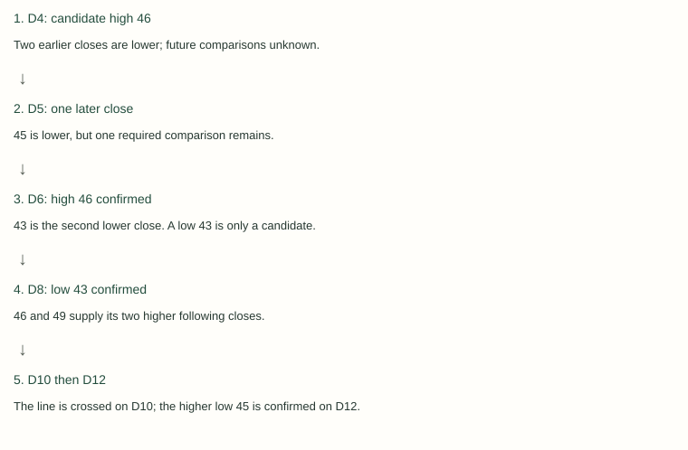

*These are information states at completed-session cutoffs, not backdated entry signals.*

#### Build the initial higher-high/higher-low map

Applying the same rule gives lows at D1$40, D6$43 and D10$45, and highs at D4$46, D8$49 and D12$52. Their recognition dates are D3, D8, D12 for the lows and D6, D10, D14 for the highs. Once the required bars exist, both sequences rise. This is a defensible uptrend description of the selected interval, independent of a guess about why participants traded.

The decline from the $49 D8 peak to the $45 D10 low is $4/49 ≈8.16%. A lower daily close therefore fits an overall sequence of higher selected troughs. Uptrend does not mean every observation rises. To reproduce the map, inspect each candidate against its four neighboring closes; do not select only the points that help the desired label.

**Named swings and delayed recognition**

| Turn date | Close ($) | Type | Recognizable after |
| --- | --- | --- | --- |
| D1 | 40 | Low | D3 |
| D4 | 46 | High | D6 |
| D6 | 43 | Low | D8 |
| D8 | 49 | High | D10 |
| D10 | 45 | Low | D12 |
| D12 | 52 | High | D14 |
| D15 | 42 | Low | D17 |
| D17 | 48 | High | D19 |

#### Draw one line from two specified anchors

Use the first two confirmed lows, D1$40 and D6$43. They are five session steps apart, so the linear-price slope is (43 −40)/(6 −1) = $0.60 per session. The projection at D10 is 40 +0.60 × 9 = $45.40. D10 closes at $45, forty cents below the projected line, while still above the prior selected low $43.

At D10 you can observe the line crossing because both anchor lows have been confirmed since D8. You cannot yet confirm D10 itself as a low until D12. After D12, it is a higher low despite crossing the line. This gives a complete example of a broken trendline and surviving higher-low structure using the same data, rather than a second invented path. The plotted line begins at D8, when both anchors are available; earlier anchor values remain marked on the closing-price series.

Drawing a line from D6$43 to D10$45 instead would yield a $0.50 slope, but the second anchor is unavailable until D12. That is a reasonable later alternative drawing, not information the D10 reader already had. Trendlines organize selected anchors; they do not replace a separately defined structural description.

**The chosen line can be reproduced**

| Input or result | Calculation | Value |
| --- | --- | --- |
| First anchor | D1 close | 40 |
| Second anchor | D6 close | 43 |
| Slope ($/session) | (43 −40)/5 | 0.6 |
| D10 projection ($) | 40 +0.6 × 9 | 45.4 |
| D10 close minus projection ($) | 45 −45.4 | -0.4 |
| First usable cutoff | Second low confirmed | After D8 |

#### Reveal the structural transition separately

Now extend the same chart. D15 falls to $42, below the previously selected $45 trough. The break of that old price is observable on D15, while the new low is confirmed only after D17’s $48 close. D17 then becomes a candidate peak. D18$46 and D19$44 confirm it as a $48 high, below the previous $52 peak.

At the D17 cutoff, you have a confirmed lower low but not a confirmed lower high. At D19, both conditions exist. Under our illustrative transition rule—one confirmed lower low followed by one confirmed lower high—the selected structure has transitioned away from the initial uptrend. A stricter reader might require two such pairs; a more responsive reader might act on the first price break. These are different declared methods. The table lets you compare what each would know at each date.

This staged description avoids two common errors: announcing a full structural reversal from any small pullback, and refusing to update after the chosen conditions occur. You can preserve uncertainty at intermediate cutoffs without losing the ability to reach a clear conclusion after your rule’s required observations arrive.

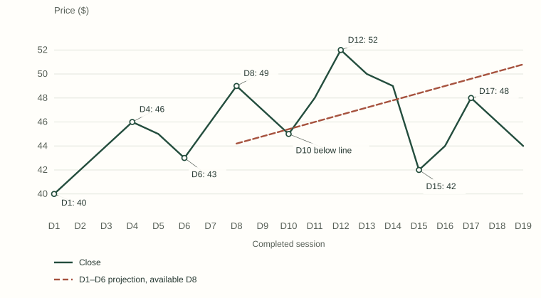

*Fictional closes D1–D19; earlier closes 44 and 42 supply D1’s left-side comparisons. Swings use two earlier and two later closes. The D1–D6 projected line starts displaying at D8, when both anchor lows are confirmed. Point labels give session and close; the swing table names high/low status and recognition dates. D15’s low is recognized after D17, and D17’s high after D19.*

#### Compare a clean, a minor, and an ambiguous turn

For a short contrast, closes 40, 41, 40.70, 42, 41.80, 44 contain a one-following-bar high at the second observation $41. A two-following-bar rule rejects it because the fourth observation $42 exceeds it. The later $42 candidate is also rejected when $44 arrives. These are small interruptions within rising endpoints. The contrasting chart shows why a rule can deliberately ignore a visually real wiggle.

An ambiguous example is highs 49, 49, 48.80 with a prior rise. Under strict inequalities the equal 49 observations do not form a unique peak; a reader using an inclusive tie rule could choose one. Neither needs to be accused of misreading the numbers. The rule determines the classification. State a tie policy and recognition delay, then keep it consistent. The appropriate scale depends on the intended question; a daily swing map and a weekly investing context can remain different but coherent.

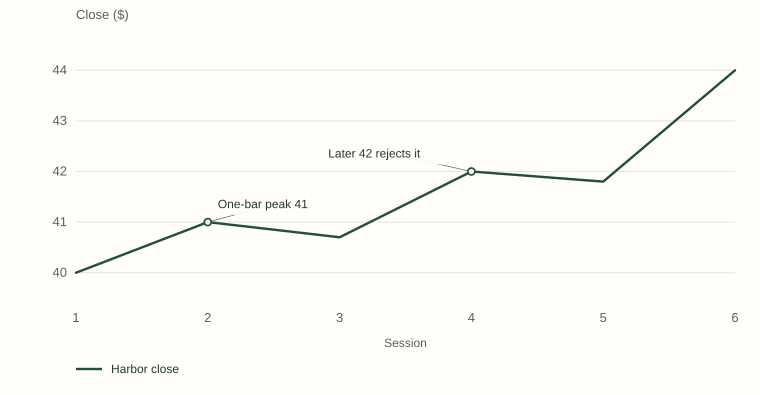

*Purposeful contrasting six-observation path. The one-following-bar $41 peak is rejected by the two-following-bar rule because the later $42 is higher.*

#### Write the analysis in a sequence another reader can follow

At D14, a completed note reads: “Daily close swings use strict two-before/two-after confirmation. Selected lows 40, 43, 45 and highs 46, 49, 52 rise. D10 crossed the D1–D6 projected line at 45.40 but later confirmed a higher low 45. The last confirmed peak is 52.” This reports both the line event and the structural state, including their recognition times.

At D19, update it: “D15’s 42 low was confirmed after D17; D17’s 48 high was confirmed after D19. They form the first lower-low/lower-high pair under the transition definition.” A trade plan would additionally need an executable decision and risk assumptions. Here the achievement is accurate, reproducible description; chapter 9 will combine description with those other decisions.

#### Worked example: Same dataset, two distinct challenges

At D10 the $45 close crosses the chosen $45.40 line but remains above the prior $43 trough. After D12 it qualifies as a higher low. Later D15 breaks below $45 and is confirmed as a $42 low after D17; the $48 D17 peak is confirmed after D19. Only then does the declared lower-low/lower-high transition criterion exist. Compare the observation date with the recognition date at every step.

#### Exercise

Using the chapter’s 40–46–43–49–45–52 swing sequence, write a precise condition that would challenge the uptrend description. Then state when your chosen swing-confirmation rule would make that challenge knowable.

Reveal the worked solution

A precise challenge is a completed close below the selected $45 D10 low. D15’s $42 close meets that price-break condition immediately after D15. If the challenge instead requires a confirmed new swing low below 45, it is not complete until D17 provides the second higher following close.

For a fuller transition rule, require that lower low followed by a confirmed high below 52. D17’s 48 peak is confirmed after D19, completing the first lower-low/lower-high pair.

Other rules are acceptable if they specify field, tie policy, required later comparisons, and the exact observation time. Do not claim confirmed-swing knowledge on D15 merely because the point is drawn at D15 later.

#### guided practice: Guided: stop the chart after D6

Using the supplied timeline, list confirmed and candidate swings at D6. Then calculate the D1–D6 line’s D10 projection and say when that line first becomes usable.

Reveal the worked solution

At D6, D1’s 40 low and D4’s 46 high are confirmed. D6’s 43 low is a candidate until D8. The second anchor is not yet confirmed at D6.

Slope is(43 −40)/5 = $0.60; D10 projection is 40 +9 × 0.60 = $45.40. Under this chapter’s confirmed-anchor rule, the line first becomes usable after D8.

#### independent practice: Independent: a small interruption is not the same swing

For 40, 41, 40.70, 42, 41.80, 44, test the second-observation $41 peak under one-following-bar and two-following-bar rules (require one earlier comparison for this short contrast). State recognition or rejection time.

Reveal the worked solution

It exceeds the preceding 40 and following 40.70, so the one-following-bar rule confirms it after observation 3.

The two-following-bar version requires observation 4 too; its 42 exceeds 41, rejecting the candidate after observation 4. These rules select different scales without changing the supplied prices.

#### Knowledge check

D4 is a $46 high candidate and D5/D6 close at $45/$43. Under two-following-bar confirmation, when is the $46 high confirmed?

1. After D4, because it exceeds the earlier closes
2. After D6, when both required lower following closes exist
3. After D5, because the next close is lower

Reveal the worked solution

Answer: 2. The rule requires both following comparisons. A point’s eventual chart location is not its recognition time.

Option 1: This checks only the preceding side of the rule; the future comparisons are still unknown.

Option 2: Correct: D5 and D6 complete the right-side comparisons after D6.

Option 3: One lower following close is insufficient under the stated two-bar requirement.

#### Sources

- [Fidelity · Basic concepts of trend](https://www.fidelity.com/learning-center/trading-investing/technical-analysis/basic-concepts-trend) — Conventional peak/trough trend classification and trendline construction.
- [StockCharts ChartSchool · What are charts?](https://chartschool.stockcharts.com/table-of-contents/chart-analysis/what-are-charts) — Arithmetic versus logarithmic price-axis conventions.

---

### Chapter 6: Support, resistance & price areas

Map prior reactions as conditional evidence, with explicit boundaries.

> A level is a predefined area to investigate. It is neither an invisible wall nor a guaranteed execution price.

**Version 0.4 · AI editorial review recorded 2026-10-12 (/root).**

Review scope: Re-accepted for documented whitespace or shared study locator/date correction; earlier substantive review retained.

**Learning outcomes**

- Construct a shaded price zone from named prior reactions.
- Freeze the zone before examining later observations.
- Apply a close-based buffer without silently changing it.
- Distinguish entering a zone, reacting, and crossing a failure condition.

Builds on: Trends, swings & changing structure.

#### First pass: freeze the D12 map

Work only from the construction data below before opening the chapter continuation. This is an attempt followed by a reference explanation; write your own map and conditions first.

Use the one-before/one-after closing-price trough rule. Select recognized troughs through D12, cluster them under a maximum $0.60 span, and freeze the zone edges. Define a visit, a $1 rise within two sessions after a visit, and a strictly-below break using a $0.30 downward buffer. State when each could be known and what would challenge the map. Do not invent D13 onward.

**Construction closes, available through D12**

| Session | Close ($) |
| --- | --- |
| D1 | 43 |
| D2 | 41 |
| D3 | 39.8 |
| D4 | 42 |
| D5 | 45 |
| D6 | 41 |
| D7 | 40.1 |
| D8 | 43 |
| D9 | 45 |
| D10 | 42 |
| D11 | 40.35 |
| D12 | 43 |

Write and retain your cutoff note before opening the continuation. In print, finish this packet before the continuation reference on the next page.

Reveal continuation, explanations and complete reference

#### Start with reactions that can be located

Support names an area associated with prior interrupted declines or a conditional expectation of another such reaction. Resistance names the analogous area for interrupted advances. The first part is observable history; the expectation is a hypothesis. We will build a support map from the same supplied closes that appear in the construction panel, then reveal later closes separately. This sequence makes the analytical choice visible.

Use a simple one-before/one-after closing-price trough rule for this mapping exercise. It differs from chapter 5’s two-bar rule because the present question is a small reaction cluster, and the supplied table explicitly declares that change. We do not change it mid-example. A trough must be strictly below its immediate neighbors and becomes recognized after the next close. This produces three selected construction troughs at D3$39.80, D7$40.10, and D11$40.35.

**Construction closes, available through D12**

| Session | Close ($) |
| --- | --- |
| D1 | 43 |
| D2 | 41 |
| D3 | 39.8 |
| D4 | 42 |
| D5 | 45 |
| D6 | 41 |
| D7 | 40.1 |
| D8 | 43 |
| D9 | 45 |
| D10 | 42 |
| D11 | 40.35 |
| D12 | 43 |

#### Select the observations and explain the exclusions

D3 is below D2$41 and D4$42, D7 is below D6$41 and D8$43, and D11 is below D10$42 and D12$43. All three follow declines and are followed by higher closes. At D12 every selected trough is recognized. The intermediate $41 close at D6 is excluded because the next $40.10 is lower; D10$42 is excluded for the same reason. These exclusions prevent every near-$40 mark from becoming a separate “touch.”

For this exercise, cluster the recognized troughs when their high-minus-low span is no more than $0.60. The observed span is 40.35 −39.80 = $0.55, so the three qualify. Choose the zone’s edges as the minimum and maximum selected troughs, $39.80–$40.35. The width is $0.55, or 1.375% of an illustrative $40 reference. The cluster tolerance is an original teaching choice, while the resulting edges are transparent arithmetic.

A reasonable alternative is to draw one reference at the cluster’s median $40.10. Another analyst could use intraday lows instead of closes and get different boundaries. Those are separate constructions. Our closing-price zone is chosen because its inputs and recognition times are supplied; it does not claim to reveal all resting orders.

**Construction decisions frozen after D12**

| Selected trough | Previous close ($) | Trough close ($) | Next close ($) | Known after |
| --- | --- | --- | --- | --- |
| D3 | 41 | 39.8 | 42 | D4 |
| D7 | 41 | 40.1 | 43 | D8 |
| D11 | 42 | 40.35 | 43 | D12 |
| Zone | Minimum trough | 39.8 | Maximum trough 40.35 | D12 |

#### Write the reaction and failure definitions before revealing

For our closing-price exercise, a visit is a close inside the frozen zone. A reaction is a visit followed within the next two completed sessions by a close at least $1 above the visiting close. A buffered downward break is a completed close below $39.50, thirty cents below the zone’s lower edge. These definitions do not follow from a law of support; they make the next six observations classifiable.

Why include a buffer? It lets a slight edge crossing and a larger excursion be different events. Why $0.30? To make this example easy to inspect, not because thirty cents is universally informative. The definition must stay fixed when a later close is uncomfortable. A stricter buffer or a two-close requirement could be examined as an alternative, but each would produce a different event set.

At D12, write this note: “Three one-bar closing troughs fit a $0.60 cluster; zone 39.80–40.35 is frozen. Watch for the defined visit/reaction, and separately record any completed close below 39.50.” You have not yet seen D13 onward. The future panel makes that separation visible instead of letting later bounces dictate where the zone should be.

#### Reveal a reaction, an edge crossing, and a buffered break

D13 closes at $40.30, inside the zone. D14 at $41.50 is $1.20 above it within the allowed two-session window, satisfying the reaction definition. D15 at $39.70 falls ten cents below the lower zone edge but remains above the $39.50 break threshold. D16 at $39.40 meets the buffered break. These events differ; labeling them all either “held” or “failed” would discard useful information.

D17 at $40.15 returns inside the same frozen zone after the break; D18 at $39.20 falls below the threshold again. That sequence does not erase D16’s earlier observation. A new role-reversal hypothesis could ask whether the old area now interrupts advances, but one return inside the area is not yet a measured resistant reaction. State the new condition before classifying it.

The zone remains 39.80–40.35 in both panels and in every row. If we lower its edge to 39.20 after D18, the apparent history of successful support changes because the definition changed, not because the original calculation improved. Preserve the old note and label any revised map as a new analysis.

**Later closes under the frozen definitions**

| Session | Close ($) | Classification available after that close |
| --- | --- | --- |
| D13 | 40.3 | Visit inside zone |
| D14 | 41.5 | Reaction:+1.20 within two sessions |
| D15 | 39.7 | Below zone edge, above buffered threshold |
| D16 | 39.4 | Buffered downward break |
| D17 | 40.15 | Return inside old zone |
| D18 | 39.2 | Below buffered threshold again |

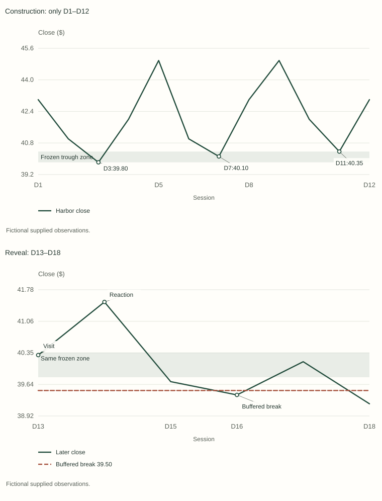

*One closing-price cluster, frozen after D12. Both panels use the same 39.80–40.35 shaded zone. The lower 39.50 reference is a separately declared buffered-break condition, not a moved zone edge.*

#### A low-based rule can disagree with a close-based rule

The extra candle for D15 has O40.20/H40.40/L39.30/C39.70. Its intraday low is below $39.50, while its completed close is above $39.50. An intraday-trigger instruction would detect the excursion; our analytical close-based break rule would not. Both can be applied correctly to the same candle because they ask different questions.

An analytical invalidation rule tells you when evidence challenges a hypothesis. An order instruction tells a broker how to attempt a transaction. If your rule waits for a completed close, a stop-market order at the intraday level is a different operational choice. Keep that distinction in the plan, including what you do during a gap. A line or zone is not an execution promise.

For a $41 assumed entry and a $39.50 trigger, price distance is $1.50 per share. If a later feasible exit is $37, price loss is $4 per share instead. Chapter 1 taught why sizing and larger-loss scenarios accompany the hypothesis. The integrated breakout case will use a complete set of these choices rather than treating a zone’s width as a maximum possible loss.

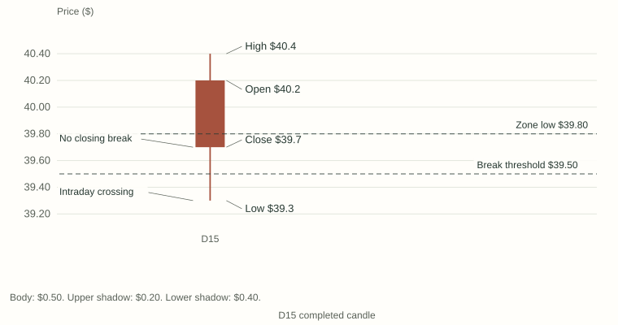

*D15’s 39.30 low lies below 39.50; its 39.70 close remains above it. The closing-price zone and buffer retain their original definitions.*

#### A small number of areas beats an all-purpose drawing

The construction above gives a reason for including one zone and excluding several nearby marks. A resistance exercise uses interrupted advances instead: select declared local peaks, cluster their prices under a stated span tolerance, and freeze the resulting area before testing the next visit. The independent practice gives you a fresh example. This symmetry helps you build a map rather than memorize one picture.

If every price gets a line, almost every turn can be explained afterward as near something. A useful map is sparse enough to be challenged. Count a visit only under the declared field and cutoff, then describe whether the reaction definition occurred. The more careful wording is “these prior closing troughs form this area” and “the later data met or did not meet this condition.” Supply-and-demand explanations can remain hypotheses while the measurements are precise.

#### A plausible mechanism has a market boundary

Osler’s order data provide a concrete example of round-number clustering in currency markets. They do not reveal the orders near Harbor’s fictional zone or test a stock support rule. Keep the mechanism as a hypothesis until the relevant stock data and executable rule have been evaluated.

#### Worked example: A completed map and an honest update

The D3/D7/D11 closing troughs create 39.80–40.35 after D12. D13–D14 satisfy the declared visit/reaction. D15 crosses the zone edge without meeting the completed-close 39.50 break; D16 meets it. Later closes are judged against the same frozen definition. This provides a successful reaction and a subsequent challenge without silently changing the drawing.

#### Exercise

Map the three troughs at 39.80, 40.10, and 40.35. Define a break with an explicit field, buffer, and observation time. Write one scenario in which an intraday crossing and a close-based rule disagree.

Reveal the worked solution

Draw a shaded band with lower edge 39.80 and upper edge 40.35; mark the three supplied troughs inside it. Its span is 0.55. Under the chapter’s 0.60 cluster tolerance, all qualify.

One complete break rule is a completed regular-session close below 39.50, a 0.30 buffer beneath 39.80. D16’s 39.40 meets it. The strict word “below” means a close exactly 39.50 does not.

D15 O40.20/H40.40/L39.30/C39.70 crosses 39.50 intraday but does not finish below it. Alternative fields, buffers or repeated-close rules are defensible if written before the later data and applied consistently.

#### guided practice: Guided: stop before the reveal

Complete this partly filled worksheet under the supplied clustering rule: selected peaks are $55.10, $54.90 and $55.30; span = $0.40; zone = [____, ____]. Use a $0.20 outward buffer. Classify later closes $55.20, $55.40 and $55.60, showing the break threshold before revealing them.

Reveal the worked solution

The selected peaks give zone [54.90, 55.30]. The upward buffer places the threshold at 55.30 + 0.20 = $55.50; a buffered break requires a completed close strictly above it.

A $55.20 close visits the zone. $55.40 crosses its upper edge but does not meet the buffered-break rule. $55.60 is a buffered upward break. No later reversal or executable fill follows from these classifications alone.

#### independent practice: Independent: construct a resistance cluster

Recognized closing-price peaks are $72.40, $72.10 and $72.60. Use a maximum cluster span $0.60. Freeze edges and a $0.25 upward buffer. Classify later completed closes $72.50, $72.75, $72.85 and $72.90; state how exact equality at the threshold is treated.

Reveal the worked solution

Span = 72.60 − 72.10 = $0.50, within the $0.60 tolerance. Zone = 72.10–72.60; threshold = 72.60 + 0.25 = $72.85.

72.50 visits the zone; 72.75 crosses the upper edge without a buffered break. 72.85 equals the threshold and does not satisfy strictly above. 72.90 meets the buffered-break condition. Keep the field and comparison fixed before the later closes.

#### Knowledge check

The frozen zone is 39.80–40.35 and break rule is a completed close below 39.50. D15 has low 39.30 and close 39.70. Which condition occurred?

1. A buffered closing break, because the low was below 39.50
2. No edge crossing, because the close was near 40
3. An edge crossing but no buffered closing break

Reveal the worked solution

Answer: 3. 39.70 is below the 39.80 zone edge but above the 39.50 closing threshold.

Option 1: This substitutes the intraday low for the completed close specified by the rule.

Option 2: Near is not the criterion: 39.70 is numerically below 39.80 even though it is near 40.

Option 3: Correct: the two fixed boundaries identify different events.

#### Sources

- [Fidelity · Support and resistance](https://www.fidelity.com/learning-center/trading-investing/technical-analysis/support-and-resistance) — Support/resistance vocabulary and the conventional role-reversal hypothesis; not a guarantee of future reactions.
- [SEC / Investor.gov · Types of orders](https://www.investor.gov/introduction-investing/investing-basics/how-stock-markets-work/types-orders) — Market, limit, and stop order distinctions; execution prices and fills are not guaranteed by a chart level.
- [SEC / Investor.gov · Understanding Order Types](https://www.investor.gov/introduction-investing/general-resources/news-alerts/alerts-bulletins/investor-bulletins-14) — Market/limit/stop/stop-limit execution, nonfills, trigger conventions, IOC cancellation; definitions only, not assumed fill probabilities.
- [StockCharts ChartSchool · Support and resistance](https://chartschool.stockcharts.com/table-of-contents/chart-analysis/support-and-resistance) — Breaks of previously defined trading areas, approximate zones, role-change and failed-crossing vocabulary. The numerical breakout and failure rules in this book are original fictional examples.
- [Osler (2001), Currency Orders and Exchange-Rate Dynamics, Staff Report 125](https://www.newyorkfed.org/medialibrary/media/research/staff_reports/sr125.pdf) — FX order clustering mechanism; one dealing bank and three currency pairs, not stock-strategy evidence.

---

### Chapter 7: Candlestick patterns in context

Use pattern names as shorthand for measured shapes, then examine the surrounding evidence.

> A candle pattern is a geometric classification. Its meaning depends on context, recognition time, and evidence about subsequent outcomes.

**Version 0.4 · AI editorial review recorded 2026-10-12 (/root).**

Review scope: Re-accepted for documented whitespace or shared study locator/date correction; earlier substantive review retained.

**Learning outcomes**

- Calculate the geometry before applying a candle name.
- Classify a valid shape and a numerical near miss.
- Explain why body engulfing and an outside range are different conditions.
- Use prior direction and later recognition separately from the shape itself.

Builds on: Anatomy of a stock chart; Trends, swings & changing structure; Support, resistance & price areas.

#### A shape is a measurement before it is a name

Chapter 2 taught one candle’s four prices. This chapter uses the same measurements to compare shapes. Body B = |close − open|; range R = high − low; upper shadow U = high − max(open, close); lower shadow D = min(open, close) − low. First compute them, then apply a classification. A name is useful shorthand for those relationships; it is not additional transaction data.

Keep three questions separate. Does the geometry meet the selected definition? What prior movement or location makes that geometry interesting? What observation would confirm or challenge the interpretation later? You can correctly classify a candle, find its context unremarkable, and choose no action. The examples show a clean shape, a near miss, an apparent reversal, and a failure, so those judgments can be practiced rather than simply asserted.

#### Doji-like: the denominator makes the difference

A doji conventionally has nearly equal open and close. Our measurable teaching version uses B/R ≤0.10 when R>0. The first supplied candle has O50/H51/L49/C50.10. Body is $0.10, range is $2, so the ratio is 5%. It qualifies. Its endpoints are close together, while the interval still traveled across a $2 range. A small endpoint change is not the same as an inactive interval.

The near miss has O50/H50.15/L49.95/C50.10. Its body remains $0.10, but its range is only $0.20. B/R = 50%, so it fails our 10% criterion. The paired candles make that contrast visible: the same ten-cent body can be tiny or substantial relative to the full interval. No fixed dollar-body threshold was silently substituted.

The name alone is neutral. After a sustained rise, a small-body interval may prompt a question about changed progress; inside an already quiet range, it may add little. The prior path supplies that context. Calling it indecision is a conventional interpretation of similar endpoints, not direct evidence of participants’ emotions.

**Same body, different classification**

| Case | OHLC ($) | Body ($) | Range ($) | Body/range | Under B/R≤10% |
| --- | --- | --- | --- | --- | --- |
| Doji-like | 50 / 51 / 49 / 50.10 | 0.1 | 2 | 5% | Qualifies |
| Near miss | 50 / 50.15 / 49.95 / 50.10 | 0.1 | 0.2 | 50% | Does not qualify |

#### Hammer-like: measure the tail and the context

Use O50/H51/L47/C50.80. Body is $0.80, upper shadow $0.20, lower shadow $3, range $4. Under this chapter’s rule, a hammer-like shape needs a positive body, lower shadow at least twice that body, and upper shadow no greater than the body. Here 3/0.80 = 3.75 and 0.20≤0.80, so it qualifies. The exact thresholds are a teaching definition within conventional long-lower-shadow vocabulary.

The prior-trend panel adds two down candles: 54/55/52/53 and 53/54/49/50. Their closes fall 53 →50, then the measured candle closes 50.80. You can now see a preceding decline and an interval finishing well above its low. That motivates investigating a possible upward change. It does not establish the order of every transaction or the cause of the rebound. The same geometry after an advance has a different conventional contextual label, often hanging man.

The near miss changes only the low to 48.90: O50/H51/L48.90/C50.80. Body and upper shadow stay unchanged, but the lower shadow is 1.10, only 1.375 times the body, so it fails the stated tail criterion. It can still be an up candle. “Up candle” and “hammer-like shape under this definition” answer different questions.

**Compare the hammer-like candle with a near miss**

| Case | Body ($) | Upper shadow ($) | Lower shadow ($) | Lower/body | Classification |
| --- | --- | --- | --- | --- | --- |
| O50/H51/L47/C50.80 | 0.8 | 0.2 | 3 | 3.75 | Qualifies |
| O50/H51/L48.90/C50.80 | 0.8 | 0.2 | 1.1 | 1.375 | Fails lower-tail threshold |

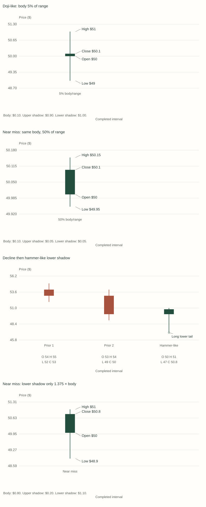

*Every OHLC value is supplied in the chapter tables. Changing one input can change classification without changing the candle’s color. The hammer context panel includes the prior declining closes.*

#### Engulfing bodies are not outside ranges

The supplied first candle has O52/H53/L49/C50: a down body spanning 50–52. The second has O49.80/H52.50/L49.50/C52.20: an up body spanning 49.80–52.20. Under our strict version, first must close below its open, second above its open, second open must be below first close, and second close above first open. The pair satisfies all four conditions.

Its highs and lows tell a different story. Second high 52.50 is below first high 53; second low 49.50 is above first low 49. Its body engulfs, but its entire range sits inside the prior range. An outside-range rule would therefore reject it. The diagram lets you inspect both comparisons rather than infer full-range coverage from the word engulfing.

For the near miss, keep the second open/high/low but lower its close to 51.90. Its body covers 49.80–51.90 and stops ten cents short of the first body’s 52 upper edge. The up body is large but fails this strict engulfing criterion. A platform allowing equal endpoints may classify a boundary case differently; our unequal values avoid that ambiguity.

**Four strict body comparisons and two range comparisons**

| Condition | Supplied values | Result |
| --- | --- | --- |
| First down body | 50 <52 | True |
| Second up body | 52.20 >49.80 | True |
| Second open below first close | 49.80 <50 | True |
| Second close above first open | 52.20 >52 | True |
| Second high beyond first high | 52.50 >53 | False |
| Second low beyond first low | 49.50 <49 | False |

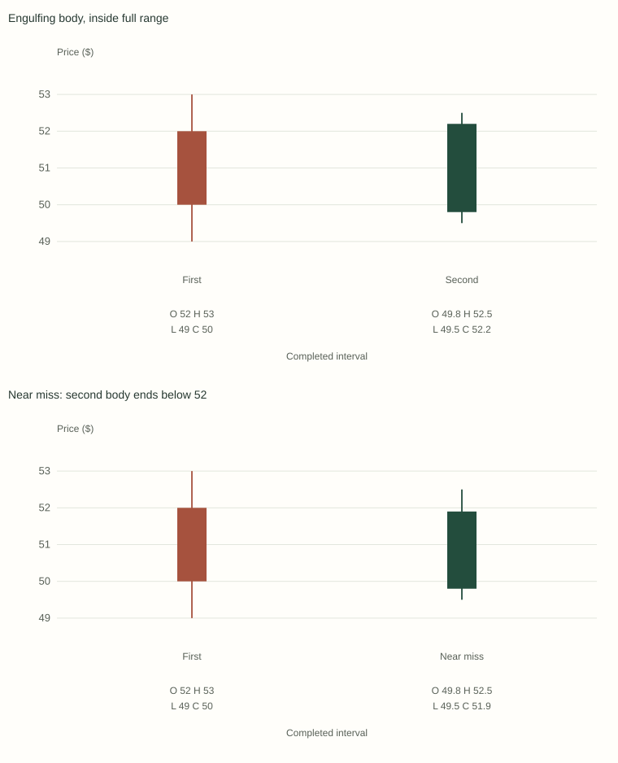

*Left pair: the second body 49.80–52.20 engulfs 50–52 while the second full range 49.50–52.50 does not cover 49–53. Right pair changes only the second close to 51.90, creating a body near miss.*

#### First pass: keep the D3 shape separate from its next close

The preceding sections teach the geometry. This guided packet rehearses that known calculation, then pauses the same fictional path after D3 closes. Only D1–D3 are available. No D4 opening, high, low or close is supplied yet; the later branches have been withheld.

For D3, calculate body B = |C − O|, range R = H − L, upper shadow U = H − max(O, C), and lower shadow D = min(O, C) − L. The frozen hammer-like rule is B > 0, D ≥ 2B and U ≤ B; it does not require an up body. Describe the preceding completed closes separately from the geometry.

For the distinct follow-up question, require the very next completed daily close to be strictly above D3’s high. Equality does not qualify. Write a cutoff note with the geometry classification, the numerical follow-up threshold, its earliest observation time and the current follow-up state. Specify what a next close equal to the threshold would mean without inventing a next close.

A shape and a later follow-up do not specify an entry order. State which execution information is still missing and why the D3 low cannot become a retrospective purchase price after observing D4. Retain this note before revealing either continuation. These constructed branches illustrate states; they are not a random sample or a test of prediction.

**Completed daily candles available after D3 (fictional USD)**

| Session | Open ($) | High ($) | Low ($) | Close ($) |
| --- | --- | --- | --- | --- |
| D1 | 54 | 55 | 52 | 53 |
| D2 | 53 | 54 | 49 | 50 |
| D3 | 50 | 51 | 47 | 50.8 |

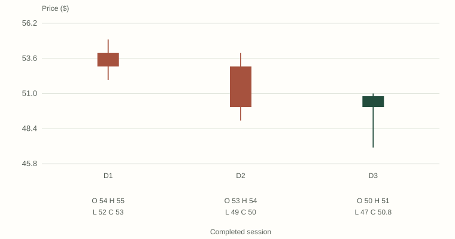

*Fictional regular-session OHLC. All three intervals have completed; no fourth interval or later branch is displayed. Neutral session labels do not supply the shape classification.*

Write and retain your cutoff note before opening the continuation. In print, finish this packet before the continuation reference on the next page.

Reveal continuation, explanations and complete reference

#### A completed shape, a later confirmation, then a challenge

At the D3 cutoff, body $0.80, range $4, upper shadow $0.20 and lower shadow $3 satisfy B > 0, D ≥ 2B and U ≤ B. The prior closes 53→50 decline before the 50.80 close. The separate next-close threshold is D3 high $51, with strict equality excluded. D4’s close is still unknown at D3, so the follow-up state is awaiting observation. No order, accessible quote or confirmed execution has been supplied. The next paragraphs reveal alternative paths from this same state; they do not revise the cutoff note.

Return to the $50/$51/$47/$50.80 hammer-like candle after a decline. Its geometry becomes final when that interval closes. For a separate reversal hypothesis, our example asks for the next completed daily close above its $51 high. A $51.20 next close meets that follow-up condition. It did not exist when the candle first opened, nor did it make a purchase at the earlier $47 low available retroactively.

If a later illustrative entry occurs at $52 with a planned trigger $46.80, distance is $5.20 per share. Entering at the candle’s $50.80 close would have meant $4, but that earlier entry used less follow-up information. The later confirmation and earlier price cannot be combined into one supposed execution. Write both alternatives as distinct plans if you want to compare them.

Now append a next opening price $46.50 and close $45 to the confirmed path. The classification and follow-up event happened, then the continuation failed. In another branch, the very next session opens 46.50 without ever producing 51.20; that candidate never meets the follow-up condition. Candidate failure and failure after confirmation are different records. The timeline includes both, so a successful classification does not disappear whenever the trade idea disappoints.

**States of the interpretation, not renamed candles**

| Cutoff | Supplied observation | Known state |
| --- | --- | --- |
| Pattern close | 50.80 | Hammer-like geometry complete |
| Next close in branch A | 51.20 >51 | Follow-up condition complete |
| Later branch A opening/close | 46.50 /45 | Adverse continuation after confirmation |
| Next branch B opening/close | 46.50 /45 | No follow-up confirmation supplied |

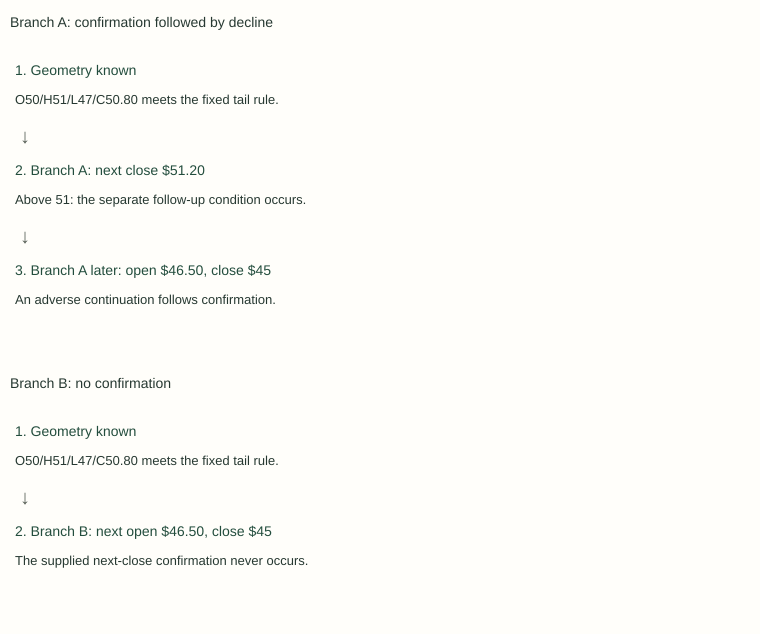

*Alternative fictional continuations share the same hammer-like candle. Read each branch from its own starting point; branch B does not follow branch A.*

#### A short classification worksheet

For a new candle, work in this order: verify OHLC inequalities; compute B, R, U, D; compare only with the declared geometry thresholds; inspect the prior path; name the observation time of any later condition. The guided practice follows that worksheet. The independent practice changes a two-candle endpoint by a small amount so you must check coverage rather than choose the cautious-sounding option.

When you study the behavior of a pattern across many examples, preserve the criterion and the context filter. “Went up eventually” is not a useful outcome definition; “closed above the pattern high on the next completed session” is checkable. Larger questions about average return belong with their frequency, costs and comparison data. Here the specific learning goal is accurate measurement plus honest chronology, with near misses retained as carefully as attractive silhouettes.

#### Worked example: A correct shape can lead to two different records

The measured lower shadow is $3 and body $0.80, so the candle meets the 3.75 tail/body relationship. If the next close is 51.20 it meets the stated follow-up rule; if the next close is 45 it does not. A later 45 close after 51.20 is failure after confirmation, rather than a reason to pretend the shape was never present. Keep geometry, follow-up, execution and outcome in separate fields.

#### Exercise

Calculate the body and shadows for OHLC 50, 51, 47, and 50.80. Write exact inequalities for your hammer-like rule and a separate follow-up condition. Identify which observations are unavailable when the bar first opens.

Reveal the worked solution

For O50/H51/L47/C50.80, B = 0.80, R = 4, U = 0.20, D = 3. Lower/body = 3.75; upper/body = 0.25. Under B>0, D≥2B, U≤B, it qualifies.

A separate follow-up rule is the next completed regular-session close above 51, the pattern’s high. The example 51.20 meets it;45 does not. This later condition is not part of the four-price shape arithmetic.

At the pattern’s opening, its eventual high, low, close and classification are unknown. At its final close the geometry is knowable; the next close remains unknown. At the follow-up close, the earlier entry price is not assumed still available.

#### guided practice: Guided: identify the near-miss condition

For O50/H51/L48.90/C50.80, finish B, U, D and lower/body. Which condition fails relative to B>0, D≥2B, U≤B?

Reveal the worked solution

B = 0.80, U = 0.20, D = 1.10. D/B = 1.375. The required 2B is 1.60, above the 1.10 lower shadow.

Only the lower-tail threshold fails; the body is positive and upper shadow remains below its length. Do not reject it for being a down candle: it is an up candle.

#### independent practice: Independent: distinguish two coverage rules

First candle O30/H32/L27/C28; second O27.80/H31/L27.50/C30.20. Does the pair meet the strict bullish body-engulfing rule? Is the second a full-range outside bar? Then change only its close to 29.90.

Reveal the worked solution

First body 28–30 is down; second body 27.80–30.20 is up and strictly spans it. Body engulfing qualifies. The second high 31 is below 32 and low 27.50 above 27, so it is not a full-range outside bar.

With second close 29.90, its body stops below 30 and no longer fully engulfs the first. Large size or an up color does not substitute for the endpoint comparison.

#### Knowledge check

For O50/H51/L48.90/C50.80, which numerical classification is correct under the stated hammer-like rule?

1. Qualifies: lower/body is 3.75, as in the main example
2. Fails: upper shadow is $1, greater than the body
3. Fails: lower/body is 1.375, below the required 2

Reveal the worked solution

Answer: 3. The changed low shortens the lower shadow to 1.10 while the body remains 0.80.

Option 1: This reuses the original $47 low’s calculation instead of the supplied $48.90 near-miss low.

Option 2: The upper shadow is 51 −50.80 = $0.20, not high minus open.

Option 3: Correct: (50 −48.90)/(50.80 −50) = 1.375.

#### Sources

- [StockCharts ChartSchool · Introduction to candlesticks](https://chartschool.stockcharts.com/table-of-contents/chart-analysis/candlestick-charts/introduction-to-candlesticks) — Doji and long-shadow pattern terminology, prior-trend context, and the inability of OHLC to reveal transaction sequence. Numerical thresholds here are original teaching conventions.
- [Fidelity · Identifying chart patterns with technical analysis](https://media.fidelity.com/assets/Fidelity.com_VMS/904/347/TA_Session_3_Identifying_Chart_Patterns.pdf) — Engulfing-body vocabulary, triangle categories, breakout filters, false breaks, and retracements. This book does not adopt the slides' performance claims.

---

### Chapter 8: Classical chart patterns

Translate familiar silhouettes into definitions that can fail.

> Pattern names organize historical geometry. Completion criteria, timing, and a fair comparison matter more than resemblance.

**Version 0.4 · AI editorial review recorded 2026-10-12 (/root).**

Review scope: Re-accepted for documented whitespace or shared study locator/date correction; earlier substantive review retained.

**Learning outcomes**

- Translate a familiar shape into candidate, recognition and completion states.
- Apply peak tolerance, separation, and support-break rules to supplied closes.
- Distinguish pattern completion from a measured target outcome.
- Recognize the main geometric families and reasonable alternative readings.

Builds on: Trends, swings & changing structure; Support, resistance & price areas.

#### Study a small core before the catalogue

A classical chart pattern names an arrangement of several price swings. This chapter’s core is a range, converging boundaries, and a complete double-top worked analysis. The optional catalogue then shows flags, pennants, mirrored bottoms, and head-and-shoulders geometry so the reference remains useful without making memorization a prerequisite for chapter 9. A clean description states which observations count and when a candidate becomes complete.

A cutoff note records the state using only observations available at that time. In this worked case, stop after the first eleven completed closes and keep that note before opening the later branches. The same prefix must receive the same initial classification in every branch; changing that initial record after reading the ending would substitute hindsight for analysis.

#### The double-top rule sheet

For this closing-price example, select peaks and troughs using strict two-before/two-after neighbors, as in chapter 5. Require two confirmed peaks separated by at least four session steps. Their absolute price difference must be at most 1% of the first peak. The minimum close between them is the intervening reference; our example also waits for its local-trough confirmation. Completion requires a subsequent completed close strictly below that reference. A later higher close above the first peak before completion invalidates this candidate version.

These tolerances and delay choices are the chapter’s teaching rules. They make “roughly equal tops” reproducible, rather than claiming a single canonical detector. A discretionary reader might select wick highs or a wider tolerance. That alternative needs its own record. Our clean example lets you see every comparison before trying one where the answer depends on a borderline choice.

**The full supplied decision rule**

| Choice | Declared version |
| --- | --- |
| Input | Completed daily closes |
| Swing selection | Strict two earlier/two later closes |
| Peak separation | At least 4 session steps |
| Peak tolerance | Difference ≤1% of first peak |
| Intervening reference | Minimum intervening close; wait for trough confirmation |
| Completion | Later completed close below that reference |
| Candidate invalidation before completion | Close above first peak |

#### First pass: classify the D11 record before D12 exists

The rule sheet above supplies the detector; the table and chart below contain all eleven completed daily closes available at the D11 cutoff. No D12–D15 values, branch outcomes or derived swing labels are supplied. Use the unchanged rule, not a more convenient tolerance chosen after reading the continuation.

Identify every peak and trough that has enough earlier and later neighbors by D11. For the eligible peak pair, record its session spacing, percentage price difference using the first peak as denominator, intervening reference and each recognition time. Then classify the D11 state: no qualifying pair, candidate, completed or invalidated.

Write the numerical conditions that a later completed close would have to satisfy for completion or pre-completion invalidation. Say how equality at each boundary is treated. Distinguish the numerical observation from an executable short trade; no borrowing, order, quote, cost or fill model is supplied.

Freeze that note, then compare it with “Work from the prices to the candidate” after revealing the continuation. Read each later branch separately from the same D11 state. The branches are deliberately constructed contrasts, not frequencies from which to estimate success probabilities.

**Completed closes available after D11 (fictional USD)**

| Session | Close ($) |
| --- | --- |
| D1 | 55 |
| D2 | 57 |
| D3 | 60 |
| D4 | 58 |
| D5 | 56 |
| D6 | 54 |
| D7 | 56 |
| D8 | 58 |
| D9 | 59.5 |
| D10 | 58 |
| D11 | 55 |

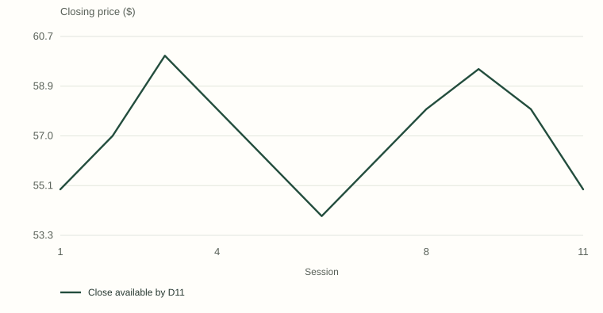

*Fictional completed closes only. The reader must construct the swings and any transition boundary; no D12 continuation, peak annotation or answer line is included.*

Write and retain your cutoff note before opening the continuation. In print, finish this packet before the continuation reference on the next page.

Reveal continuation, explanations and complete reference

#### Work from the prices to the candidate

D3 reaches $60 and D5 confirms it as a peak. D6 reaches $54 and D8 confirms it as a trough. D9 reaches $59.50; D10$58 and D11$55 confirm that peak after D11. The peak separation is 9 −3 = 6 steps, exceeding four. Their difference is $0.50; relative to 60 it is 0.50/60 ≈0.833%, below 1%. The intervening minimum is 54, already recognized before the second peak.

At D11 the candidate is valid under the stated construction, but its completed-close transition has not occurred. The latest close 55 remains above 54. A partially finished analysis should say “candidate double top; completion boundary 54; recognition cutoff D11.” It should not say that the support break has occurred merely because the two highs look similar.

Why exclude other observations? D2$57 is not a peak because D3 is higher; D4$58 is not a trough because D5 and D6 are lower. D8$58 is not a separate peak because D9 is higher. The declared comparisons choose a small set from the supplied path and prevent arbitrary anchor selection.

**Chronological construction**

| Observation | Value ($) | Rule comparison | Known after |
| --- | --- | --- | --- |
| D3 first peak | 60 | Above two earlier/later closes | D5 |
| D6 trough | 54 | Below two earlier/later closes | D8 |
| D9 second peak | 59.5 | Above two earlier/later closes | D11 |
| Peak spacing | 6 steps | 9 −3 ≥4 | D11 |
| Peak difference | 0.833% | 0.50/60 × 100 ≤1% | D11 |
| D11 close | 55 | Not below 54 | D11: candidate only |

**Shared prefix: freeze both branches after D11**

| Session | Close ($) |
| --- | --- |
| D1 | 55 |
| D2 | 57 |
| D3 | 60 |
| D4 | 58 |
| D5 | 56 |
| D6 | 54 |
| D7 | 56 |
| D8 | 58 |
| D9 | 59.5 |
| D10 | 58 |
| D11 | 55 |

#### Reveal completion, failure and an unfulfilled projection

In branch A, D12 closes 53.50, below 54, and completes the declared pattern. In branch B, D12 closes 61.50, above the first peak 60, invalidating the candidate before any completed close below 54. Those are different states from the same initial information. The branch B rise does not show that the original arithmetic was wrong; it shows why the construction and transition must be recorded separately.

A conventional double-top measured reference subtracts the first peak-to-trough height from the boundary. Height 60 −54 = $6; reference 54 −6 = $48. Now give the proposed outcome a clock: “Does a close at or below 48 occur within the next three completed sessions after the D12 break?” Branch A’s next closes 52, 54, 55 do not meet it. The pattern completed, while this particular target-and-horizon condition did not.

A reader using a longer horizon could reach a different outcome on additional data. A reader asking whether an intraday low reached 48 would need different fields. Our three-session closing outcome is a separate teaching rule, not part of the geometric formula. Neither classification supplies an executable short-sale plan or its costs. Chapter 9 develops execution with a long breakout case; advanced chapters evaluate broader strategies.

**Classify different questions, rather than one win/lose label**

| Question | Branch A | Branch B |
| --- | --- | --- |
| Candidate known after D11? | Yes | Yes |
| D12 completed close below 54? | Yes:53.50 | No:61.50 |
| Close above 60 before completion? | No | Yes:61.50 |
| Next 3 closes ≤48 after completion? | No:52, 54, 55 | No completed-pattern event to score |

**Alternative reveals after the identical prefix**

| Session | Branch A close ($) | Branch B close ($) |
| --- | --- | --- |
| D12 | 53.5 | 61.5 |
| D13 | 52 | 62 |
| D14 | 54 | 61 |
| D15 | 55 | 62 |

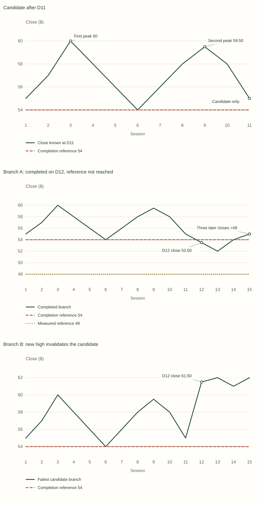

*Supplied closes share D1–D11. Peaks 60 and 59.50 fit the declared tolerance; trough 54 is the completion boundary. The candidate at D11, completed branch A, and invalidated branch B are distinct states.*

#### Ranges and triangles use the same boundary discipline

A rectangle organizes repeated reactions between approximately horizontal upper and lower areas. For the supplied rectangle panel, closes 40, 44, 40.20, 43.80, 40.10, 44 establish a lower area near 40 and upper area near 44. At the sixth close, freeze a teaching upper boundary 44 and lower boundary 40. A later close 44.60 completes an upward closing-cross condition; a competing later 39.50 close exits downward instead. The six-price prefix alone chooses neither direction.

For the symmetrical-triangle panel, selected highs 50, 49, 48 pair with lows 44, 45, 46. Their separation narrows 6 →4 →2. Fix the last upper/lower reference at 48/46 for this simplified completion exercise rather than silently extending a discretionary sloping line. A next 48.50 close exits above the last upper reference; 45.50 exits below the last lower reference. A true sloping-boundary detector would need dated anchors and projected values, as chapter 5 demonstrated.

Ascending and descending triangles make one boundary approximately horizontal and the other sloping. Their small panels display the selected sequences. Do not infer direction from the category name alone: define the boundary and observe the actual crossing. Contraction is a description of the range; the next transition is another observation. The guided and independent tasks ask you to apply those ideas to new values.

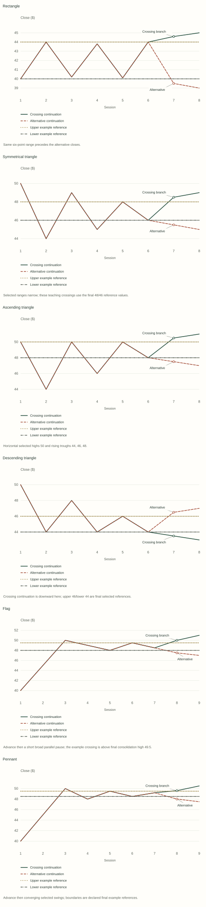

*Optional-looking catalogue used for the core range/contraction comparison. Each panel holds its prefix fixed and supplies two later branches. Horizontal references are deliberately declared teaching simplifications, not silently projected sloping detectors.*

#### Optional reference: pause and reversal families (optional extension)

A flag is a short approximately parallel consolidation after a sharp move; a pennant has converging consolidation boundaries after that move. The catalogue uses a 40→50 advance before each pause. It places the prospective closing boundary at the final consolidation high for the example. A later close above it illustrates completion of that crossing condition; a lower continuation supplies a failed continuation candidate. The length of the pause and the importance of the earlier move remain choices in a practical detector.

The double-bottom panel mirrors the core double-top D1–D11 candidate and completed branch A by subtracting each close from 110. Its first and second troughs are 50 and 50.50, with an intervening 56 peak. A 56.50 close crosses the upward reference. The separately supplied alternative uses a 49 close to undercut the first trough; an exact mirror of core branch B’s 61.50 would instead be 48.50, which also undercuts 50. This geometric comparison does not imply that the two directions have the same empirical outcomes.

For head and shoulders, the top catalogue shows peaks 60, 65, 61, and intervening troughs 55 at D4 and 56 at D8. Their neckline rises(56 −55)/4 = $0.25 per step and reaches 57 at D12; a 54 close is below it. A competing 66 close makes a new high instead. The inverted panel supplies the mirror for a bottom. These are reference drawings, not complete detectors: shoulder tolerance and minimum spacing would need an explicit choice before scanning unfamiliar data.

For a core first reading, recognize the geometry and continue to the integrated breakout chapter. Return to this catalogue when commentary uses a name you need to decode. The part review tests construction and transition rather than requiring a large set of labels.

**Family reference: what must be specified**

| Family | Geometric feature | Additional practical choice |
| --- | --- | --- |
| Flag | Near-parallel short pause after a move | Move threshold, pause length, boundary crossing |
| Pennant | Converging short pause after a move | Anchors, degree of convergence, time limit |
| Double bottom | Two troughs and intervening peak | Trough tolerance, recognition, upward completion |
| Head/shoulders top | Middle peak above shoulders; trough neckline | Shoulder tolerance, dated neckline, completion |
| Head/shoulders bottom | Inverted top geometry | Equivalent explicit choices, not assumed symmetry of returns |

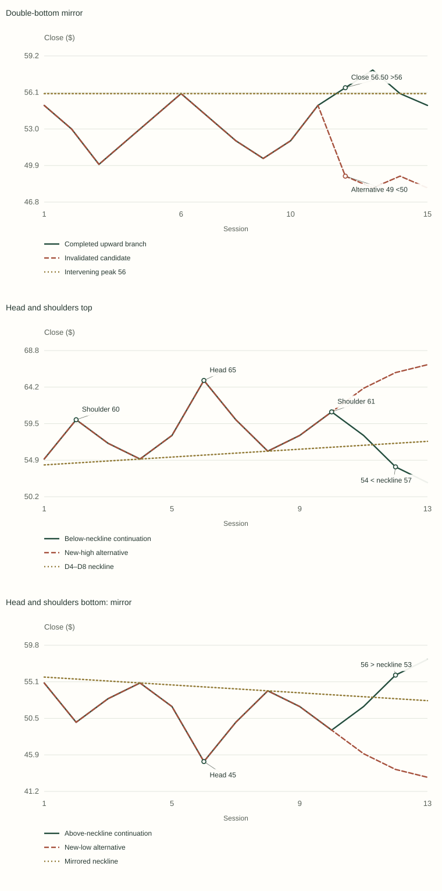

*Each case supplies one candidate prefix and two branches. The double-bottom candidate and completed branch mirror the core closes as 110 minus price; its invalidated branch is separately supplied. Head/shoulders diagrams use the dated 55/56 trough neckline (inverted D4 = $55/D8 = $54 for the bottom); these catalogue sketches do not specify a full recognition detector.*

#### What the drawing has established, and what it has not

The double-top example has enough data to establish construction, timing, completion and one specific subsequent closing outcome. It has no sample of comparable opportunities from which to estimate a useful average trade. That is a concrete distinction between recognizing a pattern and evaluating a strategy. The relevant empirical question would name a detector, market sample, comparator, outcome horizon and costs, rather than ask whether the word double top is generally reliable.

Lo, Mamaysky and Wang used algorithmic recognition in historical US stock data and reported incremental information in some pattern-conditioned return distributions. Their result motivates reproducible questions; it does not assign a success probability to our hand-built pattern or validate this three-session target condition. The book’s evidence chapters discuss broader research and how to compare results. In this chapter, the tables and frozen branches provide the smaller prerequisite: a classification that another reader can reproduce and that can actually fail.

#### Worked example: A completed structure without the specified target outcome

After D11 the 60/59.50 peaks and 54 trough make a recognized candidate. D12 close 53.50 completes its closing break. Height 6 projects the conventional 48 reference; the next three closes 52, 54, 55 do not reach it. In the alternate branch, D12 close 61.50 invalidates the candidate before completion. Each conclusion follows from the supplied prices and a different explicit question.

#### Exercise

Specify a double-top rule with a peak tolerance, minimum separation, intervening trough definition, and completion price field. Explain how future bars used to confirm peaks affect the earliest possible recognition time.

Reveal the worked solution

One complete answer is the supplied strict two-neighbor close-based detector, at least four session steps between peaks, tolerance≤1% of first peak, minimum intervening close as reference, and later completed close below it.

For 60 and 59.50, tolerance check is 0.50/60 × 100 = 0.833%; separation D9−D3 = 6. The 54 trough is recognized after D8, and the second peak only after D11. D11 close 55 leaves it a candidate; D12 close 53.50 completes it.

Other tolerances or wick-based detectors can be defensible, but state their recognition delays and apply them before seeing the branch. Future bars confirming D9 cannot make its confirmation available on D9.

#### guided practice: Guided: complete the frozen candidate note

Stop the core data after D11. Complete the partly filled note: first peak D3 = $60; second peak D9 = ____; separation = 6 sessions; difference = ____%; intervening reference = ____; current state = ____. Then reveal each D12 branch separately.

Reveal the worked solution

Peaks 60 and 59.50; separation 6; difference 0.833%; intervening minimum 54. Both peaks and the trough are recognized by D11, but close 55 is not below 54, so the pattern is a candidate.

Branch A53.50 completes the break. Branch B61.50 exceeds first peak 60 and invalidates the candidate. The pre-reveal state must remain identical for both.

#### independent practice: Independent: a borderline pair

Two confirmed peaks are 72 and 71.20, separated by five steps, with trough 66. Use the core 1% tolerance and four-step minimum. Does this pair qualify? What changes under a 1.5% alternative? What would a later 65.50 close establish under each detector?

Reveal the worked solution

Difference 0.80/72 × 100≈1.111%, exceeding 1%. Separation passes, but the core detector rejects the pair. Under 1.5%, it becomes an eligible candidate.

A65.50 close is below 66. Under the alternative detector it completes the candidate; under the original detector there was no qualifying candidate event to complete. Choose the tolerance before seeing the break rather than relaxing it to capture the favorable case.

#### Knowledge check

D9’s second peak is confirmed after D11; D11 close is 55 and D12 close 53.50 versus the 54 reference. When is the core pattern complete?

1. D12, when the required closing break occurs
2. D9, when the second high first appears
3. D11, when both peaks are confirmed

Reveal the worked solution

Answer: 1. Recognizing both peaks creates a candidate; the later boundary transition completes this detector’s event.

Option 1: Correct: the 53.50 close satisfies the declared completed-close transition.

Option 2: The second peak is not yet confirmed, and the required support break has not occurred.

Option 3: Both peaks are now available, but 55 remains above 54. This is candidate recognition, not completion.

#### Sources

- [Fidelity · Identifying chart patterns with technical analysis](https://media.fidelity.com/assets/Fidelity.com_VMS/904/347/TA_Session_3_Identifying_Chart_Patterns.pdf) — Engulfing-body vocabulary, triangle categories, breakout filters, false breaks, and retracements. This book does not adopt the slides' performance claims.
- [StockCharts ChartSchool · Double top reversal](https://chartschool.stockcharts.com/table-of-contents/chart-analysis/chart-patterns/double-top-reversal) — Two-peak construction, intervening support break, and conventional measured-move calculation.
- [StockCharts ChartSchool · Head and shoulders top](https://chartschool.stockcharts.com/table-of-contents/chart-analysis/chart-patterns/head-and-shoulders-top) — Shoulder/head/neckline construction and the need to distinguish formation from completion.
- [StockCharts ChartSchool · Flag and pennant](https://chartschool.stockcharts.com/table-of-contents/chart-analysis/chart-patterns/flag-pennant) — Short consolidation after a sharp move; flag versus pennant geometry.
- [StockCharts ChartSchool · Symmetrical triangle](https://chartschool.stockcharts.com/table-of-contents/chart-analysis/chart-patterns/symmetrical-triangle) — Converging lower highs and higher lows; distinction between pattern geometry and observed breakout direction; filter and retest conventions. No performance percentages are adopted here.
- [Lo, Mamaysky & Wang · Foundations of technical analysis (NBER working paper 7613)](https://www.nber.org/papers/w7613) — Research on formalized pattern recognition and incremental information in a historical US-stock sample. Does not establish a universal, current, after-cost trading edge.
- [Lo, Mamaysky & Wang (2000), Foundations of Technical Analysis](https://www.mit.edu/~alo/Papers/1705-1765.pdf) — Algorithmic pattern recognition and conditional return distributions, distinct from net trading profitability.

---

### Chapter 9: Breakouts, pullbacks & failed moves

Define the boundary and the observation time before evaluating a crossing.

> A breakout is a predefined crossing, not a promise. Confirmation and retests trade additional information for changed timing and execution.

**Version 0.4 · AI editorial review recorded 2026-10-02 (/root).**

Review scope: Scoped chapter editorial acceptance: prose, material source claims, tasks, numerical reproduction and compact/wide figures; release QA and human learning are separate.

**Learning outcomes**

- Determine when a fixed closing-breakout rule becomes observable.
- Separate signal recognition, an eligible entry, and a later failure.
- Reproduce the quantity, costs, and R result of a fully stated paper plan.
- Retain successful, failed, skipped, and ambiguous continuations in a review.

Builds on: The language of the market; Volume: participation behind price; Timeframes, sessions & chart scales; Support, resistance & price areas; Classical chart patterns.

#### A crossing needs a boundary and a clock

A breakout is a move beyond a previously identified price boundary or area. The word by itself is incomplete: beyond which edge, by how much, using what price field, and at what observation time? An intraday high above resistance and a completed close above it are different conditions. Both are legitimate observations, but they define different events. A downward crossing is often called a breakdown.

Imagine Harbor has a resistance area from $49.70 to $50.00. A trade at $50.01 crosses the upper edge, yet a rule requiring a close more than 1% above that edge needs a close above $50.50. The small buffer is an illustrative convention, not an optimized or universally effective threshold. Fix it beforehand. A level selected after seeing the crossing cannot fairly demonstrate that you recognized a breakout in advance.

#### The exact price field changes the result

Suppose a fictional daily bar opens at $49.40, reaches $50.80, falls to $49.10, and closes at $49.70. It crossed $50 intraday but did not finish above it. An intraday-break rule triggered; a close-above-$50 rule did not; a close-above-$50.50 rule also did not. Describing the move as false without naming the rule hides these differences. The label should refer to the event you actually defined.

If you require the completed close, that information becomes available at the end of the session. A backtest must then use a feasible subsequent execution convention, or an explicitly justified closing-auction model with its actual order and information deadlines. It cannot simply observe the finalized closing signal and assume a guaranteed trade at the same price. The decision clock is part of the method. Treating timing as an afterthought can make a historical breakout system appear better than it could have been.

#### First pass: write the Harbor instruction at the session-9 close

The first two sections distinguish price fields and observation times. Pause the main fictional Harbor case at the completed session-9 close. The resistance area $49.70–$50.00 and rules below were supplied before this cutoff; they are not selected from the future path. All nine closes and the complete session-9 candle are shown. The next session has not opened.

Apply the closing signal rule. Record what is observable now and what cannot yet be recorded about entry eligibility, a filled position or a later failure. Write the exact next-opening gate, including equality at both edges, the deadline and the behavior after a rejected open.

Calculate the maximum-entry cash reservation including the entry fee, the maximum allowed entry’s price-risk 1R and its ordinary cost-inclusive stop loss. Give the formula that freezes 1R if the eligible opening entry is lower. State which later bar fields and modeled execution assumptions would be needed to calculate a realized result.

Save the cutoff note before revealing the full Harbor path and the separate comparison branches. The volume-filter and retest examples later in the chapter are different rules; neither is an extra gate for this main plan. The constructed paths teach accounting and chronology, not return probabilities or a recommended allocation.

**Completed Harbor closes available through session 9 (fictional USD)**

| Session | Close ($) |
| --- | --- |
| 1 | 48 |
| 2 | 49 |
| 3 | 49.8 |
| 4 | 49.2 |
| 5 | 48.7 |
| 6 | 49.6 |
| 7 | 49.9 |
| 8 | 49.4 |
| 9 | 50.8 |

**Session-9 completed candle only (fictional USD)**

| Session | Open ($) | High ($) | Low ($) | Close ($) |
| --- | --- | --- | --- | --- |
| 9 | 49.4 | 51 | 49.2 | 50.8 |

**Harbor rules supplied before the continuation**

| Field | Frozen main-plan instruction |
| --- | --- |
| Signal | Completed regular-session close strictly above $50.50; no volume gate. |
| Opening entry | Only the next session’s open: accept strictly above $48.80 and at or below $50.80. Model 50 shares at that opening price; otherwise skip. |
| Deadline / rejection | Opening-only decision. A rejected open expires the candidate; a later price return does not permit an entry. |
| Account assumptions | Sufficient available cash; one position; no borrowing. Reserve maximum entry notional plus the $2.50 entry fee. |
| Standing exits after entry | Sell stop $48.80; sell-limit target $54.80. Exact trigger/target fills are teaching assumptions when their modeled conditions are met. |
| Gap / ambiguous bar | A later opening gap through the stop exits at the modeled opening price. Without an opening event deciding the first exit, a bar spanning both exit levels is sequence-ambiguous; do not invent an order. |
| Time exit | If still held, model exit at the third post-signal session’s close. Standing exits apply first. |
| Chart failure | Any of the next three completed closes strictly below $50.00. Equality is not failure; this chart label is separate from the trade outcome. |
| Fees / R | Fixed $5 round trip: $2.50 on entry and $2.50 on exit. Freeze price-risk 1R after entry as 50 × (filled entry − $48.80); fees are separate. |

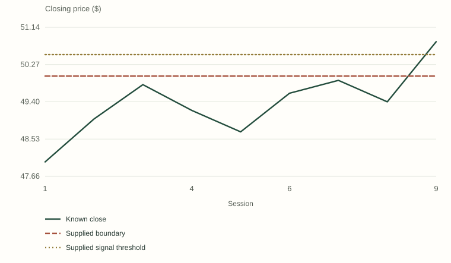

*Fictional completed closes through session 9. The $50 boundary and strict $50.50 signal threshold were supplied in advance. No next-session candle, gap or later close appears.*

Write and retain your cutoff note before opening the continuation. In print, finish this packet before the continuation reference on the next page.

Reveal continuation, explanations and complete reference

#### Confirmation filters add requirements, not certainty

Some rules require a buffer, repeated closes, increased volume, or several conditions together. These filters select a different set of observations and often delay recognition. They may remove some failed moves and exclude some successful ones. Whether the tradeoff is useful depends on measurement across the relevant universe and period. Calling a condition confirmation does not confer statistical independence or proven effectiveness.

Consider an illustrative close above $50 with volume at least 1.5 times the prior twenty-session mean. A $50.80 close on 1.6 times volume satisfies it. A $52 close on 1.2 times volume does not, even if price keeps rising later. That exclusion is part of the rule rather than an error to correct with hindsight. If you relax the volume requirement only on the examples that subsequently succeed, you are changing the method after learning the outcome.

#### Retests are optional paths

After an upward crossing, price may revisit the former boundary; after a downward crossing, it may revisit from below. Retest, pullback, and throwback terminology varies, so this book describes the direction explicitly. A return toward the area is an observation. A supportive reaction or renewed decline requires another defined condition. Price may also continue without returning at all.

If Harbor closes at $51 beyond a $50 boundary, a retest rule might require a later low inside $49.80–$50.20 followed by a close above $50.50 within three sessions. This original convention makes the hypothesis testable. A low of $50.30 misses the specified visit, and a low of $49 followed by a $49.50 close does not meet the supportive-close condition. Waiting can improve the prospective entry price in some paths, miss others, or encounter an actual failure. Record all three possibilities.

#### Execution can change the economics

Suppose the illustrative signal close is $50.80, a planned protective trigger is $48.80, and a geometric reference is $54.80. At the signal price, nominal downside distance is $2 and upside distance is $4. The next open is $52.20. Entering then changes those distances to $3.40 and $2.60, respectively. Their ratio changes from 2.0 to about 0.76. Neither calculation is an expectancy because it supplies no probabilities or execution guarantees.

An overnight gap can also pass an intended order level entirely. A market order seeks execution but does not guarantee the displayed price; a limit sets a price constraint but may not fill; a stop-market order activates a market order when its trigger is reached. These distinctions matter when a chart makes an entry look exact. A valid signal can lead to a poor executable opportunity under the chosen plan, and declining that opportunity is consistent with having recognized the chart event accurately.

#### Define failure without selecting the answer

A false-break definition needs a time window and a return condition. One illustrative rule calls an upward closing breakout failed if any of the next three completed closes is below the original $50 boundary. Another requires price to hit a protective trigger. They are different outcome measures. Neither can label the event failed at the instant of the initial crossing; the later observations have not happened yet.

A failed upward move does not automatically prove a profitable short trade. Reversing direction introduces a new entry, costs, risk, and a hypothesis that can fail independently. Price may oscillate across the area repeatedly. Study the full sequence instead of drawing arrows only on the profitable sections. Breakout analysis becomes useful when it forces you to specify boundaries, timing, execution, and update rules. Its value should be evaluated through that complete process, not through a collection of memorable escape-from-the-range pictures.

#### Freeze a small plan before revealing the continuation

Return to the main Harbor chart. Its session-9 close is $50.80 and session-10 close is $49.40. Before session 9, the resistance area is already fixed at $49.70–$50.00. For this exercise, use a completed regular-session close strictly above $50.50 as the signal. Volume is not an additional condition in this main rule; the earlier volume-filter example is a separate comparison. Declare failure if any of the next three completed closes is strictly below $50.00. Equality at either threshold does not qualify. These arbitrary rules are supplied so two readers can classify the same sequence without supplying missing decisions.

Freeze the following paper execution model after the session-9 close. Use only the next session’s opening observation. If that open is above $50.80, skip the candidate entirely, even if price later returns. Otherwise model 50 shares filled at the open, provided it is above the $48.80 protective trigger. An open at or below the protective trigger is also a skip. Model a sell stop at $48.80 and a sell limit target at $54.80; if neither exits the position by the third post-signal session, model an exit at that session’s close. A later opening gap through the stop uses the opening price, not $48.80. If an ordinary OHLC bar spans both exits without an opening gap deciding the first event, mark the result sequence-ambiguous rather than inventing an order. All fills here are explicit teaching assumptions, not deductions from a real order book.

At the maximum allowed entry of $50.80, 50 shares have $2,540 entry notional before costs and $100 planned price risk: 50 × ($50.80 − $48.80). This paper plan assumes sufficient cash, one position, no borrowing, and a fixed $5 round-trip expense, charged $2.50 on entry and $2.50 on exit. Reserve $2,542.50 before entry to cover the maximum entry debit. Freeze 1R after the modeled fill as 50 × (entry price − $48.80); an eligible lower entry has a smaller price-risk denominator. At $50.80, the ordinary cost-inclusive modeled loss is $105, or −1.05R net, and the exact target exit is +$195, or +1.95R net. Costs are separate from the price-risk denominator; a $100 all-in loss budget would require a smaller quantity at this entry. A gap can exceed either budget.

Now reveal the main continuation: session 10 opens at $52.20, reaches $52.60, falls to $49.10, and closes at $49.40. At the open the plan records a skip; at the close the chart event meets the failure definition. No trade occurred, so the journal records no realized trade P&L or R outcome. The hypothetical distances from a chased $52.20 entry remain useful for comparison, but do not become this plan’s account result. Observation, eligibility, and outcome each have their own timestamp.

**One frozen rule, three supplied continuations**

| Branch | Information after the $50.80 signal | Decision and modeled result |
| --- | --- | --- |
| Main gap/skip | Next O52.20/H52.60/L49.10/C49.40 | Skip at open; closing failure later; no trade P&L |
| Target comparison | Next O50.80/H55.00/L50.60/C54.90 | Assumed entry 50.80; target 54.80; +$195 net = +1.95R |
| Stop comparison | Next O50.80/H51.00/L48.60/C49.40 | Assumed entry 50.80; stop 48.80; −$105 net = −1.05R |

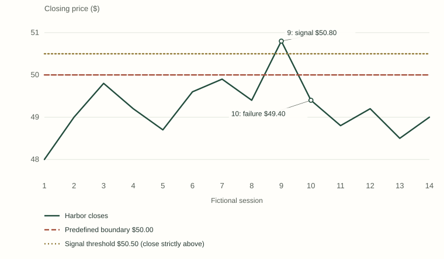

*Main Harbor closes use the same session-9 $50.80 signal and session-10 $49.40 failure as the worked record. The fixed $50 boundary and stricter $50.50 signal threshold are distinct. The supplementary candles expose the $52.20 opening gap that this close-only line omits.*

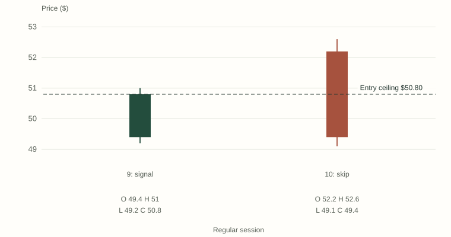

*Same main Harbor example. Session 9 closes at $50.80; session 10 opens at $52.20, so the opening-only plan skips before the closing failure is known. OHLC values are fictional and do not supply transaction sequence.*

#### Read a retest with the future covered

Use a separate retest example to practice chronological interpretation. At the signal close of $51, the fixed boundary is $50 and the visit area is $49.80–$50.20. Require a later low inside that area and a close above $50.50 in the same session, within three sessions after the signal. On the first later session, L50.30/C50.80 fails the visit condition. On the second, L50.10/C50.60 meets both conditions; the event becomes known only at that second close. A third session cannot be used to recognize it earlier.

Contrast two branches at that same second-session cutoff. L50.10/C50.40 visits but fails the closing condition. L49.00/C50.60 fails this specific low-inside-area rule because the measured low is outside it. The low and close do not prove that a trade occurred inside the area: eligible transaction prices can jump over intervening values. A different rule based on any traded touch needs the relevant transaction record or an explicit inference convention. State the field you measured. These alternatives show why a rule must be read literally before its usefulness is judged.

For a concrete counterexample, take two complete fictional eligible-price tapes. Tape A is 49.30 → 49.00 → 50.60. Tape B is 49.30 → 49.00 → 50.00 → 50.60. Both have O49.30/H50.60/L49.00/C50.60; both fail the low-inside-$49.80–$50.20 rule. Only B contains a traded touch at $50.00. A line drawn between A’s $49.00 and $50.60 marks passes across the area on paper, but that connecting stroke does not supply a transaction. Without the tapes, their identical OHLC cannot distinguish the touch outcomes.

**Identical OHLC does not establish an intermediate traded touch**

| Complete fictional tape | Ordered eligible prices ($) | Open ($) | High ($) | Low ($) | Close ($) |
| --- | --- | --- | --- | --- | --- |
| A | 49.30 → 49.00 → 50.60 | 49.3 | 50.6 | 49 | 50.6 |
| B | 49.30 → 49.00 → 50.00 → 50.60 | 49.3 | 50.6 | 49 | 50.6 |

#### Worked example: A correct signal can end in a skip

At the session-9 close, $50.80 exceeds the frozen $50.50 threshold. At the session-10 open, $52.20 exceeds the entry ceiling, so the paper plan skips. At the session-10 close, $49.40 is below the $50 boundary and meets the failure definition. The three statements are compatible. No position was opened, so neither a hypothetical stop loss nor the foregone target belongs in realized P&L.

#### Exercise

Apply the supplied main Harbor rule at the session-9 close, session-10 open, and session-10 close. State the signal, entry decision, failure classification, and realized trade P&L at each cutoff. For the target comparison branch, calculate entry notional and cash debit including entry cost, planned price risk, cost-inclusive ordinary loss, and net target profit in dollars and R.

Reveal the worked solution

At the session-9 close, 50.80 > 50.50 establishes a signal; the next open and later failure are still unknown. At the session-10 open, 52.20 > 50.80 requires a skip. At its close, 49.40 < 50.00 establishes failure inside the three-session window. There is no trade P&L, because there was no entry; a skip is a retained opportunity record rather than a zero-R executed trade.

For the explicitly modeled $50.80 target branch: entry notional = 50 × $50.80 = $2,540; entry cash debit = $2,542.50 including the $2.50 entry charge. Planned price risk = 50 × $2 = $100; ordinary loss including $5 expense = $105. Target price profit = 50 × $4 = $200; net profit = $195; net R = 195/100 = +1.95R. The denominator is frozen filled-price risk, not notional or the $105 cost-inclusive loss.

The comparison branches are invented continuations for inspecting the same plan. Their count is not a sample of strategy success rates. A bar containing both exit prices would require the declared ambiguity policy.

#### guided practice: Follow the retest clock

Using the retest rule, classify day +1 L50.30/C50.80 and day +2 L50.10/C50.60. What changes if day +2 closes at $50.40?

Reveal the worked solution

Day +1 misses the low-inside-$49.80–$50.20 condition. Day +2 meets the visit and close-above-$50.50 conditions, recognized at its close. With C50.40, the visit occurs but the closing condition fails; neither version licenses a day +1 recognition.

#### independent practice: A gap changes the realized loss

A comparison branch first models 50 shares bought at $50.80. The following session opens at $47.80, below the $48.80 stop. Under the supplied gap rule and $5 expense, calculate the exit, net P&L, and R. Explain why the ordinary $105 modeled loss is not the answer.

Reveal the worked solution

The gap rule exits at the assumed $47.80 open. Price loss = 50 × ($50.80 − $47.80) = $150; net P&L = −$155; R = −155/100 = −1.55R. The trigger was skipped by the gap, so an exact $48.80 fill cannot be assumed. The $105 figure described an ordinary exact-trigger exit, not a maximum possible loss.

#### independent practice: Keep R tied to the eligible fill

A separate permitted branch opens at $50.40 and models the same 50-share entry, $48.80 stop, $54.80 target and $5 round-trip charge. Calculate frozen 1R, entry cash debit, net target result and net ordinary-stop result in dollars and R. How much of the maximum-entry cash reserve is released?

Reveal the worked solution

The $50.40 opening entry is above $48.80 and at or below $50.80, so it is eligible. Frozen 1R = 50 × ($50.40 − $48.80) = $80. Entry notional is $2,520; cash debit is $2,522.50. The $2,542.50 maximum-entry reserve releases $20.

Target gross profit = 50 × $4.40 = $220; net = $215; net R = 215/80 = +2.6875R. Ordinary-stop net loss = −$80 − $5 = −$85, or −1.0625R. Reusing the maximum-entry $100 denominator would conceal the smaller filled-price risk.

#### independent practice: A traded touch needs a traded price

A different retest area is $72.80–$73.20 inclusive. For each complete fictional eligible-price tape below, reconstruct OHLC and apply two rules: the completed low must be inside the area; or at least one eligible trade must be inside it. Both rules additionally require a close strictly above $73.50. Explain what an OHLC-only observer cannot distinguish.

**Complete unfamiliar eligible-price tapes (fictional USD)**

| Tape | All eligible trade prices, in order ($) |
| --- | --- |
| C | 72.30 → 72.00 → 73.60 |
| D | 72.30 → 72.00 → 73.00 → 73.60 |

Reveal the worked solution

Both summarize as O72.30/H73.60/L72.00/C73.60. The low is below the area, so neither passes the low-inside-area rule; both satisfy the separate close-above-$73.50 condition.

C has no eligible trade in $72.80–$73.20, while D contains $73.00, so only D passes the traded-touch rule. The jump from $72.00 to $73.60 does not establish intermediate transactions. With only the identical OHLC, traded touch is unresolved; it cannot be inferred by drawing a continuous line.

#### Knowledge check

At a $50.80 qualifying close, the plan permits only a next open at or below $50.80. The next open is $52.20 and the close is $49.40. Which record follows the supplied rule?

1. Signal at the earlier close; buy at $50.80 because the later low passed it; stop loss.
2. Signal at the earlier close; skip at the open; chart failure at the later close.
3. No signal at the earlier close because the next close was below the boundary.

Reveal the worked solution

Answer: 2. The opening-only policy skips, while signal recognition and later closing failure remain distinct observations.

Option 1: This substitutes a later-touch entry for the fixed opening-only policy and infers fills from a bar.

Option 2: Correct: each conclusion uses only the information available at its own cutoff.

Option 3: The future outcome does not erase a condition that was already satisfied at the earlier close.

#### Sources

- [StockCharts ChartSchool · Support and resistance](https://chartschool.stockcharts.com/table-of-contents/chart-analysis/support-and-resistance) — Breaks of previously defined trading areas, approximate zones, role-change and failed-crossing vocabulary. The numerical breakout and failure rules in this book are original fictional examples.
- [StockCharts ChartSchool · Symmetrical triangle](https://chartschool.stockcharts.com/table-of-contents/chart-analysis/chart-patterns/symmetrical-triangle) — Converging lower highs and higher lows; distinction between pattern geometry and observed breakout direction; filter and retest conventions. No performance percentages are adopted here.
- [SEC / Investor.gov · Types of orders](https://www.investor.gov/introduction-investing/investing-basics/how-stock-markets-work/types-orders) — Market, limit, and stop order distinctions; execution prices and fills are not guaranteed by a chart level.
- [Fidelity · Why to consider stock volume](https://www.fidelity.com/viewpoints/active-investor/stock-volume) — Share-volume definition and comparison with historical activity.

---

### Part 02 review: Write an analysis with the next bars covered

#### Freeze the map

Prior recognized reaction highs are $59.70 and $60.00; the chosen resistance area is $59.70–$60.00. At cutoff T, a completed close is $60.50. A predeclared signal requires a close strictly above $60.60. Record observation, rule result, alternative interpretation, and what remains unknown.

Reveal the worked solution

Observation: C60.50 is above the area’s upper edge by $0.50. Rule result: no signal, because 60.50 is not strictly above 60.60. An analyst may describe an unbuffered area crossing; that does not satisfy this buffered rule.

Future closes, any retest, next opening price, and executable opportunity remain unknown. Preserve the map and threshold rather than lowering the buffer after observing the later outcome.

#### Process a new continuation

At cutoff T+1 a close of $60.80 now meets that same rule. The paper plan permits only a next opening entry at or below $60.80 and above its $58.80 stop. The next O/H/L/C is 62.00/62.50/59.00/59.50. The failure rule is a completed close below $60 within three later sessions. Write the chronological record and identify any trade P&L.

Reveal the worked solution

Signal is recognized at T+1 close. At the next open, 62.00 exceeds the ceiling, so skip. At the later close, 59.50 is below $60 and establishes the stated chart failure. The skip has no realized trade P&L; the later low does not retroactively fill an opening-only entry.

A different later-touch order policy would be a different plan and require a feasible fill model. Save the skip and failed chart event as separate fields.

#### Diagnose a result that OHLC cannot decide

An alternative paper branch models 50 shares filled at $60.80. The next bar opens at $61 and has H65.20/L58.50/C61.50. Exits are stop 58.80 and target 64.80, with $5 round-trip costs and frozen $100 price-risk R. Give the two exact-level net outcomes and explain why one cannot be selected from this bar.

Reveal the worked solution

Stop price loss = 50 × $2 = $100; net = −$105 = −1.05R. Target price profit = 50 × $4 = $200; net = +$195 = +1.95R.

The open lies between the exits and the full bar spans both. OHLC does not establish which came first. Retain sequence ambiguity or obtain suitable time-ordered data; picking the favorable path would change the evidence. Exact-level fills themselves remain teaching assumptions.

## Part 03: Look beneath the surface

Understand what an indicator measures before asking what it means.

### Chapter 10: Moving averages

Understand the smoothing before you trust the signal.

> An average compresses past prices into a smoother description; its usefulness as a trading rule is a separate, testable question.

**Version 0.4 · AI editorial review recorded 2026-10-12 (/root).**

Review scope: Re-accepted for documented whitespace or shared study locator/date correction; earlier substantive review retained.

**Learning outcomes**

- Calculate a full-window SMA and SMA-seeded EMA, including undefined early values.
- Identify the timestamp of a close-based crossover.
- Contrast trend and range behavior under one frozen definition.

Builds on: Anatomy of a stock chart; Timeframes, sessions & chart scales; Trends, swings & changing structure.

#### One line, one deliberate loss of detail

Imagine following a stock whose daily closes alternate between small advances and retreats. The individual marks can make its direction hard to describe. A moving average replaces each eligible observation with a summary of recent observations. You gain a simpler view, but you surrender information about their order and their extremes. Two quite different paths can have the same average. Begin by asking which detail you are willing to remove and why.

Fidelity defines a simple moving average, or SMA, as an arithmetic average over a specified period. Here the input is the closing price: SMA at time t equals the sum of the latest N closes divided by N. Five daily closes describe five sessions; five weekly closes describe five weeks. The parameter names a number of observations, rather than a universal duration.

#### Calculate it, then watch what leaves

For fictional closes of $10, $11, $12, $13, and $14, the five-session SMA is $12. If the next close is $15, the $10 observation leaves and $15 enters, producing $13. Notice that an average can move substantially because an old outlier leaves, even when today’s change is small. An indicator has a memory structure; understanding that structure prevents you from attributing every movement in its line to something new in the market.

This textbook leaves the SMA undefined until all N observations exist. An implementation that averages only the observations available at the beginning produces a different early series. Adjusted versus unadjusted prices also change the input. Before comparing two charting systems, match the price field, session, adjustment policy, and missing-data handling. A smooth line is only as coherent as the data underneath it.

**Main dataset: five-session averages**

| Session | Close ($) | SMA ($) | EMA ($) |
| --- | --- | --- | --- |
| 1 | 10 | Undefined | Undefined |
| 2 | 11 | Undefined | Undefined |
| 3 | 12 | Undefined | Undefined |
| 4 | 13 | Undefined | Undefined |
| 5 | 14 | 12 | 12 |
| 6 | 15 | 13 | 13 |
| 7 | 15 | 13.8 | 13.667 |
| 8 | 14 | 14.2 | 13.778 |
| 9 | 13 | 14.2 | 13.519 |
| 10 | 12 | 13.8 | 13.012 |
| 11 | 11 | 13 | 12.342 |
| 12 | 10 | 12 | 11.561 |

#### Exponential weighting and the first value

An exponential moving average, or EMA, updates a prior average rather than dropping the oldest observation completely. A common convention is EMA today = alpha × close today + (1 − alpha) × EMA yesterday, with alpha = 2/(N + 1). For N = 5, alpha is one third. Fidelity describes using an SMA for the first EMA value. In our five-session example, seed the EMA at $12; the next $15 close produces $13.

On the following $15 close, the five-session SMA becomes $13.80, while the EMA becomes approximately $13.67. An EMA responds more to the newest price than the same-length SMA, but individual comparisons need not follow a simple ranking because the rest of the history matters. A seed’s influence decays by repeated multiplication by 1 − alpha. Record the seed and warm-up history, especially in short samples.

#### The price of smoothing is delay

A longer lookback generally suppresses more local variation. It also carries older observations farther into the description of today. If a stock changes direction abruptly, those observations keep pulling the average toward the former regime. That is the source of lag. No choice eliminates both noise and delay. A very responsive setting exposes you to small fluctuations; a slower setting can remain persuasive after the underlying behavior has changed.

Suppose fictional price jumps from a long sequence near $20 to $24. An average below $24 is not an independent discovery that the stock is cheap. It is the arithmetic consequence of retaining earlier prices. Likewise, touching an average does not force a bounce. Use phrases such as “price returned to its recent mean” before adding a hypothesis about what participants might do there.

#### Observe the first state, then count crossings

At session 5 of the main table, close $14 exceeds the newly available SMA $12. This is the first classified state, not a crossover: session 4 has no eligible mean. At session 7, $15 remains above $13.80. At session 8, $14 falls below $14.20 after the preceding close was above its own average. This first downward crossing is observable after session 8 closes.

Freeze this teaching definition: up means today’s close exceeds its eligible SMA after yesterday was at or below its eligible SMA; down means today is at or below after yesterday was above. Both averages must exist. Equality belongs to the below-or-equal side. The definition identifies an analysis event, without assuming an execution at its closing price.

Apply the same definition to the contrasting range: $12, $11, $13, $11, $13, $11, $13, $11, $13, $11, $13, $11. Its first SMA is $12 at session 5, when price is above. From sessions 6–12 the close switches sides seven times. The definition has not changed; the path keeps undoing the previous directional event. The second panel makes those whipsaws visible.

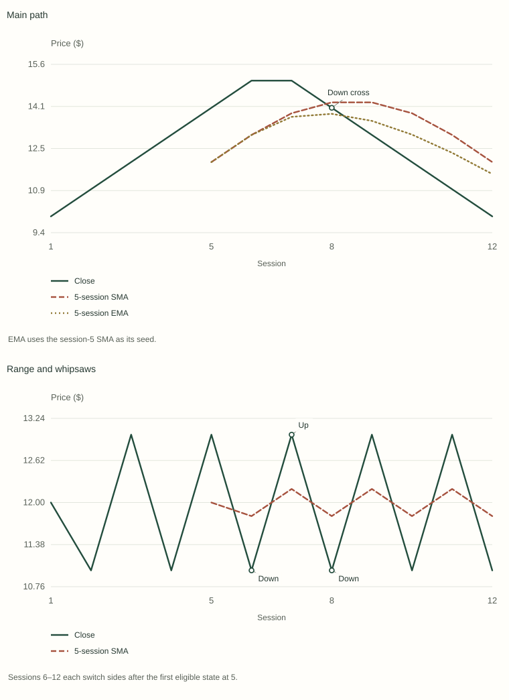

*Fictional 12-session datasets. Main values match the table, example, and exercise. The range is a deliberate contrasting path using the identical five-session SMA. Early averages are undefined.*

#### Read both panels before adding a filter

For the main path, write the observable sequence first: closes rise from $10 to $15, pause, and then decline. The mean turns after the closes turn, while price crosses it at session 8. The average supplies a fixed summary through the turn; it cannot identify the $15 peak before later prices exist. For the range, a more useful note is “closes alternate around a comparatively stable mean.”

Now require two consecutive closes on the new side before recognizing a change. In the range, none of the session-6-to-12 switches persists for two closes, so all seven are suppressed. In the main path, sessions 8 and 9 are the first pair below-or-equal, delaying recognition until 9. This is a concrete filtering tradeoff: fewer interruptions in this range, later response in this turn.

A reader could instead use a price buffer or a longer average, but those would be different definitions. Keep the demonstrated rule unchanged while comparing the panels. An annotation saying “down cross” means the ordering changed at that close; it does not show a completed trade or estimate its return. The planning and testing chapters will connect an observation to executable instructions and evaluation.

Two averages of the same closes describe overlapping information. With an equal five-session lookback, agreement shows that a reading survives a change of weighting, while disagreement reveals how differently the two lines weight and remember older closes. At session 8 here, the SMA is $14.20 and EMA about $13.78; the same $14 close is below one and above the other. Explain that arithmetic before calling either line a vote about the future.

#### A definition does not select a durable rule

Bajgrowicz and Scaillet’s DJIA experiment is relevant when a reader picks the best historical moving-average setting. Its adverse selection and cost findings concern a larger technical-rule family, not this exact SMA example. A crossover count is a path description; testing the rule still needs future evaluation and costs.

#### Worked example: Trace the session-8 crossing

Session 7’s SMA is (12 + 13 + 14 + 15 + 15)/5 = $13.80, below its $15 close. Session 8’s window is 13, 14, 15, 15, 14: $71/5 = $14.20, above its $14 close. The frozen rule identifies a downward event after session 8 closes. Its EMA is approximately $13.78, still below the close; the two weighting choices classify the same price differently.

#### Exercise

Calculate the main table’s session-7 and session-8 SMAs, identify the first downward crossing, and state when it becomes observable.

Reveal the worked solution

The five closes ending at 7 sum to $69, giving SMA $13.80. Those ending at 8 sum to $71, giving $14.20. Price goes from above its eligible mean ($15 > $13.80) to below ($14 < $14.20).

Record the crossing after session 8 closes. Session 5 merely establishes the initial state; comparing it with an undefined mean at 4 would manufacture a crossover.

#### guided practice: Finish the EMA update

Use session-7 EMA $13.6666667, alpha 1/3, and session-8 close $14. Find the updated EMA and price’s position relative to it.

Reveal the worked solution

EMA = 13.6666667 + (14 − 13.6666667)/3 = $13.7777778. Close $14 is above the EMA while below the SMA $14.20.

The indicators disagree because they retain different weights, not because one observed a different closing price.

#### independent practice: Compare a two-close filter

A fresh fictional sequence closes at $20, $22, $24, $21, $20, $23 and $25. Use a three-session SMA, initially undefined for sessions 1–2. Record above/below/equal states for sessions 3–7 and side switches only between eligible observations. A new side requires two consecutive strictly above or strictly below closes; equality resets the count. When are changes confirmed?

Reveal the worked solution

SMAs at sessions 3–7 are $22, $22.3333, $21.6667, $21.3333 and $22.6667. The close states are above, below, below, above, above. Session 3 establishes the initial state; side switches occur at 4 (down) and 6 (up).

The two-close rule confirms below at session 5 and above at session 7, each one close after the first crossing. Unlike the earlier alternating range, both changes persist in these supplied observations. The result is a property of this example, not evidence of an optimal filter.

#### Knowledge check

What is the five-session SMA at main-dataset session 7?

1. $13.00
2. $13.67
3. $13.80

Reveal the worked solution

Answer: 3. $69 divided by five gives $13.80.

Option 1: $13.00 is the prior session’s average; the old $11 must leave the window.

Option 2: $13.67 is the rounded EMA, not the equal-weight mean.

Option 3: $69 divided by five gives $13.80.

#### Sources

- [Fidelity · Simple moving average](https://www.fidelity.com/learning-center/trading-investing/technical-analysis/technical-indicator-guide/sma) — Arithmetic moving-average definition and smoothing/lag tradeoff; no claim of profitable crossover rules.
- [Fidelity · Exponential moving average](https://www.fidelity.com/learning-center/trading-investing/technical-analysis/technical-indicator-guide/ema) — Recursive EMA definition and SMA seed convention.
- [TradingView · Moving Averages](https://www.tradingview.com/support/solutions/43000502589-moving-averages/) — Conventional EMA smoothing multiplier 2/(N + 1).
- [Bajgrowicz & Scaillet · Technical trading revisited (author-hosted manuscript, sample to July 2011; published 2012)](https://scaillet.ch/pdfs/BajSca.pdf) — Multiple-testing, ex ante persistence, transaction costs, and DJIA technical rules.

---

### Chapter 11: Momentum: pace and persistence

Read price and its transformations together, including recognition times.

> Momentum indicators transform past price changes. Extreme readings and divergences need context and cannot schedule a reversal.

**Version 0.4 · AI editorial review recorded 2026-10-03 (claude-code-main).**

Review scope: Scoped chapter editorial acceptance: prose, material source claims, tasks, numerical reproduction and compact/wide figures; release QA and human learning are separate.

**Learning outcomes**

- Calculate ROC and a Wilder-style RSI seed/update.
- Distinguish MACD, its signal, and their histogram.
- Identify divergence at specified price peaks and state when it can be recognized.

Builds on: Moving averages; Trends, swings & changing structure.

#### Direction is only half the description

A stock can continue rising while its pace slows. Imagine advances of $4, then $3, then $1: the direction is positive throughout, but each increment is smaller. Momentum tools help separate a path’s direction from aspects of its speed or persistence. They cannot tell you whether the next increment will be negative. The distinction matters because slowing gains are often described as though a decline has already begun.

N-period rate of change is 100 × (current close / close N periods ago − 1). The main application has 18 closes beginning at $50 after 36 disclosed earlier closes of $50. At session 7, $64 compared with session 2’s $51 gives 25.49%; at session 12, $69 compared with session 7’s $64 gives 7.8125%. Price rose in between, while the five-session comparison weakened. Follow the aligned panels vertically: a smaller momentum reading is not a smaller price.

**Complete displayed inputs, preceded by 36 closes of $50**

| Session | Close ($) | Five-session ROC (%) |
| --- | --- | --- |
| 1 | 50 | 0 |
| 2 | 51 | 2 |
| 3 | 53 | 6 |
| 4 | 56 | 12 |
| 5 | 60 | 20 |
| 6 | 62 | 24 |
| 7 | 64 | 25.490196 |
| 8 | 65 | 22.641509 |
| 9 | 66 | 17.857143 |
| 10 | 67 | 11.666667 |
| 11 | 68 | 9.677419 |
| 12 | 69 | 7.8125 |
| 13 | 68 | 4.615385 |
| 14 | 70 | 6.060606 |
| 15 | 69 | 2.985075 |
| 16 | 71 | 4.411765 |
| 17 | 70 | 1.449275 |
| 18 | 72 | 5.882353 |

#### RSI compares upward and downward changes

The Relative Strength Index, or RSI, compares smoothed upward and downward close-to-close changes within one instrument. It is distinct from a stock-versus-index ratio. Fidelity documents the formula RSI = 100 − 100/(1 + RS), where RS is average gain divided by average loss. Loss here means a positive magnitude. A ratio of 2 gives approximately 66.67, rather than a forecast of a 66.67% probability of rising.

Our Wilder-style convention begins with N changes, requiring N + 1 closes. Separate each change into gain = max(change, 0) and loss = max(−change, 0). Seed each average with its arithmetic mean over those N changes. Thereafter update each as [(N − 1) × previous average + new observation]/N. This smoothing differs from alpha = 2/(N + 1) for a conventional EMA.

#### A short calculation makes the scale less mysterious

Use a teaching lookback of three changes and closes $10, $12, $11, $13. Gains are 2, 0, 2; loss magnitudes are 0, 1, 0. The seeded average gain is 4/3 and average loss is 1/3, so RS = 4 and RSI = 80. A subsequent $12 close changes the averages to 8/9 and 5/9. RS becomes 1.6 and RSI approximately 61.54.

When average loss is zero and gain is positive, the limiting RSI is 100; the reverse case gives 0. When both averages are zero, the formula is indeterminate. This edition uses 50 for a completely flat initialized series and documents that choice. Platforms can handle this edge case differently. Conventional thresholds near 70 and 30 are labels for comparatively one-sided recent movement, not universal instructions to sell or buy.

**RSI arithmetic companion: three changes**

| Close number | Close ($) | Gain ($) | Loss magnitude ($) | RSI |
| --- | --- | --- | --- | --- |
| 1 | 10 | — | — | Undefined |
| 2 | 12 | 2 | 0 | Undefined |
| 3 | 11 | 0 | 1 | Undefined |
| 4 | 13 | 2 | 0 | 80 |
| 5 | 12 | 0 | 1 | 61.538462 |

#### MACD asks a different question

Moving Average Convergence/Divergence, or MACD, commonly subtracts a 26-period EMA from a 12-period EMA and smooths that difference with a nine-period EMA called the signal line. The histogram is MACD minus signal. Fidelity verifies those conventional parameters. Positive MACD means the faster average exceeds the slower one; a rising histogram means that difference is becoming more positive relative to its own signal.

For an arithmetic snapshot, fast EMA $52 and slow EMA $50 give MACD $2. If the signal is $1.50, the histogram is $0.50. Later MACD $1.80 and signal $1.60 produce $0.20. The histogram has fallen, but both averages remain in the same order. Because the measure uses price units, the raw value is not directly comparable between a $20 stock and a $200 stock. Seeds and warm-up history matter here too.

For reproducibility, our MACD convention seeds the 12- and 26-period EMAs with their first complete SMAs. The first valid difference is at close 26. Seed the nine-period signal with the mean of the first nine valid MACD values, available at close 34; only then display its histogram. Extra earlier history changes warm-up readings, so match these conventions when comparing implementations.

#### A divergence is recognized after its selected peaks

Use this teaching peak rule: a close is a confirmed local peak if it exceeds the immediately preceding and following closes. A session-t peak is therefore recognized at t+1. In the main panel, $69 at 12 exceeds $68 at 11 and $68 at 13, becoming confirmed at 13. Its five-session ROC is 7.8125%. The $70 peak at 14 exceeds its $68 and $69 neighbors, becoming confirmed at 15; its ROC is about 6.0606%.

After session 15 closes, these peaks show higher price and lower corresponding ROC. The markers identify both selected peaks and the later recognition time. At session 14 itself the following neighbor was unknown, so calling $70 a completed peak would use future information. This one-bar delay belongs to the observation.

Session 16 subsequently reaches $71. The divergence correctly describes the earlier pair but did not schedule an immediate top. A wider swing rule could select different peaks or recognize them later. Compare the rules and timestamps before arguing about the label. The hand-sized RSI companion uses smaller numbers to isolate the seed and first update, while the price/ROC panels supply the complete analytical application.

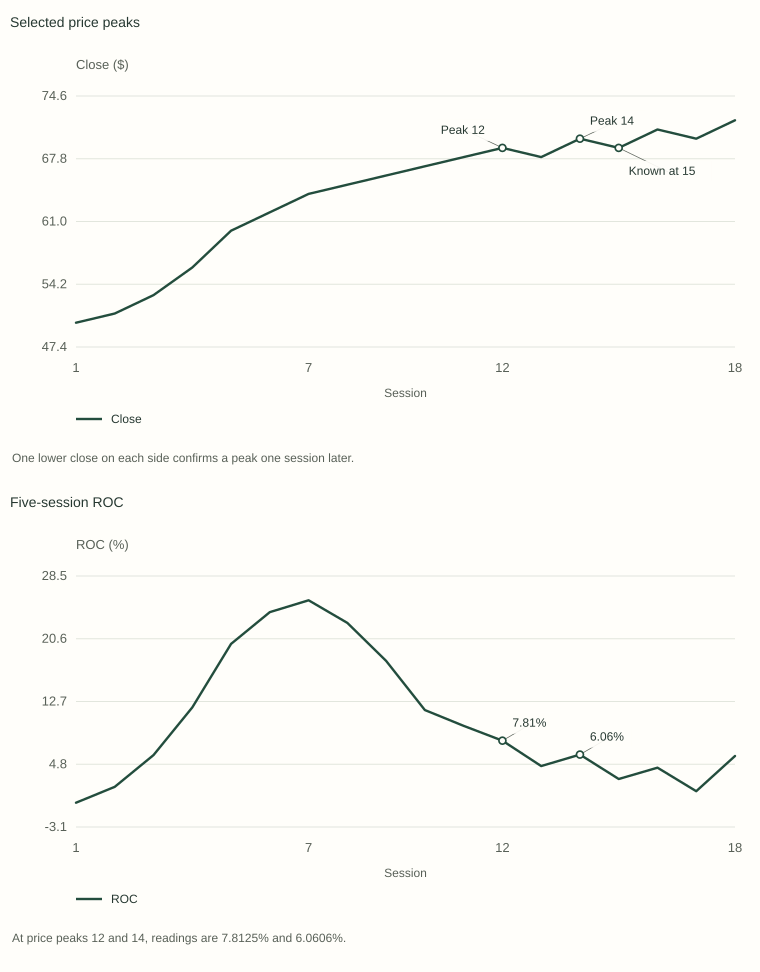

*The 18 fictional closes are the main dataset for prose, ROC exercise, and MACD. Thirty-six preceding closes are $50. Each point is sampled after its session close; each panel labels its own units.*

#### Read the MACD lines before reading the histogram

The second illustration transforms the identical price history, including its 36 earlier $50 closes, using 12/26/9 MACD and the stated SMA seeds. The flat history initializes MACD and signal at zero before the displayed rise. As closes accelerate, the fast price mean separates from the slow mean. The histogram measures MACD relative to its own signal, not the stock’s percentage return.

The checkpoint table connects the drawn lines to actual values. At session 12, price is $69, MACD about $4.713940, signal $3.164245, and histogram $1.549695. By session 18, price is $72, MACD $5.142043, signal $4.568231, and histogram $0.573812. Both price and MACD are higher, yet histogram is smaller. The signal has caught up toward the difference. A falling histogram therefore does not even require MACD itself to fall; it requires MACD minus signal to fall. Read that subtraction in the table before assigning meaning to the bar’s direction. In this supplied path the histogram remains positive at these checkpoints, so the later negative-histogram snapshot is a deliberate contrast, not a hidden claim about the figure.

When the histogram falls, check both lines above it. A positive MACD can move closer to its signal, making the histogram smaller; it can also fall below that signal while remaining above zero. Thus “the fast price average exceeds the slow one” and “MACD is below its signal” are compatible. The first compares two price averages, while the second compares their difference with its own past summary.

Return to the earlier snapshot, where MACD $2 and signal $1.50 gave histogram $0.50. If MACD later eases to $1.80 while the signal rises to $1.90, the histogram becomes −$0.10 even though MACD remains positive. This contrast isolates the arithmetic and does not supply new closing prices. To describe the stock’s direction, return to the actual price panel.

A useful momentum note names the lookback, identifies the comparison points, and states when the reading became available. At 15 here: “Two one-neighbor-confirmed price peaks rose from $69 to $70 while five-session ROC fell from 7.8125% to 6.0606%.” That is a reproducible observation. Its consequence for a prospective position depends on the already defined planning horizon; it is not a new instruction to create a strategy.

**Read the actual MACD panel at four checkpoints**

| Session | Close ($) | MACD ($) | Signal ($) | Histogram ($) |
| --- | --- | --- | --- | --- |
| 7 | 64 | 2.618313 | 1.114879 | 1.503435 |
| 12 | 69 | 4.71394 | 3.164245 | 1.549695 |
| 15 | 69 | 5.021024 | 4.043031 | 0.977993 |
| 18 | 72 | 5.142043 | 4.568231 | 0.573812 |

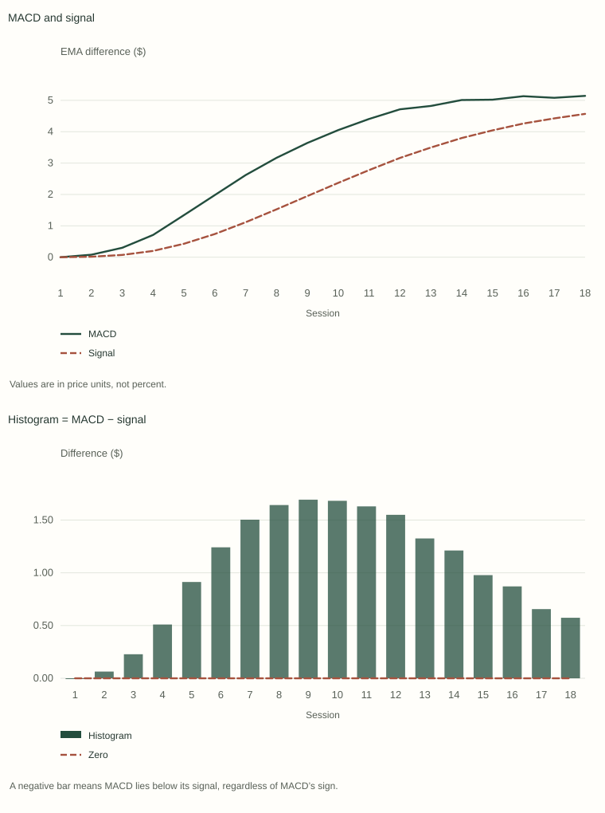

*SMA-seeded 12/26 EMAs and nine-valid-MACD signal. Full-history MACD first exists at close 26, signal at 34; the 36 earlier $50 closes supply this initialization.*

#### Three different momentum questions

RSI compares smoothed gains and losses inside one price series; MACD compares averages. Cross-sectional momentum ranks instruments against one another; time-series momentum uses each instrument’s own past return. The stock and futures studies in the appendix test the latter portfolio rules, not the RSI/MACD thresholds taught here.

#### Worked example: Reconstruct the divergence at session 15

At session 12, 100 × (69/64 − 1) = 7.8125%. At 14, 100 × (70/66 − 1) = 6.0606%. Price’s selected peak rose $1 while ROC fell about 1.75 percentage points. Peak 12 is confirmed by the next $68 close; peak 14 by the next $69 close. The complete pair is recognizable only after session 15. Session 16 then reaches $71, so the earlier divergence did not establish an immediate reversal.

#### Exercise

Calculate session-12 and session-14 five-session ROC from the main path. Under the one-neighbor rule, when are both price peaks confirmed?

Reveal the worked solution

Five sessions before 12 is 7, close $64: 100 × (69/64 − 1) = 7.8125%. Five before 14 is 9, close $66: 100 × (70/66 − 1) = 6.060606%.

The session-13 close confirms peak 12. The session-15 close confirms peak 14. Both exist only after 15 closes; a label placed on 14 itself can describe the eventual peak but cannot represent the contemporaneous recognition time.

#### guided practice: Finish the RSI companion

For $10, $12, $11, $13, $12 and N = 3, calculate the initial gain/loss means, RSI seed, and next update.

Reveal the worked solution

First three changes are +2, −1, +2. Gains sum to 4, loss magnitudes to 1; averages are 4/3 and 1/3, RS = 4, and RSI = 100−100/5 = 80.

The next −1 updates gain to (2 × 4/3+0)/3 = 8/9 and loss to (2 × 1/3+1)/3 = 5/9. RS = 1.6, RSI = 100−100/2.6 = 61.5385. Four seed closes provide three changes.

#### independent practice: Diagnose a MACD interpretation

A fresh fictional record supplies already initialized session-0 EMA and signal values in the input table. These are supplied starting states, not seeds to recreate from the one close. Update the price EMAs with alpha 2/13 and 2/27, then the nine-session signal with alpha 2/10 using each newly calculated MACD. For sessions 0–2, report MACD and histogram with signs. When does MACD first move above its signal? Has it also moved above zero, and what do the actual closes say about price direction? Work with unrounded values and report six decimals; state when the crossing is observable.

**Fresh MACD inputs: supplied state, then two completed closes**

| Session | Close ($) | Fast 12-session EMA ($) | Slow 26-session EMA ($) | 9-session signal ($) |
| --- | --- | --- | --- | --- |
| 0 | 33 | 30 | 31 | -0.6 |
| 1 | 34 | Calculate | Calculate | Calculate |
| 2 | 34.5 | Calculate | Calculate | Calculate |

Reveal the worked solution

At session 0, MACD = 30 − 31 = −$1.00; histogram = −1.00 − (−0.60) = −$0.40. The fast price mean lies below the slow mean, and their difference lies below its own signal. These initialized inputs summarize an earlier history that the task does not supply.

At session 1, fast EMA = 30 + (2/13) × (34 − 30) = $30.615385; slow EMA = 31 + (2/27) × (34 − 31) = $31.222222. MACD is −$0.606838. Signal = −0.60 + 0.20 × [−0.6068376068 − (−0.60)] = −$0.601368; histogram is −$0.005470. Keep full precision between updates: rounding this near-zero histogram too early can erase its negative sign.

At session 2, fast EMA is $31.213018 and slow EMA $31.465021; MACD is −$0.252003. Updated signal is −$0.531495, so histogram is +$0.279492. MACD first crosses above its signal after session 2 closes; it remains below zero, so this is not a zero-line crossing. The closes rise $33→$34→$34.50 even while MACD is negative. Its sign compares two price averages, rather than directly measuring the latest close-to-close change. None of these observations specifies an executable fill or a forecast.

#### Knowledge check

When is session 14’s selected peak first confirmed?

1. After session 15 closes.
2. After session 14 closes.
3. After session 16 closes.

Reveal the worked solution

Answer: 1. Session 15’s $69 close is below $70, and the preceding neighbor was $68; both required neighbors now exist.

Option 1: Session 15’s $69 close is below $70, and the preceding neighbor was $68; both required neighbors now exist.

Option 2: The later neighbor is not yet known at 14.

Option 3: Waiting until 16 adds a delay this one-neighbor rule does not require.

#### Sources

- [Fidelity · Relative Strength Index](https://www.fidelity.com/learning-center/trading-investing/technical-analysis/technical-indicator-guide/rsi) — RSI definition, formula, conventional thresholds, and persistence during strong trends.
- [Fidelity · MACD](https://www.fidelity.com/learning-center/trading-investing/technical-analysis/technical-indicator-guide/macd) — 12/26 EMA difference and 9-period signal convention.
- [TradingView · Relative Strength Index](https://www.tradingview.com/support/solutions/43000502338-relative-strength-index-rsi/) — Separate positive gain and loss magnitudes and RMA smoothing; not evidence of predictive accuracy.
- [Fidelity · Rate of Change](https://www.fidelity.com/learning-center/trading-investing/technical-analysis/technical-indicator-guide/roc) — Price change versus N earlier observations and percent-rate convention.
- [TradingView · Moving average convergence divergence (MACD) indicator](https://www.tradingview.com/support/solutions/43000502344-moving-average-convergence-divergence-macd-indicator/) — MACD fast-minus-slow, signal average and MACD-minus-signal histogram definitions; no effectiveness evidence.
- [Jegadeesh & Titman (1993), Returns to Buying Winners and Selling Losers](https://www.bauer.uh.edu/rsusmel/phd/jegadeesh-titman93.pdf) — Cross-sectional U.S. stock momentum, sample/rule/cost conventions; not validation of a particular chart setup.
- [Moskowitz, Ooi & Pedersen (2012), Time series momentum](https://fairmodel.econ.yale.edu/ec439/mosk.pdf) — Own-return momentum in 58 futures/forward instruments; gross results and market scope.

---

### Chapter 12: Volatility: the size of movement

Measure variability before choosing what a normal move should mean.

> Volatility describes movement size or dispersion, not its direction. Historical quiet can end abruptly.

**Version 0.4 · AI editorial review recorded 2026-10-03 (claude-code-main).**

Review scope: Scoped chapter editorial acceptance: prose, material source claims, tasks, numerical reproduction and compact/wide figures; release QA and human learning are separate.

**Learning outcomes**

- Calculate gap-aware true range and update an initialized ATR.
- Construct a small-window Bollinger example using a stated variance denominator.
- Distinguish range magnitude, price dispersion, and directional return.

Builds on: Anatomy of a stock chart; Moving averages.

#### Two stocks, two meanings of a dollar

Suppose one fictional stock routinely spans $0.50 in a session while another spans $5. A $1 move means something different for each. A chart’s appearance can hide that difference because the vertical axis automatically expands or contracts. Volatility tools put a scale on movement and help compare today with a stock’s own recent behavior. Always ask which type of movement the measure actually summarizes.

A range measures high minus low. A close-to-close return measures the change between two endpoints. A standard deviation of returns measures dispersion of those returns about their mean. None is interchangeable with the others. A session can travel widely and finish nearly unchanged; a large overnight gap can be followed by a narrow intraday range. A useful analysis chooses the measure that matches the question rather than calling all variation “risk.”

A concrete counterexample separates endpoint variation from range: consider two sessions that both close at the prior $100 close. One stays between $99.50 and $100.50; the other reaches $90 and $110. Both close-to-close returns are zero, but their high-low spans are $1 and $20. Conversely, the worked gap session has only a $3 current-session span while its close advances $6 from the previous close. Deciding which number answers the question comes before selecting an indicator. If studying execution during a session, the within-session extremes matter; if summarizing changes in closing wealth, endpoint returns matter. Neither can be reconstructed from the other alone.

#### True range remembers the previous close

Fidelity defines true range as the maximum of high minus low, absolute high minus previous close, and absolute low minus previous close. The latter two comparisons retain an overnight gap that the current session’s high-low span misses. In a fictional example, yesterday closes at $100, today’s high is $107 and low $104. The intraday range is $3, but true range is max(3, 7, 4) = $7.

Average True Range, or ATR, smooths these observations. Our convention seeds an N-period ATR with the mean of N valid true ranges, then updates as [(N − 1) × previous ATR + current true range]/N. The seed needs a previous close before the first valid range. Some systems instead initialize the first range as high minus low; those early readings can differ. A daily ATR and hourly ATR also describe different sampling intervals.

**The gap-aware session**

| Quantity | Value ($) |
| --- | --- |
| Previous close | 100 |
| Open | 104 |
| High | 107 |
| Low | 104 |
| Close | 106 |
| High − low | 3 |
| \|High − previous close\| | 7 |
| \|Low − previous close\| | 4 |
| True range | 7 |

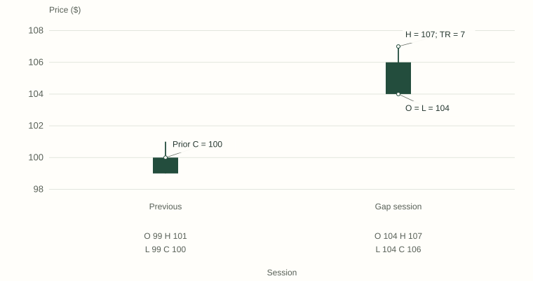

*Fictional previous O = 99/H = 101/L = 99/C = 100; current O = 104/H = 107/L = 104/C = 106. Current range is $3, opening gap $4, and previous close to high $7, which determines true range. Values match the table, example, and exercise.*

#### Scale the number without inventing a direction

Continue this session’s $7 true range. Preceding valid true ranges of $2, $2, $2 give a three-session ATR seed of $2. The update is (2 × 2 + 7)/3 = $3.6667. A downside session with high $96 and low $93 after the same $100 close also has max(3, 4, 7) = $7 true range. ATR expands by the same amount in either direction.

ATR is expressed in price units. Dividing it by a reference close and multiplying by 100 gives a percentage scale: $3 ATR at a $60 close is 5%. That normalization can improve comparisons, but it does not turn ATR into the standard deviation of returns or a probability interval. Specify the close used in the denominator. A sudden fall in price can increase the normalized value even if dollar ATR is unchanged.

#### Bands describe dispersion around a mean

Bollinger Bands conventionally place envelopes around a moving average at a chosen number of standard deviations of price. Fidelity describes a familiar setting of 20 periods and two standard deviations. In this chapter’s calculation, middle = N-period SMA; upper = middle + k × population standard deviation of those N closes; lower = middle − k × that standard deviation. The population denominator is N; a sample denominator of N − 1 produces different widths.

For fictional closes $98, $100, $102, the mean is $100 and population standard deviation is sqrt(8/3), approximately $1.633. Two-deviation bands are approximately $96.734 and $103.266. This tiny window teaches the arithmetic, rather than recommending a three-session setting. A trending collection of prices can widen the bands even if individual changes are orderly, because dispersion of price levels is different from dispersion of returns.

**Three-close population variance**

| Close ($) | Deviation ($) | Squared deviation ($²) |
| --- | --- | --- |
| 98 | -2 | 4 |
| 100 | 0 | 0 |
| 102 | 2 | 4 |
| Mean | 100 | Squares total 8 |
| Variance | 8/3 | 2.666667 |
| Standard deviation | sqrt(8/3) | 1.632993 |

#### Construct the bands, then read their width

The Bollinger figure begins with the worked closes $98, $100, $102, then adds $103, $104, $104, $103, $102, $101, $100, $101, $102. The short window makes each band reproducible by hand. Before session 3, there are too few closes, so all band lines are undefined. At 3, middle $100 and population SD $1.632993 give lower $96.7340 and upper $103.2660.

At session 6, the eligible closes are $103, $104, $104. The mean is $103.6667; squared deviations sum to 2/3, population variance is 2/9, and SD is $0.471405. Bands are approximately $102.7239–$104.6095. Price is higher while rolling dispersion is lower. Band narrowing does not describe a lower valuation of the business.

Relative bandwidth is (upper − lower)/middle × 100: about 6.532% at 3 and 1.819% at 6. It gives a comparable scale for this sample’s dispersion. The three-period window is for teaching arithmetic, while the familiar 20/2 setting describes a different, longer history. No setting becomes correct simply because the envelope looks tidy.

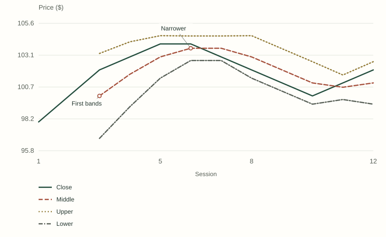

*Separate fictional dispersion sequence for a separate measurement: three-session SMA, population SD dividing by 3, multiplier 2. Undefined bands before session 3.*

#### Match the measure to the question

True range asks about today’s extremes and their distance from the prior close; ATR smooths those movement magnitudes. Band width asks about recent closing price levels around their mean. The gap candle and band sequence are deliberate contrasting examples because these are different quantities. A single line called volatility would conceal that distinction.

For a planning bridge, suppose an assumed distance equals two ATR units after the gap. It is 2 × $3.6667 = $7.3333. A hypothetical price-only $100 budget allows 13 whole shares: $95.3333 at that distance; 14 imply $102.6667. This is scaling arithmetic, not a recommendation for an ATR stop or a complete risk policy. The risk chapter adds execution and common exposures.

Diagnose a second statement: “Two-SD bands mean tomorrow is inside with 95% probability.” The drawing describes a rolling sample of price levels; no future distribution has been fitted. An appropriate analysis reports the mean, population denominator, multiplier, width, and current price position. If a probability is desired, that is a separate statistical question with additional assumptions.

The gap can also bypass a planned exit, as the events chapter demonstrates. Historical ranges provide context for the distance scale but do not set a maximum future move. This one execution limitation is enough here; the calculations and observed contrast are the primary lessons.

#### Worked example: From the candle to ATR

Current O = 104/H = 107/L = 104/C = 106 follows previous close $100. True range = max(107−104, |107−100|, |104−100|) = max(3, 7, 4) = $7. Prior three-session ATR $2 updates to (2 × 2+7)/3 = $3.6667. Close-to-close gain $6, or 6%, is a separate directional measure.

#### Exercise

Calculate the illustrated opening gap, intraday range, true range, and next three-session ATR from the prior $2 seed.

Reveal the worked solution

Opening gap = 104−100 = +$4 or 4%. High-low range = 107−104 = $3. Absolute distances to prior close are $7 and $4; true range is the largest, $7.

Next ATR = (2 × $2+$7)/3 = $11/3 = $3.6667. Its units are dollars, rather than the session’s +6% return.

#### guided practice: Reconstruct the first bands

For $98, $100, $102, find mean, population variance, SD, and two-SD bands. Compare the sample-denominator result.

Reveal the worked solution

Mean is $100. Deviations −2, 0, 2 square to 4, 0, 4. Population variance is 8/3 dollars squared; SD $1.632993; bands $96.7340–$103.2660.

Dividing by N−1 = 2 instead gives variance 4, SD $2, bands $96–$104. This is a different declared convention, not rounding.

#### independent practice: Match range while reversing direction

After prior close $100, use O = 96/H = 96/L = 93/C = 94. Find true range and updated ATR from $2, and compare direction with the illustrated candle.

Reveal the worked solution

High-low is $3; distances from prior close are $4 and $7. TR $7 and updated ATR $3.6667 match the main candle.

Close-to-close return is −6% instead of +6%. The identical range estimate does not identify direction.

#### Knowledge check

Which is true range for the main gap candle?

1. $3
2. $7
3. $6

Reveal the worked solution

Answer: 2. $7 is max($3, $7, $4), using both extremes relative to the prior close.

Option 1: $3 is only the intraday high-low span.

Option 2: $7 is max($3, $7, $4), using both extremes relative to the prior close.

Option 3: $6 is close minus prior close.

#### Sources

- [Fidelity · Average True Range](https://www.fidelity.com/learning-center/trading-investing/technical-analysis/technical-indicator-guide/atr) — True-range maximum and recursive ATR update.
- [Fidelity · Bollinger Bands](https://www.fidelity.com/learning-center/trading-investing/technical-analysis/technical-indicator-guide/bollinger-bands) — Moving-average envelopes, standard-deviation multiplier, and conventional 20/2 setting.
- [SEC / Investor.gov · Types of orders](https://www.investor.gov/introduction-investing/investing-basics/how-stock-markets-work/types-orders) — Market and limit orders, stop-to-market conversion, and execution-price uncertainty.

---

### Chapter 13: Volume tools: weight, participation, and memory

Use volume to change the question, without pretending it reveals every participant’s motive.

> Volume tools organize trading activity in different ways. Their outputs depend on price fields, aggregation, coverage, and anchors.

**Version 0.4 · AI editorial review recorded 2026-10-03 (claude-code-main).**

Review scope: Scoped chapter editorial acceptance: prose, material source claims, tasks, numerical reproduction and compact/wide figures; release QA and human learning are separate.

**Learning outcomes**

- Calculate cumulative transaction VWAP and distinguish it from bar approximation.
- Reproduce OBV additions including equal closes.
- Build a volume-by-price histogram from the same transaction tape.

Builds on: Volume: participation behind price; Anatomy of a stock chart; Moving averages.

#### More activity is not a complete explanation

Raw volume answers how many shares traded during a defined interval. A volume tool may compare that activity with a baseline, use it to weight prices, or accumulate it according to a sign rule. Those are distinct transformations. Before interpreting a line, say what it counts. Otherwise the same busy session can become a story about “institutional buying,” even though the dataset does not identify institutions or disclose their reasons.

Imagine a fictional stock trading 2 million shares after averaging 1 million over the preceding 20 completed sessions. Relative volume is 2.0 under that definition. Using the current session inside the baseline produces a different number. An unfinished morning should be compared with prior mornings at the same elapsed time, rather than full sessions. The question is whether participation differs from a fair comparison, not whether a tall bar looks impressive.

#### VWAP gives large trades greater arithmetic weight

Volume Weighted Average Price, or VWAP, divides the sum of price times share quantity by the sum of share quantity. With transaction-level data this is the actual volume-weighted transaction mean for the included trades. Chart indicators often use an approximation from bars. TradingView documents a common version using typical price (high + low + close)/3 times each bar’s volume, accumulated from a reset point.

The main toy tape has 12 fictional trades at the exact prices and quantities in the table. Its first is $10 for 100 shares, its second $12 for 300. The weighted mean after two is (10 × 100+12 × 300)/400 = $11.50, while their unweighted price mean is $11. Exact quantities at exact transaction prices make this a transaction VWAP. The high/low/close shortcut above is a bar approximation; do not silently treat every share as trading at a bar’s typical price.

**Exact tape and cumulative VWAP**

| Trade | Price ($) | Shares | Value ($) | Cumulative shares | VWAP ($) |
| --- | --- | --- | --- | --- | --- |
| 1 | 10 | 100 | 1000 | 100 | 10 |
| 2 | 12 | 300 | 3600 | 400 | 11.5 |
| 3 | 9 | 100 | 900 | 500 | 11 |
| 4 | 11 | 100 | 1100 | 600 | 11 |
| 5 | 13 | 200 | 2600 | 800 | 11.5 |
| 6 | 12 | 100 | 1200 | 900 | 11.555556 |
| 7 | 10 | 100 | 1000 | 1000 | 11.4 |
| 8 | 11 | 200 | 2200 | 1200 | 11.333333 |
| 9 | 14 | 100 | 1400 | 1300 | 11.538462 |
| 10 | 13 | 100 | 1300 | 1400 | 11.642857 |
| 11 | 12 | 200 | 2400 | 1600 | 11.6875 |
| 12 | 15 | 100 | 1500 | 1700 | 11.882353 |

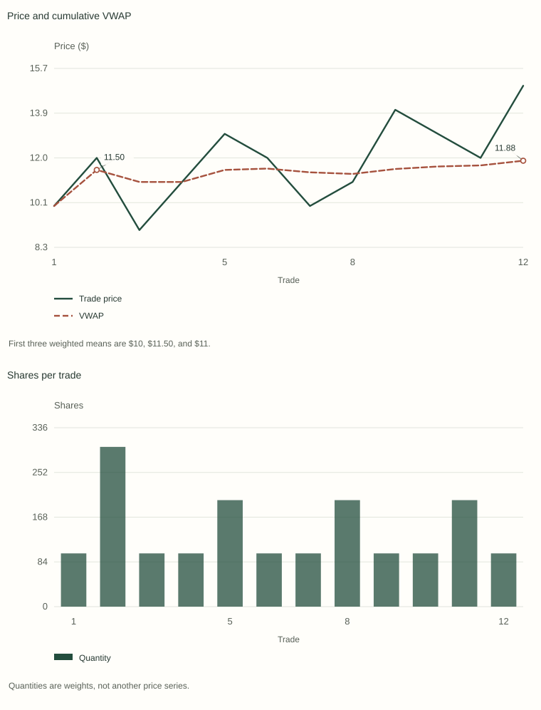

*All 12 fictional trades appear in the calculation table. VWAP accumulates from trade 1 without resetting; price and shares use separate axes.*

#### The anchor determines the question

A session VWAP starts again at a specified session boundary. An anchored VWAP starts at a selected observation, perhaps the beginning of a period or a documented event. Each asks about average transaction prices within a different included history. A price above a session VWAP and below a longer anchored VWAP is perfectly possible. The two lines are using different reference populations rather than contradicting arithmetic.

Record the anchor before evaluating later behavior. Selecting whichever historical anchor happens to fit the current price creates a large menu of chances to find apparent support. Also record whether extended-hours bars are included and whether the price source is typical price or something else. A weighted average is not an estimate of every current shareholder’s cost basis: shares can trade repeatedly, and holders can buy or sell outside the included interval.

#### OBV assigns a sign to an entire interval

On Balance Volume, or OBV, adds the interval’s volume when its close exceeds the previous close, subtracts volume when it is below, and changes nothing when closes match. Fidelity verifies this convention. Choose an arbitrary initial baseline such as zero and focus on changes, because changing that baseline simply shifts the entire line. This makes OBV a cumulative signed-volume description, rather than a dollar valuation.

For closes $20, $21, $20.50, $20.50, $22 and volumes 100, 200, 300, 400, 500, start OBV at zero at the first close. Subsequent values are 200, −100, −100, 400. All 300 shares of the second change receive a negative sign despite the small price decline, and all 400 shares during the unchanged close are ignored. These design choices are why OBV can tell a different story from the size of price changes.

**Daily OBV arithmetic companion**

| Session | Close ($) | Shares | Addition (shares) | OBV (shares) |
| --- | --- | --- | --- | --- |
| 1 | 20 | 100 | 0 | 0 |
| 2 | 21 | 200 | 200 | 200 |
| 3 | 20.5 | 300 | -300 | -100 |
| 4 | 20.5 | 400 | 0 | -100 |
| 5 | 22 | 500 | 500 | 400 |

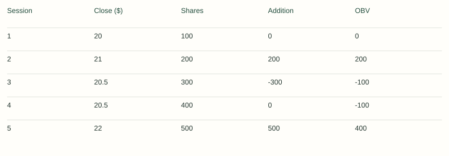

*The five-session companion deliberately isolates OBV’s daily close-sign rule. It starts at zero; equal closes add zero.*

#### Turn the tape sideways: volume by price

The profile groups the same 12 transactions by their exact dollar price. At $12, trades 2, 6, and 11 supply 300+100+200 = 600 shares. At $11, trades 4 and 8 supply 100+200 = 300. At $13, trades 5 and 10 supply 200+100 = 300. Read the histogram horizontally: bar length is shares; vertical position is price, rather than time.

The profile’s seven rows sum to 1,700 shares, matching the tape’s final quantity. The $12 row contains 600/1,700 ≈ 35.294% and is the largest row, commonly called the point of control. The final transaction is $15 for only 100 shares. Last price, the largest concentration, and VWAP are different summaries of this one tape. You can verify all three without assigning motives to participants.

Individual transaction prices make this toy profile exact for its included tape. Real chart profiles may allocate lower-timeframe bar volume by provider-specific methods. TradingView documents using lower-timeframe bars and up/down classifications rather than identified buyer/seller motives. A high-volume row describes past activity, not current resting orders. The latter belongs to market depth in the execution chapter.

Changing the bins changes the summary. If $11 and $12 were combined into one explicitly defined bin, it would contain 900 shares instead of the $12 row’s 600. That extra concentration comes from aggregation, not new trading. Always state price-bin boundaries and the included period before comparing profiles from different displays.

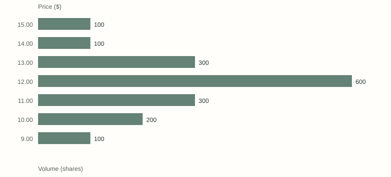

*From the same tape: $9 = 100, $10 = 200, $11 = 300, $12 = 600, $13 = 300, $14 = 100, $15 = 100 shares. Rows sum to 1,700; $12 is the point of control. Bar length represents past share volume, not an open order.*

#### Choose a summary by its question

The final tape has $20,200 of traded value across 1,700 shares, giving VWAP $11.882353. Last price is $15 and the largest historical row is $12. A clear observation is “the last trade is above the weighted mean; the largest included volume concentration was at $12.” It does not require a fair-value claim or a promise of a return to that row.

The separate daily OBV table isolates a different design choice: whole intervals receive a sign from the change in their close. Equal-close session 4 trades 400 shares but adds zero. Session 3 declines only $0.50 but subtracts all 300. OBV is consequently not a sum of observed seller-initiated quantities; it is a cumulative close-sign transformation.

Choose relative volume to compare participation with a relevant baseline, VWAP for a weighted average from a boundary, OBV for accumulation under the close-sign rule, and profile for activity across price rows. Once the tool answers the question, return to the price and session context. For the tape, volume-weighted averaging and price-bin aggregation can be checked exactly; live execution still depends on quantities offered when an order arrives.

#### Worked example: Reconcile the tape with its profile

Trade 3 adds $900 and 100 shares to prior value $4,600 and quantity 400, giving VWAP $5,500/500 = $11. After 12 trades, totals are $20,200 and 1,700, so VWAP is $11.882353. Aggregating the same tape by price leaves total quantity unchanged; the $12 row has 600 shares even though the last trade is $15.

#### Exercise

Calculate tape VWAP after trades 3 and 12. Aggregate shares traded at $12 and find their fraction of all 1,700 shares.

Reveal the worked solution

After three trades: (10 × 100+12 × 300+9 × 100)/(100+300+100) = $5,500/500 = $11. After 12, value is $20,200, quantity 1,700, mean $11.882353.

At $12, quantities 300, 100, and 200 sum to 600. Fraction = 600/1,700 = 35.2941%. The profile’s largest row is not necessarily the weighted mean.

#### guided practice: Finish the OBV companion

Starting from session-3 OBV −100, fill session 4 and 5. Explain the role of the 400 shares on the equal-close session.

Reveal the worked solution

Session 4 close equals the previous $20.50 close, so its addition is zero and OBV remains −100. Session 5 is higher, adds 500, and finishes 400.

The zero addition follows the formula; it does not mean no shares traded or that participant motives canceled.

#### independent practice: Three prices, three questions

A new fictional tape has trades of 100 shares at $20, 300 at $21, 200 at $20 and 50 at $23, in that order. Use exact-price bins. Calculate last price, point of control, VWAP and the fraction at the point of control. Diagnose “the weighted average is the longest profile row.”

Reveal the worked solution

Total shares = 650; dollar value = 2,000 + 6,300 + 4,000 + 1,150 = $13,450. VWAP = 13,450/650 = $20.6923077. Last price is $23.

The $20 bin has 300 shares and the $21 bin also has 300: the point of control is tied, rather than uniquely defined. Each accounts for 300/650 = 46.1538%. The two longest rows identify concentration, not a weighted mean; report the tie and the exact-price bin convention.

#### Knowledge check

After the first three trades, what is VWAP?

1. $11.00
2. $10.33
3. $11.50

Reveal the worked solution

Answer: 1. $5,500 divided by 500 shares is $11.

Option 1: $5,500 divided by 500 shares is $11.

Option 2: $10.33 is the unweighted mean of 10, 12, and 9.

Option 3: $11.50 is the two-trade value; the third trade has not been included.

#### Sources

- [TradingView · Volume Weighted Average Price](https://www.tradingview.com/support/solutions/43000502018-volume-weighted-average-price-vwap/) — Bar-based VWAP formula, price-source choice, and session/reset convention.
- [Fidelity · On Balance Volume](https://www.fidelity.com/learning-center/trading-investing/technical-analysis/technical-indicator-guide/obv) — Cumulative signed-volume formula, including unchanged-close treatment.
- [TradingView · Volume profile basic concepts](https://www.tradingview.com/support/solutions/43000502040-volume-profile-indicators-basic-concepts/) — Trading activity assigned to price levels and lower-timeframe aggregation; not evidence of guaranteed support.

---

### Chapter 14: Optional: Fibonacci retracement conventions

Calculate a chosen grid, then examine how the anchor choice changes it.

> Retracement levels are reproducible arithmetic once anchors are fixed; their predictive value does not follow from the mathematics.

**Optional extension.**

**Version 0.4 · AI editorial review recorded 2026-10-03 (claude-code-main).**

Review scope: Scoped chapter editorial acceptance: prose, material source claims, tasks, numerical reproduction and compact/wide figures; release QA and human learning are separate.

**Learning outcomes**

- Calculate retracement levels from fixed anchors.
- Distinguish a window boundary from a confirmed local swing.
- Compare anchor-dependent interpretations with a predeclared tolerance.

Builds on: Trends, swings & changing structure; Support, resistance & price areas; Moving averages.

#### Why a neat grid feels persuasive

This is an optional reference chapter. The core indicator path can proceed from volume tools to market context. The useful skill here is understanding an anchor-dependent percentage drawing, including why its visual precision does not settle the anchor-selection question.

A retracement tool divides a selected price move into proportional landmarks. Its appeal is immediate: an untidy chart gains a small collection of exact horizontal lines. Those lines can help organize a description of how much of a prior move has been given back. They also invite a stronger story, in which the market supposedly respects a special numerical order. Keep the descriptive calculation separate from that story.

Fidelity documents common retracement labels including 23.6%, 38.2%, 50%, and 61.8%. Their presence in a charting platform establishes a convention, not a law of financial behavior. A percentage can be calculated to many decimal places while the starting and ending points remain debatable. The apparent precision of the result should never obscure uncertainty about the inputs or the proposed interpretation.

#### The sequence explains some ratios, not a market mechanism

The Fibonacci sequence adds the previous two terms to obtain the next: 1, 1, 2, 3, 5, 8, 13, 21, and so on. Ratios of sufficiently large neighboring terms approach approximately 0.618 when the smaller is divided by the larger; skipping a term yields approximately 0.382. The related inverse is approximately 1.618. Those are mathematical relationships among sequence terms, not observations about the demand for a particular stock.

The familiar 50% retracement is a halfway convention, rather than a Fibonacci ratio. Including it can be perfectly useful as a description, but calling the entire grid Fibonacci does not change that fact. To move from ratios to an investment claim, one needs a specified behavioral or empirical argument. Invoking examples from nature does not demonstrate that a stock should reverse near a selected percentage of its earlier advance.

#### Make the calculation reproducible

Suppose a fictional stock rises from low L = $100 to high H = $120. A downward retracement fraction r corresponds to H − r × (H − L). The 38.2% level is 120 − 0.382 × 20 = $112.36; the 50% level is $110; the 61.8% level is $107.64. These prices follow from the two anchors and the formula. No assumption about future demand is needed to calculate them.

For a decline from $120 to $100, an upward retracement of the decline is L + r × (H − L). That gives $107.64 at 38.2%, $110 at 50%, and $112.36 at 61.8%. Some interfaces reverse their labels depending on drawing direction. Inspect a known example before interpreting the labels. Also state whether you use wick extremes or closes and whether the price axis represents arithmetic or logarithmic distances.

**Two declared windows, same $120 high**

| Retracement | A: $100→$120 ($) | B: $104→$120 ($) |
| --- | --- | --- |
| 0.382 | 112.36 | 113.888 |
| 0.5 | 110 | 112 |
| 0.618 | 107.64 | 110.112 |

#### Demonstrate the anchor choice before evaluating it

The main path starts at $100 in session 1, reaches $120 at 6, and closes $116 at 7. Use a one-neighbor local-high rule: $120 becomes a confirmed high only at the session-7 close, after the next observation is lower. Window A begins at the supplied session-1 boundary, $100. Window B deliberately uses a shortened displayed interval beginning at session 2, $104. These are declared window origins, not two independently confirmed local lows.

Because $104 follows $100 and precedes $108, it is not a local minimum in the full displayed path. Choosing it simply because its grid fits a later bounce would be an especially weak justification. A reader may use the full prior advance or a shorter observation window, but should name that choice before examining subsequent reactions. This example chooses both alternatives in advance to expose the effect.

A’s 61.8% line is 120−0.618 × 20 = $107.64. B’s is 120−0.618 × 16 = $110.112. The difference $2.472 is larger than the rounding shown on a chart. The figure displays both lines only from session 7 onward, when the selected high is confirmed. Extending them backward as though known at session 2 would hide a timing dependency.

**Complete anchor-and-reveal path**

| Session | Close ($) |
| --- | --- |
| 1 | 100 |
| 2 | 104 |
| 3 | 108 |
| 4 | 112 |
| 5 | 117 |
| 6 | 120 |
| 7 | 116 |
| 8 | 113 |
| 9 | 110 |
| 10 | 109 |
| 11 | 107 |
| 12 | 106 |
| 13 | 108 |
| 14 | 111 |

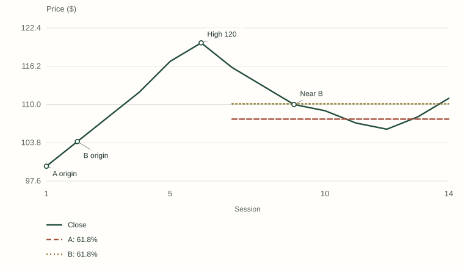

*Fictional prices match every main calculation. Origin A is session 1 $100; origin B is the shortened interval’s session 2 $104, not a confirmed swing low. High $120 at 6 is confirmed at 7, so both 61.8% lines first become available at 7.*

#### Follow a fixed reaction definition

For illustration, define “near” as a close no more than $0.25 from a level. Define a rebound as a close at least $2 above the touched level within the next two sessions. These are original teaching criteria chosen to make the classification inspectable. They are not estimated best settings. The test applies to each window’s drawn 61.8% line. At session 9, close $110 is $0.112 from B’s $110.112 line and $2.36 above A’s $107.64 line. It also sits exactly on A’s undrawn 50% midpoint, examined in the guided practice; that touch fails too, because neither later close reaches its $112 rebound threshold.

The next two closes are $109 and $107, neither at least $112.112. Therefore B’s near-touch at 9 fails the specified rebound condition. At session 11, $107 is $0.64 below A’s $107.64 line and does not qualify as a near-touch under the same tolerance. Session 12’s $106 and session 13’s $108 also do not qualify. We keep those classifications rather than widening the zone to collect a later rise.

A looser tolerance would classify more observations; a longer response window might call a later recovery successful. Both are legitimate alternative research definitions if fixed in advance, but they change the claim. Notice how easily a grid can appear predictive if anchor, tolerance, and response horizon are all adjustable after the fact. The worked classification teaches the reader what must remain fixed to assess such a claim.

#### Extensions and scope

An extension projects a stated multiple from a stated origin. Measuring the $20 span from A’s $100 origin puts 161.8% at $132.36; projecting 1.618 times that span from a later pullback point would produce another value. Quote both span and origin rather than an unexplained target. Extensions are optional reference arithmetic here, without a claim that these projected prices are likely.

The source establishes the familiar drawing convention. The formulas establish proportional levels once anchors exist. Neither establishes that this ratio family predicts stock reversals better than round-number or evenly spaced grids. The book’s evidence review handles that empirical question separately. In this chapter, the reader’s task is narrower and testable: reproduce the grid, identify which input choices alter it, and trace a fixed observation rule through a path.

#### Worked example: A near-touch that fails the declared follow-through

At session 9, $110 lies $0.112 from B’s $110.112 level, within the $0.25 tolerance. A $2 rebound above that level requires a close at least $112.112 by session 11. Actual closes are $109 and $107, so this opportunity fails the teaching condition. A visually selected later recovery cannot change that recorded result.

#### Exercise

Calculate the 61.8% levels for A and B. Apply the $0.25 near-touch and two-session $2 rebound definitions to session 9.

Reveal the worked solution

A = 120−0.618 × (120−100) = $107.64. B = 120−0.618 × (120−104) = $110.112. Session 9 $110 is $0.112 away from B, so it qualifies; it is $2.36 away from A, so it does not.

B’s rebound threshold is $112.112. Sessions 10 and 11 are $109 and $107, so no qualifying rebound occurs. Both anchor definitions existed before this classification.

#### guided practice: Complete the halfway rows

Find A’s and B’s 50% levels. Is session 9 within $0.25 of either?

Reveal the worked solution

A = 120−0.5 × 20 = $110. B = 120−0.5 × 16 = $112. Session 9 is exactly A’s midpoint and $2 below B’s, so only A qualifies.

A’s 50% and B’s 61.8% are close because the anchors differ. That overlap is not independent confirmation from two separate datasets.

#### independent practice: Diagnose a shifted window

A reader replaces origin $100 with $104 after seeing session 9’s $110 close, then claims the 61.8% grid forecast the touch. Explain the selection problem and give an acceptable alternative statement.

Reveal the worked solution

The $104 origin was selected using the later response it is supposed to predict. Its apparent fit is not a prospective test. In the full path, $104 is also a window boundary rather than a local low.

An acceptable statement is “the shorter $104–$120 window places a proportional level near $110; its usefulness should be assessed with an origin rule fixed before later prices.” Other predeclared windows are acceptable, but must be recorded consistently.

#### independent practice: Choose anchors on a fresh sequence

New fictional closes T1–T9 are $70, $73, $77, $76, $81, $79, $77, $78, $80. Cover T7–T9 and stop after T6. Use a strict one-neighbor swing rule. Select the latest confirmed high. Policy A uses the first window close as origin; policy B uses the most recent confirmed trough before that high. Name each anchor and its recognition time, and calculate both 61.8% retracement levels. Then reveal T7–T9. With near-touch tolerance $0.25 and a rebound of at least $2 above the selected level within the next two closes, classify T8 under each policy.

Reveal the worked solution

At T6, high $81 at T5 is confirmed by lower T4 = $76 and T6 = $79. The trough $76 at T4 was confirmed at T5 by higher T3 = $77 and T5 = $81. A uses window origin T1 = $70; B uses confirmed trough T4 = $76. Both policies can be fixed by the T6 cutoff.

A: 81 − 0.618 × (81 − 70) = $74.202. B: 81 − 0.618 × (81 − 76) = $77.91. T8 = $78 is $0.09 from B and $3.798 from A, so only B has a qualifying near-touch.

B’s rebound threshold is $79.91. T9 = $80 meets it at the next close; no T10 observation is needed to establish this occurrence. The rubric checks anchor availability, subtraction from the high, fixed tolerance and later recognition. This one constructed success does not estimate a hit rate.

#### Knowledge check

For origin $104 and high $120, what is the 61.8% downward retracement price?

1. $107.64
2. $113.888
3. $110.112

Reveal the worked solution

Answer: 3. $120−0.618 × $16 gives $110.112.

Option 1: $107.64 uses the other $100 origin.

Option 2: $113.888 is the 38.2% downward retracement; the fraction is reversed.

Option 3: $120−0.618 × $16 gives $110.112.

#### Sources

- [Fidelity · Fibonacci retracement](https://www.fidelity.com/learning-center/trading-investing/technical-analysis/technical-indicator-guide/fibonacci-retracement) — Common drawing convention and anchor-based percentage levels; not evidence of an economic law.

---

### Part 03 review: Indicator review: calculate, compare, explain

#### Read an unfamiliar price path

Use fictional closes 40, 42, 41, 43, 44, 46, 45, 44, 43, 42, 43, 44. Compute three-session SMA at sessions 10 and 11 and three-session ROC at 11. Under the chapter’s close-based crossover rule, classify session 11. Explain why its ROC sign need not match its SMA position.

Reveal the worked solution

At 10, SMA = (44+43+42)/3 = $43. At 11, SMA = (43+42+43)/3 = $42.6667. Session 10 close $42 is below its mean; session 11 close $43 exceeds its mean, so an up-cross is known after 11 closes.

Three-session ROC at 11 compares session 8 close $44: 100 × (43/44−1) = −2.2727%. Price can be above a recent mean while below a selected earlier close. These are different questions, not contradictory facts.

#### Match the tool to the evidence

For that close-only path, which of SMA, ROC, RSI, ATR, exact transaction VWAP, and exact volume-by-price profile can be computed from the supplied information? Then check the volume-tools chapter’s 12-trade tape by reconciling VWAP and profile totals.

Reveal the worked solution

SMA and ROC are computable with declared lookbacks. RSI is computable once gain/loss smoothing, seed, lookback, and flat-case convention are fixed. ATR needs highs/lows and previous closes, which are absent; transaction VWAP and exact profile need prices and quantities of included trades, which are absent from this close-only path.

For the separate supplied tape, quantity = 1,700 and value = $20,200; VWAP = $11.882353. Profile shares sum to the same 1,700; $12 holds 600. A closing price alone cannot supply those quantities.

#### Audit one indicator statement

Rewrite “A lower histogram means the stock fell and the high RSI proves an overvalued business.” Give a defensible observation and identify the missing evidence for each proposed conclusion.

Reveal the worked solution

A lower MACD histogram means MACD moved downward relative to its signal, under the declared calculation. Whether closing price fell must be checked in the price series.

A high RSI describes smoothed recent gains relative to losses, not business valuation. Valuation requires business and cash-flow assumptions beyond this indicator. A correct note states the actual reading and lookback before adding an interpretation.

## Part 04: See the bigger picture

Connect a stock to its sector, the broad market, and the trading session.

### Chapter 15: Relative strength: leading compared with what?

Separate winning the comparison from making money.

> Outperformance is a relative statement. A stock can lead its benchmark while both lose value.

**Version 0.4 · AI editorial review recorded 2026-10-11 (claude-code-alpha).**

Review scope: Scoped chapter editorial acceptance: prose, material source claims, tasks, numerical reproduction and compact/wide figures; release QA and human learning are separate.

**Learning outcomes**

- Rebase stock/comparator ratios and distinguish them from return differences.
- Describe absolute loss alongside relative leadership.
- Compare a stock with both sector and broad market under matched data conventions.

Builds on: Anatomy of a stock chart; Momentum: pace and persistence.

#### A comparison always needs a second object

Suppose your stock rises 5%. That sounds strong until you learn its sector rose 15%. Now suppose it falls 5% while the broad market falls 20%. The absolute result is negative, but the comparative result is stronger. Relative-strength analysis keeps these two questions separate: what happened to this stock, and what happened to it compared with an explicitly named alternative over the same interval?

Fidelity describes a relative-strength comparison as a ratio of one security’s price to another security’s or index’s price. If stock price is S and benchmark value is B, the ratio is S/B. An increase means the numerator performed better in proportional terms over the comparison. This relative-strength ratio is different from RSI, an oscillator based on a single instrument’s own gains and losses. Similar names do not imply identical calculations.

#### Rebase the comparison so its origin is visible

A raw ratio’s level depends on price units. A $50 stock divided by a 500-point benchmark starts at 0.1; replacing that benchmark with a proportional series in different units changes the number without changing its performance. Rebase the ratio to 100 at a stated start: relative index today = 100 × (S today / B today) / (S start / B start). Now the movement has a clear comparison point.

For fictional start values S = $100 and B = 100, and end values S = $90 and B = 80, the rebased ratio is 100 × (90/80) = 112.5. The stock declined 10%, yet the ratio rose 12.5%. Subtracting returns instead yields a 10-percentage-point advantage: −10% minus −20%. The ratio’s percentage change and the return difference are distinct quantities, so label whichever you use.

**Main comparison: all series rebased at 100**

| Session | Stock | Sector | Market | Stock/market × 100 | Stock/sector × 100 |
| --- | --- | --- | --- | --- | --- |
| 1 | 100 | 100 | 100 | 100 | 100 |
| 2 | 99 | 99 | 98 | 101.0204 | 100 |
| 3 | 101 | 100 | 99 | 102.0202 | 101 |
| 4 | 98 | 97 | 95 | 103.1579 | 101.0309 |
| 5 | 97 | 95 | 92 | 105.4348 | 102.1053 |
| 6 | 96 | 93 | 90 | 106.6667 | 103.2258 |
| 7 | 94 | 90 | 87 | 108.046 | 104.4444 |
| 8 | 95 | 92 | 89 | 106.7416 | 103.2609 |
| 9 | 93 | 89 | 85 | 109.4118 | 104.4944 |
| 10 | 92 | 88 | 84 | 109.5238 | 104.5455 |
| 11 | 91 | 87 | 82 | 110.9756 | 104.5977 |
| 12 | 90 | 85 | 80 | 112.5 | 105.8824 |

#### Choose a benchmark that answers your question

A broad market benchmark asks how the stock performed against a diversified market reference. A sector benchmark asks how it performed against a closer industry-related alternative. A peer asks a narrower comparison, but differences in size, geography, leverage, and business mix can still matter. None is universally correct. Write the question first and select the comparator deliberately rather than choosing whichever makes the stock appear strongest.

Imagine a manufacturer gains 8%, its sector gains 12%, and the broad market gains 4%. It outperformed the broad market while underperforming its sector. That pattern may motivate research into common industry conditions and company-specific differences, but the ratios alone establish neither cause. If the benchmark itself contains the stock at a large weight, the comparison also partly reflects the stock in the denominator. Recognize that overlap before interpreting the relationship.

#### Use consistent dates, distributions, and units

Two histories must refer to comparable observations. Comparing a stock’s latest close with a stale benchmark quote can create spurious movement. Missing sessions, different trading hours, currency changes, and corporate actions also require care. A raw two-for-one split halves the quoted share price while doubling the shares held; an unadjusted ratio could falsely appear to collapse. Investor.gov’s split definition explains why this is a change in units rather than an equivalent overnight ownership loss.

A price comparison excludes distributed cash unless the history is adjusted for that purpose. A total-return comparison incorporates distributions under its stated reinvestment convention. Comparing a stock’s price return with a benchmark’s total return mixes two different measures. Use matched conventions and document the provider’s adjustment policy. For this book’s fictional illustrations, there are no distributions, currency changes, or splits, so the arithmetic remains directly visible.

#### Follow the comparison chronologically

At session 1 all three main series are 100, so each relative index begins at 100. At session 3 the stock is 101, sector 100, and market 99. It is up 1% absolutely, ahead of sector by one percentage point and market by two. Its stock/market index is 101/99 × 100 ≈ 102.0202. The calculation uses percentage relationships; it is not a difference in quoted price units.

At session 6, stock 96 is down 4%, sector 93 down 7%, and market 90 down 10%. The stock now loses money over the interval while outperforming both references. Its relative indices are 96/93 × 100 ≈ 103.2258 against sector and 96/90 × 100 ≈ 106.6667 against market. The bottom panel rises while the top panel falls. Read both before using the word strength.

At session 12, stock 90, sector 85, and market 80 give relative indices 105.8824 and 112.5. The stock’s absolute −10% accompanies a five-percentage-point advantage over sector and ten-point advantage over market. The higher market-relative figure reflects the market’s greater weakness (80 versus the sector’s 85), not a different stock result; the stock itself did not earn +12.5%.

A precise note now says “stock declined less than both comparators in this window; its relative strength versus market exceeded that versus sector.” Sector leadership and market leadership can differ in other windows. Changing the comparator is appropriate when changing the research question, but not to rescue an unfavorable comparison after its outcome is known.

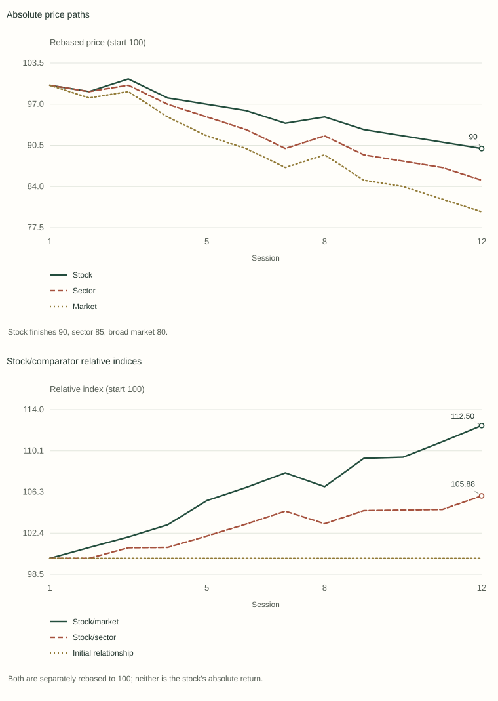

*The same 12 fictional observations underlie table, prose, example, and exercise. No distributions, splits, currency changes, or mismatched sessions. All initial values are rebased to 100.*

#### Use the comparison to organize research

Return to the manufacturer from the benchmark section: stock +8%, sector +12%, market +4%. Stock/market relative index is 108/104 × 100 = 103.8462, while stock/sector is 108/112 × 100 = 96.4286. Absolute gain and market outperformance coexist with sector underperformance. This is why a “strong stock” label should identify the benchmark and period.

An investor could use these observations to decide where further business or chart research is useful. In the main dataset, ask whether relative resilience is consistent across shorter windows or concentrated around a few dates. In the contrast, ask why the sector was stronger than this company. The ratios identify the comparison; they do not by themselves establish causes or replace valuation and diversification.

For a method selecting leaders, eligibility, horizon, ranking, and rebalance rules still require explicit specification. That is a later system-design task. The beginner task here is to calculate matched comparisons and write a coherent note. Record distributions, currency, adjustment policy, and timestamps before moving from these synthetic price-only examples to a real data provider.

A quick quality check is to work backward: divide the stock growth factor by the benchmark growth factor. Main end factors are 0.90/0.80 = 1.125 and 0.90/0.85 = 1.058824. A purported relative result inconsistent with those ratios has probably mixed percentages, denominators, dates, or adjustment conventions.

#### A price ratio is not a momentum portfolio

The relative index above describes one matched price comparison. Jegadeesh and Titman instead rank a stock universe, form winner-minus-loser portfolios and specify formation and holding periods; in their 1965–1989 NYSE/AMEX sample those portfolios earned positive returns. That portfolio evidence does not validate buying this example’s leader. The research appendix keeps its market, comparator and cost assumptions visible.

#### Worked example: Three end values, four distinct results

Stock 100→90 loses 10%; sector 100→85 loses 15%; market 100→80 loses 20%. Stock’s return advantage is 5 percentage points versus sector and 10 versus market. Relative-index gains are 90/85−1 = 5.8824% and 90/80−1 = 12.5%. Return differences and ratio changes use different denominators; neither transforms the stock’s loss into a gain.

#### Exercise

From the main final values, calculate absolute returns, stock/market and stock/sector relative indices, and stock’s return differences against both comparators.

Reveal the worked solution

Absolute returns are 90/100−1 = −10%, 85/100−1 = −15%, and 80/100−1 = −20%. Relative indices are 100 × 0.90/0.80 = 112.5 and 100 × 0.90/0.85 = 105.8824.

Stock advantages are −10−(−20) = 10 percentage points and −10−(−15) = 5 points. Ratio gains are 12.5% and 5.8824%, not those percentage-point differences.

#### guided practice: Complete the session-6 note

Use stock 96, sector 93, market 90 at session 6. Calculate both relative indices and write one sentence containing the absolute result.

Reveal the worked solution

Stock/market = 100 × 96/90 = 106.6667; stock/sector = 100 × 96/93 = 103.2258. All initial values are 100.

Example note: “Stock is down 4% from the common start, but has outperformed sector and market in proportional terms, with relative indices 103.2258 and 106.6667.” Equivalent clear wording is acceptable.

#### independent practice: An absolute gain with relative weakness

A separate stock rises $40→$44 while its benchmark rises 200→240. Calculate the rebased relative index and return difference.

Reveal the worked solution

Stock factor 44/40 = 1.10; benchmark factor 240/200 = 1.20. Relative index = 100 × 1.10/1.20 = 91.6667. Relative-index change is −8.3333%.

Absolute stock gain is +10%; comparator gain +20%; return difference −10 percentage points. The stock gained value while losing relative ground.

#### Knowledge check

In the main final observation, which is the stock’s absolute return?

1. +10 percentage points
2. −10%
3. +12.5%

Reveal the worked solution

Answer: 2. 90/100−1 is −10%; this is the holder’s price-only return.

Option 1: Ten percentage points is its advantage over the falling market, not its own return.

Option 2: 90/100−1 is −10%; this is the holder’s price-only return.

Option 3: 12.5% is the market-relative ratio increase, using the market’s growth factor in the denominator.

#### Sources

- [Fidelity · Relative Strength Comparison](https://www.fidelity.com/learning-center/trading-investing/technical-analysis/technical-indicator-guide/relative-strength-comparison) — Price ratio definition and interpretation of relative performance.
- [SEC / Investor.gov · Stock split](https://www.investor.gov/introduction-investing/investing-basics/glossary/stock-split) — Split mechanics: a two-for-one split doubles share count and halves price per share without diluting ownership (100 shares at $100 become 200 at $50). Comparability of price histories across a split is the book’s inference.
- [Jegadeesh & Titman (1993), Returns to Buying Winners and Selling Losers](https://www.bauer.uh.edu/rsusmel/phd/jegadeesh-titman93.pdf) — Cross-sectional U.S. stock momentum, sample/rule/cost conventions; not validation of a particular chart setup.

---

### Chapter 16: Market breadth: how many are participating?

An index can look healthy while its members tell a more varied story.

> Breadth summarizes participation across a defined universe. The universe and counting rule are as important as the indicator.

**Version 0.4 · AI editorial review recorded 2026-10-11 (claude-code-alpha).**

Review scope: Scoped chapter editorial acceptance: prose, material source claims, tasks, numerical reproduction and compact/wide figures; release QA and human learning are separate.

**Learning outcomes**

- Derive an index move and breadth count from the same constituents.
- Accumulate advancing-minus-declining counts.
- Compute breadth fractions with explicit unchanged/missing denominators.

Builds on: Relative strength: leading compared with what?; Moving averages.

#### One aggregate, four very different experiences

The main dataset has four fictional constituents beginning at 100. A carries 60% of initial index weight, B 20%, and C/D 10% each. At the final observation A is 110, B 98, C 97, D 95. The index is positive even though three of four constituents have lost value since the start. Rather than asking which summary is correct, reproduce the weighting and count separately.

Use a fixed-initial-weight teaching index with no constituent changes, distributions, or intervening rebalance: index level is the sum of each initial weight times its rebased price. This is a transparent toy aggregation, not a reconstruction of a named exchange index. A’s gain contributes +6 percentage points; B/C/D contribute −0.4, −0.3, −0.5. The net is +4.8 points, taking 100 to 104.8.

**Final constituent states versus the common start**

| Constituent | Start | Finish | Initial weight (%) | Return (%) | Contribution (percentage points) |
| --- | --- | --- | --- | --- | --- |
| A | 100 | 110 | 60 | 10 | 6 |
| B | 100 | 98 | 20 | -2 | -0.4 |
| C | 100 | 97 | 10 | -3 | -0.3 |
| D | 100 | 95 | 10 | -5 | -0.5 |
| Total | 100 | 104.8 | 100 | Index +4.8 | 4.8 |

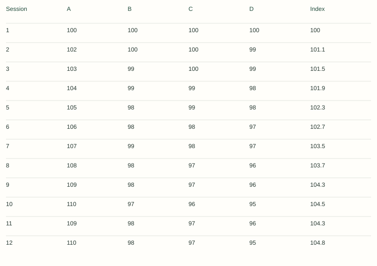

*Constituent levels are the exact data used for index and daily counts.*

#### The advance–decline line accumulates net participation

Let adv be the count of advancing issues and dec the count of declining issues. Net advances equal adv − dec. An advance–decline line adds that daily net count to the preceding cumulative value. Fidelity’s glossary describes this cumulative concept. Choose a baseline such as zero at a documented start. The absolute cumulative level then depends on that start; changes and shape are the meaningful objects of comparison.

In a fictional 100-stock universe, day one has 60 advances, 30 declines, and 10 unchanged: net +30 and cumulative +30. Day two has 35 advances, 55 declines, and 10 unchanged: net −20 and cumulative +10. Day three has 45 advances, 45 declines, and 10 unchanged: net zero and cumulative still +10. A day with equal advances and declines does not imply unchanged prices for every member or an unchanged weighted index.

The final constituent table compares each stock with the common starting point. A daily A/D count uses the immediately preceding observation instead. At session 12, A rises 109→110, B and C are unchanged at 98 and 97, and D falls 96→95: advances = 1, declines = 1, unchanged = 2, daily net zero. Do not substitute the since-start count of one winner and three losers into the daily line.

**Daily direction counts from the four price paths**

| Session | Advances | Declines | Unchanged | Daily net | Cumulative A/D |
| --- | --- | --- | --- | --- | --- |
| 1 | 0 | 0 | 4 | 0 | 0 |
| 2 | 1 | 1 | 2 | 0 | 0 |
| 3 | 1 | 1 | 2 | 0 | 0 |
| 4 | 1 | 2 | 1 | -1 | -1 |
| 5 | 1 | 1 | 2 | 0 | -1 |
| 6 | 1 | 2 | 1 | -1 | -2 |
| 7 | 2 | 0 | 2 | 2 | 0 |
| 8 | 1 | 3 | 0 | -2 | -2 |
| 9 | 1 | 0 | 3 | 1 | -1 |
| 10 | 1 | 3 | 0 | -2 | -3 |
| 11 | 3 | 1 | 0 | 2 | -1 |
| 12 | 1 | 1 | 2 | 0 | -1 |

#### Different breadth measures encode different questions

An advance/decline ratio is adv/dec when dec is nonzero. An advancing fraction might be adv/(adv + dec), excluding unchanged issues, or adv/U, where U is all eligible issues. Those fractions differ when some issues are unchanged. On day one of the 100-stock example, 60/90 ≈ 66.67% of movers advanced, while 60/100 = 60% of the full universe advanced. Never discuss a threshold without naming its denominator and edge-case treatment.

Another measure counts stocks above a chosen moving average: 100 × eligible stocks above their average / eligible stocks with sufficient history. Equality, missing history, and the lookback must be specified. New-high and new-low counts require a lookback and a definition, such as intraday extreme versus closing extreme. Each measure condenses the market in a different way; agreement is more informative when you understand exactly which classifications are agreeing.

#### The universe is part of the measurement

Exchange-wide issues are not automatically the same population as common stocks in an equity index. A dataset may include funds, preferred shares, or other instruments. Membership changes, new listings, delistings, and securities without adequate lookback history can change the denominator. A rising above-average percentage may reflect improved prices or removal of weak members. A well-kept analysis records how eligibility changes over time.

The historical universe should be the one available at the historical date. Using only today’s constituents can erase unsuccessful former members and create an attractive account of the past. Exchange-level breadth can also react to concentrations in certain types of listings, while a specific index reflects its own weighting and eligibility. Compare like with like when using an index and a participation series to support a conclusion.

#### Trace the weighted aggregate and the counts

At session 2, A rises from 100 to 102 while D falls to 99 and B/C stay at 100. Index = 0.6 × 102+0.2 × 100+0.1 × 100+0.1 × 99 = 101.1. There is one advance, one decline, and two unchanged, so daily net zero. A and D receive equal votes in breadth although their initial index weights differ sixfold.

By session 10, A reaches 110 while B/C/D are 97/96/95. The index is 66+19.4+9.6+9.5 = 104.5. That session has one advance and three declines, daily net −2. At session 11 the direction count flips: A declines while B/C/D advance, daily net +2, but the index falls to 104.3 because the heavier constituent’s loss outweighs the smaller gains.

These are not just unequal gains paired with a vague story about narrowness. Every stock path is supplied, each count is derived, and both plotted summaries can be reconstructed. A positive index and weak participation invite inspection of concentration, while a negative index with more advancers invites inspection of the largest weights. The underlying table resolves the apparent contradiction.

Equal weighting would give a different final aggregation: (110+98+97+95)/4 = 100. Its zero change does not mean every stock was flat. This further contrast teaches why “the market” needs a named universe and aggregation convention, even before any indicator is added.

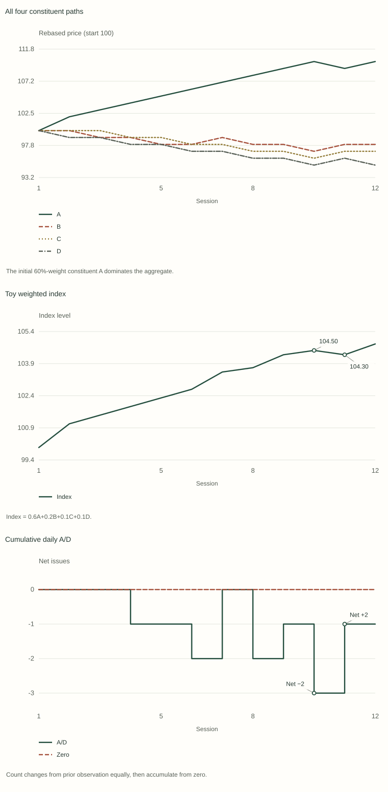

*Four fictional price paths, fixed initial weights 60/20/10/10%, no rebalances or distributions. Session 1 compares with four preceding 100 values. Daily breadth compares consecutive closes; the final weight table separately compares with the common start.*

#### Write a breadth note with a fair denominator

At session 12, one advance, one decline, and two unchanged give advancing fraction among movers 1/(1+1) = 50%, but advancing fraction among all eligible constituents 1/4 = 25%. The daily net is zero. The since-start count instead has one gainer out of four, with net −2. All are valid measurements, but each must name its comparison period and denominator.

For the core exercise, write the counts alongside the index contribution rather than calling the index healthy or weak without evidence. A defensible final note is “the fixed-weight toy index gained 4.8% from its start, led by the 60%-weight constituent; only one of four stocks gained over that interval.” It says precisely what the data establish.

For real datasets, first inspect whether the population includes common stocks, funds, or other issues, and how new listings, delistings, unchanged prices, and insufficient histories affect the denominator. The above-average metric introduced earlier requires sufficient history for the chosen window. Those eligibility questions should precede any numerical threshold. This edition reports no study testing whether a breadth divergence — an index rising while participation narrows, or the reverse — predicts later index returns. Do not infer a forecast from this accounting example.

#### Worked example: A positive index with three since-start decliners

Final weighted index = 0.60 × 110+0.20 × 98+0.10 × 97+0.10 × 95 = 104.8, a +4.8% move from 100. Only A rose from the initial 100, so since-start breadth is one advance and three declines, net −2. Daily session-12 net is instead zero because A rose, B/C were unchanged, and D fell from session 11. The same data answer two different period questions.

#### Exercise

Recalculate final index 104.8 and the since-start advance/decline count. Then compute session-12 daily net and advancing fractions among movers and all eligible stocks.

Reveal the worked solution

Weighted final level is 66+19.6+9.7+9.5 = 104.8. Since start: A rises, B/C/D fall, so advances = 1, declines = 3, net −2.

From session 11 to 12, A rises, D falls, B/C are unchanged: advances = 1, declines = 1, unchanged = 2. Daily net is zero. Among movers 1/2 = 50% advanced; among all constituents 1/4 = 25%.

#### guided practice: Reconstruct session 2

Use A = 102, B = 100, C = 100, D = 99. Calculate weighted index, daily net, and unchanged count from initial 100s.

Reveal the worked solution

Index is 61.2+20+10+9.9 = 101.1. A advances, D declines, B/C unchanged; net 1−1 = 0, unchanged = 2.

The larger weight on A explains the positive aggregate; breadth gives equal directional votes.

#### independent practice: Three advancers while the index falls

A fresh fictional five-stock index fixes the table’s initial weights at session 0, with no rebalance, distributions or membership changes. All rebased price levels are 100 at session 0. Calculate the session-1 weighted index and its change from 100; advances, declines and unchanged counts; advancing fractions among movers and among all five stocks. Then calculate each eligible three-session SMA through session 1 and the percentage strictly above it, excluding insufficient history and treating equality as not above. Explain why dividing by five is wrong for that last measure, and write a note separating weighted performance from participation.

**Fresh breadth inputs: fixed weights and three sessions**

| Stock | Initial weight (%) | Session −1 level | Session 0 level | Session 1 level |
| --- | --- | --- | --- | --- |
| A | 55 | 98 | 100 | 96 |
| B | 20 | 103 | 100 | 103 |
| C | 10 | 104 | 100 | 102 |
| D | 10 | 102 | 100 | 101 |
| E | 5 | Missing | 100 | 100 |

Reveal the worked solution

Index = 0.55 × 96 + 0.20 × 103 + 0.10 × 102 + 0.10 × 101 + 0.05 × 100 = 52.80 + 20.60 + 10.20 + 10.10 + 5.00 = 98.70. Change is −1.30 points, or −1.30% from 100. A contributes −2.20 points; B/C/D contribute +0.60/+0.20/+0.10, and E contributes zero.

Compared with session 0, B/C/D advance, A declines and E is unchanged: advances 3, declines 1, unchanged 1; net advances +2. Advancing fraction among movers is 3/(3 + 1) = 75%; among all five is 3/5 = 60%. These daily counts use session 0, not session −1.

Three-session SMAs use sessions −1, 0 and 1: A (98 + 100 + 96)/3 = 98; B (103 + 100 + 103)/3 = 102; C (104 + 100 + 102)/3 = 102; D (102 + 100 + 101)/3 = 101. A is below, B above, C/D equal. E has only two observations, so its three-session SMA is undefined. One of four eligible stocks is strictly above its SMA: 25%, rather than 1/5 = 20%. Including E would silently classify unavailable information as not above.

Example note: “From session 0 to session 1, the fixed-initial-weight index fell 1.30% despite three advancers, one decliner and one unchanged stock, because A’s 55% weight dominated the aggregate. Separately, at the session-1 close one of four stocks with a complete three-session history (sessions −1 to 1) was strictly above its mean; E was excluded for insufficient history.” Equivalent wording earns credit if it names both comparison periods, the weighting, equality policy and eligibility denominator. Neither count establishes future direction.

#### Knowledge check

At session 12, what fraction of daily movers advanced?

1. 25%
2. 50%
3. 75%

Reveal the worked solution

Answer: 2. One advance among two moving constituents gives 50%.

Option 1: 25% uses all four eligible constituents, including two unchanged, in the denominator.

Option 2: One advance among two moving constituents gives 50%.

Option 3: 75% is session 11’s figure (three advances, one decline). At session 12 only A advanced, and only two constituents moved.

#### Sources

- [Fidelity · Glossary: Advance/Decline line](https://www.fidelity.com/webcontent/ap002390-mlo-content/18.04/help/help_definition_a.shtml) — Cumulative advancing-minus-declining issue counts.

---

### Chapter 17: Multiple timeframes: one market, several summaries

Give each chart a job and respect when its information exists.

> Different timeframes aggregate the same underlying activity. Use them for distinct questions and keep incomplete bars visibly provisional.

**Version 0.4 · AI editorial review recorded 2026-10-11 (claude-code-alpha).**

Review scope: Scoped chapter editorial acceptance: prose, material source claims, tasks, numerical reproduction and compact/wide figures; release QA and human learning are separate.

**Learning outcomes**

- Aggregate daily closes into weekly closes under disclosed boundaries.
- Track the last completed weekly value as a step series.
- Resolve an apparent daily/weekly conflict using a stated analytical role.

Builds on: Timeframes, sessions & chart scales; Trends, swings & changing structure; Moving averages.

#### Different views need not disagree

A stock can rise across several months, pull back for three days, and rebound over the last hour. A monthly observer, daily observer, and intraday observer may all describe different directions correctly. Trouble begins when one sentence calls the stock bullish without stating the horizon or when the analyst selects whichever chart supports a preferred position. Multiple-timeframe work should make the intended duration clearer rather than provide more opportunities to rationalize a trade.

Think of the higher timeframe as a broad summary and the lower timeframe as greater detail within that summary. Their relationship is aggregation, not a hierarchy of truth. A daily candle can hide several sharp intraday reversals. An intraday reversal may barely affect the weekly close. Decide which behavior matters to your question before moving between charts. A tool chosen for minute-scale decisions should not quietly become the justification for a month-scale holding period.

#### Aggregate consistently, then accept lost information

A weekly OHLC bar uses the first eligible open, highest eligible high, lowest eligible low, and last eligible close within its defined week. Its volume sums eligible interval volume. This construction requires matching session boundaries and adjustment rules. Aggregation discards the order of intermediate observations. Identical weekly candles can arise from very different daily sequences, so the larger bar cannot recover the path that it omitted.

The main 15 daily closes are $100, $102, $101, $104, $105; $106, $107, $105, $104, $103; $104, $106, $108, $107, $110. Group these into three explicitly defined five-session weeks. Their closes are $105, $103, and $110. The prior two completed weekly closes, before the display, are $98 and $99. Daily closes alone do not reveal weekly high or low; intraday extremes are absent.

**What exists after each daily close**

| Session | Daily close ($) | Last completed weekly close ($) | Weekly close-direction state |
| --- | --- | --- | --- |
| 1 | 100 | 99 | Up |
| 2 | 102 | 99 | Up |
| 3 | 101 | 99 | Up |
| 4 | 104 | 99 | Up |
| 5 | 105 | 105 | Up |
| 6 | 106 | 105 | Up |
| 7 | 107 | 105 | Up |
| 8 | 105 | 105 | Up |
| 9 | 104 | 105 | Up |
| 10 | 103 | 103 | Down |
| 11 | 104 | 103 | Down |
| 12 | 106 | 103 | Down |
| 13 | 108 | 103 | Down |
| 14 | 107 | 103 | Down |
| 15 | 110 | 110 | Up |

#### Give the weekly and daily views separate jobs

For this demonstration, weekly context is up if the latest completed weekly close exceeds the preceding completed weekly close, otherwise down-or-equal. This is a close-direction teaching classification, not a full higher-high/higher-low trend definition. Daily change describes today’s close compared with yesterday. We then label an upward daily change aligned when completed-week context is up and conflicting when it is down-or-equal. The label compares directions over different intervals; it does not mean either description is wrong, and the developing week is never used to assign it. No order rule is implied.

Before session 5, the known weekly pair is $98→$99, so context is up. After 5, it is $99→$105, still up. During sessions 8 and 9 the daily price falls from $107 to $105 to $104, while last completed weekly close remains $105. This is a daily retreat inside the still-up completed weekly context. The directions differ, but the descriptions do not contradict each other: they cover different intervals. Because the labels apply only to upward daily changes, sessions 8 and 9 receive neither label.

At session 10 the week actually finishes at $103, below prior $105. Context changes to down at that close. Session 11 rises $103→$104, an upward daily change against down completed-week context. The analyst should record a conflict rather than quietly treating the current developing week as already complete. At session 15, the $110 completion changes weekly context back to up.

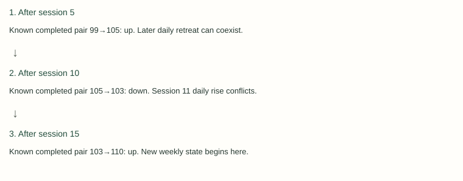

*Each state is sampled after the named daily close, the convention used throughout the chapter.*

#### An unfinished higher-timeframe bar is provisional

On Wednesday, this week’s closing price has not yet been established. A weekly RSI, average, or crossover based on the developing close can change by Friday. TradingView’s documentation explains why higher-timeframe requests can repaint as unconfirmed values evolve and why confirmation changes availability. The ordinary updating of a live bar is not inherently improper; presenting its final historical value as known earlier is the problem.

In this same second week, Tuesday session 7 closes $107; Wednesday session 8 closes $105; Friday session 10 closes $103. At Wednesday’s close the current developing weekly close is $105, but the eventual $103 finish is unknown. The last completed weekly close is also $105, from the preceding week, but it is a different observation with a different timestamp. Matching numerical values do not make a developing and completed bar equivalent.

#### Follow the clock rather than interpolate

The confirmed series is $99 after sessions 1–4, $105 after 5–9, $103 after 10–14, and $110 after 15. It holds each established value constant and jumps only at the completion timestamp. The illustration uses a step line: a slope between sessions 4 and 5 would falsely suggest gradual availability of the next final value. Observations are sampled after the daily close; just before the session-5 close, $99 is still the latest confirmed value.

A developing weekly close can be shown separately if it is labeled provisional. In this simplified close-only example, that developing value equals each latest daily close during the week. It changes with the daily line, not the confirmed step series. A reader examining session 9 must not replace it with the session-10 final close.

To check a multi-timeframe note, ask for three fields: decision timestamp, most recent completed higher-timeframe observation, and current lower-timeframe observation. At session 11 they are “after close 11,” “completed week 2 close $103 versus prior $105,” and “daily close $104 versus $103.” That record preserves the labelled conflict without requiring a trade to resolve it.

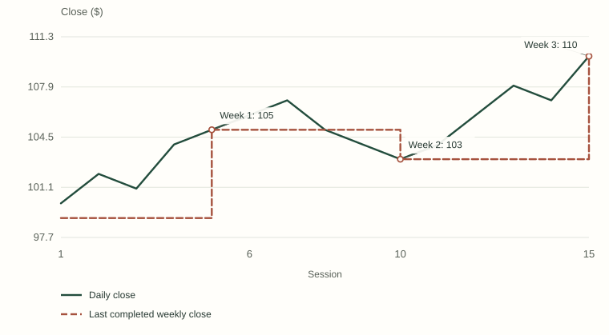

*The 15 fictional sessions form three five-session weeks. Values are sampled after each daily close. Confirmed weekly close changes only at sessions 5, 10 and 15, to $105, $103 and $110; prior completed closes are $98 and $99. In this close-only example the developing weekly close is the daily line itself. Daily closes do not supply weekly highs/lows.*

#### Work through an aligned and a conflicting case

After session 6 closes, daily price rises $105→$106 and completed weekly pair $99→$105 is up: the observations align under the stated close-direction classifications. After session 11 closes, daily price rises $103→$104 while completed weekly pair $105→$103 is down: they conflict. Both statements can be reconstructed from the table without selecting a new interval after the fact.

Suppose a predeclared research filter requires up completed-week context before examining an upward daily change. Session 6 would be eligible and session 11 would not. That is the consequence of this particular filter, not proof that the filtered observation is better. If instead the project studies countertrend daily recoveries, session 11 is relevant precisely because of the conflict. The research question decides the role.

The next chapters add event and execution context; the testing chapter shows how timestamp mistakes contaminate results. For now, the essential achievement is a coherent observation record. Larger intervals summarize overlapping underlying activity, so agreement is informative about scale but not several independent votes. Keep a small set of views tied to the intended question and use the table to settle what was actually known.

#### Worked example: A conflict that the timestamps explain

At close 11, daily price is $104, above session 10’s $103. The most recent completed weekly pair is $105→$103, so weekly close-direction context is down. A weekly-up eligibility filter excludes this daily rise; a countertrend study could include it. The developing third week has not yet supplied its final $110 close, which arrives only after session 15.

#### Exercise

From the synchronized table, give the latest completed weekly close after sessions 4, 5, 9, 10, 14, and 15. Classify the session-11 daily/weekly relationship.

Reveal the worked solution

After 4: $99; 5: $105; 9: $105; 10: $103; 14: $103; 15: $110. The step changes only at the three completion points.

At 11 the daily close rises 103→104, while completed weekly close fell 105→103. Under the stated close-direction definition they conflict. The developing week’s eventual $110 cannot be used at 11.

#### guided practice: Fill the session-8 record

After session 8 closes, identify current daily close, prior daily close, latest completed weekly pair, and whether the daily retreat contradicts that weekly state.

Reveal the worked solution

Current daily close $105 follows $107, so daily change is −$2. Completed weekly pair remains $99→$105, so weekly context is up.

They describe a daily retreat within completed up-week context. The developing week’s current close $105 is numerically equal to prior completed close, but belongs to a different interval.

#### independent practice: Spot future information

A fresh fictional series defines five-session weeks. Prior completed weekly closes are $48 and $50. Sessions 1–5 close $51, $49, $52, $53, $54; sessions 6–10 close $55, $56, $53, $52, $51. At session 8 close, give the current daily change, latest completed weekly pair and developing weekly close. When does the second displayed week’s $51 close become available, and why are sessions 6–9 not assigned it?

Reveal the worked solution

At session 8, the daily move is 53 − 56 = −$3. Completed weekly pair is $50→$54, an up comparison. The developing week currently ends at $53; it is not a completed weekly observation.

The completed $51 weekly close becomes known only after session 10. At sessions 6–9 the latest completed weekly close stays $54. The fresh path contains a daily retreat within completed up-week context; assigning $51 early would borrow future information.

#### Knowledge check

After session 9 closes, what is the latest completed weekly close?

1. $105
2. $104
3. $103

Reveal the worked solution

Answer: 1. $105 is the completed preceding week; it remains held through session 9.

Option 1: $105 is the completed preceding week; it remains held through session 9.

Option 2: $104 is the current daily close, also the developing week’s current close.

Option 3: $103 is the future session-10 weekly finish.

#### Sources

- [TradingView · Other timeframes and data](https://www.tradingview.com/pine-script-docs/concepts/other-timeframes-and-data/) — Developing higher-timeframe bars, confirmation, and lookahead/repainting risks; not evidence of profitable timeframe alignment.

---

### Chapter 18: Events and opening gaps

Separate the overnight repricing from the new session’s intraday recovery.

> Event context can change both price behavior and execution. A technical level is not a promise of continuity through new information.

**Version 0.4 · AI editorial review recorded 2026-10-11 (claude-code-alpha).**

Review scope: Scoped chapter editorial acceptance: prose, material source claims, tasks, numerical reproduction and compact/wide figures; release QA and human learning are separate.

**Learning outcomes**

- Calculate opening-gap, open-to-close, and close-to-close returns separately.
- Trace planned versus gap-executed price loss.
- Distinguish market repricing from corporate-action changes in units.

Builds on: Anatomy of a stock chart; Volatility: the size of movement.

#### The recent pattern is a conditional history

Suppose a fictional stock spends a month between $48 and $53. Its recent chart supports a description of repeated trading in that range. Now the company releases information that materially changes participants’ expectations. The next transactions may occur outside the familiar band. The old chart was not a contract requiring the next buyer and seller to negotiate inside its boundaries. It summarized trading under the information then available.

Events can be scheduled, such as a results announcement, or unexpected, such as a sudden operational disruption. Other developments affect many stocks at once. You do not need to predict every headline to recognize that information arrival is part of the trading environment. A technical hypothesis should specify how it handles an event during its intended holding period, especially when the plan relies on small recent ranges or an orderly exit.

#### Measure the gap from the correct endpoint

The main fictional case has prior regular-session close $52 and an announcement afterward. Next regular session opens $43, reaches high $47 and low $42, then closes $46. Opening gap is 43−52 = −$9, or −17.3077% using prior close as denominator. The current candle’s body is positive because $46 exceeds $43; that does not erase the overnight loss.

Open-to-close return is (46/43−1) × 100 = +6.9767%. Close-to-close return is (46/52−1) × 100 = −11.5385%. These differ because they compare different starting prices. The candle figure shows the $43 open and $46 close inside the $42–$47 range, with the previous $52 close above that entire range. Follow the table before trying to narrate why it happened.

A regular-session chart can omit trades outside its displayed session. “Opening gap” therefore specifies a sampled regular close-to-open comparison, rather than proving that no transactions occurred in between. If a missing interval is caused by incomplete data, the same visual blank has another explanation. Check instrument, session, data coverage, and corporate actions before assigning a market story. A stricter test asks whether the whole new range lies outside the previous session’s range. Here both tests agree, because the $47 high is below the prior $50 low. They can disagree: an open below the prior close that later trades back into the prior high–low range is a close-to-open gap but not a range gap. State which definition a rule uses.

**Three comparisons in the same event case**

| Comparison | Dollar change | Denominator ($) | Return (%) |
| --- | --- | --- | --- |
| Prior close 52→open 43 | -9 | 52 | -17.307692 |
| Open 43→close 46 | 3 | 43 | 6.976744 |
| Prior close 52→close 46 | -6 | 52 | -11.538462 |

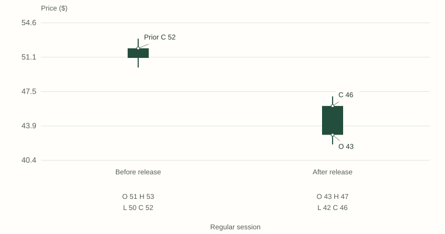

*Same fictional event case as table, example, and exercise. Previous O = 51/H = 53/L = 50/C = 52. Announcement follows the prior close. Next O = 43/H = 47/L = 42/C = 46. The $3 intraday rise is distinct from the $9 opening gap and $6 close-to-close loss.*

#### Good reported news and a falling price can coexist

A headline may sound favorable in isolation while the market response is negative. Investors can care about expectations, guidance, margins, timing, or details beyond the headline. The chart records the resulting prices, but it does not identify a unique explanation. If a stock falls after an earnings release, first record the release time, visible price response, and volume. Then distinguish documented statements from your hypothesis about which detail mattered.

An analyst can otherwise build an explanation that fits every possible outcome: rising price proves strong results, falling price proves profit taking, unchanged price proves the news was priced in. A story flexible enough to explain everything cannot be tested meaningfully. Prefer a modest conclusion, such as “the observed reaction was negative over this interval,” and inspect what the company actually disclosed before attributing motives to a particular group of traders.

#### A trigger is different from a guaranteed fill

Before the announcement, suppose a hypothetical holder entered 100 shares at $52 and recorded an intended $48 exit threshold. Planned price distance is $4 per share or $400 total. A modeled ordinary-stop execution at next open $43 gives $9 per share or $900 loss before fees. The $500 difference comes from the specified fill assumption, not a change in share count.

The SEC explains that an ordinary stop becomes a market order when triggered and does not guarantee execution price. Its extended-hours bulletin also describes liquidity, spread, and order-handling differences around news outside regular sessions. The candle does not establish an actual stop fill; this exercise explicitly models a $43 execution to examine the consequence of discontinuity.

For comparison, a modeled sell stop-limit with stop $48 and limit $47 would not sell at the $43 opening price. In the supplied next-session range, high $47 merely touches the limit; without order timing, accessible quantities, and priority, we cannot infer a fill. Price protection trades away execution certainty. The later microstructure chapter demonstrates why a candle touch is insufficient.

A learner’s record should separate trigger level, order type, assumed/actual fill, shares, and costs. These distinctions make a gap review reproducible. Keeping $48 as the loss price after showing the next observation at $43 would hide the case’s central risk.

**One position, two price-loss models**

| Case | Shares | Entry ($) | Assumed exit ($) | Price loss ($) |
| --- | --- | --- | --- | --- |
| Planned threshold model | 100 | 52 | 48 | 400 |
| Gap fill model | 100 | 52 | 43 | 900 |

#### Some apparent jumps are changes in measurement

A two-for-one split changes the number of shares corresponding to the old position and the nominal price per share. Investor.gov explains that the ownership interest is not diluted by the split itself. A raw move from $100 to $50 at the split boundary is therefore not equivalent to an ordinary 50% loss for the holder whose share count doubled. Check corporate-action records before classifying the mark as a technical breakdown.

Distributions also require context. Investor.gov notes that a significant dividend can be accompanied by a price decline on the ex-dividend date. That does not imply an identical adjustment on every real market opening, because other information can move price as well. Use consistent price or total-return histories for the question at hand. Adjustment policy changes can alter old levels and indicator readings, so keep the original data convention with your analysis.

#### Write the before-and-after note

Before release: “The regular-session close is $52, after a month’s observations in the $48–$53 region. An announcement is scheduled after the close. Our hypothetical worksheet uses 100 shares from $52 and a $48 ordinary-stop trigger; a gap beyond it can change execution.” This note records what the chart and plan establish without forecasting the release’s sign.

After next close: “Session O = 43/H = 47/L = 42/C = 46. Gap was −17.3077%; intraday recovery +6.9767%; close-to-close result −11.5385%. The price stayed below prior $52 throughout the session. Under the explicit $43 exit model, price loss is $900, compared with $400 at the planned threshold.” The note uses exactly the illustrated values.

Now separate observation from explanation. A negative reaction is visible; the claim that a particular guidance detail caused it requires the release itself and further evidence. A positive candle is also visible; the claim that the pre-release position recovered is contradicted by the $46 close. These two diagnoses build chart-reading competence without assigning a story that can accommodate every outcome.

A practical scenario exercise can compare little change, a favorable gap, and an adverse gap before the event. Use it to expose assumptions about exits, rather than inventing probabilities. The present chapter demonstrates only the adverse-gap accounting and recovery comparisons. The planning chapter adds an earnings calendar and halt handling to the record. This book reports no study of event-based strategies; the testing chapter describes what evidence such a rule would need.

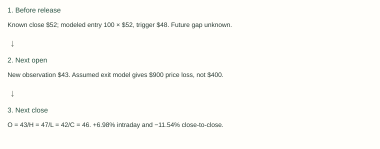

*A fictional sequence. Neither the candle nor a trigger level establishes a live execution.*

#### Worked example: The recovery uses a different denominator

A pre-release holder’s $52 reference declines to the $46 close: −$6/52 = −11.5385%. An observer beginning at the $43 open sees +$3/43 = +6.9767%. The opening gap itself is −$9/52 = −17.3077%. The same session supports all three statements. Under the separate explicit 100-share exit-at-open model, price loss is $900; a holder still present at $46 has a different, $600 price loss.

#### Exercise

Using the event candles, calculate opening-gap, open-to-close, and close-to-close returns. For 100 shares entered $52, compare a $48 planned exit with an assumed $43 exit.

Reveal the worked solution

Gap = (43−52)/52 = −17.3077%. Intraday = (46−43)/43 = +6.9767%. Close-to-close = (46−52)/52 = −11.5385%. Each percentage names its starting reference.

Planned price loss = 100 × (52−48) = $400. Assumed gap exit loss = 100 × (52−43) = $900. The additional $500 is the modeled execution difference; no fees or actual fills are supplied.

#### guided practice: Reconcile the two returns multiplicatively

Show that the opening-gap growth factor followed by intraday growth gives the close-to-close factor.

Reveal the worked solution

(43/52) × (46/43) = 46/52 = 0.8846154, or −11.5385%. The $43 term cancels.

Adding −17.3077% and +6.9767% gives the wrong result because the two returns use different starting bases.

#### independent practice: A limit touch is not a completed exit

Compare two separate counterfactual exit instructions for a fresh fictional holding of 60 shares bought at $80, with prior regular-session close $80: an ordinary sell stop at $77, or a sell stop-limit with stop $77 and limit $76.50. Both are active before the next regular-session open and last through that session. In this teaching model the opening trade at or below the stop triggers the order; use all regular-session trade prices in the supplied OHLC and assume no execution outside that range. Model the ordinary-stop fill at the open in each case, with no fees. Compute gap percent, frozen price-risk 1R, modeled ordinary-stop P&L and R. For each stop-limit case, state whether an exit is ruled out or unresolved. If A remains held, give its close-marked P&L and explain why that is not a realized exit result.

**Fresh gap cases: only the session high differs**

| Case | Open ($) | High ($) | Low ($) | Close ($) |
| --- | --- | --- | --- | --- |
| A | 75.5 | 76.4 | 74 | 76 |
| B | 75.5 | 76.5 | 74 | 76 |

Reveal the worked solution

Opening gap = 100 × (75.50/80 − 1) = −5.625%. Frozen price-risk 1R = 60 × (80 − 77) = $180. The separate ordinary-stop model exits at $75.50: P&L = 60 × (75.50 − 80) = −$270, or −1.50R before fees. This is an assumed execution in both cases; a real stop does not guarantee that opening fill. Selling at the $77 trigger would instead hide the additional $90 loss.

Both stop-limit cases trigger at the opening trade under the declared rule. In A, the entire supplied session remains below the $76.50 sell limit: even its $76.40 high is ineligible. Under the stated range-only model, no stop-limit exit is possible in that session. The still-held position marks at 60 × (76 − 80) = −$240, or −1.333333R relative to the frozen $180 denominator; that is unrealized price P&L, not a completed trade or a sale at $76.

In B, the $76.50 high reaches an eligible price after the opening trigger. Equality satisfies the sell-limit price bound, but the candle supplies no accessible quantity or queue priority, so partial fill, full fill and no fill remain unresolved. A confirmed execution report would resolve them. The price bound is a minimum for any actual sale; it is not a promise to sell. These are counterfactual order-type comparisons, not two simultaneous exits on the same holding.

#### Knowledge check

Which is the illustrated session’s open-to-close return?

1. +5.7692%
2. −11.5385%
3. +6.9767%

Reveal the worked solution

Answer: 3. (46−43)/43 gives +6.9767%.

Option 1: 5.7692% divides the $3 rise by prior $52 close, mixing starting references.

Option 2: −11.5385% is prior-close-to-current-close return, not intraday.

Option 3: (46−43)/43 gives +6.9767%.

#### Sources

- [SEC / Investor.gov · Extended-hours trading](https://www.investor.gov/introduction-investing/general-resources/news-alerts/alerts-bulletins/investor-bulletins-42) — News releases outside regular hours, liquidity/spread/price uncertainty, and venue-dependent order handling.
- [SEC / Investor.gov · Types of orders](https://www.investor.gov/introduction-investing/investing-basics/how-stock-markets-work/types-orders) — Market and limit orders, stop-to-market conversion, and execution-price uncertainty.
- [SEC / Investor.gov · Stock split](https://www.investor.gov/introduction-investing/investing-basics/glossary/stock-split) — Split mechanics: a two-for-one split doubles share count and halves price per share without diluting ownership (100 shares at $100 become 200 at $50). Comparability of price histories across a split is the book’s inference.
- [SEC / Investor.gov · Ex-dividend dates](https://www.investor.gov/introduction-investing/investing-basics/glossary/ex-dividend-dates-when-are-you-entitled-stock-and) — Distribution-related price changes on an ex-dividend date; entitlement rules require current verification.
- [SEC · Trading Basics: order types and instructions](https://www.sec.gov/files/trading101basics.pdf) — Stop-limit conversion and possible nonexecution; immediate-or-cancel remainder cancellation; market orders filling at different prices.

---

### Chapter 19: Market microstructure: from a chart to an actual trade

The price you see and the price you can transact at are different questions.

> A trade requires available counterparties under specific order rules. Spread, depth, timing, and venue affect the outcome.

**Version 0.4 · AI editorial review recorded 2026-10-11 (claude-code-alpha).**

Review scope: Scoped chapter editorial acceptance: prose, material source claims, tasks, numerical reproduction and compact/wide figures; release QA and human learning are separate.

**Learning outcomes**

- Read spread and quoted quantity separately from last-traded price.
- Process a larger buy through a static order-book ladder and compute weighted execution.
- Compare a partial limit fill with a full market-order purchase and label model assumptions.

Builds on: Anatomy of a stock chart; Volume: participation behind price; Events and opening gaps.

#### Last price, bid, and ask describe different things

A candlestick summarizes completed trades. A quote describes displayed interest to transact under particular conditions. The bid is a price buyers are willing to pay; the ask is a price sellers are willing to accept. The highest displayed bid is the best bid and the lowest displayed ask is the best ask; the quoted spread is best ask minus best bid. FINRA links limited liquidity with greater difficulty transacting and wider spreads. The last completed trade can lie between current quotes or become stale after they move.

The main static book has best bid $49.90 for 300 shares and best ask $50.10 for 100 shares. The midpoint, the average of best bid and best ask, is ($49.90 + $50.10)/2 = $50; the spread is $0.20. Last trade is assumed $50, but that print does not supply a counterparty for a new order. A buyer seeking immediate execution consumes an available ask; an immediate seller consumes an available bid. The SEC notes that last-traded price need not equal the price obtained by a market order.

#### The spread is a cost even before price moves

In a deliberately simplified example, buy 100 shares at $50.10 and immediately sell them at $49.90, with unchanged quotes, sufficient quantity, and no fees. The round trip loses $20. The midpoint never moved. This makes the spread visible as a trading friction that a backtest using only closing prices can omit. Real execution can differ through price improvement (execution at a better price than the current quote, possible but not guaranteed), partial fills, changing quotes, and other costs.

A twenty-cent spread has different proportional importance at different prices. Spread divided by midpoint gives a relative spread: $0.20/$50 = 0.4% in this example. That measure still omits size. A quote suitable for 100 shares may not support an order for 10,000 shares. When a trading method aims for small price changes or high turnover, even modest execution friction can materially alter its results. Test the cost model at the scale of the actual method.

#### Walk a 250-share buy through the ladder

The figure lists displayed asks at $50.10 for 100 shares, $50.20 for 200, and $50.30 for 300. We assume these quantities remain fixed, no other accessible liquidity, and no competing orders arriving first. Those conditions deliberately create a small executable arithmetic model. They are not claims about a real order book’s stability.

A market buy order for 250 shares (a buy limit at $50.20 or higher would fill the same way here) first takes 100 at $50.10. It needs 150 more, which are taken from the 200 offered at $50.20. The third row is untouched. Fill value is 100 × 50.10 + 150 × 50.20 = $12,540. Divide by 250 to obtain the weighted fill price $50.16. The best ask $50.10 was available only for 100 shares; it was not a price offer for the whole order.

The ladder’s consumed/remaining columns make the sequence visible. The first ask is depleted, 50 remain at $50.20, and all 300 at $50.30 remain. Now compare a buy limit at $50.10 for the same 250 shares. It can execute immediately only against the 100 shares offered at $50.10. Under this static model it can take only 100 immediately; the other 150 remain unfilled under an ordinary resting instruction. If given an immediate-or-cancel instruction, that remainder is canceled.

A historical candle touching $50.10 does not establish either modeled outcome without the available quantities and timing. The static ladder is valuable precisely because it supplies those assumptions. Live quotes can change before the order arrives, accessible interest can exist elsewhere, and competing orders can consume it first. The SEC’s execution overview explains why order submission and execution are separate events.

**Two modeled fill instructions**

| Instruction | Immediate filled shares | Weighted price ($) | Unfilled shares |
| --- | --- | --- | --- |
| Market buy, 250 shares | 250 | 50.16 | 0 |
| Buy limit $50.10, 250 shares | 100 | 50.1 | 150 |
| Same limit, immediate-or-cancel | 100 | 50.1 | 150 canceled |

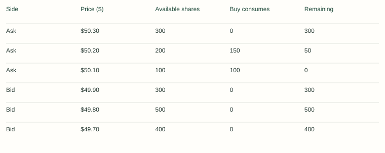

*Fictional static book. Buy consumes 100 shares at $50.10 then 150 at $50.20; average price $50.16. Rows show the whole visible ladder and remaining quantities. No other accessible liquidity, cancellations, or competing orders are assumed.*

#### Different mechanisms can form opening and closing prices

An auction collects eligible buying and selling interest and applies exchange rules to determine a match. NYSE publishes opening and closing auction information, including indicative match prices and imbalance quantities. Those indications describe the state of the auction calculation, not a guarantee of the final auction price. Orders can change before the relevant deadlines, and exact procedures differ by venue and can change over time.

A large final volume bar can therefore include activity concentrated in a closing auction rather than the same style of continuous trading seen earlier in the day. That does not make the print unimportant. It does change what you can infer from it. If a strategy requires a closing transaction, study the actual auction mechanism and the time by which its order would have to exist. Knowing the final close afterward is not enough to assume participation at that price.

#### Trading conditions vary across the session

The SEC’s extended-hours bulletin highlights lower liquidity, wider spreads, uncertain prices, and differences in available venues and order handling outside regular hours. A narrow daytime spread should not be assumed for an overnight news reaction. A quote from one view may also fail to represent the liquidity reachable through your broker at that moment. Broker routing is part of the transaction path, as Investor.gov’s execution overview explains.

For a fictional illustration, let the midpoint stay near $50 while the bid and ask separate from $49.99/$50.01 to $49.60/$50.40. A close-only chart could look motionless while an immediate round trip becomes much more expensive. This is why liquidity and volume are related but distinct. A daily share count describes accumulated activity; your execution depends on available interest when, where, and at what size you arrive.

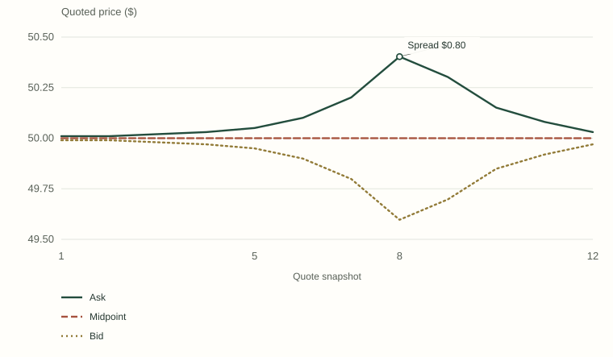

*Fictional quotes. A separate contrast retains midpoint $50 while quoted spread changes. It illustrates a liquidity condition, not the fixed book’s post-fill evolution.*

#### Measure costs against a named reference

Using decision-time midpoint $50 as reference, the main 250-share buy at average $50.16 is $0.16 per share above midpoint, or $40 total. Relative to the best ask $50.10, it is $0.06 higher on average, or $15. These are different benchmarks for the same fill; quoting slippage without identifying the reference leaves the comparison ambiguous.

Suppose the 300-share bid at $49.90 remains available after the modeled purchase and the position is immediately sold. Sale value is 250 × 49.90 = $12,475; purchase value $12,540; price-only round-trip loss is $65. On 250 shares the $0.20 spread alone costs $50; the remaining $15 is the extra $0.10 paid on the 150 shares taken at the second ask level. Per share the loss is $0.26, against $0.20 for the earlier 100-share round trip; that $0.06 difference is what reaching beyond the first quote cost.

A completed model record is now possible: “Decision reference midpoint $50; buy 250; static accessible asks 100@50.10 and at least 150@50.20; fills 100/150; mean $50.16; immediate sale assumption 250@49.90; loss $65 before fees.” If the bid changes or quantity disappears, that last result changes. Recording the assumptions makes the consequence inspectable.

For actual practice, record decision time, quote reference, order instruction, requested shares, individual fills, and unfilled remainder. A no-fee statement removes fees only; it does not remove spread or price movement. The planning and testing chapters use this distinction when translating a chart event into a cost-aware opportunity. You need enough mechanics to challenge impossible fills, without mastering every exchange rule.

#### Worked example: Every fill has a quantity

The 250-share purchase consumes 100@$50.10 and 150@$50.20. Value $5,010+$7,530 = $12,540; weighted average $50.16. Unweighted mean $50.15 would give the two price levels equal influence despite unequal quantities. An immediate 250-share sale at the assumed unchanged $49.90 bid receives $12,475, producing a $65 price loss before fees.

#### Exercise

Process the 250-share buy through the displayed asks. Compute weighted fill price and each remaining ask quantity, then the modeled immediate round-trip loss at the unchanged $49.90 bid.

Reveal the worked solution

Take 100 at $50.10 and 150 at $50.20. Value $5,010+$7,530 = $12,540; divided by 250 gives $50.16. Remaining asks: 0 at $50.10, 50 at $50.20, 300 at $50.30.

With at least 250 shares still bid at $49.90, sale value is $12,475, so price-only loss is $65. No fees, competing fills, other venues, or quote changes are included.

#### guided practice: Compare reference prices

Using the $50.16 weighted buy price, compute total difference versus midpoint $50 and versus first ask $50.10 on 250 shares.

Reveal the worked solution

Versus midpoint: (50.16−50) × 250 = $40. Versus first ask: (50.16−50.10) × 250 = $15.

Both compare the same fill with different references. Their $25 difference is the original $0.10 midpoint-to-ask distance times 250.

#### independent practice: A partial fill under a tighter limit

A fresh static ask book offers 80 shares at $32.05, 120 at $32.10 and 200 at $32.20. Submit a 300-share buy limit at $32.10, immediate-or-cancel; assume those offers remain available and no fees. Give filled quantity, average execution, cash spent and canceled remainder. Can the journal count the full order as filled?

Reveal the worked solution

The first two levels satisfy the limit: 80 + 120 = 200 shares. Spend = 80 × 32.05 + 120 × 32.10 = $6,416; filled average = 6,416/200 = $32.08. The remaining 100 shares are canceled; the $32.20 level is outside the limit.

Record 200 filled and 100 unfilled, not 300 filled at the limit. The supplied static availability is a modeling assumption; actual changing queues could produce a different execution.

#### Knowledge check

What is the weighted execution price of the 250-share main buy?

1. $50.16
2. $50.10
3. $50.15

Reveal the worked solution

Answer: 1. (100 × 50.10+150 × 50.20)/250 gives $50.16.

Option 1: (100 × 50.10+150 × 50.20)/250 gives $50.16.

Option 2: $50.10 is the best ask for only 100 shares.

Option 3: $50.15 weights the two price levels equally rather than weighting 100 and 150 shares.

#### Sources

- [FINRA · Understanding market liquidity and your investments](https://www.finra.org/investors/insights/market-liquidity-risk) — Bid, ask, spread, and the link between limited liquidity and execution difficulty.
- [SEC / Investor.gov · Types of orders](https://www.investor.gov/introduction-investing/investing-basics/how-stock-markets-work/types-orders) — Market and limit orders, stop-to-market conversion, and execution-price uncertainty.
- [SEC / Investor.gov · Executing an order](https://www.investor.gov/introduction-investing/investing-basics/how-stock-markets-work/executing-order) — Broker routing and multiple market venues; order receipt and execution are separate events.
- [NYSE · Auctions](https://www.nyse.com/trade/auctions) — Exchange auction mechanisms and indicative match/imbalance definitions; current rules can change.
- [SEC / Investor.gov · Extended-hours trading](https://www.investor.gov/introduction-investing/general-resources/news-alerts/alerts-bulletins/investor-bulletins-42) — News releases outside regular hours, liquidity/spread/price uncertainty, and venue-dependent order handling.
- [SEC · Trading Basics: order types and instructions](https://www.sec.gov/files/trading101basics.pdf) — Stop-limit conversion and possible nonexecution; immediate-or-cancel remainder cancellation; market orders filling at different prices.

---

### Part 04 review: Context review: participation, clock, and execution

#### Resolve apparent contradictions

Use the breadth chapter’s final four-stock values/weights and session-11-to-12 changes. Report the since-start weighted index result, since-start participation, and daily breadth. Explain why they differ.

Reveal the worked solution

Final index = 0.6 × 110+0.2 × 98+0.1 × 97+0.1 × 95 = 104.8, +4.8%. Since start, one constituent rose and three fell; equal weighting gives mean final level 100.

Daily session 12 has A rising 109→110, B/C unchanged, and D declining 96→95: one advance, one decline, two unchanged, daily net zero. Different weights and comparison periods explain the three summaries.

#### Freeze the analysis timestamp

At the multi-timeframe dataset’s session-11 close, write the daily change and latest completed weekly pair. A worksheet uses the eventual session-15 weekly $110 close to approve session 11. Diagnose the mistake and apply the stated weekly-up eligibility filter correctly.

Reveal the worked solution

Daily close rises $103→$104; completed weekly pair is $105→$103, down under the teaching close-direction classification. The future $110 weekly close is unavailable until 15.

Using $110 at 11 leaks future information. A filter requiring up completed-week context rejects that daily rise at 11. This says what the specified filter does, not whether rejecting it improves results.

#### Reconcile a gap and a deeper order

For the events case, calculate the $52→$43 opening-gap return and $43→$46 intraday return. For the separate static book, process a 250-share purchase against 100 shares at $50.10 and at least 150 at $50.20. Which results are observations and which are modeled fills?

Reveal the worked solution

The fictional event observations yield −17.3077% opening gap and +6.9767% intraday. Their factors multiply to 46/52, or −11.5385% close-to-close.

The book’s explicitly modeled fills cost $12,540 across 250 shares, average $50.16. Static accessible quantities and no competing/changed quotes make this a model; a historical candle touching those prices alone would not establish that execution.

## Part 05: Build a repeatable process

Translate an observation into a clear hypothesis, with a defined risk budget.

### Chapter 20: Risk & position sizing

Give uncertainty a budget before giving a trade your money.

> A loss budget sizes a position under a model. Keep price risk, costs, capital committed and common-shock exposure visible; a stop does not cap the eventual loss.

**Version 0.4 · AI editorial review recorded 2026-10-02 (/root).**

Review scope: Scoped chapter editorial acceptance: prose, material source claims, tasks, numerical reproduction and compact/wide figures; release QA and human learning are separate.

**Learning outcomes**

- Calculate shares under price-risk, cost-inclusive, cash and notional constraints.
- Keep the planned price-risk R denominator fixed while reporting costs separately.
- Reconcile a portfolio’s stop-loss estimate and common-shock scenario.
- Calculate loss compounding and the gain needed to recover a drawdown.

Builds on: Breakouts, pullbacks & failed moves; Market microstructure: from a chart to an actual trade.

#### Begin with the account, not the target

A chart may suggest an interesting opportunity without telling you how many shares to buy. Position sizing translates a hypothesis into exposure. Start with an account value, a maximum acceptable planned loss, an entry assumption, and an exit condition if the hypothesis fails. These are separate decisions. An exit should follow the reasoning of the trade; the share count should follow the amount the account can tolerate.

Our fictional investor Maya has $20,000 in an unleveraged account. For a teaching example, she chooses a $100 planned loss budget, equivalent to 0.5% of that starting equity. This percentage is an illustration, not an optimal rule. Her circumstances, other holdings, cash needs, and tolerance for a sequence of losses could justify a different limit or no speculative position at all. Choosing a budget does not establish that her strategy has a positive expected return. The following prices and accounts are fictional. We use them to build a worksheet, not to recommend a risk percentage.

#### From dollars to shares

Maya considers buying ATLS at $50 with an invalidation exit near $48. Price distance is $2 per share. Ignoring costs initially, the risk-based quantity is floor($100 ÷ $2) = 50 shares. The position costs $2,500 and has $100 of planned price risk. Position value and loss budget differ: she commits $2,500 of capital to a plan that anticipates losing $100 if its exit works as modeled.

Now include a modeled $0.10 per share round-trip charge, separate from the quoted entry and exit prices. Sizing against a $100 cost-inclusive ordinary-loss budget gives floor(100 ÷ 2.10) = 47 shares. Entry notional is $2,350, planned price risk is $94, modeled costs are $4.70, and the cost-inclusive modeled loss is $98.70. Calling all four quantities “risk” would conceal important differences. A $1,000 notional cap would allow only 20 shares; a cash check also reserves the entry charge. Apply whichever constraint permits the fewest shares.

**Two sizing policies, one price-risk definition**

| Policy | Shares | Entry notional ($) | 1R price risk ($) | Modeled costs ($) | Ordinary net loss ($) |
| --- | --- | --- | --- | --- | --- |
| $100 price-risk budget; E50/S48 | 50 | 2,500.00 | 100.00 | 5.00 | 105.00 |
| $100 cost-inclusive budget; E50/S48 | 47 | 2,350.00 | 94.00 | 4.70 | 98.70 |
| Connected BRDG; E50.60/S48.60 | 50 | 2,530.00 | 100.00 | 5.00 | 105.00 |

#### A stop is an instruction, not insurance

A stop-market order generally becomes a market order after its trigger; the execution price is not guaranteed. A stop-limit order introduces a price constraint but can remain unfilled. Investor.gov explains this distinction. Your loss estimate therefore describes an assumption about execution rather than a contractual ceiling on loss.

For those 47 shares, an unexpected announcement produces a next available exit of $45. Price loss is 47 × ($45 − $50) = −$235. With the same $4.70 modeled costs, net loss is −$239.70. The $100 budget was an ordinary-exit model, not an insured ceiling. Record a separate gap stress and ask whether the capital committed is tolerable when execution departs from the chart level.

#### Portfolio risk is more than a sum of tickets

If Maya takes four positions, each with a $100 planned loss, their combined planned loss is $400. That bookkeeping is useful, but their risks need not be independent. Four semiconductor stocks may respond to the same earnings warning or sector selloff. Treating them as four unrelated bets could conceal a concentrated exposure.

Build a second view by grouping positions around shared drivers: sector, broad-market sensitivity, event dates, and liquidity. Then imagine a single adverse session affecting the entire group. This exercise does not require pretending that a recent correlation estimate predicts the exact next loss. It asks whether the account could tolerate a plausible common shock. Existing long-term holdings count too. A small trading position can still add to an already substantial concentration.

#### Work a common shock, then make the allocation decision

Return to Maya’s $20,000 account. She considers four simultaneous positions, with each entry also the starting valuation for this stress. The table gives shares, entry, stop, and one adverse exit assumption for every position. BRDG, CHIP and FABR share a chip-demand driver; UTIL adds a different exposure but is not assumed immune. We keep $5 round-trip costs per position for comparability. The scenario assumes available exits at the stated shock prices, not guaranteed real fills.

The stop view totals $400 planned price risk plus $20 costs: a $420 ordinary modeled loss, 2.10% of account equity. Entry notional is $2,530 + $3,000 + $3,000 + $2,000 = $10,530. Splitting the modeled fees equally reserves $10,540 at entry and leaves $9,460 cash. Four $100 tickets are compatible with that cash but say little about one common driver. The three chip-linked positions commit $8,530, or 42.65% of equity.

Now apply the shock. BRDG loses 50 × 5.60 = $280; CHIP loses 40 × 9 = $360; FABR loses 100 × 4 = $400; UTIL loses 50 × 1.50 = $75. Total price loss is $1,115 and net modeled loss $1,135, or 5.675% of starting equity. Shock ending equity is $18,865. The stop estimate understates this particular shock by $715. Neither estimate is a probability or worst-case ceiling; a different shock could be worse, and a delayed exit changes the result.

For an explicit decision, give Maya a separate teaching constraint: no more than $800 cost-inclusive loss under this named stress. The full portfolio fails. Cutting CHIP to 20 shares and FABR to 50 changes their shock price losses to $180 and $200; the revised total is $280 + $180 + $200 + $75 + $20 = $755, inside the constraint. Planned price risk is now $300, entry notional $7,530, entry cash reserve $7,540, and the chip-linked notional $5,530. This decision demonstrates applying a written limit; it does not prove $800 is appropriate or that the reduced portfolio is safe.

A contrary reasonable decision is to skip the entire group because the stress is uncertain or the account already holds chip exposure elsewhere. Include long-term holdings when assessing the shared driver. A recent correlation coefficient is not needed to see a common business dependency. The exercise tests arithmetic and transparent allocation reasoning, not an optimal diversification claim.

**One shock across the proposed portfolio (all entries/marks equal here)**

| Position / driver | Shares | Entry ($) | Stop ($) | Price risk ($) | Shock exit ($) | Shock price loss ($) | Round-trip costs ($) |
| --- | --- | --- | --- | --- | --- | --- | --- |
| BRDG / chip demand | 50 | 50.60 | 48.60 | 100.00 | 45.00 | 280.00 | 5.00 |
| CHIP / chip demand | 40 | 75.00 | 72.50 | 100.00 | 66.00 | 360.00 | 5.00 |
| FABR / chip demand | 100 | 30.00 | 29.00 | 100.00 | 26.00 | 400.00 | 5.00 |
| UTIL / rate-sensitive | 50 | 40.00 | 38.00 | 100.00 | 38.50 | 75.00 | 5.00 |

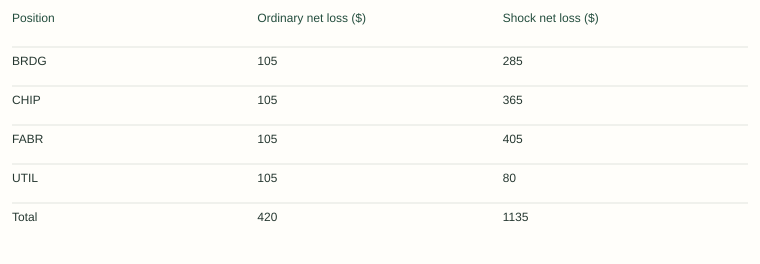

*Fictional proposed portfolio. Loss magnitudes include $5 per position; compare the four-ticket plan with one joint adverse event.*

#### Loss sequences and recovery arithmetic

Drawdown is the decline from a prior equity peak. If an account falls from $20,000 to $18,000, the drawdown is 10%. Recovering requires $2,000 ÷ $18,000 = 11.11%, not 10%. After a 25% decline, recovery requires 33.33%; after a 50% decline, it requires 100%. The denominator changes after the loss, which explains the asymmetry.

The illustration compares twelve consecutive modeled losses at 0.5% and 2% of current equity. Equity after n losses is initial equity × (1 − fraction)^n. At twelve losses the paths end near $18,832 and $15,694 respectively. These deterministic paths assume exact fractional losses, no gaps, no costs, and no intervening wins. They demonstrate compounding, not the probability of experiencing a losing streak. A real strategy needs a distribution of outcomes and a separate stress analysis.

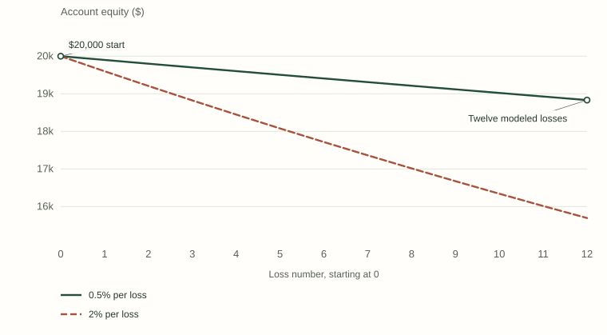

*Fictional arithmetic illustration: twelve exact losses sized at 0.5% or 2% of current equity. These are scenario paths, not historical results or estimated probabilities.*

#### Declare the R denominator before the result

Before entry, order price risk is an estimate based on the intended quantity, entry and protective level. Once the modeled or actual fill is confirmed, this book freezes the long position’s 1R PRICE risk as filled shares × (filled entry − the declared initial stop). It excludes costs. A maximum entry ceiling is not the filled entry, and unfilled shares are not a position. Net R = net P&L ÷ that frozen 1R. The 47-share worksheet therefore has 1R = $94, although its cost-inclusive modeled loss is $98.70 and its sizing budget is $100. Its ordinary stop result is −98.70 ÷ 94 = −1.05R; the gap result is −239.70 ÷ 94 = −2.55R. Do not divide by the $100 budget or redefine R after the gap.

A quantity partly filled has its own filled-share price risk. Freeze that denominator when the position is established under the declared entry/stop convention, keeping the original order quantity in a separate field. If there are later additions, the plan must define how their risk is recorded. Our worked plans cancel the unfilled remainder and never add, so the original denominator remains simple.

The completed BRDG record used in the next three chapters instead sizes against PRICE risk: 50 shares at $50.60, stop $48.60, 1R = $100. A flat $5 modeled round-trip cost makes its ordinary net stop loss $105. Both approaches are legitimate teaching contracts if their labels stay explicit. They are different sizing policies, not conflicting definitions of R. When costs are already reflected in actual executable fills, do not subtract the same spread or slippage again.

Always retain dollars beside R. Equal R results have unequal account effects when initial risks differ, and adding R from overlapping trades is not a portfolio return. Sizing limits exposure under the assumptions; it supplies no evidence of a profitable signal. A smaller trade, a paper observation or a skip can be consistent with the same chart interpretation.

#### Worked example: The tight-stop temptation

At $50, a stop at $49.50 implies 200 shares for a $100 budget before costs, versus 50 shares with a $48 stop. The tighter stop quadruples notional exposure. It does not prove that normal fluctuations will spare the position or that a gap will respect the $0.50 distance.

#### Exercise

With $20,000 equity, a $75 COST-INCLUSIVE ordinary-loss budget, $30 entry, $28.80 stop, and $0.15 modeled round-trip cost per share, calculate shares, notional, price-risk 1R and modeled stop loss. If the exit fills at $27, compute gross loss, net loss and net R. Treat fees as $0.075/share at each side for the cash reserve.

Reveal the worked solution

Distance = $30 − $28.80 = $1.20/share; modeled ordinary loss = $1.20 + $0.15 = $1.35/share. Shares = floor(75 ÷ 1.35) = 55. Notional = 55 × $30 = $1,650; entry cash reserve = $1,650 + 55 × $0.075 = $1,654.125 (about $1,654.13).

1R = 55 × $1.20 = $66 PRICE risk. Round-trip costs = 55 × $0.15 = $8.25, ordinary cost-inclusive loss $74.25. At $27, price loss is 55 × $3 = $165; net loss is $173.25; net R = −173.25 ÷ 66 = −2.625R. The budget is not the R denominator.

#### guided practice: Apply the portfolio limit

Reproduce the full and reduced portfolio’s notional, planned price risk and common-shock net loss. Does each meet the $800 stress constraint?

Reveal the worked solution

Full: notional $10,530, price risk $400, net shock $1,135: fails. Reduced CHIP20/FABR50: notional $7,530, price risk $300, net shock $755: passes this specified stress. Fixed $5 round-trip costs still apply to each of four executed positions.

The limit concerns one supplied scenario. A passing calculation does not establish a maximum future loss.

#### independent practice: Diagnose a tighter stop

At $50 with a $100 price-risk budget, compare a $49.50 stop with a $48 stop. For each, compute shares, notional and price loss at a $45 gap exit. Then apply a $3,000 notional cap.

Reveal the worked solution

Without the cap: 200 shares/$10,000 notional/$1,000 gap loss versus 50 shares/$2,500/$250. Both gaps are $5/share, but the tighter stop quadruples quantity.

With the cap: at most 60 shares. Tight-stop quantity becomes 60, 1R = $30 and $300 gap price loss; wide-stop quantity stays 50, 1R = $100 and $250 gap price loss. Costs are omitted here to isolate exposure.

#### Knowledge check

The 47-share E50/S48 position was sized against a $100 cost-inclusive budget. It exits at $45, with $4.70 costs. What is its net R?

1. −2.397R using the $100 budget.
2. −2.55R using 47 × $2 = $94 planned price risk.
3. −1.00R after redefining 1R as the $239.70 net loss.

Reveal the worked solution

Answer: 2. Net loss is $239.70; divide by the original $94 price risk to get −2.55R.

Option 1: The sizing budget is not the frozen price-risk denominator.

Option 2: Net loss is $239.70; divide by the original $94 price risk to get −2.55R.

Option 3: Changing the denominator after the event hides loss beyond the plan.

#### Sources

- [SEC / Investor.gov · Understanding Order Types](https://www.investor.gov/introduction-investing/general-resources/news-alerts/alerts-bulletins/investor-bulletins-14) — Market, limit, stop, and stop-limit mechanics; triggered stops do not guarantee execution price. Numerical plans and paths in the chapters are original fictional examples.

---

### Chapter 21: From chart idea to trade plan

Write the decisions while the outcome is still unknown.

> A complete plan names the data cutoff, eligible opportunity, order and expiry, size, exit priority and review record. Each missing choice can change the result.

**Version 0.4 · AI editorial review recorded 2026-10-02 (/root).**

Review scope: Scoped chapter editorial acceptance: prose, material source claims, tasks, numerical reproduction and compact/wide figures; release QA and human learning are separate.

**Learning outcomes**

- Freeze a complete plan before the continuation.
- Process an opening opportunity, partial fill, expiry and conflicting exits.
- Reconcile a modeled outcome to planned price-risk R and cash.
- Grade plan compliance independently of profit.

Builds on: Breakouts, pullbacks & failed moves; Market microstructure: from a chart to an actual trade; Risk & position sizing.

#### Begin with a question and freeze the available facts

A plan gives a chart hypothesis an observable decision procedure. Consider BRDG after session S0 closes. The upper edge of its previously mapped range is $50.00; the new close is $50.40. Maya’s hypothesis is continuation above that range. The observation is merely a completed close beyond a boundary selected earlier. A hypothesis does not supply an order, and an order does not supply evidence of future profitability. These fictional records continue the sizing chapter’s price-risk convention.

The completed plan below is BRDG-P1. The account begins with $20,000 cash and no positions. S0 has O49.90/H50.70/L49.70/C50.40; the event calendar as then known has no scheduled earnings in S1 through S10. This is enough to apply the supplied boundary and calendar rule. It is not a complete twenty-session channel dataset and is not Atlas-20: that later system defines a different signal, ranking and portfolio process.

Write observations in a field separate from interpretations. “S0 C50.40 > 50.00” is reproducible. “Demand may persist above the old range” is a proposed explanation. “Send an eligible order tomorrow” is an action conditional on new execution information. The record keeps the clock attached to each statement, preventing a later open from quietly becoming evidence that was available at S0.

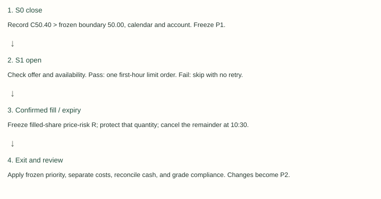

*Fictional BRDG-P1 process. Information enters the decision only at the stated cutoff.*

#### Finish the choices that change the outcome

A beginner should be able to process the table without inventing a rule. Entry is allowed only if the opening offer is above the protective level and no higher than $50.90, the rounded-down ceiling from 50.40 × 1.01. A missing quote, uncertain calendar or unresolved account balance makes this a skip. An opening offer of $52 is an immediate opportunity rejection; a later return below $50.90 does not reactivate P1. This opening gate and no-retry instruction are teaching choices, not properties of all limit orders.

If the gate passes, the order remains eligible for the first hour only. The limit controls the maximum purchase price, while a confirmed execution report controls whether and how much was filled. Keep those facts distinct. The source describes general limit and stop mechanics; it does not establish that touching a plotted price fills this order. Our exercise supplies specific simulated execution reports so that we can rehearse the decision record.

The order quantity is capped at 50 shares with a fixed $48.60 stop. At the worst permitted $50.90 fill, price risk is 50 × $2.30 = $115, which is the plan’s maximum PRICE-risk budget. At the supplied $50.60 fill, 50 shares instead carry $100 price risk. The entry cash reservation uses the limit: 50 × 50.90 + 2.50 = $2,547.50. This avoids sizing 50 shares as though every possible fill would be exactly $50.60. The target is fixed at $54.60, so the nominal payoff ratio also changes with the actual fill.

**BRDG-P1: completed plan, frozen after S0 close**

| Field | Recorded instruction |
| --- | --- |
| Scope and cutoff | Fictional long-only paper study; $20,000 cash, no holdings; S0 completed regular-session close. |
| Available data | Range upper edge $50.00 frozen before S0; S0 O49.90/H50.70/L49.70/C50.40. Calendar snapshot known; no earnings S1–S10. |
| Signal | S0 close strictly above $50.00; equality does not signal. |
| Opportunity rule | At S1 open: skip if offer > $50.90 or ≤ $48.60; skip if required quote/calendar/account facts unavailable. No retry during S1. |
| Order and expiry | If gate passes, submit one buy limit $50.90 for at most 50 shares during S1 09:30–10:30 ET. Cancel unfilled remainder at 10:30; no later retry. |
| Sizing and cash | 50-share maximum at $50.90 risks at most $115 PRICE risk to fixed $48.60 stop; reserve $2,547.50 at limit incl. $2.50 entry charge. No leverage. |
| Filled-share R | At the supplied $50.60 fill: 1R = filled shares × $2.00. Freeze once; unfilled quantity is not a position. |
| Protective order | Stop-market trigger $48.60 after a confirmed entry; no widening. Model regular stop at trigger and adverse opening gap at open. |
| Profit / time exit | Sell limit $54.60; modeled intraday fill only if trade > target; opening price ≥ target exits at open. Otherwise S10 close market-model exit (S1 = holding session 1). |
| Exit priority | For earlier holdings: open ≤ stop, then open ≥ target, then an overdue time exit at the first executable resumed open; otherwise intraday stop, then target, then time close. If both levels in an ordinary daily bar, assume stop first. |
| Entry-bar policy | No target credit for an intraday fill without sequence data; stop if subsequent evidence reaches stop. Use supplied execution observations here, not a full-bar assumed fill. |
| Partial / operational policy | Keep confirmed partial fill; cancel remainder, resize exit quantities to filled shares. If cancel acknowledgement or account state unknown, pause new orders and reconcile. Halt: no fill assumed; retain position and flag stale. If S10 close is unavailable, its deadline remains due; exit at the first executable resumed open after checking opening stop/target priority. |
| Costs and event changes | $2.50 per executed side; no fee on skips/unfilled orders. Calendar change before entry cancels eligibility. Later surprise follows existing exit rules and is flagged in review. |
| Review | Preserve every candidate, order/fill/cancel timestamp, version, price-risk R, separate costs and unresolved facts. Changes create P2. |

#### Reveal the entry, then reconcile it

At S1 09:30 the supplied offer is $50.60, so the opportunity gate passes. The paper execution record confirms 50 shares at $50.60 at 09:31 and charges $2.50. Cash becomes $20,000 − $2,530 − $2.50 = $17,467.50. The stop remains $48.60, target $54.60, and 1R freezes at 50 × $2 = $100. No unfilled remainder exists. The difference between the $2,547.50 reserved and $2,532.50 actually spent is released; a reservation is not an expense.

For a contrasting entry, suppose the report confirms only 30 shares at the same price before 10:30. P1 keeps those shares and cancels 20. Price-risk 1R is $60, entry debit $1,520.50, and protective/target quantities become 30. If the target subsequently fills at $54.60 with one $2.50 exit charge, gross profit is $120 and net $115, or +1.9167R. Using the 50-share order’s $100 denominator would report only +1.15R and confuse planned order exposure with the position actually established.

More complicated partial fills at several prices need a declared average-cost and fee policy. They are outside this supplied one-price entry, and should not be silently treated as this simpler case. The discipline transfers: retain order quantities, filled quantities, fees and timestamps separately. A full position and a partial position can follow the same plan while producing different dollars and fee burdens.

#### Reveal an orderly failure without repairing the plan

From the full-fill state, S1 closes at $50.90 after H51.20/L50.30. S2 opens at $50.80, reaches $51.30, falls to $49.40 and closes $49.60. Neither stop nor target has executed. At this close, the stock is back below the $50 boundary; the original chart-continuation interpretation has weakened. P1 nevertheless uses a fixed intraday stop, not a close-below-$50 exit. Do not quietly substitute an analytical concern for a different operational rule.

S3 opens $49.50, reaches H49.80, trades to L48.40 and closes $48.70. The paper model records the $48.60 stop. Gross loss is $100; exit proceeds after the $2.50 charge are $2,427.50. Final cash is $19,895, matching −$105 net and −1.05R on the frozen $100. This result is compliant under the modeled exit, even though the hypothesis failed. The next chapter preserves the decision note and the journal chapter records the same outcome.

A favorable branch shares the same S0 and entry but instead has a later session high of $54.80 with low $52.80 and open $53.80. It trades beyond the $54.60 target without reaching the stop. The modeled exit yields $200 gross, $195 net and +1.95R. It is a separate continuation, not an additional trade in Maya’s realized paper journal. It helps compare outcomes while holding the initial decision constant.

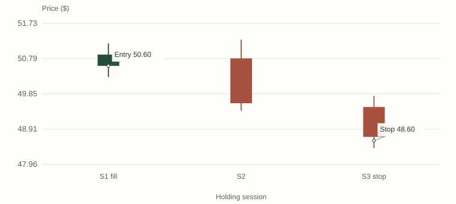

*Fictional OHLC from the completed plan. S1 simulated entry is $50.60; S3 crosses the $48.60 stop, modeled at that price. A daily candle by itself does not prove the fill.*

#### Resolve the awkward branches before counting results

Suppose a later held-position bar is O50.80/H54.80/L48.20/C51.00. Both exit levels are inside it. The high does not prove the target came first. Under P1’s stop-first daily-bar convention, score the modeled stop and −$105 net. With suitable intraday records you might resolve the actual sequence; without them, changing to target-first because the candle looks bullish would select the answer. Keep the assumption in the result label.

For a gap, replace the next held-position open with $47.60. The stop-market instruction is already active, and the model exits at that open: 50 × (47.60 − 50.60) = −$150 gross, −$155 net and −1.55R. Real execution can differ. A stop-limit would introduce a further price constraint and possible nonexecution; it would be a different plan, not a way to promise the same exit at the old stop.

A halt supplies no executable price. Keep the position and mark the last available close as stale, rather than inventing a $48.60 fill. If the S10 closing time exit is unavailable, its deadline remains due; the halt does not restart the holding clock. At the first executable resumed open, first check open ≤ $48.60 for the modeled stop-gap exit, then open ≥ $54.60 for the modeled target-gap exit. If neither applies and the time exit is overdue, exit at that open before using any later intraday high or low. A reopening print still does not guarantee a real fill; this is P1’s explicit paper convention. If the account cannot establish an order’s status, the record is unresolved until reconciled.

For example, retain the 50-share $50.60 entry when S10 is halted. If S11 first resumes at $49.80, inside the standing exit levels, the overdue rule models an immediate $49.80 exit: $40 price loss plus $5 costs, or −$45/−0.45R, leaving $19,955 cash. The later S11 high and low cannot replace an exit already modeled at its open. A $47.60 resumed open instead follows stop-gap priority; a $55.00 resumed open follows target-gap priority. These reason labels distinguish the standing orders from the overdue deadline, while all three use the first executable opening price under the supplied model.

#### Grade the process and test the proposal

Process compliance asks whether the frozen rules were applied to the information available. Outcome records what happened under the stated fill model. Evidence quality asks whether repeated observations justify the hypothesis. These are separate fields. One compliant loss does not refute the rule, and one profitable violation does not establish a better rule. A proposed revision should state the failure it addresses and the new observations that could test it.

For example, Maya may wish to add a close-below-$50 exit after the S2 close. Record that as P2, with a new exit timestamp and feasible subsequent fill assumption, then evaluate on fresh opportunities. Do not rewrite the P1 row as if P2 had existed. Likewise, relaxing the entry ceiling after a skipped rally changes the opportunity set and needs complete records of unfavorable as well as favorable skips.

The chart and the paper record serve different purposes. The candles show which prices were observed and which levels were crossed. The plan supplies the modeling rules connecting observations to fills. Read both before treating the computed result as an execution claim. In the casebook you will apply the same accounting discipline to range recoveries and conflicting timeframes as well as breakouts.

#### Worked example: A valid reason to do nothing

S0 closes $50.40; P1 ceiling is $50.90. S1 opening offer $52 fails the gate: no order and no fee. A later $56 close is an opportunity cost of that restriction, not a P1 violation.

#### Exercise

Apply P1 to a 30-share partial fill at $50.60. Record the entry cash debit, canceled remainder, stop/target quantity and frozen 1R. The next held-position session opens at $47.60; calculate gross loss, net loss, final account cash and net R.

Reveal the worked solution

Entry debit = 30 × $50.60 + $2.50 = $1,520.50; cash $18,479.50. Cancel 20 shares; exit quantity 30. 1R = 30 × ($50.60 − $48.60) = $60.

Gap exit proceeds = 30 × $47.60 − $2.50 = $1,425.50. Gross = −$90; net = −$95; final cash $19,905; net R = −95 ÷ 60 = −1.5833R. Flat costs have a larger R burden on the partial position.

#### guided practice: Reconcile the completed failure

Process the 50-share entry and $48.60 modeled stop. Show both cash flows, 1R, gross, costs and net R.

Reveal the worked solution

Entry −$2,532.50; exit +$2,427.50. 1R $100; gross −$100; fees $5; net −$105/−1.05R; ending cash $19,895.

#### independent practice: Choose the right decision clock

S1 opens at $52, then falls to $50.80 at 10:00 and later rallies. Under P1, can Maya fill? Describe the rule change needed to buy at 10:00.

Reveal the worked solution

No. P1 rejects the opening opportunity and permits no retry. A wait-for-first-hour-return rule would be P2, with its own eligibility, order deadline, fill assumptions and evaluation. A later available price does not reopen P1.

#### independent practice: Carry the deadline through a halt

Start from the confirmed 50-share $50.60 entry, fixed stop $48.60, target $54.60, frozen 1R $100 and $2.50 fee on each side. No earlier exit occurred. S10 is halted with no executable close. Each row below is a separate complete fictional S11 reopening branch. Apply opening exit priority, then the overdue deadline; record the modeled exit reason/price, net P&L, final cash from $20,000 and net R. Explain whether later intraday levels may change the result.

**Separate S11 reopening branches after a halted S10 (fictional USD)**

| Branch | Open ($) | High ($) | Low ($) | Close ($) |
| --- | --- | --- | --- | --- |
| Inside both exits | 49.8 | 55 | 48 | 52 |
| Below stop | 47.6 | 50 | 47 | 49 |
| Above target | 55 | 56 | 48 | 50 |

Reveal the worked solution

Inside: neither opening stop nor target applies, so the overdue time exit uses $49.80 immediately. Gross = 50 × (49.80 − 50.60) = −$40; net = −$45; final cash $19,955; net R −0.45R. The later bar spans both exit levels, but the position was already closed at the open.

Below stop: opening stop-gap priority exits at $47.60. Gross −$150; net −$155; final cash $19,845; net R −1.55R. Above target: opening target-gap priority exits at $55.00. Gross +$220; net +$215; final cash $20,215; net R +2.15R. Neither branch waits for a later intraday event or substitutes the old trigger/target for the supplied opening fill.

The halt preserves the position and overdue deadline, not a fictional S10 fill or a fresh ten-session clock. These are separate paper branches, not three realized trades. Real fills can differ from the supplied opening model.

#### Knowledge check

P1 filled 30 of 50 shares at $50.60, canceled the rest, and later hit its $54.60 target. With $5 total costs, what is its net R?

1. +1.15R on the 50-share order’s $100 risk.
2. +2.00R because the target was twice the stop distance.
3. +1.9167R on the filled position’s $60 price risk.

Reveal the worked solution

Answer: 3. $120 gross − $5 = $115; $115 ÷ $60 = +1.9167R.

Option 1: The unfilled 20 shares never entered the position; $100 is the order’s hypothetical risk at that fill.

Option 2: The nominal target is +2R gross; fees reduce net R.

Option 3: $120 gross − $5 = $115; $115 ÷ $60 = +1.9167R.

#### Sources

- [SEC / Investor.gov · Understanding Order Types](https://www.investor.gov/introduction-investing/general-resources/news-alerts/alerts-bulletins/investor-bulletins-14) — Market, limit, stop, and stop-limit mechanics; triggered stops do not guarantee execution price. Numerical plans and paths in the chapters are original fictional examples.

---

### Chapter 22: Psychology without market mythology

Design decisions that survive a persuasive story.

> Record beliefs before outcomes arrive, and use process constraints to make changing your mind easier.

**Version 0.4 · AI editorial review recorded 2026-10-11 (/root).**

Review scope: Scoped chapter editorial acceptance: prose, material source claims, tasks, numerical reproduction and compact/wide figures; release QA and human learning are separate.

**Learning outcomes**

- Separate a frozen observation, hypothesis and action from a later outcome story.
- Identify a changed rule or denominator without diagnosing the trader’s motive.
- Compare identical price paths at two position sizes.
- Write a counterargument and a prospective test for a proposed revision.

Builds on: Risk & position sizing; From chart idea to trade plan.

#### First pass: write an unfamiliar Q0 decision note

For a fresh fictional stock LARK, the Q0 close supplies only O63.80/H64.70/L63.60/C64.40 and a previously frozen $64 boundary. This is a separate path from the P1 example in earlier chapters; its continuation is hidden. Sector, breadth and executable next-session quotes are absent.

For this paper attempt, L1 begins with $20,000 cash and no positions. The known calendar has no scheduled earnings in Q1–Q10. The $64.90 entry ceiling, $62.60 stop and $68.60 target are frozen teaching choices. The table states the opening gate, exact order, expiry and exit priority; do not infer a fill from the already completed Q0 close.

Write an observation, a counterargument limited to supplied data, a conditional L1 action and an observation that would weaken the interpretation. Record uncertainty without a numerical win probability. After revealing the continuation, append the outcome and a separate compliance review; keep this note unchanged.

**Completed Q0 candle only (fictional USD)**

| Open | High | Low | Close | Frozen boundary |
| --- | --- | --- | --- | --- |
| 63.80 | 64.70 | 63.60 | 64.40 | 64.00 |

**L1: instructions frozen at Q0 (fictional paper study)**

| Field | Instruction |
| --- | --- |
| Opening opportunity | At Q1 09:30 ET, require a supplied opening ask strictly above $62.60 and at or below $64.90. If the gate fails or required quote/calendar/account facts are missing, skip with no Q1 retry. |
| Entry and expiry | If the gate passes, submit one buy limit at $64.90 for at most 50 shares. It is eligible Q1 09:30–10:30 ET only. Cancel any unfilled remainder at 10:30; do not top up or retry. |
| Risk and cash | Maximum planned price-risk = 50 × (64.90 − 62.60) = $115. Reserve 50 × 64.90 + $2.50 = $3,247.50 from the $20,000 cash account; no leverage. |
| Execution record | Use the supplied confirmed execution reports, not a candle touch, to establish entry quantity and price. Keep a confirmed partial fill and resize exits to its shares. |
| Frozen R and costs | For a long fill, 1R = filled shares × (actual fill − $62.60), excluding costs. Charge $2.50 per executed side; no fill means no fee or position R. |
| Standing exits | After entry, stop-market trigger $62.60; target sell limit $68.60. For prior holdings, opening stop/target gap has priority; otherwise stop before target if both occur in one daily bar. Intraday target credit requires a trade strictly above $68.60. Use supplied exit reports here. |
| Time and exceptions | Scheduled time exit Q10 close if entry is Q1 (entry session counts as 1). A halt cannot produce a fill: retain the position/stale mark. After an overdue deadline, opening gap checks come first; otherwise exit at the first resumed open. Unknown order status requires reconciliation before new orders. |
| Interpretation and orders | A completed close below $64 weakens continuation but does not replace the standing exits. Keep the original note; any different exit or size policy is a future L2 proposal. |

Write and retain your cutoff note before opening the continuation. In print, finish this packet before the continuation reference on the next page.

Reveal continuation, explanations and complete reference

#### The problem is judgment under uncertainty

Technical analysis involves looking for structure in noisy observations. That makes it easy to mistake an explanation that feels coherent for an explanation that has earned confidence. You can describe a chart eloquently while leaving its predictive claim untested. Good psychological practice begins by accepting that an uncertain decision can produce either outcome.

Maya’s BRDG-P1 trade connects this chapter with the completed plan. The initial interpretation was continuation beyond $50; the supplied path is revealed after the cutoff attempt. The same note could instead precede a rally. The exercise is to preserve what she knew, then grade what she did, with the outcome recorded in its own field. The figures and counterfactuals are fictional, constructed to make the comparison inspectable.

#### A price is not a personal obligation

The disposition effect describes a tendency to realize gains more readily than losses. The SEC-hosted Library of Congress investor-behavior review discusses this among several potentially harmful investing behaviors. This is a description of observed tendencies, not a diagnosis of every trader or proof about the motive behind a particular trade.

Maya buys at $40 and plans an exit if her specific hypothesis fails near $38. Price reaches $37.80. She changes the rationale to “I will wait until it gets back to $40.” Her purchase price has become a psychological reference point even though it does not oblige future buyers to transact there. The key process failure is the unrecorded change in hypothesis. A fresh long-term investment thesis could be evaluated separately, but silently converting a short trade into that thesis prevents a fair assessment of either decision.

#### Confirmation becomes an editing habit

Suppose Maya believes a breakout is forming. She notices a rising moving average and ignores weak sector performance. Then she searches only for commentary supporting the rally. Each supporting observation may be real; the problem is that the selection rule favors her initial conclusion. Adding more agreeable indicators can create an appearance of corroboration without adding independent information.

Try a concrete counterargument exercise. Before committing, write the strongest observable reason the trade might fail. For BRDG this could be a prior breakout that quickly reentered the range, an upcoming event, or an entry price already far from the planned invalidation. Next specify what new observation would change the decision. This exercise is a proposed discipline, not a proven treatment with a guaranteed return benefit. Its usefulness comes from exposing the criteria you are actually using.

#### Outcome bias and hindsight work together

A rule violation followed by profit can look brilliant in the journal. A careful decision followed by loss can look foolish. This is outcome-based grading. It becomes more misleading when hindsight changes the remembered difficulty of the original decision. After a rally, yesterday's ambiguity can feel like an obvious opportunity; after a decline, the same setup can feel obviously defective.

Freeze a short note and screenshot at the decision time, showing only information then available. Record an estimated scenario range rather than a single confident target. After the outcome, compare that frozen view with the narrative you now feel tempted to tell. If your original note considered both breakout and failure, keep both visible. Do not rewrite uncertainty as certainty merely because the next ten bars resolved it. A loss can teach something without proving that the initial choice was irrational.

#### Read one frozen note against its continuation

The table is Maya’s actual completed note in the fictional paper exercise, recorded after S0 and before S1. It does not claim three independent reasons to buy. The completed close crosses the boundary; the upper shadow supplies a concrete counterobservation. These are both derived from the same candle, so counting them as statistically independent evidence would be a mistake. The record also says which context data were not supplied, rather than filling that field with an agreeable story.

Hide the continuation and ask what this note licenses. It licenses applying P1 at the next opening opportunity. It does not license buying at the already completed S0 close, increasing quantity after a losing week, or widening the stop because the word “retest” sounds reassuring. It explicitly allows the continuation hypothesis to weaken before the operational stop executes. Keeping those two conditions distinct makes it possible to evaluate both the interpretation and the exit rule.

Now reveal the appended record. At S2, the $49.60 close is back below the range edge; at S3, the supplied stop model produces −$105 net. Maya may feel she should have “known” the breakout would fail. Compare that impression with the unchanged S0 note. It recognized both possibilities and supplied no probability. The correct update is that this continuation failed. A statement that the original outcome was obvious would add certainty that the original record did not contain.

There is a reasonable alternative editorial reading: the S0 upper shadow is not compelling counterevidence and may deserve little weight. Another analyst might focus on a prior failure or sector weakness if those data were supplied. The rubric asks for an observable counterargument and a clear limit on the inference, not agreement with Maya’s chosen weighting. Both readers must distinguish a new interpretation from changing P1’s written orders.

The same process can record a winning violation. Suppose Maya bought 200 rather than 50 shares at $50.60 without revising the risk authorization, and this time the path reached $54.60. Price gain would be $800 instead of $200; under the plan’s flat $5 cost assumption the net figures would be $795 and $195. That modeled fee convention is kept constant for this counterfactual, while actual liquidity might make such proportional fills unrealistic. Profit scales with quantity on the same path; policy adherence does not become better because the sign is positive.

**Frozen decision note: BRDG-P1, S0 after the completed close**

| Field | Original note (retained after S3) |
| --- | --- |
| Observation for | S0 C50.40 is above the previously frozen $50.00 range edge. |
| Observation against | S0 H50.70/C50.40 leaves a $0.30 upper shadow: the close is not the high. No breadth/sector series is supplied, so no corroboration is claimed. |
| Interpretation | Continuation is possible; reentry into the old range is also possible. The pattern supplies no numerical win probability. |
| Action | Apply P1 opening gate and first-hour limit; at most 50 shares. Fixed stop 48.60/target 54.60; worst entry price-risk budget $115. |
| What would change my view | A completed close below $50 weakens continuation. P1 operational exit still uses the stop, not that close; change requires a new version. |
| Expected record | Keep entry/expiry facts, filled-share 1R, fees and alternative paths. Missing quote/calendar/account: skip. |

**After the reveal: append, do not overwrite**

| Cutoff | New information | Process / interpretation record |
| --- | --- | --- |
| S1 09:31 | 50 simulated shares filled at $50.60 | P1 gate passed; 1R freezes $100; cost $2.50. |
| S2 close | Close $49.60 is below $50 | Continuation weakened as anticipated; no stop yet. No retroactive close-exit rule. |
| S3 stop model | Exit $48.60; gross −$100, costs $5, net −$105 | P1 complied; net −1.05R. Hypothesis failed on this path; no general strategy conclusion. |
| Review after S3 | Temptation: “The upper shadow made failure obvious.” | Original note allowed failure but predicted no probability. Keep the note; propose P2 close-exit research without changing P1. |

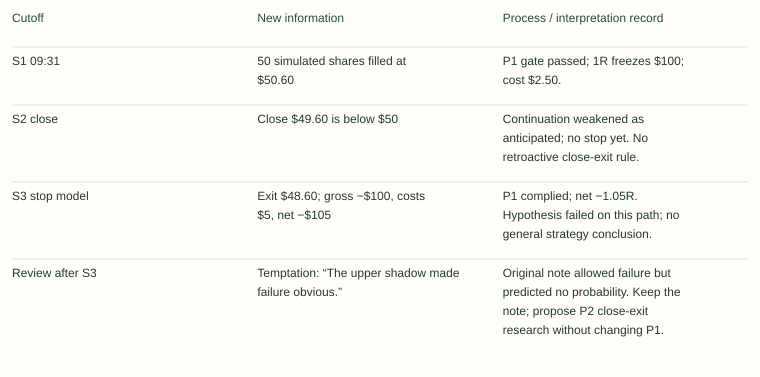

*Fictional BRDG-P1 record. The outcome and the temptation to rewrite it are appended beside the original note, not substituted for it.*

#### Make pressure smaller and decisions slower

Imagine that Maya doubles her normal position after three losses because she wants to recover the week immediately. The next trade may still meet her chart criteria, but its size now responds to a financial and emotional deadline rather than the documented risk policy. It is useful to separate the signal decision from the exposure decision: a qualifying signal does not authorize any share count she happens to want.

Possible constraints include a maximum aggregate exposure, a waiting period before discretionary rule changes, and a pause in new entries when she cannot explain the plan calmly. These are examples to evaluate, not universal psychological prescriptions. A smaller paper exercise may reveal whether the process is understandable without the urgency of money. If repeatedly monitoring positions disrupts sleep or necessary work, that information belongs in the decision about whether this activity fits her life.

#### Calibration is more useful than bravado

A forecast is calibrated when events assigned similar probabilities occur at comparable frequencies over many relevant observations. If Maya labels ten scenarios “70% likely” and six occur, one small group is insufficient to declare her well or poorly calibrated. She needs a larger record, consistent event definitions, and awareness that market conditions can change. Even a well-calibrated forecast may offer no worthwhile trade after costs.

The separate escalation illustration isolates another question: what happens to account damage when only the first three loss quantities grow? The ordinary sequence loses $100 three times; the escalation sequence loses $100, $200 and $400. Both then use the same subsequent dollar changes. The difference is $400 after the third loss and stays $400; the later recoveries are held equal. It is a sizing arithmetic demonstration, not an estimate of how often revenge trading occurs. A prospective process record can reveal escalation without claiming to read the trader’s motive.

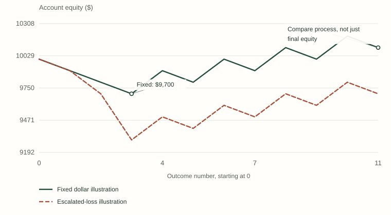

*Fictional account paths in dollars. Both start at $10,000. The fixed-dollar path uses −$100, −$100, −$100, +$200, −$100, +$200, −$100, +$200, −$100, +$200, −$100. The escalated path replaces the first three losses with −$100, −$200 and −$400, then uses the same later dollar changes. After outcome 3, the accounts are $9,700 and $9,300: a $400 difference that persists through outcome 11 ($10,100 versus $9,700). Compare the exposure policy as well as the final equity. No frequencies or predictive claims are implied.*

#### Reconcile the unfamiliar cutoff note

One defensible Q0 note is: “The completed $64.40 close is above the frozen $64 boundary; its $0.30 upper shadow is a counterobservation from the same candle, not independent sector evidence. Apply L1 only if the opening quote and fill conditions pass. A completed close below $64 would weaken continuation without rewriting the standing exits.” Another supplied observation may receive different weight; the rubric rewards a timestamp and bounded inference.

The fictional reveal supplies a Q1 09:30 ET opening ask of $64.60, above $62.60 and no higher than $64.90. A confirmed paper execution report then fills all 50 shares at $64.60 at 09:31, within the $64.90 limit and first-hour window; no remainder is left. The Q2 close is $63.60 and the supplied position report confirms that no standing exit has executed. At Q3, the supplied stop execution report closes the 50 shares at $62.60, with no earlier target or gap exit. These reports are scenario inputs, not facts inferred from daily closes. Filled price-risk is 50 × (64.60 − 62.60) = $100; gross result −$100, fees $5 and net −$105/−1.05R. Cash falls by $3,232.50 at entry and receives $3,127.50 at exit, ending at $19,895. The weakening observation appeared before the modeled exit. Keep the original note unchanged, record a compliant loss separately from the failed continuation hypothesis, and propose any new close-exit rule only for future evaluation.

The BRDG-P1 note earlier in this reference is a shared worked rehearsal whose outcome readers may already know from Chapter 21. Reconstructing it cannot demonstrate a fresh prospective decision. The unfamiliar Q0 packet is the chapter’s attempt-first exercise; neither a model-generated note nor this constructed continuation validates a psychological intervention.

#### Observation does not prove an intervention

Barber and Odean’s brokerage sample connects turnover with net performance after trading costs. It does not assign people to journal, pause or counterargument exercises. The process proposals in this chapter aim to make decisions inspectable; this edition supplies no experiment showing that they improve returns.

#### Worked example: The lucky violation

The same fictional winning path earns +2 times initial price risk before costs. At the documented $100 risk size it would earn $200. Maya instead quadruples quantity and risks $400 without a recorded reason, earning $800 on that same path. Assume proportional fills and omit costs for this comparison. The gain is real in the scenario; it supplies no evidence that breaking the documented sizing policy was a sound decision. Grade policy adherence and outcome in separate fields.

#### Exercise

For rehearsal, reconstruct a four-field S0 note from O49.90/H50.70/L49.70/C50.40 and the $50 boundary, then reconcile the already explained P1 continuation (S2 C49.60 and the S3 modeled stop). Keep observation, counterargument, conditional action and weakening condition separate. Because the shared P1 outcome has appeared in Chapter 21 and this chapter, this reconstruction is not a prospective learning test; attempt the unfamiliar LARK cutoff packet first.

Reveal the worked solution

One defensible note: “C50.40 is above the prior $50 edge. The close is $0.30 below its high; this one candle does not show independent sector support. Apply P1 only if the next opening gate and account checks pass. A completed close below $50 weakens continuation; P1 still exits via its declared stop/target/time rules.” Other observable counterarguments are acceptable if supplied before the outcome.

Afterward: S2 close 49.60 meets the named weakening observation; S3 modeled stop yields −$105/−1.05R. Grade P1 compliance separately from loss. Keep the S0 note unchanged. Full credit requires no use of S1–S3 data in the initial note and no invented probability.

#### guided practice: Hold the winning path constant

The documented position carries $100 price risk and its winning path earns +2R gross. A violation quadruples the shares. Calculate both gross results and both net results under a fixed $5 modeled round-trip fee.

Reveal the worked solution

Documented: $200 gross/$195 net. Quadrupled: $800 gross/$795 net. Own frozen R denominators are $100 and $400, so net R is +1.95 and +1.9875. Different fee fractions explain the difference; neither establishes that the violation was justified.

#### independent practice: Write a useful revision hypothesis

After the loss, Maya writes “I should always exit a failed breakout early.” Turn this into a prospective rule proposal and explain which data remain development data.

Reveal the worked solution

One proposal: P2 exits at the next feasible opening price after any completed close below the original boundary, unless the standing stop/target has already exited. Declare whether a close-exit request replaces or supplements standing orders. Compare P2 with P1 on later opportunities, including rebounds after reentry.

The BRDG loss motivated the proposal and remains development evidence. It is not a fresh test of P2. The rubric rewards a timestamp, price field, order priority and prospective comparator; no particular threshold is required.

#### Knowledge check

After S2 closes below $50, Maya labels the original P1 trade “noncompliant” because it did not exit at that close. Which review is defensible?

1. Compliant so far: P1 used a fixed stop, and a close-based exit would be a new version.
2. Noncompliant: the hypothesis weakened, so the plan necessarily required a closing exit.
3. Compliant only if the eventual outcome is positive.

Reveal the worked solution

Answer: 1. P1 did not define a close-below-$50 exit. Append the concern, preserve P1, and record P2 separately.

Option 1: P1 did not define a close-below-$50 exit. Append the concern, preserve P1, and record P2 separately.

Option 2: A weakened hypothesis is not automatically the plan’s operational exit.

Option 3: Compliance concerns the frozen decision protocol, not the eventual profit sign.

#### Sources

- [SEC · Library of Congress Report: Behavioral Patterns of U.S. Investors](https://www.sec.gov/investor/tools/behaviorialpatterns.htm) — Overview of investor-behavior research and disposition effect. Proposed decision-recording practices are instructional suggestions, not proven psychological interventions.
- [Barber & Odean (2000), Trading Is Hazardous to Your Wealth](https://faculty.haas.berkeley.edu/odean/papers/returns/Individual_Investor_Performance_Final.pdf) — Household turnover and net performance, observed brokerage sample rather than a randomized psychology intervention.

---

### Chapter 23: A journal that can teach you something

Preserve the decision, the opportunity set, and the result.

> A journal is useful when it makes your decisions reproducible and keeps inconvenient observations in the record.

**Version 0.4 · AI editorial review recorded 2026-10-11 (/root).**

Review scope: Scoped chapter editorial acceptance: prose, material source claims, tasks, numerical reproduction and compact/wide figures; release QA and human learning are separate.

**Learning outcomes**

- Complete a connected trade, skip and review record.
- Reconcile fees, cash, price-risk 1R and net R.
- Distinguish a holding-period excursion from a hindsight optimal exit.
- Preserve hypotheses and rule versions when exploring subgroups.

Builds on: Risk & position sizing; From chart idea to trade plan; Psychology without market mythology.

#### Build a record rather than a scrapbook

A collection of attractive screenshots can make a method look coherent while hiding its failures. A trading journal should preserve the decision process and the opportunity set, not merely memorable trades. Keep the original signal, the time it was identified, the available data, the rule version, and the intended action. Then record what actually occurred without editing the earlier note.

This chapter fills the record instead of leaving a blank template. The data are the fictional BRDG-P1 failure from Chapters 21–22 plus a separately identified skipped candidate, SKIP. The example keeps both so that a paper result cannot be made more attractive by losing the nontrades. All fills below are simulated, and fees are model debits, not broker statements.

#### Define fields another person can interpret

An entry can include instrument, timestamp, timeframe, setup identifier, rule version, entry assumption, initial stop, target or exit logic, share count, original dollar risk, modeled costs, and current portfolio exposure. For actual trades add order and fill records, cancellations, partial fills, and actual costs. For paper studies explicitly mark every assumed fill as simulated.

Use consistent units and field meanings. “Risk = 1” is ambiguous unless you specify whether it means 1% of equity, $1 per share, or 1R. Save the initial risk separately from later modifications. A label such as “strong breakout” needs an objective definition or an explicit discretionary note. Free prose remains valuable for context, but structured fields make comparison possible. Do not collect dozens of measures simply because they are available; each field should answer a question you expect to review.

#### Fill one trade, one skip and one review

Read the completed trade row as a chain of evidence. The signal timestamp points back to the frozen plan; the entry report names shares and price; the cash debit includes the entry charge; the exit row records the declared stop model. Anyone can compare these fields against P1 without relying on a story about what the trader intended. A note such as “good setup, unfortunate result” would omit almost everything needed to reproduce it.

The two cash flows give a compact reconciliation. Starting from $20,000, the $2,532.50 entry debit leaves $17,467.50. The $2,427.50 exit credit returns cash to $19,895. Difference from the start is −$105, exactly the $100 price loss plus $5 charges. Frozen price-risk 1R is $100, so net R is −1.05. Do not use the $115 maximum order risk or the $105 cost-inclusive modeled stop loss as the filled trade’s denominator.

The skip occurs at a separate K0/K1 decision, after the BRDG record. Its $52 opening offer fails the same $50.90 ceiling. No order exists, no fee is charged and no R denominator is created. Enter “not applicable,” not “0R,” in its trade-result field; counting a skip as a scratch would dilute the mean outcome per completed trade. A separate opportunity metric may assign a zero account contribution, but it must include all screened opportunities under an explicit definition.

The $56 later close supplies a review observation, not an alternative execution record. A ceiling-change experiment would need its own entry order, fill, costs, exit and losing paths. Do not subtract an invented $200 “missed profit” from the account. Opportunity cost can be studied only with a specified comparison, whose whole opportunity set is retained.

The review row separates record quality, compliance, outcome and proposed research. This small log contains one loss and one missed rally because those cases exercise different rules. It is a purposive teaching selection, not a strategy sample. The useful next step is to collect the same fields for every later opportunity, rather than decorate this pair with a success rate or a claim that a different ceiling would work better.

**Completed trade row: BRDG-P1**

| Field | Filled value |
| --- | --- |
| Record / version | P1-001 / BRDG-P1; long paper trade |
| Cutoff / signal | S0 completed close 50.40 > previously frozen edge 50.00; calendar clear S1–S10. |
| Opening gate / order | S1 09:30 offer 50.60 passes; buy limit 50.90, 50 shares, expiry 10:30. |
| Execution report | S1 09:31 simulated fill 50 @50.60; no remainder. |
| Entry cash / risk | Debit $2,532.50 including $2.50 fee. 1R = 50 × (50.60−48.60) = $100 PRICE risk. |
| Levels / time | Stop 48.60, target 54.60; time exit S10 close. |
| Intermediate observation | S2 C49.60 reenters the range; interpretation weakens, original exit rule retained. |
| Exit / cash | S3 simulated stop 48.60; credit $2,427.50 including $2.50 exit fee. |
| Result | Gross −$100; modeled costs $5; net −$105; net R −1.05; account cash $19,895. |
| Compliance / evidence | Compliant P1; exact stop fill modeled, not established by OHLC alone. No efficacy inference from one trade. |

**Completed nontrade row: SKIP at a separate decision**

| Field | Filled value |
| --- | --- |
| Record / version | P1-002 / BRDG-P1 opportunity rule applied to fictional SKIP |
| Cutoff / signal | K0 C50.40 > frozen edge 50.00; no scheduled earnings K1–K10; cash $19,895 after BRDG. |
| New observation | K1 opening offer 52.00 > ceiling 50.90. |
| Decision | Skip; no order, no fee, no position and no trade R denominator. |
| Later reveal | K2 C56.00. Retained for opportunity review; no fictitious $52 purchase entered. |
| Compliance / limitation | Compliant gate rejection; later closing price is not an achievable alternative exit. |

**Filled review entry, after both records**

| Question | Recorded answer |
| --- | --- |
| Record completeness | Two screened candidates; one filled trade and one opening-gate skip. Costs and cash reconcile. |
| Process | P1-001 and P1-002 compliant under their stated inputs. No actual fills were collected. |
| Outcome | One completed modeled trade: −$105/−1.05R. Skip has no trade P&L; account remains $19,895. |
| Interpretation | BRDG continuation failed; SKIP later rose. Neither is a representative sample. |
| Research proposal | P2 close-below-boundary exit; development motivation is BRDG. Separately log any ceiling-change proposal. |
| Next observation | Timestamp later P1 opportunities; compare any locked P2 with P1 on fresh records, including failed rebounds and losing gaps. |

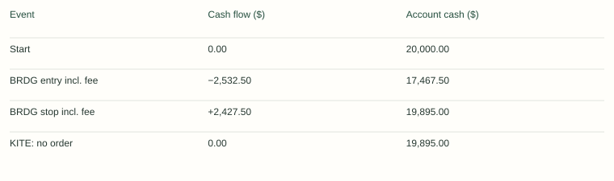

*Fictional connected P1 journal. Skips contribute no account cash flow and are excluded from completed-trade averages.*

#### Track the journey inside the trade

Maximum favorable excursion, or MFE, is the greatest unrealized gain relative to entry during the defined holding interval. Maximum adverse excursion, or MAE, is the greatest unrealized loss over that interval. State whether you measure these from highs and lows, executable quotes, or another price series, and whether costs are included. They are path summaries, not automatically attainable gains or losses.

Suppose a simulated long enters at $50, has a highest subsequent traded price of $54 and a lowest of $48.80, then exits at $51.50. Price MFE is $4 per share and MAE is $1.20 per share. With $2 initial risk per share, these are 2R favorable and 0.6R adverse excursions; the exit is +0.75R before costs. Knowing the high afterward does not mean Maya could identify it in real time. Repeatedly replacing exits with retrospectively ideal highs creates an untradeable comparison. This separate E50/S48 example isolates the measurement definition and is not BRDG’s execution record.

For BRDG, the supplied high while held is $51.30, so price MFE is $0.70/share, $35 or 0.35R. Under the exact-stop model, the measurement ends at the $48.60 fill: price MAE is $2/share, $100 or 1R. The S3 low of $48.40 may occur after the position has exited, so it is not automatically a $110 holding-period MAE. If only daily bars exist, intraday excursion precision is model-dependent; disclose that cutoff instead of claiming the whole daily extreme belonged to the position.

#### Review behavior and outcome separately

A review should show planned action, actual action, and consequence. If Maya's entry rule required a close above $50, but she entered before the close at $49.80, mark that as a timing deviation even if it earned a profit. If she followed the rule and exited at a loss, mark implementation as compliant while still asking whether the rule has sufficient evidence.

The SEC's performance bulletin warns that hypothetical results deserve careful scrutiny. A paper journal is likewise a modeled record. It may omit hesitation, unavailable liquidity, and uncertain fills. Keep its performance distinct from actual execution. Compare both against a defined alternative, such as holding the relevant benchmark during comparable exposure windows or doing nothing. The benchmark needs its own costs and risk interpretation; a journal's profitable trades do not by themselves establish that the activity was worthwhile.

#### Look for patterns without inventing discoveries

Maya reviews 30 fictional outcomes and notices that trades after a green Monday did better. Before calling this a rule, count how many alternative groupings she inspected. Sector, weekday, candle color, indicator threshold, and holding time can generate many apparently interesting partitions. A small favorable subgroup may be a chance finding selected from a large search.

Record the observation as a new hypothesis and test it on later eligible cases. Keep the original sample labeled as discovery data. Also inspect concentration: did one stock or one unusually favorable week explain most of the result? Several trades during one rally are not necessarily independent evidence. The journal's value lies in preserving enough detail to ask these questions. It cannot create a large, representative sample merely by offering elaborate dashboards or persuasive summaries.

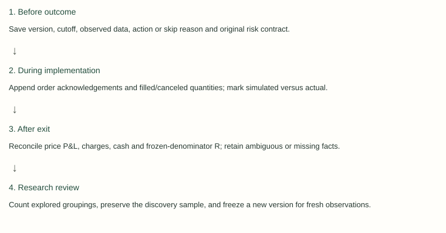

*Fictional journal process. A proposal creates a version for later evaluation; it does not overwrite the earlier decision.*

#### Choose a review cadence and a revision rule

Daily review can confirm whether records are complete; a scheduled longer review can evaluate the method. Mixing the two encourages strategic changes after every emotional result. Maya might verify fields each evening, compare execution weekly, and assess a predeclared research question after a complete batch of eligible cases. These intervals are process examples rather than statistically sufficient sample sizes.

When a revision is justified, assign a new version and preserve the older rule’s outcomes. The completed review proposes P2 but keeps P1-001 untouched. A weekly field-completeness check can be sensible without being a statistically sufficient batch for strategy evaluation. Record what was checked and what remains unknown: broker fills, calendar errors, concentration, and the representativeness of opportunities. Elaborate charts cannot supply information that the journal did not collect.

#### What the journal cannot certify

A timestamped journal makes the author’s stated plan and later edits visible. It cannot by itself establish calibration, causation or a profitable strategy. Keep every eligible opportunity and use the testing chapter’s chronology before treating a journal’s selected wins as evidence.

#### Worked example: A transparent excursion record

Fictional 50-share trade: entry $50, initial planned exit $48, highest price $54, lowest $48.80, final exit $51.50. Initial price risk is $100; MFE is $200, MAE is $60, and realized price profit is $75. Any costs reduce net profit. The MFE was not a guaranteed available exit.

#### Exercise

Reconstruct BRDG’s journal cash flows and net R, then add SKIP without treating it as a trade. Compare BRDG’s modeled MAE to using the full S3 low 48.40. State what the full daily low cannot establish.

Reveal the worked solution

$20,000 − $2,532.50 + $2,427.50 = $19,895. Net −$105; 1R $100; net −1.05R. SKIP: no order/fee/position; no trade R, cash unchanged. One completed trade remains in the trade mean.

Under the exact-stop model, MAE before exit is 50 × (50.60−48.60) = $100/1R. Whole-bar low gives 50 × 2.20 = $110/1.10R, but may include post-exit prices. Without a timestamped sequence, that is a full-bar statistic, not established holding-period MAE.

#### guided practice: Recompute the separate excursion example

For entry 50/stop 48, 50 shares, high 54, low 48.80 and exit 51.50, calculate price MFE, MAE, gross and net result with $5 costs.

Reveal the worked solution

1R = $100. MFE = $200/2R; MAE = $60/0.6R; gross = $75/0.75R; net = $70/0.70R. The high is a path observation, not a guaranteed executable exit.

#### independent practice: Audit a journal summary

Audit this unfamiliar fictional paper journal at the review cutoff. The account starts with $20,000 cash and no holdings. The table contains all five screened candidates; T1 and T2 close before H opens. Entries and exits are supplied confirmed paper reports, not fills inferred from candle touches. Fees paid include all executed-side charges to this cutoff; K and U incur none. A dashboard treats all five candidates as completed trades. Recompute each filled position’s frozen price-risk 1R, the two completed trades’ gross/net dollars and net R, and mean net R per completed trade. Reconcile cash, H’s marked holdings and total equity. Separately report closed-trade net dollars per screened candidate, retaining all five records. Explain why that metric excludes H’s open marked contribution and why neither metric proves strategy performance.

**Five screened candidates at the review cutoff (fictional USD)**

| Record / status | Filled shares | Entry ($) | Initial stop ($) | Exit ($) | Fees paid ($) | Cutoff mark ($) |
| --- | --- | --- | --- | --- | --- | --- |
| T1: closed | 25 | 80 | 78 | 83 | 5 | — |
| T2: closed | 40 | 30 | 28.5 | 28 | 8 | — |
| K: opening-gate skip; no order | 0 | — | — | — | 0 | — |
| U: order expired unfilled; cancellation confirmed | 0 | — | — | — | 0 | — |
| H: still open | 10 | 50 | 48 | — | 2 | 51 |

Reveal the worked solution

T1 freezes 1R = 25 × (80−78) = $50. Gross = 25 × (83−80) = $75; net = $75−$5 = $70, or +1.40R. T2 freezes 1R = 40 × (30−28.50) = $60. Gross = 40 × (28−30) = −$80; net = −$80−$8 = −$88, or −1.4667R. Mean net R per completed trade = (1.40−1.466666…)/2 = −0.0333R, using exact values before rounding. Do not divide by five or divide aggregate net dollars by aggregate initial risk: those are different statistics.

K has no order or position; U has an expired unfilled order but no position. Neither has a trade R denominator. H is a confirmed open position with frozen 1R = 10 × (50−48) = $20, but no completed outcome yet. Retain all five records while excluding K, U and H from the completed-trade mean.

The completed trades contribute $70−$88 = −$18 to cash. H then spends 10 × $50 + $2 = $502. Cash = $20,000−$18−$502 = $19,480. Marked holdings = 10 × $51 = $510; equity = $19,990. H’s marked price gain is $10, or $8 after its paid entry charge, so total equity change is −$18+$8 = −$10. The mark is not a guaranteed liquidation price; no future exit fee or slippage has been modeled.

Closed-trade net dollars per screened candidate = −$18/5 = −$3.60 for this declared cutoff and complete five-record teaching set. Its numerator includes only closed trades, so it omits H’s $8 open marked contribution; it is neither account return nor mean trade R. The account’s marked change is −$10/$20,000 = −0.05%. These constructed records establish accounting, not a representative performance estimate or evidence of rule compliance.

#### Knowledge check

The BRDG stop model exits at 48.60; the same daily bar later has a low 48.40. Which MAE entry is defensible?

1. 1.10R as the proven holding-period MAE because the full daily low is known.
2. −1.05R because MAE is the net realized trade loss.
3. 1R under the declared exact-stop model, with daily-sequence limitations noted.

Reveal the worked solution

Answer: 3. MAE ends at the modeled exit; $2/share × 50 = $100, or 1R. The cutoff is an assumption until execution timing is known.

Option 1: The full-bar extreme can occur after exit; it does not establish a held-position excursion.

Option 2: MAE is a path measurement with a declared price convention, not net realized P&L.

Option 3: MAE ends at the modeled exit; $2/share × 50 = $100, or 1R. The cutoff is an assumption until execution timing is known.

#### Sources

- [SEC / Investor.gov · Investor Bulletin: Performance Claims](https://www.investor.gov/introduction-investing/general-resources/news-alerts/alerts-bulletins/investor-bulletins-47) — Scrutiny of hypothetical performance and performance presentations. Journal designs and fictional case calculations are original instructional examples.

---

### Part 05 review: Process review: one complete record, from budget to review

#### Size a cost-inclusive plan

Unfamiliar fictional stock: entry $32/stop $30.50, $90 cost-inclusive budget, $0.12/share round-trip costs, $1,600 notional cap and ample cash. Compute shares, notional, 1R, ordinary net loss and net R if it gaps to $28. Split costs equally between sides. For this arithmetic, model the entry at $32 and the exit at the stated stop or gap price; actual stop execution may differ.

Reveal the worked solution

Budget allowance = floor(90/1.62) = 55; notional allowance = floor(1600/32) = 50; use 50. Notional $1,600; entry charge $3; price-risk 1R $75; ordinary net loss $81/−1.08R. Gap price loss $200 plus $6 costs = $206; net R−2.7467.

#### Complete a decision and a partial fill

A frozen range edge is $40; a completed close is $40.30. Rule: opening offer must be strictly above the $38.70 stop and at or below the $40.70 ceiling; if it passes, submit one day buy limit at $40.70 for at most 50 shares. Keep a confirmed partial fill and cancel the remainder, with no retry. Standing stop $38.70/target $44.70; model stop first if both levels occur in a held-position bar. Costs are $2.50 per executed side. Required calendar and account checks pass. The opening offer is $40.70; a supplied execution report confirms 20 shares at $40.70. A cancellation report confirms the remaining 30 shares canceled before the next bar. Write the entry and review fields if that later held-position bar is O40.80/H44.90/L38.50/C41. Apply the declared exact-stop model; OHLC alone does not prove a real fill or the true stop/target sequence.

Reveal the worked solution

The supplied reports establish order 50/fill 20 at $40.70/cancel 30 before the later bar; the opening offer alone would not establish those fills. Entry debit = 20 × $40.70 + $2.50 = $816.50; frozen 1R = 20 × ($40.70−$38.70) = $40. The later held bar opens inside both exit levels and reaches both; modeled stop $38.70 gives gross −$40, net −$45/−1.125R. Exit credit = 20 × $38.70−$2.50 = $771.50. Cash change is −$816.50+$771.50 = −$45. Preserve true sequence as unresolved; compliance under the supplied contract and modeled loss are separate fields.

#### Review without rewriting

That trade loses; a separate candidate fails the opening ceiling then rallies. The supplied frozen record contains the original signal and execution rules, but no pre-outcome counterargument or probability estimate. Write an appended review that preserves the available record, identifies those missing fields without inventing them, and proposes defensible future research.

Reveal the worked solution

Keep the supplied original signal and exit priority unchanged. Mark the pre-outcome counterargument and probability estimate as not recorded; do not write a hindsight objection as though it existed before entry. A missing note is a record-quality limitation, not by itself a violation of an execution rule that never required that field. Record the loss under the declared model and the gate rejection as a nontrade with no R denominator. A ceiling relaxation or close-exit rule is a new version motivated by discovery cases. Freeze it and compare later opportunities, including rebounds and losing gaps. Do not diagnose motive or promise improved returns from journaling.

## Part 06: Question, test, refine

Study evidence, test ideas honestly, and separate a good story from a useful method.

### Chapter 24: Evidence before conviction

Turn a chart story into a test that could disappoint you.

> A historical simulation measures a rule under assumptions. Honest evaluation fixes the rule, the information clock, and the cost models before the evidence arrives, then reports how the conclusion changes with them.

**Version 0.4 · AI editorial review recorded 2026-10-12 (/root).**

Review scope: Full chapter final review with inherited initial reviewer/source evidence; final arithmetic, actual figures and native reader checks.

**Learning outcomes**

- Place each research activity on a timeline and state which information it is allowed to use.
- Detect a look-ahead error by comparing a feasible implementation with one that uses later information.
- Process a small trade ledger under declared cost models, from gross to net in dollars and R.
- Calculate a break-even cost per round trip and per share, and explain how a conclusion depends on it.
- Explain why survivorship, unlogged variants, and a reused held-out window weaken evidence.

Builds on: Breakouts, pullbacks & failed moves; Market microstructure: from a chart to an actual trade; Risk & position sizing; From chart idea to trade plan; A journal that can teach you something.

#### Start with a reproducible question

A backtest is a historical simulation of a decision rule, portfolio process, and execution model. “Buy strong stocks” leaves too many choices unresolved. A reproducible specification names the universe, data availability, signal, execution timing, sizing, exits, costs, and treatment of missing or exceptional events. Another reader should be able to implement it without guessing which charts you considered attractive.

Maya’s research question is narrow: when a completed daily close is strictly above the highest high of the prior twenty completed sessions, what happens under a specified next-session entry and exit? Version v1-b of her specification reads as follows. Universe: a point-in-time list of liquid U.S. common stocks, recorded as of each date. Signal: the regular-session close of day t is strictly above the highest high of days t−20 through t−1; the signal day’s own high is excluded. Entry: the next session’s opening price, only if it is no more than 1% above the signal close, rounded down to the cent; otherwise the candidate is a recorded skip. Stop: the lowest low of the ten completed sessions before entry. If the eligible open is at or below that stop, record a skip rather than size a zero or negative distance. Size: shares = floor($100 ÷ (entry − stop)), so 1R, the frozen planned price risk, is about $100 per trade. Because the quantity uses the opening price itself, this is a signal-study simplification: a live order must fix its quantity before the open, for example by sizing from the entry ceiling, and its filled 1R would then fall below $100 whenever the open is lower (Chapter 20). Exits: a target two planned per-share stop distances above entry, the stop, or the close of holding session 10, counting the entry session as session 1, whichever comes first. An opening gap through the stop exits at that open, and a daily bar that contains both stop and target counts as a stop; this applies on the entry day too. For an entry at session E1, the scheduled time exit is therefore the E10 close, not E11. If a halt prevents that exit, keep the holding and stale mark visible; on the first tradable bar after the overdue deadline, apply any opening stop/target gap first, otherwise model the overdue time exit at that opening price. An overdue time exit does not wait for another ten-session period. Costs are reported separately under three declared models introduced later.

Two features of this specification deserve attention. First, it is a signal study: every qualifying signal is evaluated with its own $100 budget, as though capital and position slots were unlimited. That keeps the arithmetic transparent, but it is not a portfolio simulation; Chapter 26 adds slots, cash, and simultaneous candidates. Second, every price, trade, and result in this chapter is invented for teaching so that you can reproduce each step. None of it estimates how a real breakout rule performs.

#### Put the research on a timeline

The most important protection in research is chronological: decide what you will do before you see the evidence that will judge it. The timeline figure lays out Maya’s sequence, and each stage carries a rule about which information it may use. The stages are easy to list and easy to violate, because violations rarely feel like cheating. Glancing at recent charts “just to check that the code works” is enough to let later information shape an earlier choice.

Stage one freezes the written question before any result exists: the v1 specification, the data definitions, the three cost models, the list of variants to explore, the rule that will choose among them, the dates of the development and evaluation windows, and the decision criteria: what held-out result would justify a paper forward study, and what result would end the idea. Stage two runs the listed variants on the earlier development window and logs every one, including the unattractive ones. Stage three applies the declared lock rule, saves the code and data snapshot, and records how many variants were tried. Only then does stage four run the locked rule, once, on the later held-out window, and record the result under every declared cost model.

Walk-forward evaluation repeats stages two to four through time. Develop on, say, the first five years, lock, and evaluate year six; then develop on years one to six, lock again, and evaluate year seven. Each evaluation window is opened only after the rule applied to it has been locked. Stage five, a paper forward study, applies the locked rule to sessions that have not yet happened, with each decision timestamped before its outcome and every fill labeled as simulated. Stage six compares the results with criteria written at stage one. Any change after that point creates a new version, v2, whose development data now include the old held-out window. Evaluating v2 needs a fresh window or more forward observation.

*Maya’s fictional study in chronological order. Each step lists the information it may use. Information from a later step must not flow back into an earlier one; any change after step 4 starts a new version.*

#### Use only information that existed then

Look-ahead bias occurs when a simulated decision uses information unavailable at its timestamp. Buying at an earlier price because later bars confirm a swing high is an obvious example. Less obvious forms include using revised data, today’s index constituents throughout history, or a completed daily close to justify an assumed earlier intraday fill.

Look-ahead is easiest to recognize on data. In the look-ahead table, the highest high of the twenty sessions before day S is $50.00. On day S the stock opens at $49.80, trades up to $50.90, and closes at $50.40. The close is strictly above $50.00, so v1-b signals, but only once the close is final. Day S+1 opens at $50.70, inside the $50.90 entry ceiling (1% above $50.40 is $50.904, rounded down). To isolate the effect of the entry assumption alone, give every implementation 50 shares and measure each to the same S+2 close of $51.50.

Implementation A is feasible: each input existed before it was used, and the gross result is 50 × ($51.50 − $50.70) = $40. Implementation B fills at the $50.40 signal close and reports $55. That close was a real traded price, but the signal did not exist until it printed; trading there requires a declared closing-auction model with its own order deadline, as Chapter 19 described, rather than a default assumption. Implementation C buys at the $49.80 open of day S because the day later closed above the channel. It reports $85, more than double the feasible result, by using the close to justify an earlier trade. Implementation D makes a different mistake. Its window includes day S, so the channel becomes that day’s own $50.90 high, and a close can never be strictly above the high of its own bar. The signal silently disappears. That is not look-ahead, but it changes the opportunity set, which is why the window boundaries belong in the written rule.

The sizes matter. Implementation B overstates this trade by $15 and C by $45. In the held-out study later in this chapter, the feasible rule earns only about $7.60 gross per trade, so a timing error worth $15 per trade would be roughly twice the effect being measured. Other forms of look-ahead are harder to see: a liquidity filter computed from the full sample, a sector classification known only today, or a stop placed at a low that was identified later. Delisting, suspension, and corporate-action handling must also be documented; silently dropping difficult records can change both signals and results.

**One stock around a signal day (fictional OHLC)**

| Day | Open ($) | High ($) | Low ($) | Close ($) | Known at that close |
| --- | --- | --- | --- | --- | --- |
| S−1 | 49.60 | 49.95 | 49.30 | 49.70 | Close below the $50.00 prior-20 high: no signal |
| S | 49.80 | 50.90 | 49.70 | 50.40 | Close above $50.00: signal; entry ceiling $50.90 |
| S+1 | 50.70 | 51.40 | 50.30 | 51.10 | Open $50.70 ≤ $50.90: feasible entry at the open |
| S+2 | 51.00 | 51.80 | 50.90 | 51.50 | Common comparison exit for the table below |

**Four implementations of the same sentence (50 shares, exit at S+2 close)**

| Implementation | Channel used ($) | Signal at S close? | Modeled entry ($) | Gross to $51.50 ($) | Information problem |
| --- | --- | --- | --- | --- | --- |
| A. Prior 20 completed days; next open | 50.00 | Yes | 50.70 (S+1 open) | +40.00 | None: each input existed before it was used |
| B. Fill at the signal close | 50.00 | Yes | 50.40 (S close) | +55.00 | Trades at the price that created the signal; needs a declared auction model |
| C. Buy at the signal day’s open | 50.00 | Yes | 49.80 (S open) | +85.00 | Look-ahead: uses the S close to justify an earlier trade |
| D. Window includes day S | 50.90 | No: 50.40 < 50.90 | None | No trade | Off-by-one definition that deletes the signal |

*Fictional OHLC from the look-ahead table. The day-S close of $50.40 is above the $50.00 prior-20 high, but it is known only at the close; the first feasible fill is the S+1 open of $50.70. Buying at the $49.80 S open would use information that did not yet exist.*

#### Preserve the original opportunity set

Survivorship bias arises when the available sample excludes securities or strategies that disappeared. Studying only companies trading today can remove failed or acquired companies from a historical stock universe. Defining a past portfolio with a current list then gives the simulation information the historical researcher would not have had.

A small example shows the size of the effect. Suppose ten stocks were in a universe at the start of a period. Eight still trade at the end and returned an average of +12%. Two were delisted after falling 70% on average. The equal-weighted average of all ten is (8 × 12% + 2 × (−70%)) ÷ 10 = (96% − 140%) ÷ 10 = −4.4%. A study that starts from today’s list sees only the eight survivors and reports +12%. Nothing in the survivors’ own charts reveals the missing two.

Use point-in-time membership records where the research question requires them. Save the rules for inclusion, exclusions, unavailable data, and final liquidation. Separately audit split adjustments, cash distributions, ticker changes, and whether a series represents price or total return. A split can create a false signal in an untreated price series. A total-return benchmark compared with price-only strategy returns can also distort the comparison. These are data-engineering questions, but they determine what the financial claim actually means.

#### Do not hide the search behind the winner

Overfitting selects features of historical accidents as though they were durable relationships. If Maya tries fifty lookbacks, eight exits, and six filters, then reports only the best combination, she has conducted a large search. The winning result carries information about that selection process as well as about the rule. The original research by Bailey and coauthors addresses the problem of backtest selection and proposes a framework for evaluating overfitting risk.

Maya’s stage-one list was deliberately small: three lookbacks (10, 20, and 55 sessions) crossed with two exit styles, six variants in all. Her lock rule, written before any run, was to choose the highest development average net R under cost model B among variants with at least 30 development trades. The variant log shows the result. The 55-session target version had the most impressive average, +0.34R, but only 22 trades, so the declared rule excluded it, and v1-b, at +0.21R over 41 trades, was locked. Writing the rule first matters. Otherwise the 30-trade minimum, or the choice of net rather than gross results, could itself be tuned after looking.

The same v1-b rule then produced 12 trades in the held-out window, with an average net result under model B of about +0.03R. Selection can produce such a decline because the chosen variant may have benefited from favorable development noise. Market changes and sampling variation could also explain it; the decline alone does not diagnose overfitting. Twelve trades are also far too few to estimate anything precisely, and Chapter 25 shows how wide the uncertainty remains even for twenty. Neither number is a performance estimate. What the record does show is a fair procedure: six variants were tried, one was chosen by a pre-written rule, and the evaluation was run once.

A held-out interval is useful only while it remains outside the design process. Looking at it repeatedly and tuning accordingly turns it into another development set. Bailey and coauthors list further weaknesses of a simple hold-out. A researcher may already know how markets behaved during the held-out years, which can shape the design consciously or not. Short samples leave both windows too small to support a conclusion. And a single held-out test ignores how many configurations were tried before the one being tested. Walk-forward evaluation, a logged variant count, and fresh forward data each address part of this. No split scheme automatically prevents researcher discretion from leaking into conclusions.

**Development variant log (fictional development window)**

| Variant | Lookback (sessions) | Exit rule | Development trades | Average net R, model B | Lock-rule status |
| --- | --- | --- | --- | --- | --- |
| v1-a | 10 | Stop, +2R target, 10-session time exit | 64 | +0.03 | Eligible |
| v1-b | 20 | Stop, +2R target, 10-session time exit | 41 | +0.21 | Eligible; highest: locked |
| v1-c | 55 | Stop, +2R target, 10-session time exit | 22 | +0.34 | Excluded: fewer than 30 trades |
| v1-d | 10 | Stop, 10-session time exit only | 64 | −0.04 | Eligible |
| v1-e | 20 | Stop, 10-session time exit only | 41 | +0.08 | Eligible |
| v1-f | 55 | Stop, 10-session time exit only | 22 | +0.15 | Excluded: fewer than 30 trades |

#### Execution assumptions belong in the result

Costs can include commissions, the bid–ask spread, slippage, market impact, financing, and applicable charges. Which matter depends on the instrument and the trading process. Maya declared three cost models at stage one, each building on the last. Model A charges a $1 commission per order, or $2 per round trip. Model B adds half of an assumed quoted spread on each side, $0.02 per share: buying at the ask and later selling at the bid each cost about half the spread relative to the midpoint, as Chapter 19 showed. Model C adds $0.03 per share of slippage on each side for adverse movement between decision and fill. Per round trip, A costs $2, B costs $2 + $0.04 × shares, and C costs $2 + $0.10 × shares. These are declared assumptions, not estimates of any broker’s or stock’s actual costs.

The entry and exit columns are friction-free reference prices, not already executable ask and bid fills. Spread and slippage are debited once as dollar adjustments in the cost models. If a ledger instead uses actual ask/bid fills, their spread effect is already in price P&L and should not be charged again. The ledger supplies completed teaching trades; it omits their full lookback histories, so it demonstrates accounting, not a reimplementation of every signal in v1-b.

The held-out ledger lists the 12 trades, and each line can be reproduced from three prices. Trade 2 enters BRDG at $31.10 with a $29.60 stop. Risk of $1.50 per share gives floor(100 ÷ 1.50) = 66 shares and planned price risk of 66 × $1.50 = $99, which is that trade’s 1R. The stop exit loses 66 × $1.50 = $99, or −1.00R gross. Trade 8, HALO, gaps below its $26.30 stop and exits at the $25.90 open: 66 × ($25.90 − $27.80) = −$125.40, or −1.27R. Net R always divides by the trade’s frozen planned price risk. It is never divided by a cost-inclusive figure chosen afterward.

The cost table applies the three models trade by trade. Because every position is sized to roughly $100 of price risk, a cheap stock with a tight stop needs many shares, and per-share costs follow the shares. FERN’s 133 shares cost $15.30 under model C, while IRIS’s 25 shares cost $4.50. The four stocks priced under $25 account for 458 of the 854 shares traded and $53.80 of the $109.40 model C total. Risk-based sizing equalizes planned price risk, not cost burden.

The totals table shows the conclusion changing. Gross, the 12 trades earn $91.15, or +0.90R summed. Model A leaves $67.15, model B $32.99, and model C −$18.25 (−0.20R). Under the first three descriptions the rule looks mildly profitable; under the most conservative it loses money. The main figure plots the same four running totals. Notice that the lines separate steadily rather than at one dramatic trade, because costs are charged on every trade, winners and losers alike.

**Held-out ledger, rule v1-b (simulated fills)**

| Trade | Stock | Entry ($) | Stop ($) | Shares | 1R planned risk ($) | Exit ($) | Exit type | Gross P&L ($) | Gross R |
| --- | --- | --- | --- | --- | --- | --- | --- | --- | --- |
| 1 | ATLS | 50.20 | 48.20 | 50 | 100.00 | 54.20 | Target (+2R) | +200.00 | +2.00 |
| 2 | BRDG | 31.10 | 29.60 | 66 | 99.00 | 29.60 | Stop | −99.00 | −1.00 |
| 3 | CRSC | 82.40 | 79.40 | 33 | 99.00 | 84.10 | Time exit | +56.10 | +0.57 |
| 4 | DUNE | 18.30 | 17.30 | 100 | 100.00 | 17.30 | Stop | −100.00 | −1.00 |
| 5 | ELMS | 64.00 | 61.50 | 40 | 100.00 | 69.00 | Target (+2R) | +200.00 | +2.00 |
| 6 | FERN | 12.40 | 11.65 | 133 | 99.75 | 11.65 | Stop | −99.75 | −1.00 |
| 7 | GRAN | 45.50 | 43.50 | 50 | 100.00 | 45.10 | Time exit | −20.00 | −0.20 |
| 8 | HALO | 27.80 | 26.30 | 66 | 99.00 | 25.90 | Gap below stop (open) | −125.40 | −1.27 |
| 9 | IRIS | 95.00 | 91.00 | 25 | 100.00 | 103.00 | Target (+2R) | +200.00 | +2.00 |
| 10 | JUNO | 22.60 | 21.60 | 100 | 100.00 | 21.60 | Stop | −100.00 | −1.00 |
| 11 | KILN | 38.20 | 36.70 | 66 | 99.00 | 39.40 | Time exit | +79.20 | +0.80 |
| 12 | LARK | 15.10 | 14.30 | 125 | 100.00 | 14.30 | Stop | −100.00 | −1.00 |

**Costs per trade under the three declared models**

| Trade | Shares | Model A cost ($) | Model B cost ($) | Model C cost ($) | Net P&L, B ($) | Net P&L, C ($) | Net R, C |
| --- | --- | --- | --- | --- | --- | --- | --- |
| 1 | 50 | 2.00 | 4.00 | 7.00 | +196.00 | +193.00 | +1.93 |
| 2 | 66 | 2.00 | 4.64 | 8.60 | −103.64 | −107.60 | −1.09 |
| 3 | 33 | 2.00 | 3.32 | 5.30 | +52.78 | +50.80 | +0.51 |
| 4 | 100 | 2.00 | 6.00 | 12.00 | −106.00 | −112.00 | −1.12 |
| 5 | 40 | 2.00 | 3.60 | 6.00 | +196.40 | +194.00 | +1.94 |
| 6 | 133 | 2.00 | 7.32 | 15.30 | −107.07 | −115.05 | −1.15 |
| 7 | 50 | 2.00 | 4.00 | 7.00 | −24.00 | −27.00 | −0.27 |
| 8 | 66 | 2.00 | 4.64 | 8.60 | −130.04 | −134.00 | −1.35 |
| 9 | 25 | 2.00 | 3.00 | 4.50 | +197.00 | +195.50 | +1.96 |
| 10 | 100 | 2.00 | 6.00 | 12.00 | −106.00 | −112.00 | −1.12 |
| 11 | 66 | 2.00 | 4.64 | 8.60 | +74.56 | +70.60 | +0.71 |
| 12 | 125 | 2.00 | 7.00 | 14.50 | −107.00 | −114.50 | −1.15 |

**Gross to net for the whole ledger (12 trades, 854 shares)**

| Model | Cost rule | Total cost ($) | Net P&L ($) | Net per trade ($) | Sum of net R | Reading |
| --- | --- | --- | --- | --- | --- | --- |
| Gross | No costs | 0.00 | +91.15 | +7.60 | +0.90 | Mildly positive |
| A | $1 commission per order ($2 per round trip) | 24.00 | +67.15 | +5.60 | +0.66 | Mildly positive |
| B | A + $0.02/share half-spread each side | 58.16 | +32.99 | +2.75 | +0.32 | Barely positive |
| C | B + $0.03/share slippage each side | 109.40 | −18.25 | −1.52 | −0.20 | Negative |

*Fictional held-out ledger from this chapter. Running total P&L in dollars after each trade, starting from 0 before trade 1. All four lines use the same trades and fills; only the declared cost model changes. Compare the endpoints: +$91.15 gross, +$67.15 (A), +$32.99 (B), −$18.25 (C).*

#### Find the cost that would erase the result

Instead of asking only “what is the net result?”, ask “how large would costs have to be to erase the gross result?” That break-even cost turns an uncertain assumption into a threshold you can investigate. With a flat cost per round trip, break-even is gross profit ÷ number of trades: $91.15 ÷ 12 ≈ $7.60 per round trip. With per-share costs on top of model A’s $24 of commissions, break-even is ($91.15 − $24.00) ÷ 854 shares ≈ $0.079 per share per round trip, or about $0.039 per share on each side. Model B’s $0.04 per share per round trip sits below that line; model C’s $0.10 sits above it.

The worked example at the end of this chapter applies the same method to a larger fictional study whose break-even lies between two plausible cost assumptions, so the sign of its result depends on which one is right. When break-even sits close to plausible costs, the result needs direct execution evidence: actual fills, quoted spreads at the decision time, and order sizes relative to typical volume.

Sensitivity analysis applies the same idea to other assumptions. If entry and stop are touched in one daily bar, resolve the sequence with suitable data or a declared conservative rule, as v1-b does. If a model assumes every limit order fills completely when touched, test a less favorable fill convention. Report every declared cost model rather than the friendliest one. Bajgrowicz and Scaillet make a sharper point about break-even costs in large rule searches: rules that survive costs are often not the ones that looked best before costs, and a break-even calculated after the best rule has been chosen is an after-the-fact number. Costs belong inside the selection process, which is why Maya’s lock rule ranks variants on model B rather than on gross results.

#### Interpret the evidence at the right level

A simulation can be useful without being conclusive. Lo, Mamaysky, and Wang studied algorithmic recognition of technical patterns in U.S. stocks from 1962 to 1996 and found that several patterns provided incremental information about conditional return distributions. Their comparison is between distributions, not a completed net trading account, so it does not establish that every visually identified pattern offers net profits today. Pattern definition, sample period, execution, and economic significance remain separate questions. The evidence appendix compares several such studies by market, rule, comparator, and costs.

Report returns beside exposure, turnover, drawdown, benchmark behavior, and the number of substantially independent opportunities. Maya’s honest summary of v1-b is short: six logged variants; one locked by a pre-written rule; twelve held-out trades whose net result runs from +$67.15 to −$18.25 depending on a cost assumption she has not measured; break-even near $7.60 per round trip. Her stage-one criteria said to begin a paper forward study only if the locked rule’s held-out result was positive under model B, to set the idea aside if it was negative even under model A, and otherwise to measure costs before deciding. The model B result, +$32.99, meets the first condition, so the responsible next step is a paper forward study under the frozen rule, with timestamped decisions and labeled simulated fills, together with direct measurement of spreads. The strongest responsible conclusion may be that the idea is worth further study, or that its current evidence is insufficient. A test that rejects an appealing rule has done useful work: it saved the reader from confusing a persuasive example with a reliable method.

#### Use the appropriate empirical comparator

For a rule-selection question, read the adverse DJIA study in the appendix, especially its chronological persistence and cost tests. For a pattern-information question, read Lo, Mamaysky and Wang’s distribution comparison. Neither supplies a performance estimate for Maya’s invented ledger. The study specification must match the claim.

#### Worked example: The cost that reverses a conclusion

Fictional study: 200 round trips generate $1,600 gross profit, so the break-even cost is $1,600 ÷ 200 = $8 per round trip. A modeled $5 cost leaves $1,600 − $1,000 = $600; a modeled $9 cost leaves $1,600 − $1,800 = −$200. Because $8 lies between the two assumptions, a $4 difference per trade reverses the conclusion. The 12-trade held-out ledger in this chapter has a similar break-even, about $7.60 per round trip, so its sign also depends on execution evidence that has not yet been collected.

#### Exercise

Use the held-out ledger. (a) Verify the shares, 1R, and gross P&L of trades 2 and 8. (b) Compute total cost and net P&L under models A, B, and C. (c) Compute the break-even flat cost per round trip and the break-even per-share cost per round trip above model A’s commissions. (d) A different fictional study of 150 round trips earns $975 gross. Find its flat break-even cost and its net results at $5 and $8 per round trip.

Reveal the worked solution

(a) Trade 2: risk per share = $31.10 − $29.60 = $1.50; shares = floor(100 ÷ 1.50) = floor(66.67) = 66; 1R = 66 × $1.50 = $99.00. The stop exit gives 66 × ($29.60 − $31.10) = −$99.00, or −$99.00 ÷ $99.00 = −1.00R. Trade 8: risk per share = $27.80 − $26.30 = $1.50, so again 66 shares and 1R = $99.00. The gap exit at the $25.90 open gives 66 × ($25.90 − $27.80) = −$125.40, or −$125.40 ÷ $99.00 ≈ −1.27R. The R denominator stays $99 even though the loss exceeded it.

(b) Total shares = 854 and gross P&L = +$91.15. Model A: 12 × $2 = $24.00, net +$67.15. Model B: $24.00 + $0.04 × 854 = $24.00 + $34.16 = $58.16, net +$32.99. Model C: $24.00 + $0.10 × 854 = $24.00 + $85.40 = $109.40, net −$18.25. In R, summing each trade’s net P&L ÷ its own 1R gives +0.90R gross, +0.66R (A), +0.32R (B), and −0.20R (C).

(c) Flat break-even = $91.15 ÷ 12 = $7.596, about $7.60 per round trip. Per-share break-even above commissions = ($91.15 − $24.00) ÷ 854 = $67.15 ÷ 854 ≈ $0.0786 per share per round trip, or about $0.039 per share on each side. Model B ($0.04 per share per round trip) is below it and stays positive; model C ($0.10) is above it and turns negative.

(d) $975 ÷ 150 = $6.50 per round trip. At $5: $975 − 150 × $5 = $975 − $750 = +$225. At $8: $975 − 150 × $8 = $975 − $1,200 = −$225. The $6.50 break-even lies between the two assumptions, so a $3 difference in cost per trade reverses the sign. Like the held-out ledger, this result should not be reported without its cost model attached.

#### guided practice: Same R, different cost burden

Trades 6 (FERN) and 9 (IRIS) both have about $100 of planned price risk. Under model C, compute each trade’s cost, net P&L, and net R. Explain why their costs differ so much.

Reveal the worked solution

FERN: risk per share $12.40 − $11.65 = $0.75; shares = floor(100 ÷ 0.75) = 133; 1R = 133 × $0.75 = $99.75. Model C cost = $2 + 133 × $0.10 = $15.30. Gross = 133 × ($11.65 − $12.40) = −$99.75; net = −$115.05; net R = −115.05 ÷ 99.75 ≈ −1.15R.

IRIS: risk per share $95.00 − $91.00 = $4.00; shares = 25; 1R = $100. Model C cost = $2 + 25 × $0.10 = $4.50. Gross = 25 × ($103.00 − $95.00) = +$200; net = +$195.50; net R = +1.955R (shown as +1.96R in the cost table).

Both positions risk about the same dollars, but FERN needs more than five times as many shares because its stop is $0.75 away rather than $4.00. Per-share costs scale with shares, so the tight-stop, low-price trade pays about 0.15R in costs while IRIS pays about 0.045R.

#### independent practice: A colleague’s cost model

A colleague reruns the 12 held-out trades with no commission, a $0.05 per share half-spread on each side, and no slippage. Compute total cost and net P&L, the break-even half-spread per share on each side under zero commission, and say whether the colleague’s result should change Maya’s conclusion.

Reveal the worked solution

Cost per share per round trip = 2 × $0.05 = $0.10, so total cost = 854 × $0.10 = $85.40 and net P&L = $91.15 − $85.40 = +$5.75, about $0.48 per trade.

With zero commission, break-even half-spread per side = $91.15 ÷ (2 × 854) ≈ $0.053 per share. The colleague’s $0.05 assumption sits only about a third of a cent below it.

The colleague’s positive result is not reassuring evidence. It shows the conclusion still hinges on a per-share cost within a fraction of a cent of break-even. The useful next step is to measure actual spreads at the decision times, not to choose the friendliest of four assumptions.

#### independent practice: Audit a backtest description

A report says: (1) the universe is the current members of a stock index, tested over the previous ten years; (2) the signal is a close above the 20-day high “including today”; (3) entries fill at the signal close; (4) the reported lookback is the best of 40 tried; (5) each stop is placed at the lowest low of the three sessions after entry. Classify each problem and propose a repair.

Reveal the worked solution

(1) Survivorship: today’s members exclude stocks that were removed or delisted. Use point-in-time membership. (2) A definition error: a close cannot be strictly above a window that contains its own high, so signals vanish or the code silently uses something else. State the window as the prior 20 completed days. (3) Timing: the fill uses the price whose completion created the signal. Enter at the next open, or declare and justify a closing-auction model. (4) Selection: the best of 40 is an optimistic estimate. Report the variant count and all results, and evaluate the chosen version on data not used to choose it. (5) Look-ahead: the stop uses lows that do not yet exist at entry. Base the stop on completed data before entry.

#### Knowledge check

Maya’s locked v1-b rule gives a weak result on the held-out window. She changes the lookback from 20 to 30 sessions, reruns the same held-out window, and the result improves. How should she label the 30-session result?

1. As a held-out result for the new version, because the 30-session rule was never fitted on the development window.
2. As development evidence for a new version v2, which still needs a fresh evaluation window or forward data.
3. As the replacement for the v1-b result, which should be deleted because that version has been superseded.

Reveal the worked solution

Answer: 2. The 30-session choice was made after seeing the held-out results, so that window now helped design v2. The original v1-b result stays in the record.

Option 1: The held-out window was used to choose the change, so it is no longer outside the design process. Where a rule was first fitted does not matter; what matters is which data influenced the choice.

Option 2: Correct: any change made after viewing evaluation data creates a new version whose evaluation must use data that did not influence it.

Option 3: Deleting the v1-b result hides one of the trials. The record should keep every tested version, which is what makes the search visible.

#### Sources

- [Bailey, Borwein, López de Prado & Zhu · The Probability of Backtest Overfitting](https://www.davidhbailey.com/dhbpapers/backtest-prob.pdf) — Original research on strategy selection and backtest overfitting. Textbook examples do not implement or claim a computed probability of backtest overfitting.
- [Lo, Mamaysky & Wang · Foundations of Technical Analysis (2000 working paper)](https://business.columbia.edu/sites/default/files-efs/pubfiles/19268/Lo-Mamaysky_wang_foundations.pdf) — Algorithmic technical-pattern recognition and conditional return-distribution research using historical U.S. stocks. Does not validate all chart methods or net profitability of textbook examples.
- [Bajgrowicz & Scaillet · Technical trading revisited (author-hosted manuscript, sample to July 2011; published 2012)](https://scaillet.ch/pdfs/BajSca.pdf) — Multiple-testing, ex ante persistence, transaction costs, and DJIA technical rules.
- [Lo, Mamaysky & Wang (2000), Foundations of Technical Analysis](https://www.mit.edu/~alo/Papers/1705-1765.pdf) — Algorithmic pattern recognition and conditional return distributions, distinct from net trading profitability.

---

### Chapter 25: Statistics for a skeptical chart reader

Understand what the numbers measure before trusting their precision.

> Average outcome, return, drawdown, and uncertainty are four different measurements of the same trades. Compute each from the list of outcomes, and let the uncertainty decide how much the others can mean.

**Version 0.4 · AI editorial review recorded 2026-10-12 (/root).**

Review scope: Full chapter final review with inherited initial reviewer/source evidence; final arithmetic, actual figures and native reader checks.

**Learning outcomes**

- Summarize a list of net R outcomes as a distribution, a win rate, average win and loss, and an expectancy computed two ways, before and after costs.
- Convert R outcomes into a dollar equity path and measure account return, maximum drawdown, the gain needed to recover, and the recovery point.
- Explain why the same outcomes in a different order share an average and an ending value but not a drawdown.
- Show how far a 20-trade estimate can move, using one-trade sensitivity, a rough standard-error band, and the break-even win rate.
- In the optional sections, interpret a Wilson interval, CAGR, a Sharpe ratio, and a p-value together with the assumptions each requires.

Builds on: Risk & position sizing; A journal that can teach you something; Evidence before conviction.

#### Start with the outcomes, not a summary

A performance statistic compresses a list of outcomes into one number. Before compressing, look at the list. The ledger below holds twenty completed trades from Maya’s paper record under one frozen rule version. Like every number in this chapter, they are invented so that each statistic can be recomputed by hand, and they estimate nothing about a real strategy. Each trade was sized so that 1R, the frozen planned price risk from entry to stop, equals $100. A modeled cost of $5 per round trip, or 0.05R, is recorded separately, and net R = net P&L ÷ $100.

Read down the columns before summarizing. Five trades reached the +2R target and five hit the −1R stop. The rest left on the time rule with assorted smaller results. One trade gapped below its stop and lost 2.30R before costs; it is recorded as it happened rather than forced to equal −1R. One time exit finished exactly at its entry price, a gross scratch, and the $5 cost turns it into a small net loss of −0.05R. Whether such a trade counts as a win, a loss, or a separate scratch category must be declared. This chapter defines a win as a net result above zero, so the scratch is a loss.

The main figure groups the twenty net outcomes into half-R bins; the frequency table gives the same counts. This shape is the payoff distribution: a cluster of stop losses just below −1R, a single gap loss in the far-left tail, a spread of small time-exit results near zero, and a cluster of target exits just below +2R. Two methods with the same average can have very differently shaped histograms. The shape tells you what experience the average summarizes: frequent small losses with occasional large wins, or frequent small wins with occasional large losses.

**Twenty fictional paper trades (1R = $100; cost $5 = 0.05R per trade)**

| Trade | Exit type | Gross R | Cost (R) | Net R | Net P&L ($) |
| --- | --- | --- | --- | --- | --- |
| 1 | Target (+2R) | +2.00 | 0.05 | +1.95 | +195.00 |
| 2 | Stop | −1.00 | 0.05 | −1.05 | −105.00 |
| 3 | Time exit | +0.60 | 0.05 | +0.55 | +55.00 |
| 4 | Stop | −1.00 | 0.05 | −1.05 | −105.00 |
| 5 | Target (+2R) | +2.00 | 0.05 | +1.95 | +195.00 |
| 6 | Time exit | +0.35 | 0.05 | +0.30 | +30.00 |
| 7 | Gap below stop | −2.30 | 0.05 | −2.35 | −235.00 |
| 8 | Stop | −1.00 | 0.05 | −1.05 | −105.00 |
| 9 | Time exit | +0.90 | 0.05 | +0.85 | +85.00 |
| 10 | Target (+2R) | +2.00 | 0.05 | +1.95 | +195.00 |
| 11 | Time exit (scratch) | 0.00 | 0.05 | −0.05 | −5.00 |
| 12 | Time exit | +0.25 | 0.05 | +0.20 | +20.00 |
| 13 | Stop | −1.00 | 0.05 | −1.05 | −105.00 |
| 14 | Time exit | +1.40 | 0.05 | +1.35 | +135.00 |
| 15 | Time exit | +0.15 | 0.05 | +0.10 | +10.00 |
| 16 | Time exit | −0.40 | 0.05 | −0.45 | −45.00 |
| 17 | Target (+2R) | +2.00 | 0.05 | +1.95 | +195.00 |
| 18 | Stop | −1.00 | 0.05 | −1.05 | −105.00 |
| 19 | Time exit | +1.10 | 0.05 | +1.05 | +105.00 |
| 20 | Target (+2R) | +2.00 | 0.05 | +1.95 | +195.00 |

**Frequency table of net R (each bin includes its lower edge)**

| Net R bin | Trades |
| --- | --- |
| −2.5 to −2 | 1 |
| −2 to −1.5 | 0 |
| −1.5 to −1 | 5 |
| −1 to −0.5 | 0 |
| −0.5 to 0 | 2 |
| 0 to 0.5 | 3 |
| 0.5 to 1 | 2 |
| 1 to 1.5 | 2 |
| 1.5 to 2 | 5 |

*Fictional paper record from this chapter’s ledger, net of a $5 (0.05R) cost per trade. Bar height is the number of trades in each half-R bin; every bin includes its lower edge. Look at the two clusters near −1R and +2R and the single gap loss in the left tail.*

#### Average outcome: expectancy computed two ways

Win rate is the proportion of trades with a positive net result: 12 of 20, or 60%. On its own it says little. The twelve net wins sum to +14.15R, an average win of 14.15 ÷ 12 ≈ +1.18R. The eight net losses sum to −8.10R, an average loss of 8.10 ÷ 8 ≈ 1.01R in magnitude. Expectancy, the average result per trade, can be computed two ways. By formula: win rate × average win − loss rate × average loss = 0.60 × 1.179 − 0.40 × 1.0125 ≈ +0.30R. Directly: total net R ÷ number of trades = (14.15 − 8.10) ÷ 20 = 6.05 ÷ 20 = +0.3025R. The two agree because they are the same arithmetic rearranged. If they disagree in your own work, a trade has been miscounted, or the loss rate was taken as 1 − win rate although a scratch belongs to neither group. In the before-cost (gross) column of the ledger, for example, there are 12 wins, 7 losses and 1 scratch, so the loss rate is 7 ÷ 20 = 35%: 0.60 × (14.75 ÷ 12) − 0.35 × 1.10 = 0.7375 − 0.3850 = +0.3525R.

Costs enter every trade. Gross, the same twenty trades total +7.05R, a gross expectancy of +0.3525R. Twenty costs of 0.05R remove 1.00R, leaving +6.05R. In dollars at $100 per R, that is $705 gross, $100 of costs, and $605 net. Costs also changed one classification, turning the gross scratch into a net loss. In a real record, prefer the direct average: it automatically includes the gap loss, the scratch, and every partial result, whereas the two-group formula is easily fed planned values, such as −1R for every loss, instead of the recorded averages.

The formula is still useful for reasoning about assumed distributions. If 40% of trades earn +2R and 60% lose 1R, gross expectancy is 0.40 × 2 − 0.60 × 1 = +0.20R; deducting 0.08R of average costs leaves +0.12R. A second assumed method wins 80% of the time for +0.25R and loses 20% of the time for 1.5R: 0.20 − 0.30 = −0.10R before costs, despite its high win rate. Rearranging the formula gives a break-even win rate, average loss ÷ (average win + average loss). For Maya’s sample that is 1.0125 ÷ (1.179 + 1.0125) ≈ 46.2%. Her observed 60% is above it, but the section on uncertainty asks whether twenty trades can tell 60% from 46%.

**The same twenty trades, before and after costs**

| Measure | Gross | Net (after $5 per trade) |
| --- | --- | --- |
| Wins (result > 0) | 12 | 12 |
| Losses (result < 0) | 7 | 8 |
| Scratches (result = 0) | 1 | 0 |
| Win rate | 60% (12 of 20) | 60% (12 of 20) |
| Total R | +7.05R | +6.05R |
| Expectancy (total ÷ 20) | +0.3525R | +0.3025R |
| Average win | +1.229R (14.75 ÷ 12) | +1.179R (14.15 ÷ 12) |
| Average loss (magnitude) | 1.10R (7.70 ÷ 7) | 1.0125R (8.10 ÷ 8) |
| Total in dollars | $705 | $605 |

#### From R to dollars: the equity path and its drawdowns

Expectancy describes the average trade, but the account experiences trades in order. Start Maya’s paper account at $20,000, add each net result at $100 per R, and you get an equity path: $20,195 after trade 1, $20,090 after trade 2, and so on to $20,605 after trade 20. Account return (ending equity ÷ starting equity − 1) is $605 ÷ $20,000 = 3.025%, about 3.03%. Because each trade risks a fixed $100 rather than a fraction of current equity, the order of the trades does not change this ending value.

Drawdown measures the decline from the highest equity reached so far, the running peak: drawdown = (running peak − current equity) ÷ running peak. An underwater plot draws this percentage below zero at every point and returns to zero whenever a new peak is set. In the recorded order, equity peaks at $20,265 after trade 6, falls through the gap loss to $19,925 after trade 8, and does not exceed $20,265 again until trade 17. The maximum drawdown is $340, or 340 ÷ 20,265 ≈ 1.68% of the peak. Recovering it requires a 340 ÷ 19,925 ≈ 1.71% gain from the trough, slightly more than the percentage lost because the denominator is now smaller, the same asymmetry Chapter 20 showed. The account stayed below the trade-6 peak at ten successive closes (trades 7–16), recovering at trade 17, eleven trade intervals after that peak.

Now rearrange the same twenty outcomes so that the eight losses come first. The average is still +0.3025R, the win rate still 60%, and the ending equity still $20,605. But the account falls from $20,000 to $19,190 before the first win: an $810 drawdown of 4.05%, which needs a 4.22% gain to recover and is regained at trade 16. The panel figure shows both orderings, with dollars and percentages on separate axes. Doubling the dollars per R would double every dollar gain, loss and drawdown, though not the account balances; the percentage drawdowns would also roughly double, to 3.31% and 8.10%. Average outcome, account return, and drawdown answer three different questions. A recorded drawdown is the worst decline in one ordering of one sample. It is not a maximum future loss, and other orderings of the same trades can be much deeper.

**Same trades, two orders ($20,000 start, $100 per R)**

| Measure | Recorded order | Losses-first order |
| --- | --- | --- |
| Ending equity ($) | 20,605 | 20,605 |
| Account return | 3.03% | 3.03% |
| Expectancy (net R per trade) | +0.3025R | +0.3025R |
| Running peak before the deepest decline ($) | 20,265 (after trade 6) | 20,000 (start) |
| Trough ($) | 19,925 (after trade 8) | 19,190 (after trade 8) |
| Maximum drawdown | $340 = 1.68% of peak | $810 = 4.05% of peak |
| Gain needed from trough | 1.71% | 4.22% |
| First trade back at or above that peak | Trade 17 ($20,410) | Trade 16 ($20,100) |

*Fictional paper account, $20,000 start, $100 per R, net of costs. Both orders end at $20,605 with the same +0.3025R average; only the path differs. Dollars and percentages are on separate panels.*

#### How much can twenty trades tell you?

The arithmetic above describes twenty trades; interpreting it as an estimate of a repeatable outcome process requires a sampling model, and twenty is a small sample. You can see how fragile the estimate is without any formula. Drop one of the five +1.95R target trades and the average of the remaining nineteen falls to +0.22R. Drop the gap loss instead and it rises to +0.44R. One trade in twenty moves the estimate by roughly a quarter to a half of its value. Removing a genuine loss because it is inconvenient is not analysis; this calculation only shows how much a single observation weighs. If a trade was a data error, correct it and keep the audit trail.

The uncertainty figure tracks the running average after each trade. It is +1.95R after one trade, turns negative after trade 8 (−0.09R), and finishes at +0.30R. Around it, from trade 5 onward, is a rough band of plus or minus two standard errors. The standard error is the sample standard deviation of net R divided by the square root of the number of trades. After 20 trades the standard deviation is about 1.31R. To reproduce it, subtract the mean (0.3025R) from each net result, square and add the differences (32.512), divide by n − 1 = 19 (1.7112), and take the square root: 1.308R. Dividing by 20 instead, as Chapter 12’s population bands do, would give 1.275R; the n − 1 divisor is the usual choice when a sample estimates an unknown spread. The standard error is then about 0.29R, and the band runs from roughly −0.28R to +0.89R. At a fixed standard deviation under the independence model, band width falls as one over the square root of the trade count, so halving it needs about four times as many trades. The realized sample standard deviation also changes as observations arrive.

The band is a rough guide, not a precise interval. It treats the trades as independent draws from one unchanging distribution, and with twenty lumpy outcomes even that approximation is crude. Even within that model, a t-interval would use a multiplier larger than 2: about 2.09 at 20 trades (about −0.31R to +0.91R) and 2.78 at five, so the band is too narrow throughout, most of all early on. Zero lies inside this approximate band, so it does not provide convincing evidence of a positive mean under that model. This is an illustration of imprecision, not a calibrated hypothesis test for these twenty lumpy observations. The win-rate interval illustrates another dimension of uncertainty. The 60% observed win rate has a 95% Wilson interval of about 38.7% to 78.1%, explained in the optional section that follows, and that range contains the 46.2% break-even computed from the observed payoffs. That comparison is illustrative: the average win and loss used to compute break-even are themselves uncertain, so the Wilson interval alone is not a test of positive expectancy. A sample this size can teach the arithmetic. It cannot validate a strategy, whether its trades are fictional or real.

**How far the twenty-trade estimate can move**

| Calculation | Result | What it shows |
| --- | --- | --- |
| Mean net R, all 20 trades | +0.3025R | The point estimate |
| Mean without one +1.95R target trade (19 trades) | +0.216R | One winner carries about 0.09R of the average |
| Mean without the −2.35R gap loss (19 trades) | +0.442R | One loss carries about 0.14R of the average |
| Sample standard deviation of net R | 1.308R | Typical spread of single outcomes |
| Standard error (1.3081 ÷ √20) | 0.2925R | Rough uncertainty of the mean |
| Mean ± 2 standard errors | −0.28R to +0.89R | Includes zero |
| Win rate and 95% Wilson interval | 60%; 38.66% to 78.12% | Includes the break-even win rate |
| Break-even win rate (1.0125 ÷ 2.1917) | 46.2% | Win rate needed at these average payoffs |

*Fictional ledger from this chapter. The running mean of net R after each trade, with a rough band of ±2 standard errors from trade 5 onward. The band still includes zero after twenty trades. It assumes independent trades and is a guide, not a precise interval.*

#### Optional: an interval for a win rate (optional extension)

Prerequisites: the expectancy and uncertainty sections of this chapter, and comfort with a square root. An observed proportion is an estimate. NIST’s Dataplot documentation gives the Wilson score interval as an alternative to a symmetric normal-approximation interval. Its limits stay within the probability range. The formula used here comes from that documentation; the linked handbook also discusses exact binomial intervals. With p̂ = 12/20 = 0.60, n = 20, and z ≈ 1.96 for 95%, the limits are [p̂ + z²/(2n) ± z × √(p̂(1 − p̂)/n + z²/(4n²))] ÷ (1 + z²/n). Numerically, the center term is 0.60 + 0.09604 = 0.69604, the square-root term is 1.96 × √(0.0120 + 0.002401) ≈ 0.23521, and the divisor is 1.19208. The interval is approximately 38.66% to 78.12%. That range is compatible with materially different trading interpretations.

This interval assumes independent Bernoulli trials with a common probability. Trades across changing regimes or simultaneous stocks may violate those assumptions. It is not a 95% probability guarantee for the next trade, nor a direct interval for expected profit. Win sizes and loss sizes remain unknown even when the win probability is well estimated. A frequentist confidence procedure describes its long-run coverage under its model; the particular observed interval does not assign a probability to a fixed underlying parameter.

#### Optional: dependence reduces the information you have (optional extension)

Prerequisites: the uncertainty section of this chapter. Twenty trades taken during one sector rally may share a driver. Counting each as independent can make the sample look more informative than it is. If Maya’s twenty trades came in four bursts of five, each during a different market episode, the record may behave more like four observations of “how the rule did in that episode” than twenty independent draws, and the standard-error band above would be too narrow. Overlapping holding periods create dependence as well. Inspect results by period, instrument group, and market condition, while remembering that increasingly fine partitions produce small subgroups and additional opportunities to select attractive accidents.

As a brief introduction to a topic needing separate technical study, a bootstrap resamples observed data to study variation in a statistic under a chosen resampling model. For time-dependent returns, block resampling preserves some local sequences rather than shuffling individual days independently. Choosing blocks requires judgment, and a bootstrap cannot manufacture unobserved crises or repair biased data. Treat simulated distributions as conditional on their assumptions. Report whether the result changes materially when a few concentrated observations or one particular period dominate the sample.

#### Optional: annualized return and the Sharpe ratio (optional extension)

Prerequisites: the equity-path section of this chapter, exponents, and the idea of a standard deviation. Compound annual growth rate summarizes start-to-finish compounding: CAGR = (ending equity ÷ starting equity)^(1 ÷ years) − 1, assuming external cash flows have been handled appropriately. If Maya’s twenty paper trades spanned six months, CAGR = (20,605 ÷ 20,000)^(1 ÷ 0.5) − 1 = 1.03025² − 1 ≈ 6.14%. Annualizing expresses the observed growth as an equivalent constant yearly rate. It adds no information and forecasts nothing; projecting that rate forward would assume the observed growth repeats. A short interval can produce a striking annualized number. Report the period and the raw account return beside it.

The Sharpe ratio divides the mean excess, or differential, return by the standard deviation of those same excess returns over a consistent interval. “Excess” requires specifying the reference rate or benchmark. Sharpe shows that multiplying a one-period ratio by the square root of the number of periods relies on zero serial correlation, so multiplying a daily ratio by √252 is a common convention under restrictive assumptions rather than a universally valid step. Dividing Maya’s mean net R by its standard deviation (0.3025 ÷ 1.308 ≈ 0.23) is not a Sharpe ratio: R per trade is not a return over a fixed time interval, and no reference rate has been subtracted. Standard deviation also treats upside and downside variation together and does not directly describe liquidity, leverage, or catastrophic tail exposure. Two methods with similar summary ratios can feel very different to the person holding them.

#### Optional: p-values and how many numbers were considered (optional extension)

Prerequisites: the uncertainty section of this chapter and the variant log in Chapter 24. A p-value is the probability, computed under a specified null model, of a test statistic at least as extreme as the one observed. NIST advises deciding the rejection threshold before seeing the results. A p-value is not the probability that the null hypothesis is true (for example, that the rule has no edge), and by itself it says nothing about whether a gross effect survives costs.

Searching changes the interpretation. Maya’s development log in Chapter 24 had six variants. If six independent tests were each run at a 5% threshold on rules with no edge, the chance that at least one passes is 1 − 0.95⁶ ≈ 26%. Variants that share trades are related, which changes that figure, but reporting only the passing variant still overstates the evidence. Bajgrowicz and Scaillet address this at scale, testing 7,846 technical rules on daily Dow Jones Industrial Average data with a false-discovery-rate method; the Research and evidence appendix at the end of the book summarizes what they found. Use each statistic for its own question, then state the uncertainty it leaves unresolved. Apparent precision in a spreadsheet should never conceal fragile definitions, limited independent data, or a large unreported search.

#### Do not confuse different evidence tests

A difference between conditional return distributions asks about information; a cost-adjusted portfolio return asks about implementation. The pattern and DJIA-rule studies in the Research and evidence appendix use different comparisons. Neither a statistically significant difference nor a gross mean alone supplies an executable net advantage.

#### Worked example: A payoff ratio is not expectancy

A planned +2R target and −1R stop give a nominal payoff ratio of 2. If the target occurs only 25% of the time and every other outcome is exactly −1R, gross expectancy is 0.25 × 2 − 0.75 × 1 = −0.25R. The break-even win rate for these two outcomes is 1 ÷ (2 + 1) ≈ 33.3%. Costs raise it, and real trades also include time exits and gaps that a two-outcome picture leaves out.

#### Exercise

Using the twenty-trade ledger: (a) compute the net win rate, average win, average loss, and expectancy by formula and by direct average, then the gross expectancy; (b) build the equity path from $20,000 at $100 per R and find account return, maximum drawdown in dollars and percent, the gain needed to recover, and the trade at which equity first regains the earlier peak; (c) compute the mean net R without trade 7 and explain why that number is not the rule’s result.

Reveal the worked solution

(a) Net wins are trades 1, 3, 5, 6, 9, 10, 12, 14, 15, 17, 19 and 20, so the win rate is 12 ÷ 20 = 60%. Their net R sum is 5 × 1.95 + 0.55 + 0.30 + 0.85 + 0.20 + 1.35 + 0.10 + 1.05 = 14.15R, so the average win is 14.15 ÷ 12 ≈ 1.179R. The losses sum to 5 × (−1.05) − 2.35 − 0.05 − 0.45 = −8.10R, an average loss of 1.0125R. Formula: 0.60 × (14.15 ÷ 12) − 0.40 × 1.0125 = 0.7075 − 0.4050 = +0.3025R. Direct: (14.15 − 8.10) ÷ 20 = +0.3025R. Gross: (6.05 + 20 × 0.05) ÷ 20 = 7.05 ÷ 20 = +0.3525R.

(b) Multiply each net R by $100 and add: 20,000 → 20,195 → 20,090 → 20,145 → 20,040 → 20,235 → 20,265 → 20,030 → 19,925 → 20,010 → 20,205 → 20,200 → 20,220 → 20,115 → 20,250 → 20,260 → 20,215 → 20,410 → 20,305 → 20,410 → 20,605. Account return = 605 ÷ 20,000 = 3.025%. The running peak of $20,265 (trade 6) is followed by the lowest later value, $19,925 (trade 8): drawdown = $340, and 340 ÷ 20,265 ≈ 1.68%. Gain needed = 340 ÷ 19,925 ≈ 1.71%. Equity first reaches $20,265 or more at trade 17 ($20,410). The smaller dip after trade 4 ($20,040 from a $20,195 peak, 0.77%) is not the maximum.

(c) Without trade 7: (6.05 + 2.35) ÷ 19 = 8.40 ÷ 19 ≈ +0.442R. The gap loss happened under the rule, so it belongs in the result; dropping it measures only how much one observation moves a small-sample average. A trade could be removed only if it were shown to be a data error, with the correction documented.

#### guided practice: Drawdown when the losses come first

Reorder the twenty net results with the eight losses first, in ledger order (−1.05, −1.05, −2.35, −1.05, −0.05, −1.05, −0.45, −1.05), followed by the twelve wins in ledger order. Starting at $20,000 with $100 per R, find the trough, the maximum drawdown in dollars and percent, the percentage gain needed to recover, and the trade at which the account first returns to $20,000.

Reveal the worked solution

The eight losses total −8.10R, or −$810, so equity bottoms at $20,000 − $810 = $19,190 after trade 8. The peak before it is the $20,000 start, so maximum drawdown = $810 ÷ $20,000 = 4.05%.

Recovery needs $810 ÷ $19,190 ≈ 4.22%. The wins in order add $195, $55, $195, $30, $85, $195, $20, $135, giving running gains of $195, $250, $445, $475, $560, $755, $775, and $910. The account first reaches at least $20,000 after the eighth win, which is trade 16, at $19,190 + $910 = $20,100.

Ending equity is still $20,605 and expectancy still +0.3025R. Only the path, and therefore the drawdown, changed.

#### independent practice: Break-even win rate with costs

An assumed method wins 35% of the time for +3R and otherwise loses 1R, before costs. Average costs are 0.12R per trade. Compute gross and net expectancy, then the break-even win rate before and after costs.

Reveal the worked solution

Gross expectancy = 0.35 × 3 − 0.65 × 1 = 1.05 − 0.65 = +0.40R. Net expectancy = 0.40 − 0.12 = +0.28R. Equivalently, winners net +2.88R and losers −1.12R: 0.35 × 2.88 − 0.65 × 1.12 = 1.008 − 0.728 = +0.28R.

Before costs, the break-even win rate p solves 3p = 1 × (1 − p), so p = 1 ÷ 4 = 25%. After costs, 2.88p = 1.12(1 − p), so p = 1.12 ÷ 4.00 = 28%. Costs raise the win rate the method needs by three percentage points. These are assumed probabilities and payoffs, not estimates.

#### independent practice: Evaluate a confident claim

A reader looks at the twenty-trade record and writes: “Twelve wins in twenty and +0.30R per trade. This rule works.” Using only numbers from this chapter, write a short reply that separates what the record shows from what it cannot show.

Reveal the worked solution

A strong reply makes four points. First, the arithmetic is right: 60% net wins and +0.3025R expectancy after the modeled $5 cost. Second, the estimate is fragile: removing one +1.95R trade gives +0.22R, removing the gap loss gives +0.44R, and the rough ±2 standard-error band runs from about −0.28R to +0.89R, which includes zero.

Third, the 95% Wilson interval for the win rate is about 38.7% to 78.1%, which includes the sample-based 46.2% break-even. Both payoff estimates are uncertain too, so this comparison does not constitute an expectancy test. Fourth, the record does not show whether trades were clustered in time or shared a market driver; if they were, independence fails and these intervals are too narrow. These fictional outcomes teach calculations; establishing a real rule’s merit needs independent evaluation, a suitable comparator, and execution evidence.

#### Knowledge check

Maya’s twenty net results contain 12 wins averaging +1.18R and 8 losses averaging −1.01R. A colleague reports expectancy as 1.18 − 1.01 = +0.17R. What is the correction?

1. Divide the difference by the number of trades: (1.18 − 1.01) ÷ 20 ≈ +0.01R per trade.
2. Use the gross averages instead, because the $5 cost is already built into the $100 R denominator.
3. Weight each average by its frequency: 0.60 × 1.18 − 0.40 × 1.01 ≈ +0.30R, which matches the direct average of the twenty net results.

Reveal the worked solution

Answer: 3. Expectancy weights the average win and the average loss by how often each occurs. The result matches 6.05R ÷ 20 = +0.3025R.

Option 1: Subtracting the two group averages omits their 60%/40% frequencies. Dividing that unweighted difference by 20 does not repair the error; the direct method divides the sum of all outcomes by 20.

Option 2: The R denominator is the $100 planned price risk only; costs are recorded separately and must be subtracted. Gross figures would overstate expectancy by 0.05R per trade.

Option 3: Correct: with 60% wins and 40% losses, the weighted result equals the total net R divided by the number of trades.

#### Sources

- [NIST/SEMATECH · Confidence Intervals for a Binomial Proportion](https://www.itl.nist.gov/div898/handbook/prc/section2/prc241.htm) — Binomial proportion confidence-interval methods and assumptions; the 12-of-20 Wilson interval is independently calculated for illustration.
- [Bailey, Borwein, López de Prado & Zhu · The Probability of Backtest Overfitting](https://www.davidhbailey.com/dhbpapers/backtest-prob.pdf) — Original research on strategy selection and backtest overfitting. Textbook examples do not implement or claim a computed probability of backtest overfitting.
- [NIST/SEMATECH · Critical Values and p Values](https://itl.nist.gov/div898/handbook/prc/section1/prc131.htm) — Meaning of a p-value under a specified null hypothesis.
- [William F. Sharpe · The Sharpe Ratio (1994)](https://web.stanford.edu/~wfsharpe/art/sr/sr.htm) — Definition using differential returns and dependence on measurement interval; assumptions behind time scaling.
- [NIST Dataplot · Agresti Coull: Wilson score interval](https://www.itl.nist.gov/div898/software/dataplot/refman2/auxillar/agrecoul.htm) — Wilson score interval formula and distinction from adjusted Wald; original 12/20 arithmetic computed independently.
- [NIST · Confidence Limits for the Mean](https://www.itl.nist.gov/div898/handbook/eda/section3/eda352.htm) — Long-run coverage interpretation and standard-error mean formula; not an exact justification of the textbook’s crude ±2 SE band.
- [Lo, Mamaysky & Wang (2000), Foundations of Technical Analysis](https://www.mit.edu/~alo/Papers/1705-1765.pdf) — Algorithmic pattern recognition and conditional return distributions, distinct from net trading profitability.
- [Bajgrowicz & Scaillet · Technical trading revisited (author-hosted manuscript, sample to July 2011; published 2012)](https://scaillet.ch/pdfs/BajSca.pdf) — Multiple-testing, ex ante persistence, transaction costs, and DJIA technical rules.

---

### Chapter 26: Designing a complete trading system

A signal is one component of a much larger decision process.

> A complete system specifies data, eligibility, ranking, sizing, fills, exits, and accounting so precisely that two people processing the same inputs produce the same ledger.

**Version 0.4 · AI editorial review recorded 2026-10-12 (/root).**

Review scope: Full chapter final review with inherited initial reviewer/source evidence; final arithmetic, actual figures and native reader checks.

**Learning outcomes**

- Screen, rank with a deterministic tie-break, and size simultaneous candidates as the smallest of the risk, notional, and cash allowances.
- Process fills, partial fills, nonfills, halts, gaps, same-bar ambiguity, and time exits in a declared order.
- Keep a ledger in which cash + holdings = equity at every close, with reserved cash and costs, and report net R on each trade’s frozen 1R.
- Distinguish definitions, conventions, and arbitrary teaching settings, and explain why any rule change, including a regime filter, is a new version.

Builds on: Breakouts, pullbacks & failed moves; Events and opening gaps; Market microstructure: from a chart to an actual trade; Risk & position sizing; From chart idea to trade plan; A journal that can teach you something; Evidence before conviction.

#### Start with an economic question

A trading system is an organized set of decisions that can be applied consistently. It need not be automated, but its rules should be clear enough to evaluate. Begin with a proposed mechanism and an observable claim. “Trends may persist over this horizon” is a research hypothesis. “This indicator predicts everything” is not a useful specification. The mechanism does not prove an edge; it tells you what evidence would support or weaken the idea.

Chapter 24 tested a twenty-session breakout signal one trade at a time, as though capital and position slots were unlimited. This chapter builds Atlas-20, a complete fictional research system around the same kind of daily breakout signal, and makes every remaining decision explicit. It freezes version 1.0 of the rule sheet, supplies a small invented market of eight stocks over eight sessions, and processes each decision in order until the ledger reconciles to the cent. All companies, prices, volumes, and calendars are fictional. The percentages are teaching settings, not recommended allocations, and the system has no demonstrated performance. The scenario was built to exercise the rules, including a tie, a partial fill, an unfilled order, a halt, and other exceptions, so it is not a typical week.

Use one test for completeness: two careful readers given the same inputs should produce the same ledger without asking the author anything. Each rule below is labeled as a definition, a modeling convention, a scope choice, or an arbitrary teaching setting. The included scripts/atlas20-sim.cjs processes the supplied scenario under the rule sheet and reproduces its accounting; it is a teaching simulator, not a trading engine. You can also reproduce every number by hand from this chapter’s tables.

#### Write the data and eligibility contract

Atlas-20 uses a point-in-time universe and completed regular-session daily bars. “Point in time” means the system uses the member list, prices, and calendar as they were known at each decision close, not as they are known today. The signal needs the twenty sessions before the decision day, so a stock needs 21 consecutive valid bars before it can be screened. If any of those bars is missing, v1.0 records an incomplete record and evaluates nothing that day. It does not fill the gap with yesterday’s price, because an invented bar could create or hide a breakout.

Each filter is part of the research claim, so each is stated with its data and timing. The liquidity filter averages close × volume over the twenty sessions ending at the decision close. A cutoff chosen from the full sample would quietly use the future. The price band keeps the fixed $2 stop between 2% and 10% of the share price. Without it, the same rule would mean very different risks for a $15 stock and a $150 stock. The earnings exclusion covers sessions t+1 through t+10 because this is the planned ten-session holding window for an entry in t+1 (holding session 1), ending at t+10 (holding session 10), so entries exclude announcements known at the decision close within that window. A rescheduled or unexpected announcement remains possible; the calendar is not insurance. The checks run in a declared order, and the first failure is recorded. That keeps the record of skipped candidates honest. A halt can extend the actual elapsed holding beyond that planned window; the calendar filter cannot exclude every announcement during an overdue holding.

**Atlas-20 v1.0 rule sheet, part 1: data, universe, and eligibility**

| Rule | Atlas-20 v1.0 setting | Kind |
| --- | --- | --- |
| Scope | Long-only fictional U.S.-listed common stocks in one U.S.-dollar account; no leverage, short sales, or derivatives. | Scope choice |
| Universe | Point-in-time member list as of each decision date. Scenario members throughout: Alder, Birch, Cedar, Dogwood, Elm, Fir, Ginkgo, Hazel. | Convention |
| Data and clock | Completed regular-session daily OHLC and share volume; split adjustment uses only actions effective by the decision date. Decisions are computed after the close; orders are submitted before the next open. | Convention |
| Minimum history | 21 consecutive valid bars: sessions t−20 through t. | Teaching setting |
| Missing data | Any absent or invalid bar in t−20…t: no signal is evaluated that day. No interpolation or carried-forward bars. | Convention |
| Already held | A stock with an open position or a working order is not screened; v1.0 never adds to a position. | Teaching setting |
| Signal | Close at t strictly above the highest high of sessions t−20…t−1. | Definition |
| Price band | $20.00 ≤ decision close ≤ $100.00, so the fixed $2 stop is 2%–10% of price. | Teaching setting |
| Liquidity | Mean of close × volume over sessions t−19…t ≥ $2,000,000 (past data only). | Teaching setting |
| Earnings | No scheduled earnings in sessions t+1…t+10 (the planned ten-session holding window; a halt can delay exit), per the calendar snapshot at the decision close. | Teaching setting |
| Regime filter | None in v1.0. | Scope choice |
| Check order | Complete record → signal → price band → liquidity → earnings. The first failure is recorded. | Convention |

#### Translate a signal into portfolio decisions

An eligible stock signals when its completed close exceeds the highest high of the prior twenty completed sessions. When several qualify at the same close, Atlas-20 ranks them by breakout margin, the percentage by which the close clears that high. Rank the margin rounded to 0.01 percentage point, as stated in the table; ties in that rounded value are broken alphabetically. Two unequal raw margins can therefore receive the same rank value. Do not silently switch to unrounded ranking. This rule is not wise or optimized. Its only virtue is that it is written down. Without a declared order, a backtest quietly selects candidates by file order or by whichever result the researcher noticed first.

At most five slots exist, and a slot is occupied by any open position, including a halted one, and by any order placed at the current close. Each order’s quantity is the smallest of three allowances computed from equity E at the decision close. The risk allowance spends at most 0.5% of E on planned price risk at $2 per share. The notional allowance keeps the position at or below 10% of E at the limit price. The cash allowance uses only cash not already reserved for an order placed earlier at the same close. Following the book’s contract, 1R is the frozen planned price risk: filled shares × $2.00, fixed at the fill. The $5 round-trip cost is shown separately. So an ordinary stop exit for a full 250-share position loses $500 of price and $505 including costs. That cost-inclusive figure is a separate, labeled quantity, not 1R.

The cash test deserves a remark. Five slots at a 10% notional cap can commit only about half of equity, so cash does not bind in this unleveraged, mildly varying scenario. Large mark changes, stale valuations, or a later version can make the cash test important; the entry caps do not bound subsequent market values. It is still computed at every decision, for two reasons. Reservations must prevent the same dollars from funding two orders, and any later version with larger caps or more slots can make cash bind. One of the practice tasks shows such a variant.

**Atlas-20 v1.0 rule sheet, part 2: ranking, slots, sizing, and costs**

| Rule | Atlas-20 v1.0 setting | Kind |
| --- | --- | --- |
| Ranking value | Breakout margin = 100 × (close − prior-20 high) ÷ prior-20 high, rounded to 0.01 percentage point; larger ranks first. | Teaching setting |
| Tie-break | Alphabetical by company name. | Convention |
| Slots | At most 5 = open positions (halted ones included) + orders placed at this close. | Teaching setting |
| Sizing equity E | Cash + shares × close for every holding, after the session’s exits and fills; a halted holding uses its last valid close. | Definition |
| Limit price L | 1.01 × signal close, rounded down to the cent. | Teaching setting |
| Risk allowance | floor(0.5% × E ÷ $2.00) shares. | Teaching setting |
| Notional allowance | floor(10% × E ÷ L) shares. | Teaching setting |
| Cash allowance | floor((cash − cash already reserved at this close − $2.50) ÷ L) shares. | Definition |
| Quantity | Smallest of the three allowances; fewer than 1 share means no order. | Definition |
| Cash reservation | Shares × L + $2.50, held from order placement until the order fills or expires. | Convention |
| R | 1R = filled shares × $2.00, frozen at the fill. Net R = net P&L ÷ 1R. Costs are shown separately. | Book contract |
| Costs | $2.50 per executed fill (entry, exit, or partial entry), so $5.00 per round trip. No separate spread or slippage charge beyond the fill rules. | Teaching setting |
| Cash interest and settlement | Cash earns zero; settlement timing is ignored. | Convention |

#### Exits, gaps, and time are first-class rules

Entries use a day-limit buy order for the next session at 1.01 × the signal close, rounded down to the cent. Investor.gov explains that a buy limit executes only at its limit or lower and is not guaranteed to execute, and that a day order generally cancels at the end of the regular session. Atlas-20 models those facts with deliberately conservative conventions. An open at or below the limit fills at the open. A later trade strictly below the limit fills at the limit. A low exactly equal to the limit shows only that the price was touched, which does not prove that shares were available, so it is not a fill. The filled quantity is capped at 1% of the session’s share volume, and the rest of the order is canceled.

Each fill receives a sell stop $2.00 below and a sell limit target $4.00 above the actual fill price, plus a time exit at the close of the tenth holding session. Investor.gov notes that a stop becomes a market order once its price is reached and can execute well away from that price. Atlas-20 therefore models an ordinary stop at the stop price, an opening gap through the stop at the open, and a bar that contains both levels as a stop. Daily data cannot show which level traded first, and assuming the favorable order would flatter the record. These are assumptions about fills, not reports of actual executions.

A trading halt is a different problem. According to Investor.gov, the most common regulatory halt occurs when news is pending, and securities exchanges, not the SEC, decide whether to impose it; other U.S. markets honor a halt imposed by the security’s primary market. While a held stock has no bar, no exit can be modeled. Atlas-20 marks the stock at its last valid close, flags that mark as stale, keeps the slot occupied, and applies the gap rule to the first new bar. Cash earns nothing, settlement timing is ignored, and short sales, leverage, and derivatives are outside the scope of v1.0.

The 1% volume cap is a retrospective daily-bar fill model: the total session volume is unknown at the opening trade. It cannot be used as an instruction for how many shares to execute at that open. A live participation algorithm would need intraday volume and quote data, which this scenario does not provide. There are no splits, dividends, membership changes or calendar revisions during these eight sessions; a deployment specification would need separate policies for them. The supplied rolling-high, liquidity and completeness fields are sufficient statistics for this exercise, not a full historical feed.

If a halt spans holding-session-10 close, record an overdue time exit and retain the slot and stale mark. At the first subsequent tradable opening, opening stop/target gap rules have priority; otherwise exit at that open for the overdue deadline, before considering that bar’s intraday range. For entry E1 and a halt at E10–E12, a reopening at E13 executes this overdue rule. E10 remains the scheduled date; E13 is the later modeled execution date.

**Atlas-20 v1.0 rule sheet, part 3: orders, fills, exits, and review**

| Rule | Atlas-20 v1.0 setting | Kind |
| --- | --- | --- |
| Entry order | Buy day-limit order at L for the next session only; any unfilled remainder cancels at that session’s close. | Convention |
| Entry fill | Open ≤ L: fill at the open. Otherwise, low strictly below L: fill at L. A low exactly at L is a touch, not a fill. | Convention (conservative) |
| Partial fill | Filled shares ≤ floor(1% × entry-session volume). Keep the filled shares, cancel the rest, never top up. | Teaching setting |
| Rejected or unfilled candidates | Not re-offered. A stock needs a new signal at a later close. | Convention |
| Stop | Sell stop at fill − $2.00; triggered when low ≤ stop. | Teaching setting |
| Target | Sell limit at fill + $4.00; fills only when high is strictly above the target. | Teaching setting |
| Time exit | At the close of holding session 10 (entry session = 1; exchange sessions counted, including halted ones). | Teaching setting |
| Exit priority (held from an earlier session) | 1. Open ≤ stop: exit at open. 2. Open ≥ target: exit at open. 3. Low ≤ stop and high > target: stop assumed first. 4. Low ≤ stop: exit at stop. 5. High > target: exit at target. 6. Holding session 10: exit at close. After opening checks 1–2, an overdue time deadline exits at the open before steps 3–5; a scheduled session-10 close uses step 6. | Convention (conservative) |
| Entry bar | Fill at the open: steps 3–5 apply to the rest of that bar. Fill at L intraday: the stop applies if low ≤ stop; a target is not credited. | Convention (conservative) |
| Halt or missing bar while held | No exit is possible. Mark at the last valid close, flagged stale; the position keeps its slot. The first new bar starts at step 1. | Convention |
| Processing order | Batch accounting: held-position exits and reserved entries, then close marks and screening. Entry quantities are fixed at the previous close and fully cash-reserved; no same-session exit funds a larger order. Within-session event rows are not a timestamped tape. | Convention |
| Review triggers | Operational: a held stock without a bar; any nonzero reconciliation difference; an actual fill differing from the modeled fill. Performance: drawdown above 8% of the equity peak; observed costs differing from modeled costs by more than 50% over 20 fills. A trigger starts a review; any rule change becomes a new version. | Teaching setting |
| Overdue time exit after halt | First resumed open: opening stop/target gap first; otherwise overdue time exit at the open, before intraday tests. Keep stale marks and occupied slot until then. | Convention |

*Fixed daily-bar accounting sequence for the fictional scenario. Orders and cash reservations are frozen at the prior close. Batch processing of a close exit before an opening entry is an accounting order only; no later proceeds fund that entry or increase its quantity.*

#### The supplied scenario

The account begins at the session-0 close with $100,000.00 of equity: $81,330.00 in cash and two positions entered before the scenario. Hazel’s tenth holding session is session 2; Fir’s would be session 7. The screen log is supplied data. It lists every stock that was not held and whose close exceeded its prior-20 high at a decision close, along with the pre-computed liquidity, the calendar, and the completeness facts. Every unlisted non-held stock and decision-close pair did not signal. Held stocks are excluded before screening; their omission says nothing about whether their close exceeded a rolling high. The two price grids supply each bar the rules need. A dash means the bar is not needed because the stock was neither held nor being bought. “No bar” means the record does not exist.

Before reading on, apply the rule sheet to decision close 0 yourself. List the six signals, decide which are eligible, rank them, and size whatever fits in the free slots.

**Opening state at the session-0 close**

| Holding | Shares | Entry session | Fill ($) | Stop / target ($) | 1R ($) | Session-0 close ($) | Value ($) |
| --- | --- | --- | --- | --- | --- | --- | --- |
| Hazel | 200 | −7 (holding session 10 = session 2) | 47.00 | 45.00 / 51.00 | 400.00 | 48.60 | 9,720.00 |
| Fir | 250 | −2 (holding session 10 = session 7) | 36.00 | 34.00 / 40.00 | 500.00 | 35.80 | 8,950.00 |
| Cash | — | — | — | — | — | — | 81,330.00 |
| Equity | — | — | — | — | — | — | 100,000.00 |

**Screen log: every non-held stock whose close exceeded its prior-20 high**

| Decision close | Stock | Close ($) | Prior-20 high ($) | 20-session mean dollar volume ($ million) | Next scheduled earnings (session) | 21-bar record |
| --- | --- | --- | --- | --- | --- | --- |
| D0 | Alder | 31.96 | 31.00 | 9.8 | 31 | complete |
| D0 | Birch | 71.75 | 70.00 | 2.3 | 40 | complete |
| D0 | Cedar | 40.80 | 40.00 | 6.4 | 25 | complete |
| D0 | Dogwood | 61.20 | 60.00 | 14.1 | 35 | complete |
| D0 | Elm | 55.40 | 54.00 | 11.7 | 6 | complete |
| D0 | Ginkgo | 24.60 | 24.10 | 1.6 | 44 | complete |
| D1 | Dogwood | 62.40 | 61.50 | 14.3 | 35 | complete |
| D2 | Cedar | 42.30 | 41.95 | 6.6 | 25 | complete |
| D3 | Hazel | 51.80 | 50.90 | 5.2 | 38 | complete |
| D5 | Ginkgo | 25.40 | 25.00 | not computed | 44 | session-3 bar missing |
| D6 | Elm | 58.90 | 56.30 | 13.9 | 68 | complete |

**Supplied bars, part 1 (O/H/L/C in $; volume in shares where an entry needs it)**

| Session | Alder | Birch | Cedar | Dogwood |
| --- | --- | --- | --- | --- |
| 0 | 31.10/32.05/31.00/31.96 | 70.40/71.90/70.10/71.75 | 40.10/41.60/40.00/40.80 | 60.30/61.50/60.10/61.20 |
| 1 | 32.10/32.60/31.70/32.45; vol 410,000 | 72.20/73.10/71.60/72.80; vol 11,800 | 41.60/41.95/41.20/41.50; vol 240,000 | 61.40/62.60/61.20/62.40 |
| 2 | 32.50/33.40/32.20/33.20 | 72.90/73.60/72.10/73.30 | 41.70/42.40/41.40/42.30 | 62.80/63.30/62.10/62.90; vol 520,000 |
| 3 | 33.30/34.10/33.00/33.90 | 73.20/74.00/72.60/73.10 | 43.00/43.40/42.50/43.10; vol 260,000 | 62.70/63.20/61.90/62.20 |
| 4 | 33.80/34.70/33.50/34.40 | 73.00/73.50/72.20/72.90 | 43.20/43.90/42.80/43.60 | 62.30/63.80/62.00/63.50 |
| 5 | 34.50/35.60/34.30/35.40 | 72.90/76.60/70.00/71.20 | 43.50/44.20/43.10/43.30 | 63.40/64.10/62.60/62.90 |
| 6 | 35.50/36.40/35.20/35.50 | — | 43.40/44.00/42.70/43.80 | 62.80/63.40/61.70/62.10 |
| 7 | — | — | 43.90/44.60/43.50/44.30 | 62.20/63.60/61.90/63.30 |

**Supplied bars, part 2 (— = not needed; no bar = record absent)**

| Session | Elm | Fir | Ginkgo | Hazel |
| --- | --- | --- | --- | --- |
| 0 | 54.20/55.60/54.00/55.40 | 35.90/36.20/35.40/35.80 | 24.00/24.70/23.90/24.60 | 48.20/48.90/47.90/48.60 |
| 1 | — | 35.70/35.95/34.60/34.90 | — | 48.70/49.40/48.30/49.10 |
| 2 | — | 34.80/35.30/34.40/35.10 | — | 49.20/49.80/48.90/49.30 |
| 3 | — | no bar | no bar | 49.60/51.95/49.50/51.80 |
| 4 | — | 33.10/33.60/32.40/33.20 | — | — |
| 5 | — | — | 25.00/25.50/24.90/25.40 | — |
| 6 | 57.00/59.20/56.80/58.90 | — | — | — |
| 7 | 59.10/59.90/58.70/59.60; vol 300,000 | — | — | — |

#### Decision close 0: four eligible candidates, three slots

Six stocks signal. Elm is excluded because its scheduled earnings fall in session 6, inside the window from session 1 to session 10. Ginkgo is excluded because its mean dollar volume of $1.6 million is below the $2.0 million threshold. Both would have looked attractive on a chart, and both stay in the opportunity record as ineligible. The remaining four rank as Alder at 3.10%, Birch at 2.50%, and then Cedar and Dogwood tied at exactly 2.00%. Cedar wins the tie alphabetically. Hazel and Fir occupy two of the five slots, so only three are free, and Dogwood is recorded as “eligible, no free slot.”

At E = $100,000.00, the risk allowance is floor(500 ÷ 2) = 250 shares for every candidate. Alder’s limit is $32.27, so its notional allowance is floor(10,000 ÷ 32.27) = 309, and risk binds at 250 shares. Birch’s limit is $72.46, so notional binds at 138 shares, which is $9,999.48 at the limit. Cedar’s notional allowance is 242 shares at $41.20. The cash allowances, computed in rank order after earlier reservations, are far larger. The three reservations total $28,044.88 and leave $53,285.12 available. The same price-risk rule produces a full-risk Alder order and two smaller orders because the notional cap binds for the higher-priced stocks.

**Decision close 0: screening, ranking, and sizing (E = $100,000.00; 3 free slots)**

| Candidate | Margin (%) | Eligibility | Rank | Limit L ($) | Risk / notional / cash allowance (shares) | Order (shares) | Reserved ($) |
| --- | --- | --- | --- | --- | --- | --- | --- |
| Alder | 3.10 | Yes | 1 | 32.27 | 250 / 309 / 2,520 | 250 (risk binds) | 8,070.00 |
| Birch | 2.50 | Yes | 2 | 72.46 | 250 / 138 / 1,011 | 138 (notional binds) | 10,001.98 |
| Cedar | 2.00 | Yes | 3 | 41.20 | 250 / 242 / 1,535 | 242 (notional binds) | 9,972.90 |
| Dogwood | 2.00 | Yes | 4 | 61.81 | 250 / 161 / 862 | 0: no free slot | — |
| Elm | 2.59 | No: earnings in session 6 | — | — | — | — | — |
| Ginkgo | 2.07 | No: $1.6M < $2.0M | — | — | — | — | — |
| Total | — | — | — | — | — | 3 orders | 28,044.88 |

#### Sessions 1–3: fills, a nonfill, a time exit, and a halt

Session 1 begins with the held positions. Hazel’s range stays between its $45 stop and $51 target. Fir’s low of $34.60 stays above its $34.00 stop. Next come the entries. Alder opens at $32.10, below its $32.27 limit, so all 250 shares fill at the open. Its stop is $30.10, its target is $36.10, and 1R is $500. Birch opens at $72.20, within its limit, but only 11,800 shares trade, so the 1% cap allows 118 of the 138 shares ordered. The remainder cancels, and Birch’s 1R is 118 × $2 = $236, not the $276 planned at the order. Cedar opens at $41.60, above its $41.20 limit, and its low is exactly $41.20. That is a touch, so there is no fill, and the $9,972.90 reservation is released. Cash falls from $81,330.00 by $8,027.50 and $8,522.10 to $64,780.40, and equity at the close is $100,028.30.

Cedar’s unused slot does not go back to Dogwood, because candidates are offered only at their own signal close. Dogwood earns a new chance by signaling again at decision close 1: its $62.40 close exceeds the new prior-20 high of $61.50. The 158-share order reflects the notional allowance, floor(10,002.83 ÷ 63.02). In session 2, Dogwood opens at $62.80, below its limit, and fills there. Hazel reaches holding session 10 without touching either level and exits at the $49.30 close for +$455 net, or +1.14R on its $400 denominator. At decision close 2, Cedar signals again at $42.30, above the $41.95 high it set in session 1, and receives a 234-share order at $42.72.

In session 3, Fir has no bar: trading is halted. Fir is marked at its session-2 close of $35.10 and flagged stale, and the missing bar fires an operational review trigger. Cedar opens at $43.00, above its limit, then trades down to $42.50, so the model fills it at $42.72. Because the fill happened intraday, the entry bar cannot credit a target, and the stop is not reached. At the close, five slots are in use: Fir, Alder, Birch, Dogwood, and Cedar. Hazel then signals at $51.80 and passes every filter, but the halted Fir still holds a slot, so Hazel gets no order. Equity is $100,502.82, and holdings are 45.6% of it, the highest exposure so far.

Pause here. The worksheet below starts from this session-3 state and asks you to process sessions 4 and 5 before you open the complete ledger.

#### First pass: reconcile the S4–S5 accounting replay

This worksheet begins from the supplied S3-close state. Cash is $54,714.02, the five filled holdings are listed below, and no entry orders are working. Each prior entry incurred $2.50; an exit incurs another $2.50. Use filled shares, not earlier order quantities, to calculate each position’s frozen R.

This is an accounting replay, not a forecast or an unseen-chart learning test. The S4/S5 bars and screen facts are exercise inputs, released for this replay. Process S4 and its decision close before using S5. The resulting exits, cash, equity and full reference ledger stay behind the continuation reveal. All stocks and records are fictional.

The three unchanged v1.0 rule tables are restated here for reference. For each session, record exits in priority order, cash after fills, every surviving close mark, equity, occupied/free slots and any new order. Then give Fir’s and Birch’s net trade dollars and net R. Start Fir’s trade P&L from its $36.00 entry, even though the replay starts from a later close mark.

Fir’s S5 bar is not supplied. If your S4 processing leaves it held, flag that missing input rather than inventing a mark. For D4/D5, the supplied screen facts cover the unheld candidates; no omitted stock supplies an additional signal. Freeze your working below before opening the complete continuation.

**Starting position state at S3 close (fictional USD; Fir mark stale)**

| Position | Filled shares | Entry session / fill ($) | Stop / target ($) | Frozen 1R ($) | Last close ($) |
| --- | --- | --- | --- | --- | --- |
| Fir | 250 | S−2 / 36.00 | 34.00 / 40.00 | 500.00 | 35.10 (stale: S3 has no bar) |
| Alder | 250 | S1 / 32.10 | 30.10 / 36.10 | 500.00 | 33.90 |
| Birch | 118 | S1 / 72.20 | 70.20 / 76.20 | 236.00 | 73.10 |
| Dogwood | 158 | S2 / 62.80 | 60.80 / 66.80 | 316.00 | 62.20 |
| Cedar | 234 | S3 / 42.72 | 40.72 / 46.72 | 468.00 | 43.10 |

**Atlas-20 v1.0 rule sheet, part 1: data, universe, and eligibility**

| Rule | Atlas-20 v1.0 setting | Kind |
| --- | --- | --- |
| Scope | Long-only fictional U.S.-listed common stocks in one U.S.-dollar account; no leverage, short sales, or derivatives. | Scope choice |
| Universe | Point-in-time member list as of each decision date. Scenario members throughout: Alder, Birch, Cedar, Dogwood, Elm, Fir, Ginkgo, Hazel. | Convention |
| Data and clock | Completed regular-session daily OHLC and share volume; split adjustment uses only actions effective by the decision date. Decisions are computed after the close; orders are submitted before the next open. | Convention |
| Minimum history | 21 consecutive valid bars: sessions t−20 through t. | Teaching setting |
| Missing data | Any absent or invalid bar in t−20…t: no signal is evaluated that day. No interpolation or carried-forward bars. | Convention |
| Already held | A stock with an open position or a working order is not screened; v1.0 never adds to a position. | Teaching setting |
| Signal | Close at t strictly above the highest high of sessions t−20…t−1. | Definition |
| Price band | $20.00 ≤ decision close ≤ $100.00, so the fixed $2 stop is 2%–10% of price. | Teaching setting |
| Liquidity | Mean of close × volume over sessions t−19…t ≥ $2,000,000 (past data only). | Teaching setting |
| Earnings | No scheduled earnings in sessions t+1…t+10 (the planned ten-session holding window; a halt can delay exit), per the calendar snapshot at the decision close. | Teaching setting |
| Regime filter | None in v1.0. | Scope choice |
| Check order | Complete record → signal → price band → liquidity → earnings. The first failure is recorded. | Convention |

**Atlas-20 v1.0 rule sheet, part 2: ranking, slots, sizing, and costs**

| Rule | Atlas-20 v1.0 setting | Kind |
| --- | --- | --- |
| Ranking value | Breakout margin = 100 × (close − prior-20 high) ÷ prior-20 high, rounded to 0.01 percentage point; larger ranks first. | Teaching setting |
| Tie-break | Alphabetical by company name. | Convention |
| Slots | At most 5 = open positions (halted ones included) + orders placed at this close. | Teaching setting |
| Sizing equity E | Cash + shares × close for every holding, after the session’s exits and fills; a halted holding uses its last valid close. | Definition |
| Limit price L | 1.01 × signal close, rounded down to the cent. | Teaching setting |
| Risk allowance | floor(0.5% × E ÷ $2.00) shares. | Teaching setting |
| Notional allowance | floor(10% × E ÷ L) shares. | Teaching setting |
| Cash allowance | floor((cash − cash already reserved at this close − $2.50) ÷ L) shares. | Definition |
| Quantity | Smallest of the three allowances; fewer than 1 share means no order. | Definition |
| Cash reservation | Shares × L + $2.50, held from order placement until the order fills or expires. | Convention |
| R | 1R = filled shares × $2.00, frozen at the fill. Net R = net P&L ÷ 1R. Costs are shown separately. | Book contract |
| Costs | $2.50 per executed fill (entry, exit, or partial entry), so $5.00 per round trip. No separate spread or slippage charge beyond the fill rules. | Teaching setting |
| Cash interest and settlement | Cash earns zero; settlement timing is ignored. | Convention |

**Atlas-20 v1.0 rule sheet, part 3: orders, fills, exits, and review**

| Rule | Atlas-20 v1.0 setting | Kind |
| --- | --- | --- |
| Entry order | Buy day-limit order at L for the next session only; any unfilled remainder cancels at that session’s close. | Convention |
| Entry fill | Open ≤ L: fill at the open. Otherwise, low strictly below L: fill at L. A low exactly at L is a touch, not a fill. | Convention (conservative) |
| Partial fill | Filled shares ≤ floor(1% × entry-session volume). Keep the filled shares, cancel the rest, never top up. | Teaching setting |
| Rejected or unfilled candidates | Not re-offered. A stock needs a new signal at a later close. | Convention |
| Stop | Sell stop at fill − $2.00; triggered when low ≤ stop. | Teaching setting |
| Target | Sell limit at fill + $4.00; fills only when high is strictly above the target. | Teaching setting |
| Time exit | At the close of holding session 10 (entry session = 1; exchange sessions counted, including halted ones). | Teaching setting |
| Exit priority (held from an earlier session) | 1. Open ≤ stop: exit at open. 2. Open ≥ target: exit at open. 3. Low ≤ stop and high > target: stop assumed first. 4. Low ≤ stop: exit at stop. 5. High > target: exit at target. 6. Holding session 10: exit at close. After opening checks 1–2, an overdue time deadline exits at the open before steps 3–5; a scheduled session-10 close uses step 6. | Convention (conservative) |
| Entry bar | Fill at the open: steps 3–5 apply to the rest of that bar. Fill at L intraday: the stop applies if low ≤ stop; a target is not credited. | Convention (conservative) |
| Halt or missing bar while held | No exit is possible. Mark at the last valid close, flagged stale; the position keeps its slot. The first new bar starts at step 1. | Convention |
| Processing order | Batch accounting: held-position exits and reserved entries, then close marks and screening. Entry quantities are fixed at the previous close and fully cash-reserved; no same-session exit funds a larger order. Within-session event rows are not a timestamped tape. | Convention |
| Review triggers | Operational: a held stock without a bar; any nonzero reconciliation difference; an actual fill differing from the modeled fill. Performance: drawdown above 8% of the equity peak; observed costs differing from modeled costs by more than 50% over 20 fills. A trigger starts a review; any rule change becomes a new version. | Teaching setting |
| Overdue time exit after halt | First resumed open: opening stop/target gap first; otherwise overdue time exit at the open, before intraday tests. Keep stale marks and occupied slot until then. | Convention |

**Replay inputs: completed S4 and S5 bars (O/H/L/C, fictional USD)**

| Session | Fir | Alder | Birch | Dogwood | Cedar |
| --- | --- | --- | --- | --- | --- |
| S4 | 33.10/33.60/32.40/33.20 | 33.80/34.70/33.50/34.40 | 73.00/73.50/72.20/72.90 | 62.30/63.80/62.00/63.50 | 43.20/43.90/42.80/43.60 |
| S5 | Not supplied; first determine whether S4 leaves it held | 34.50/35.60/34.30/35.40 | 72.90/76.60/70.00/71.20 | 63.40/64.10/62.60/62.90 | 43.50/44.20/43.10/43.30 |

**Replay inputs: screen facts released at each decision close**

| Decision close | Unheld candidate / close ($) | Prior-20 high ($) | 20-session mean dollar volume | Next earnings session | History completeness |
| --- | --- | --- | --- | --- | --- |
| D4 | No non-held stock signals | — | — | — | Supplied screen covers every non-held stock |
| D5 | Ginkgo / 25.40 | 25.00 | Not computed | 44 | S3 bar missing in required history |

Write and retain your cutoff note before opening the continuation. In print, finish this packet before the continuation reference on the next page.

Reveal continuation, explanations and complete reference

#### Sessions 4–7 and the complete ledger

Fir resumes trading in session 4 with an open of $33.10, below its $34.00 stop, so the exit occurs at the open. The loss is −$725 of price and −$730 net, or −1.46R. That is well beyond the ordinary $505 cost-inclusive modeled loss, because the gap skipped the stop price. In session 5, Birch trades from $70.00 to $76.60, a bar that contains both its $70.20 stop and its $76.20 target. The conservative priority records a stop: −$241 net, or −1.02R. A reader who assumed the target came first would report +$467, or +1.98R. A single unverifiable assumption about the order of trades moves this result by three R. At decision close 5, Ginkgo’s close is above its prior-20 high, but its session-3 bar is missing from the record, so nothing is evaluated.

Alder trades above its $36.10 target in session 6 and exits there for +$995 net, or +1.99R. At that close, Elm signals again. Its earnings date of session 6 is now in the past, and its next scheduled report falls outside the window. It receives a 168-share order, which fills at the $59.10 open of session 7. The scenario ends with Dogwood, Cedar, and Elm open and marked at the session-7 close.

Every row of the ledger satisfies cash + holdings = equity. Equity rises from $100,000.00 to $100,739.22, a change of $739.22. Measured from the session-0 marks, the closed trades contribute +$137.50 for Hazel, −$677.50 for Fir, −$241.00 for Birch, and +$995.00 for Alder, a total of $214.00. The three open positions contribute $532.72 of unrealized price gain less $7.50 of entry costs, or $525.22. The total, $214.00 + $525.22, equals the $739.22 change. Nine fills cost $22.50 inside the scenario.

**Session event log (cash flows include the $2.50 fill cost)**

| Session | Event | Cash flow ($) |
| --- | --- | --- |
| 0 | Opening state; orders placed at the close (see allocation table) | — |
| 0 | Close marks: Hazel 200 × 48.60 = 9,720.00; Fir 250 × 35.80 = 8,950.00 | — |
| 1 | Alder buy 250 @ $32.10 (open); stop $30.10, target $36.10 | −8,027.50 |
| 1 | Birch buy 118 of 138 (partial: cap 118) @ $72.20 (open); stop $70.20, target $76.20 | −8,522.10 |
| 1 | Cedar buy 242 @ limit $41.20: no fill; $9,972.90 released | 0.00 |
| 1 | Close marks: Hazel 200 × 49.10 = 9,820.00; Fir 250 × 34.90 = 8,725.00; Alder 250 × 32.45 = 8,112.50; Birch 118 × 72.80 = 8,590.40 | — |
| 2 | Hazel exit 200 @ $49.30 (time exit at close (holding session 10)) | 9,857.50 |
| 2 | Dogwood buy 158 @ $62.80 (open); stop $60.80, target $66.80 | −9,924.90 |
| 2 | Close marks: Fir 250 × 35.10 = 8,775.00; Alder 250 × 33.20 = 8,300.00; Birch 118 × 73.30 = 8,649.40; Dogwood 158 × 62.90 = 9,938.20 | — |
| 3 | Fir halted: no bar; marked at last close $35.10 | 0.00 |
| 3 | Cedar buy 234 @ $42.72 (intraday limit fill); stop $40.72, target $46.72 | −9,998.98 |
| 3 | Close marks: Fir 250 × 35.10 (stale) = 8,775.00; Alder 250 × 33.90 = 8,475.00; Birch 118 × 73.10 = 8,625.80; Dogwood 158 × 62.20 = 9,827.60; Cedar 234 × 43.10 = 10,085.40 | — |
| 4 | Fir exit 250 @ $33.10 (gap through stop, exit at open) | 8,272.50 |
| 4 | Close marks: Alder 250 × 34.40 = 8,600.00; Birch 118 × 72.90 = 8,602.20; Dogwood 158 × 63.50 = 10,033.00; Cedar 234 × 43.60 = 10,202.40 | — |
| 5 | Birch exit 118 @ $70.20 (stop and target in one bar: stop assumed first) | 8,281.10 |
| 5 | Close marks: Alder 250 × 35.40 = 8,850.00; Dogwood 158 × 62.90 = 9,938.20; Cedar 234 × 43.30 = 10,132.20 | — |
| 6 | Alder exit 250 @ $36.10 (target) | 9,022.50 |
| 6 | Close marks: Dogwood 158 × 62.10 = 9,811.80; Cedar 234 × 43.80 = 10,249.20 | — |
| 7 | Elm buy 168 @ $59.10 (open); stop $57.10, target $63.10 | −9,931.30 |
| 7 | Close marks: Dogwood 158 × 63.30 = 10,001.40; Cedar 234 × 44.30 = 10,366.20; Elm 168 × 59.60 = 10,012.80 | — |

**Close-of-session accounting (cash + holdings = equity)**

| Session | Cash ($) | Holdings at close ($) | Equity ($) | Open positions | Orders placed at this close | Reserved ($) | Available cash ($) |
| --- | --- | --- | --- | --- | --- | --- | --- |
| 0 | 81,330.00 | 18,670.00 | 100,000.00 | 2 | 3 orders; Dogwood: no slot; Elm, Ginkgo ineligible | 28,044.88 | 53,285.12 |
| 1 | 64,780.40 | 35,247.90 | 100,028.30 | 4 | Dogwood 158 @ 63.02 | 9,959.66 | 54,820.74 |
| 2 | 64,713.00 | 35,662.60 | 100,375.60 | 4 | Cedar 234 @ 42.72 | 9,998.98 | 54,714.02 |
| 3 | 54,714.02 | 45,788.80 | 100,502.82 | 5 (Fir stale) | None: Hazel eligible, no free slot | 0.00 | 54,714.02 |
| 4 | 62,986.52 | 37,437.60 | 100,424.12 | 4 | None: no signal | 0.00 | 62,986.52 |
| 5 | 71,267.62 | 28,920.40 | 100,188.02 | 3 | None: Ginkgo record incomplete | 0.00 | 71,267.62 |
| 6 | 80,290.12 | 20,061.00 | 100,351.12 | 2 | Elm 168 @ 59.48 | 9,995.14 | 70,294.98 |
| 7 | 70,358.82 | 30,380.40 | 100,739.22 | 3 | None: no signal (scenario ends) | 0.00 | 70,358.82 |

**Closed trades (net = gross − $5.00 round-trip cost; R on the frozen 1R)**

| Trade | Shares | Entry → exit | Exit reason | 1R ($) | Gross / costs / net ($) | Net R |
| --- | --- | --- | --- | --- | --- | --- |
| Hazel | 200 | S-7 @ 47.00 → S2 @ 49.30 | time exit at close | 400.00 | 460.00 / 5.00 / 455.00 | +1.14 |
| Fir | 250 | S-2 @ 36.00 → S4 @ 33.10 | gap through stop: open | 500.00 | −725.00 / 5.00 / −730.00 | −1.46 |
| Birch | 118 | S1 @ 72.20 → S5 @ 70.20 | both levels in bar: stop first | 236.00 | −236.00 / 5.00 / −241.00 | −1.02 |
| Alder | 250 | S1 @ 32.10 → S6 @ 36.10 | target | 500.00 | 1,000.00 / 5.00 / 995.00 | +1.99 |

**Open positions at the session-7 close**

| Position | Shares | Fill ($) | Stop / target ($) | 1R ($) | Session-7 close ($) | Unrealized gross ($) |
| --- | --- | --- | --- | --- | --- | --- |
| Dogwood | 158 | S2 @ 62.80 | 60.80 / 66.80 | 316.00 | 63.30 | 79.00 |
| Cedar | 234 | S3 @ 42.72 | 40.72 / 46.72 | 468.00 | 44.30 | 369.72 |
| Elm | 168 | S7 @ 59.10 | 57.10 / 63.10 | 336.00 | 59.60 | 84.00 |

*Fictional Atlas-20 v1.0 scenario, read from the close-of-session ledger; session 0 is the opening state. Equity moves by less than 1% while exposure never exceeds 45.6%, under the supplied path and entry caps. Subsequent prices can change exposure; the cap is applied at order placement. Look at session 3, where all five slots are used even though Fir is halted.*

#### What the ledger can and cannot tell you

The +0.74% change over seven sessions is evidence of nothing about Atlas-20’s merit. It comes from four closed trades and three open ones, invented to exercise the rules. What the ledger does show is structural. Exposure peaked at 45.6% in this supplied path. Entry caps constrain orders at their limits; subsequent mark changes can move holdings above those percentages. Slots, not cash, rationed the opportunities: Dogwood at decision close 0 and Hazel at decision close 3 were eligible and turned away. The conventions also matter, though not in one direction. Stop-first turned Birch’s ambiguous bar into −$241 instead of +$467. The participation cap shrank that same losing trade from 138 to 118 shares, which reduced its loss by $40. The touch rule kept Cedar out at $41.20, which changed which candidates later received slots; the supplied bars cannot price that alternative path. Conservative here means not assuming an unproven favorable fill, not always lowering the result.

The ledger also keeps the decisions that never became trades. Elm and Ginkgo were ineligible, Cedar did not fill, Dogwood and Hazel found no free slot, and Ginkgo’s record was incomplete. Testing, discussed in the earlier evidence chapter, needs exactly this full opportunity set. A researcher who keeps only the trades cannot ask whether the ranking rule, the slot limit, or the earnings window is doing useful work. Answering those questions takes many more opportunities than this scenario provides, held-out data, and realistic costs. The case studies in the last chapter return to such records.

#### A regime filter would be version 1.1

A regime filter restricts trading according to a defined market state. Atlas-20 v1.0 has none. Adding one creates a new version that needs its own data contract. A complete specification might read: “No new entries at a decision close unless the fictional benchmark’s completed close exceeds the simple average of its previous 50 completed closes. Existing positions are unaffected. If the benchmark bar is missing, no new entries.” That sentence names the series, the lookback, the timestamp, what the filter blocks, and its missing-data rule. It is still a hypothesis, not an improvement. A filter can skip losing periods and also miss rebounds. If its definition is repeatedly altered to fit the same history, the search grows while the final system appears more careful.

The separate fictional figure contrasts two predetermined exposure schedules over an invented price path. The switching path holds 101 in cash for steps 4–7 and reenters at an index of 92, so its later values equal 101 × index ÷ 92. The figure shows the consequences of exposure timing, not evidence that any filter can identify those dates. In a real test, every switch must follow information available at the time, and cash returns and costs must be included. Measuring only the invested periods would hide the opportunity cost of sitting in cash.

*Separate fictional illustration, not part of the Atlas-20 scenario. Normalized wealth starts at step 0. The switching path follows the stock through step 3, holds 101 in cash for steps 4–7, and reenters after step 7 at stock index 92; later values equal 101 × (index ÷ 92), rounded to two decimals. Cash earns zero and costs are omitted. The switch dates are given, not produced by a tested filter.*

#### Specify when to pause and how to improve

A monitoring plan compares observed behavior with the specification: signal counts, data completeness, exposure, costs, and differences between modeled and actual fills. Atlas-20 separates operational triggers from performance triggers. Fir’s missing bar in session 3 fired an operational trigger. The right response is to confirm the halt and the data feed, not to change a parameter. The scenario’s largest decline from an equity peak, from $100,502.82 to $100,188.02, is about 0.31%, far from the 8% performance trigger. Even a breached trigger only starts a review; a losing week is not proof that the hypothesis has failed.

Any change to the rule sheet, whether a new ranking, a different cap, or a regime filter, becomes a new version with its own record. Bailey and coauthors explain why this matters. The chance of a false discovery rises with the number of configurations tried on the same data, and published backtests rarely report how many trials were run. Keep every version and the reason for it, evaluate on data not used to choose the change, and compare with simpler alternatives. A complete system is valuable because it exposes every decision to scrutiny. It becomes credible only through honest evidence, feasible execution, and a risk policy suited to its uncertainty.

#### Atlas-20 still needs its own empirical test

The research appendix gives supportive momentum evidence and adverse rule-selection evidence under other specifications. Atlas-20’s thresholds, allocation and fills are original teaching choices. The cash reconciliation proves that the scenario’s accounting works; it is not a held-out real-stock trial or an estimate of its profitability.

#### Worked example: Two limits disagree

At decision close 0, equity is $100,000.00 and the risk allowance is 250 shares for every candidate. Alder’s $32.27 limit allows 309 shares under the 10% notional cap, so risk binds at 250 shares: $8,067.50 of notional and a 1R of $500. Birch’s $72.46 limit allows only 138 shares, so notional binds. Its planned risk is $276, but after the partial fill of 118 shares its frozen 1R is $236. The qualifying signal does not override the tighter limit, and the denominator follows the shares actually filled.

#### Exercise

Start from the session-3 close. Cash is $54,714.02; the holdings are Fir 250 shares (halted, last close $35.10, stop $34.00), Alder 250 (stop $30.10, target $36.10), Birch 118 (stop $70.20, target $76.20), Dogwood 158 (stop $60.80, target $66.80), and Cedar 234 (stop $40.72, target $46.72); no orders are working. Using the rule sheet, the price grids, and the screen log, process session 4, decision close 4, session 5, and decision close 5. For each, record every exit price and reason, cash after the fills, each close mark, equity, free slots, and any order. Then give the net P&L and net R of the Fir and Birch trades.

Reveal the worked solution

Session 4, held positions. Fir’s first bar since the halt opens at $33.10, at or below its $34.00 stop, so step 1 exits at the open. The proceeds are 250 × $33.10 − $2.50 = $8,272.50, and cash becomes $54,714.02 + $8,272.50 = $62,986.52. Alder (low $33.50, high $34.70), Birch (low $72.20, high $73.50), Dogwood (low $62.00, high $63.80), and Cedar (low $42.80, high $43.90) reach neither their stops nor their targets. No entry orders are working.

Session-4 close. The marks are Alder 250 × $34.40 = $8,600.00, Birch 118 × $72.90 = $8,602.20, Dogwood 158 × $63.50 = $10,033.00, and Cedar 234 × $43.60 = $10,202.40, totaling $37,437.60. Equity = $62,986.52 + $37,437.60 = $100,424.12. Decision close 4 has four positions and one free slot, but the screen log lists no signal, so no order is placed.

The Fir trade. Gross = 250 × ($33.10 − $36.00) = −$725.00. Costs = $2.50 at entry + $2.50 at exit = $5.00, so net = −$730.00. 1R = 250 × $2.00 = $500, so net R = −730 ÷ 500 = −1.46R. The $505 ordinary cost-inclusive loss does not apply, because the gap skipped the stop price.

Session 5. Birch’s bar (O $72.90, H $76.60, L $70.00) contains both its $70.20 stop and its $76.20 target, and the open is between them. Step 3 applies: the stop is assumed first, and the exit is at $70.20. The proceeds are 118 × $70.20 − $2.50 = $8,281.10, so cash = $71,267.62. Alder’s high of $35.60 is still below its $36.10 target, and Dogwood and Cedar stay inside their levels. The marks are Alder $8,850.00, Dogwood $9,938.20, and Cedar $10,132.20, totaling $28,920.40, so equity = $100,188.02.

The Birch trade. Gross = 118 × ($70.20 − $72.20) = −$236.00, net = −$241.00, and 1R = 118 × $2.00 = $236, so net R = −1.02R. Using the 138 shares ordered would give a $276 denominator, which is wrong, because 1R is frozen on the filled shares. At decision close 5, Ginkgo’s close of $25.40 exceeds its $25.00 prior-20 high, but its session-3 bar is missing, so no signal is evaluated. With three positions and two free slots, no order is placed. Every figure should match the ledger rows for sessions 4 and 5.

#### guided practice: Rerank decision close 0 by liquidity

Keep every v1.0 rule except the ranking: rank eligible candidates by 20-session mean dollar volume, largest first. Using the screen log, which three candidates receive orders at decision close 0, how many shares each, and how much cash is reserved? Hint: rank first, then size in rank order, deducting each reservation before computing the next cash allowance.

Reveal the worked solution

The eligible set is unchanged: Alder, Birch, Cedar, and Dogwood. Ranked by dollar volume, the order is Dogwood ($14.1M), Alder ($9.8M), Cedar ($6.4M), and Birch ($2.3M). With three free slots, Birch is left out.

Dogwood: L = floor(1.01 × 61.20) = $61.81. The allowances are 250 shares for risk, floor(10,000 ÷ 61.81) = 161 for notional, and 1,315 for cash, so the order is 161 shares and the reservation is 161 × 61.81 + 2.50 = $9,953.91. Alder: the cash available is now $71,376.09, and its order stays at 250 shares (risk binds) with an $8,070.00 reservation. Cedar: 242 shares, $9,972.90. Total reserved: $27,996.81, leaving $53,333.19 available.

This is a different system version. Birch’s later stop-out might make the change look better here, but judging the ranking by this one week’s outcome is exactly the kind of outcome-driven selection the testing chapter warns against.

#### independent practice: A variant in which cash binds

A deliberately aggressive teaching variant, for arithmetic only, raises the risk budget to 2% of equity and the notional cap to 40%, with every other v1.0 rule unchanged. Redo the decision-close-0 sizing for Alder, Birch, and Cedar. Which allowance binds for each, and how much cash is left after the three reservations?

Reveal the worked solution

Risk allowance = floor(2,000 ÷ 2) = 1,000 shares. Alder: notional floor(40,000 ÷ 32.27) = 1,239 and cash 2,520, so risk binds at 1,000 shares, with a reservation of 1,000 × 32.27 + 2.50 = $32,272.50. Birch: notional floor(40,000 ÷ 72.46) = 552, and cash floor((49,057.50 − 2.50) ÷ 72.46) = 676, so notional binds at 552 shares; the reservation is 552 × 72.46 + 2.50 = $40,000.42.

Cedar: $9,057.08 remains, so the cash allowance is floor((9,057.08 − 2.50) ÷ 41.20) = 219 shares, below the risk (1,000) and notional (970) allowances. Cash binds at 219 shares, with a reservation of $9,025.30, leaving $31.78. Without reservations, the account would appear to fund three full orders worth more than its cash. Rank order now also decides who gets the leftover cash, and Alder’s 1R alone would be 2% of equity.

#### independent practice: Diagnose a substituted order

A colleague’s ledger shows Dogwood bought during session 1 at its decision-close-0 limit of $61.81. The colleague reasons that Cedar failed to fill, so its slot should pass to the next-ranked candidate. The session-1 open of $61.40 then fills Dogwood below the limit. Identify every rule this record breaks, and give the v1.0 treatment of Dogwood.

Reveal the worked solution

First, v1.0 places orders only at a decision close, using information through that close. Cedar’s nonfill became known only during session 1. Second, rejected candidates are not re-offered. Third, Cedar’s reservation and slot are released only when its order expires, and a new slot can be used only at the next decision close. The substitution is a new rule, invented after seeing the outcome, and it would flatter the record by buying $1.40 per share cheaper than v1.0 does.

Under v1.0, Dogwood is recorded as eligible with no free slot at decision close 0. It signals again at decision close 1 and receives 158 shares at a $63.02 limit, filled at the $62.80 open of session 2. Testing a substitution rule properly would mean writing it into a new version and applying it to every opportunity, including the cases where it would buy a loser.

#### Knowledge check

Birch holds 118 shares filled at $72.20, from a 138-share order, with a $70.20 stop and a $76.20 target. In session 5 its bar is O $72.90 / H $76.60 / L $70.00 / C $71.20. Under Atlas-20 v1.0, what is the trade’s net result after the $5.00 round-trip cost?

1. +$467, or +1.98R: the high exceeded the target, so the target exit is recorded.
2. −$241, or −1.02R: both levels lie inside the bar, so the stop is assumed first and 1R = 118 × $2.
3. −$241, or −0.87R: the stop is assumed first, and 1R = 138 ordered shares × $2 = $276.

Reveal the worked solution

Answer: 2. Daily OHLC cannot show which level traded first, so the declared conservative priority records the stop. R uses the frozen denominator of the shares actually filled.

Option 1: This credits the favorable sequence. The bar also reached the stop, and v1.0 assumes the stop came first whenever both levels lie inside one bar.

Option 2: Correct. The stop-first convention gives 118 × (−$2) − $5 = −$241, and the denominator is the filled shares’ frozen 1R of $236.

Option 3: The exit is right, but the denominator is not. The 20 unfilled shares were canceled and never carried risk, so 1R is 118 × $2, not the planned 138 × $2.

#### Sources

- [SEC / Investor.gov · Understanding Order Types](https://www.investor.gov/introduction-investing/general-resources/news-alerts/alerts-bulletins/investor-bulletins-14) — Market, limit, stop, and stop-limit mechanics; triggered stops do not guarantee execution price. Numerical plans and paths in the chapters are original fictional examples.
- [SEC / Investor.gov · Trading Halts and Delays](https://www.investor.gov/introduction-investing/investing-basics/glossary/trading-halts-and-delays) — Regulatory versus non-regulatory halts; news-pending halts as the most common regulatory halt; primary-market halts honored by other U.S. markets; exchanges decide. Does not describe reopening prices; Atlas-20 halt accounting is a teaching convention.
- [Bailey, Borwein, López de Prado & Zhu · The Probability of Backtest Overfitting](https://www.davidhbailey.com/dhbpapers/backtest-prob.pdf) — Original research on strategy selection and backtest overfitting. Textbook examples do not implement or claim a computed probability of backtest overfitting.

---

### Chapter 27: Optional: Dow, Wyckoff, and Elliott, read critically

Apply one core rule from each framework to a fictional chart, and keep description, causal story, and evidence apart.

> Each classical framework can be made precise enough to test one claim at a time; its labels, and its advocates’ confidence, do not by themselves establish a trading edge.

**Optional extension.**

**Version 0.4.1 · AI editorial review recorded 2026-10-12 (/root).**

Review scope: Prior full chapter acceptance retained; independent Dow author-manuscript addition and revised evidence limits reviewed on 2026-10-12. Teaching rules, tasks and figures unchanged.

**Learning outcomes**

- Classify a two-average Dow-style move as unconfirmed or confirmed by comparing each average’s close with its own reference high, at the close where the classification becomes known.
- Apply a frozen spring rule, with a stated breach size and reentry window, to a fictional trading range, and classify the alternative breakdown branch under the same rule.
- Check a proposed Elliott impulse count against the three standard rules, and show that more than one count can pass them.
- Separate each framework’s descriptive convention, causal story, and empirical claim, and name the evidence each layer would need.

Builds on: Trends, swings & changing structure; Support, resistance & price areas; Volume: participation behind price; Classical chart patterns; Breakouts, pullbacks & failed moves; Evidence before conviction.

#### What this optional chapter covers

Dow theory, Wyckoff analysis, and Elliott wave analysis are older than most of the indicators in this book, and they still shape market commentary. You will meet sentences such as “the averages have not confirmed,” “that dip looked like a spring,” or “we are in wave three.” This chapter teaches enough of each framework to read those sentences precisely and to test one of their claims. It is an optional branch. Nothing later in the core path depends on it, and it is not a practitioner’s manual.

The scope is deliberately narrow. From Dow theory we take one idea: confirmation between two averages, each judged against its own reference high. The full classification of primary, secondary, and minor movements is left out. From Wyckoff we take the trading range and the spring. Point-and-figure “cause” counts, the full phase schematics, and the distribution events are left out. From Elliott we take the five-wave impulse, its three standard rules, and the idea of alternate counts. Corrective-pattern families, diagonals, and Fibonacci ratio guidelines are left out. Each framework gets its own worked example and its own figure. All of the charts are invented for teaching.

One distinction organizes everything that follows. A framework offers a descriptive convention: what is labeled, from which data, at what time. It usually adds a causal story: why the labeled pattern supposedly happens. Many presentations then make an empirical claim, about later returns or reliability. The three layers need different evidence. A description can be checked by reproducing it. A causal story needs evidence about participants and mechanisms. An empirical claim needs a defined test across many cases. The definitions in this chapter come from CMT Association, Wyckoff Analytics, and Elliott Wave International. These are proponent organizations: they are the right sources for what the frameworks say, but they are not independent evidence that following them earns money.

**Three layers in each framework**

| Framework | Descriptive convention (reproducible) | Causal story (interpretation) | Empirical claim (needs a test) |
| --- | --- | --- | --- |
| Dow | Each average’s close compared with its own prior reference high | Related parts of the economy should move together if a primary trend is genuine | A confirmed advance is followed by better outcomes than an unconfirmed one |
| Wyckoff | A trading range; a session low below support, followed by a close back inside the range | Large informed interests shake out weaker holders before a markup | Springs precede advances more often, or by more, than comparable breaches that do not reenter |
| Elliott | Swings labeled 1–5 and A–C that satisfy stated counting rules | Collective psychology unfolds in a recurring, nested pattern | A valid count improves the odds of correctly calling the next direction |

#### Dow theory: each average against its own reference high

Dow theory grew out of Charles Dow’s editorials and the work of later interpreters. In the CMT Association’s summary, the two averages must confirm each other: a primary uptrend is signaled when both rise above their respective highs of previous upward secondary reactions. Only closing prices count. Confirmation does not have to arrive on the same day or even in the same month, and a nonconfirmation, where one average exceeds its prior extreme while the other does not, is treated as a warning to stay alert, not as a signal in its own right. Historically the averages were industrial and railroad indexes, chosen because they represented related parts of economic activity.

The figure follows two fictional averages, A and B, both indexed to 100 at step 0. At step 3, A closes at 110 and B at 106. Both then decline to step 5, A to 103 and B to 100. For this exercise, treat the rise to step 3 as the previous upward secondary reaction; its step-3 closes are given as the reference highs. Deciding whether a move qualifies as a secondary reaction, and which primary trend it interrupts, needs further rules, which this chapter does not teach. Freeze the teaching rule before reading on: a close strictly above the reference counts, and equality does not; confirmation is recorded at the first completed close at which both averages are above their own references at the same time.

Now walk forward one close at a time. At step 7, A closes at 109 and B at 103; neither has crossed. At step 8, A closes at 112, above 110, while B closes at 104, below 106. That close establishes a nonconfirmation, and nothing more. Through steps 9 and 10, A stays above its reference while B reaches only 103 and 105. At step 11, B closes at 107 while A closes at 113. Both are now above their own references, so confirmation is recorded at the step-11 close, three observations after A’s first crossing, with A at 113, one point above its step-8 close.

Two tempting shortcuts give the wrong answer. At step 8, A is up 12% from the start and B is up 4%, so both are up, but neither gain decides confirmation; only the reference high does. If B’s reference had been 103 instead of 106, the same 104 close would already be above it. And an intraday high above 106 would not count, because the convention uses closes. The test also leaves several decisions open: which averages to use, whether the second crossing may come weeks later, as the source allows, and what action, if any, follows. The empirical claim, that confirmed moves are followed by better outcomes, can only be judged by applying one frozen version of the rule across many episodes, nonconfirmations included.

**The confirmation test, one close at a time**

| Step | A close (index) | A above 110? | B close (index) | B above 106? | Record at this close |
| --- | --- | --- | --- | --- | --- |
| 7 | 109 | No | 103 | No | No crossing |
| 8 | 112 | Yes | 104 | No | Nonconfirmation: A only |
| 9 | 111 | Yes | 103 | No | Nonconfirmation continues |
| 10 | 112 | Yes | 105 | No | Nonconfirmation continues |
| 11 | 113 | Yes | 107 | Yes | Confirmed at this close |

*Fictional averages indexed to 100 at step 0. Each reference line starts at the step-3 close that becomes that average’s reference high. A first closes above 110 at step 8, while B stays below 106 (a nonconfirmation). B closes above 106 at step 11, while A is still above 110, so confirmation is recorded at that close.*

#### Wyckoff: a range, a spring candidate, and a breakdown branch

Wyckoff analysis organizes price and volume into trading ranges and a repeating cycle of accumulation, markup, distribution, and markdown. Wyckoff Analytics presents three laws: supply and demand, cause and effect, and effort versus result. It describes a spring as a move that takes price below the low of the trading range and then reverses to close within it, and it notes that springs are not required: some accumulation ranges do not have one. The “Composite Man” is a teaching device: the analyst studies the market as if one operator were behind its movements. It helps generate questions about who might be buying or selling. It is not an observation of an actual person.

Here is the fictional range. Over sessions 1 to 16, the reaction lows are $30.00, $30.20, and $30.40 (sessions 4, 9, and 14), and the reaction highs are $34.00, $33.80, and $33.60 (sessions 2, 7, and 12). The first table below lists them beside the closes that the figure plots; a close line alone cannot show them. No other session in 1–16 trades below $30.00 or above $34.00. The figure shades a support zone from $30.00 to $30.40 and a resistance zone from $33.60 to $34.00. A zone is a good way to show where reactions occurred, but a rule needs a single number, so after session 16 support is frozen at the lowest low, $30.00. The spring rule is frozen at the same time. A breach is a completed session whose low is at least 1% below support, that is, $29.70 or lower. A breach becomes a spring candidate at the first completed close strictly above $30.00, counting from the breach session’s own close through the three sessions after it. It becomes a breakdown if none of those four closes is above $30.00. While that window is open, further lows at or below $29.70 belong to the same breach event and do not open a new window; a new event can begin only after the current one is classified. A low between $29.70 and $30.00 is an undercut smaller than this rule’s breach threshold and is not classified. The 1% and three-session settings are this chapter’s own research choices, not canonical Wyckoff values.

Session 17 opens at $30.50, trades as high as $30.60 and as low as $29.50, and closes at $29.80. The breach is (30.00 − 29.50) ÷ 30.00 = 1.67%, so it qualifies. The close of $29.80 is still below support, which means the price has not yet reversed to close inside the range. Our rule therefore has not classified a recovery. At this cutoff the only correct record is “breach; window open.” Calling it a spring, or a breakdown, would be using bars that do not yet exist.

Two continuations share that session-17 record. In the spring branch, session 18 trades between $29.70 and $30.80 and closes at $30.60; its $29.70 low belongs to the open session-17 event rather than starting a new one. That is a close above $30.00 in the first session of the window, so a spring candidate is recorded at the session-18 close; the later closes of $31.00 and $31.40 do not change the classification. In the breakdown branch, sessions 18 to 20 close at $29.40, $29.10, and $28.60. None is above $30.00, so the breakdown is recorded only at the session-20 close, when the window ends. Before that close it was undecided, not “probably a breakdown.”

Notice what the rule has and has not established. The spring branch is a rule event. It says nothing about accumulation by hidden buyers. Wyckoff Analytics interprets a low-volume spring as a sign of readiness to rise; adding a volume condition, such as breach-session volume below its 20-session average, would need its own threshold and would change which breaches count. The causal story remains a hypothesis. The empirical claim requires counting every breach in a defined universe, with both branches kept in the record.

**Reaction extremes behind the support and resistance zones (sessions 1–16)**

| Session | Close ($) | Reaction low ($) | Reaction high ($) |
| --- | --- | --- | --- |
| 2 | 33.50 | — | 34.00 |
| 4 | 30.60 | 30.00 | — |
| 7 | 33.40 | — | 33.80 |
| 9 | 30.70 | 30.20 | — |
| 12 | 33.20 | — | 33.60 |
| 14 | 30.90 | 30.40 | — |

**The frozen spring rule applied to both branches**

| Session | Spring branch O/H/L/C ($) | Breakdown branch O/H/L/C ($) | Record at the close |
| --- | --- | --- | --- |
| 17 | 30.50 / 30.60 / 29.50 / 29.80 | Same session | Both: breach of 1.67%; window open for sessions 18–20 |
| 18 | 29.90 / 30.80 / 29.70 / 30.60 | 29.70 / 29.90 / 29.20 / 29.40 | Spring: candidate recorded (close 30.60). Breakdown branch: undecided |
| 19 | 30.60 / 31.20 / 30.40 / 31.00 | 29.40 / 29.60 / 28.90 / 29.10 | Spring: unchanged. Breakdown branch: undecided |
| 20 | 31.00 / 31.60 / 30.80 / 31.40 | 29.10 / 29.30 / 28.50 / 28.60 | Spring: unchanged. Breakdown branch: breakdown recorded, no reentry in window |

*Fictional daily closes. Shaded zones show where the session-1–16 reaction lows ($30.00–$30.40) and highs ($33.60–$34.00) occurred. The frozen rule uses $30.00 support. Session 17 breaches it with a $29.50 low (marked). The close line does not show highs or lows, so the session-1–16 reaction extremes behind the zones are listed in the chapter’s table. The spring branch closes back above $30.00 at session 18; the breakdown branch never does within sessions 18–20 and closes at $28.60 at session 20.*

#### Elliott wave: an impulse must pass three rules

Elliott wave analysis classifies swings into nested structures. Elliott Wave International describes an impulse as five subwaves moving in the direction of the next larger trend, and a correction as three subwaves. These patterns combine into larger patterns of the same form, at larger “degrees.” For a standard impulse, EWI states three rules: wave 2 never retraces more than 100% of wave 1; wave 3 is never the shortest of waves 1, 3, and 5; and wave 4 never ends in the price territory of wave 1. EWI distinguishes these rules, which it says govern every impulse, from guidelines such as alternation, extension, and truncation, which describe typical but not inevitable features. Diagonals are a separate pattern family with their own rules, which this chapter does not review. Switching to a diagonal to rescue a count that has broken a rule is a change of classification, and it should be recorded as one.

The schematic in the figure has swing endpoints at $40 (the start, step 0), $44, $42, $50, $47, and $53, followed by $49, $51, and $46. Check the labeled count one rule at a time. Rule 1: wave 2 ends at $42, above the $40 start; it retraces $2 of a $4 advance, or 50%. Rule 2: waves 1, 3, and 5 measure $4, $8, and $6, so wave 3 is the longest, not the shortest. Rule 3: wave 4 ends at $47, above wave 1’s $44 high. The count passes all three rules, and the final $53 → $49 → $51 → $46 sequence is labeled as an A–B–C correction.

Two cautions apply even to this tidy picture. First, the two EWI pages word rule 3 slightly differently: one says wave 4 does not “end in” wave-1 territory, the other that it does not “enter” or overlap it. EWI’s Impulse entry states that the no-overlap form holds for all non-leveraged cash markets, which include the stocks in this book, so this exercise uses it: no point of wave 4 may enter wave-1 territory. The endpoint is its lowest point in this schematic. A real intraday overlap would invalidate this standard-impulse classification even if the close later recovered; the endpoint-only paraphrase is insufficient. Second, the intermediate points are straight-line fillers, not lower-degree waves. A full analysis would also require the impulse to subdivide 5-3-5-3-5, with waves 1, 3, and 5 themselves motive waves, and the schematic does not attempt that.

*Invented Elliott-style schematic; the initial state is step 0. Labels 1–5 and A–C mark the swing endpoints of count A: wave 2 ends at 42, above the 40 start; wave 4 ends at 47, above the wave-1 high of 44; impulse lengths are 4, 8, and 6, so wave 3 is not the shortest. Intermediate points are straight-line fillers, not lower-degree waves. The rule-check table shows that a different count of the same swings also passes.*

#### Alternate counts and the timing of a label

EWI states that two or more valid wave interpretations usually exist at any time, and that analysts rank them as “preferred” and “alternate” according to how well each fits the guidelines. The same nine swing points show why. Count B treats the rise from $42 to $53 as one extended wave 3, with $50 and $47 as internal swings. It then labels $49 as wave 4 and $51 as wave 5. Its lengths are $4, $11, and $2, so wave 3 is not the shortest, and wave 4 ends at $49, above $44. Count B passes these three top-level comparisons; subdivisions are not supplied, so this is a candidate count, not a validated impulse. Its fifth wave ends below the end of wave 3, a “truncation,” which EWI treats as a guideline-level feature rather than a rule violation. Count C starts at $42 and labels $50, $47, $53, $49, and $51 as waves 1 through 5. Its wave 4 ends at $49, inside wave 1’s territory below $50, so it fails rule 3.

The top-level checks remove count C, but they cannot choose between candidates A and B. Passing necessary checks is not sufficient to validate either complete wave structure. Those two counts imply different provisional claims at the same moment. At step 12, with price at $49 and no later bar, count A treats the decline from $53 as a possible wave A of a correction and expects a wave-B rally followed by a wave-C decline. Count B treats it as a possible wave 4 and expects a fifth advance. Both expect the next swing to be up, so the next bar cannot separate them, and neither can yet know that $49 is a completed low. Ranking them as preferred and alternate is a judgment about guidelines, and it is exactly the judgment a test must capture. Labels also arrive late. At step 10 no reader could know that $53 was the end of an impulse rather than part of a longer advance. An endpoint label remains provisional until a declared reversal criterion recognizes it; hindsight endpoints cannot be treated as known in real time.

Good practice is to freeze the preferred count, the alternate, and the price that would invalidate each, at every cutoff. At step 12, count B would be invalidated by any trade at or below $44, where wave 4 would enter wave-1 territory. The three impulse rules give count A no invalidation level, because a correction is not an impulse, and this chapter does not teach the corrective-pattern rules that would supply one; the analyst must declare it. If an analyst re-labels after each surprise and keeps only the final count, the method will look continuously right, because the record contains only the interpretation that survived. Three outcomes can then be measured separately: whether the counts obeyed the rules, whether the frozen forecasts were directionally right over a stated horizon, and whether any action based on them earned money after costs. They are different questions.

**Rule check for three counts of the same swings**

| Count | Endpoints of waves 0–5 ($) | Wave 1 / 3 / 5 lengths ($) | Rule 1: wave 2 end at or above wave 1 start | Rule 2: wave 3 not shortest | Rule 3: wave 4 low above wave 1 high (no overlap) | Result |
| --- | --- | --- | --- | --- | --- | --- |
| A (figure labels) | 40, 44, 42, 50, 47, 53 | 4 / 8 / 6 | 42 ≥ 40: pass | pass | 47 > 44: pass | Top-level compatible; subdivisions unchecked |
| B (extended wave 3) | 40, 44, 42, 53, 49, 51 | 4 / 11 / 2 | 42 ≥ 40: pass | pass | 49 > 44: pass | Top-level compatible; proposed truncated fifth unchecked |
| C (starts at 42) | 42, 50, 47, 53, 49, 51 | 8 / 6 / 2 | 47 ≥ 42: pass | pass (2 is shortest) | 49 < 50: fail | Fails standard-impulse no-overlap rule |

#### From vocabulary to an honest test

An empirical claim can be tested only one precise proposition at a time, and the proposition has to be fixed before the outcomes are known. The spring rule above is a ready-made example. Apply it to every breach in a defined universe and period, state when support is re-frozen after a breakdown so that later lows do not keep opening new events, keep both branches, and declare an action in advance: perhaps a next-open entry after the reentry close, a stop below the breach low, a time exit, and modeled costs, the same structure as the breakout plan in Chapter 9 and the casebook in the next chapter. Then compare the outcomes with a stated alternative, such as breaches that did not reenter or all sessions in the same stocks. A favorable result on that one specification would support that one specification, not Wyckoff analysis as a whole.

Where discretion is essential, as in choosing between Elliott counts, test the discretion itself. Ask two readers to label the same charts with the future bars hidden, timestamp their preferred and alternate counts, and keep their disagreements. Measure agreement first, then forecast accuracy, then net results. Lo, Mamaysky, and Wang took another route: they replaced visual judgment with an algorithm that detects chart patterns, then compared returns after detected patterns with ordinary returns in U.S. stocks. Their findings concern their own pattern definitions. They are not tests of Dow confirmation, springs, or wave counts.

Brown, Goetzmann and Kumar reexamined Hamilton’s 1902–1929 editorials and reported favorable risk-adjusted results for a reconstructed timing strategy. This is independent historical evidence, but it tests interpreted editorial calls, not our simultaneous-close rule. One reader coded the editorials; eleven indeterminate calls were excluded. Their later neural-net experiment also shows execution sensitivity: delaying action materially changes the result. Transaction costs are omitted, and the authors flag uncertainty about daily returns and achievable index returns. Treat this as evidence about those definitions and assumptions, not validation of present-day Dow, Wyckoff or Elliott trading.

This book has not reviewed an independent study that establishes the predictive value of these three frameworks as defined here. That is a statement about the evidence considered, not a proof that they have none. The research appendix summarizes the studies that were examined. Historical influence earns a framework a place in study. Reproducible evidence determines how much confidence any particular claim deserves.

#### Worked example: Disagreement is data

At the session-17 close of the Wyckoff example, one fictional reader writes “spring developing” and another writes “breakdown under way.” Under the frozen rule, both are premature: the only valid record is a 1.67% breach with the window open. Each reader should still save their label, reasons, invalidation level, and any proposed action before session 18 appears. The later close can then test those frozen interpretations. It cannot tell you what either reader knew at the time.

#### Exercise

Using the Wyckoff table, state the record for each branch at the session-17, 18, 19, and 20 closes under the frozen spring rule. Then reclassify the spring branch under an alternative, stricter teaching rule requiring the breach session itself to close back inside the range, and explain why the two classifications differ.

Reveal the worked solution

Session-17 close: breach size = (30.00 − 29.50) ÷ 30.00 = 0.0167, or 1.67%, which is at least 1% (equivalently, 29.50 ≤ 29.70). A breach is recorded. The breach session’s own close of 29.80 is not above 30.00, so the window stays open through sessions 18–20 and both branches are undecided. They are identical up to this point.

Spring branch: the session-18 close of 30.60 is above 30.00 and inside the window, so a spring candidate is recorded at that close. The session-19 and session-20 closes (31.00, 31.40) do not change the record. Breakdown branch: closes of 29.40, 29.10, and 28.60 are all at or below 30.00. The record stays undecided through session 19 and becomes a breakdown at the session-20 close, when the window ends.

Alternative same-session rule: session 17 closes at 29.80, below support, so neither branch has a spring under that definition. The spring branch’s session-18 recovery would have to be recorded under some other label, such as “breach followed by a later recovery.” The same-session rule is a strict subset: every same-session spring is a frozen-rule spring, but the spring branch here is not a same-session spring. The two definitions therefore classify these bars differently, so the definition must be frozen before outcomes are counted. Neither version establishes accumulation or predicts the next move.

#### guided practice: Two versions of confirmation

Fictional averages C and D have reference highs of 220 and 85. Their closes are: t0 C 218.0, D 85.0; t1 C 221.0, D 84.2; t2 C 219.5, D 85.4; t3 C 222.4, D 85.3. (a) Under this chapter’s simultaneous-close rule, when is confirmation recorded? (b) Under an alternative rule that records confirmation once each average has closed above its own reference at least once since the reference highs were set, when is it recorded? (c) What does t0 teach?

Reveal the worked solution

(a) t1: C 221.0 > 220 but D 84.2 is not above 85, so this is a nonconfirmation. t2: D 85.4 > 85, but C 219.5 has fallen back below 220, so the two are not above at the same close. t3: C 222.4 > 220 and D 85.3 > 85, so confirmation is recorded at t3.

(b) C first closes above at t1 and D first closes above at t2. Once both have crossed, the alternative rule records confirmation at t2, one observation earlier than the simultaneous rule.

(c) At t0, D’s 85.0 equals its reference. Under a strictly-above rule, equality does not count. The two rule versions are both defensible readings of a source that allows lag, which is why the version must be frozen before outcomes are compared.

#### independent practice: Check a new count before forecasting

A reader labels fictional swings $20 (start), $26, $21.50, $30, $25.50, and $31 as waves 0–5 of a standard impulse, then forecasts a decline. Check all three rules, show your arithmetic, and state what the reader must record if they want to keep a bullish or bearish interpretation.

Reveal the worked solution

Wave lengths: wave 1 = 26 − 20 = $6; wave 3 = 30 − 21.50 = $8.50; wave 5 = 31 − 25.50 = $5.50. Rule 1: wave 2 ends at 21.50 ≥ 20, a 4.50 ÷ 6 = 75% retracement, so it passes. Rule 2: wave 3 ($8.50) is the longest, so it passes. Rule 3: wave 4 ends at 25.50, below wave 1’s $26 high, so it ends inside wave-1 territory and fails.

The labels are not a valid standard impulse, so the forecast cannot rest on “wave 5 is complete.” The reader can (1) state that no valid impulse count exists here, (2) propose a different structure, such as a diagonal, whose separate rules this chapter does not teach, or (3) change the degree or starting point. Whichever they choose, they should timestamp the new label, record that the original count failed rule 3, and state the new invalidation level, taken from the rules of whichever structure they choose, before the next swing appears. This chapter supplies those rules only for the standard impulse. The overlap is a classification fact. It is not, on its own, evidence about the next direction.

#### guided practice: Sort framework statements into layers

Classify each statement as a descriptive convention, a causal story, or an empirical claim, and name the evidence that would check it. (a) “Both averages closed above their own reference highs at step 11.” (b) “The averages must confirm because industry and transport move together in a genuine expansion.” (c) “Springs in large U.S. stocks are followed by higher 20-session returns than breaches that do not reenter.” (d) “At step 12, count B labels $49 as the end of wave 4.”

Reveal the worked solution

(a) Descriptive convention. Check it by reproducing the closes against the frozen simultaneous-close rule; two readers should agree.

(b) Causal story. It needs evidence about economic linkages and participants, not just chart agreement; a reproducible confirmation record cannot establish why it happens.

(c) Empirical claim. It needs one frozen spring rule applied to every breach in a defined universe and period, a stated comparator, a fixed horizon and costs if trades are implied, with both branches kept.

(d) A descriptive label, but a provisional one. It can be checked against the three impulse rules, yet passing them does not validate the count, $49 is not yet a recognized low at step 12, and the label is not by itself a forecast. Its predictive value would be an empirical claim needing frozen, timestamped counts across many charts.

#### Knowledge check

Average A closes at 112 and average B at 104; both started at 100. Their reference highs are 110 and 106. Under this chapter’s closing-price rule, what should be recorded at this close?

1. Unconfirmed: A is above its own reference high, but B’s close is not above 106.
2. Confirmed: both averages are above their common starting value of 100.
3. Confirmed, provided B traded as high as 106.50 during the session.

Reveal the worked solution

Answer: 1. Each average is compared with its own reference high, using completed closes. B has not closed above 106, so the record at this close is a nonconfirmation. A later close can change it.

Option 1: Correct: 112 > 110, but 104 is not above 106. Record a nonconfirmation at this close, and keep watching for a later close.

Option 2: This uses the wrong comparator. Confirmation compares each average with its own prior reference high, not with the starting value; percentage gains from 100 do not decide it.

Option 3: This uses the wrong price field. The convention described here counts closing prices only, so an intraday high above 106 does not confirm.

#### Sources

- [CMT Association · Technically Speaking, September 2016](https://cmtassociation.org/technically_speaking/technically-speaking-september-2016/) — Practitioner account of Dow trends and confirmation using industrial and railroad averages. Cited for description, not independent proof of returns.
- [CMT Association · Technically Speaking, October 2011: Dow Theory](https://cmtassociation.org/technically_speaking/technically-speaking-october-2011/) — Practitioner definitions of confirmation against each average’s prior secondary-reaction extremes, completed closes, and potentially lagged confirmation; not independent efficacy evidence.
- [Wyckoff Analytics · Wyckoff Method](https://www.wyckoffanalytics.com/wyckoff-method/) — Proponent description of phases, traditional laws, springs, and Composite Man heuristic. Cited for terminology; interpretations of institutional intent are not treated as observed fact.
- [Elliott Wave International · Introduction to the Wave Principle](https://www.elliottwave.com/free/introduction-to-the-wave-principle/) — Proponent account of nested five/three-wave structures and alternate counts. Cited for description, not independent validation of forecasting claims.
- [Elliott Wave International · Impulse](https://www.elliottwave.com/waveopedia/impulse/) — Standard-impulse counting constraints; other wave structures require different rules. The textbook schematic omits lower-degree subdivisions.
- [Elliott Wave International · Elevate Your Elliott Wave Analysis](https://www.elliottwave.com/articles/elevate-your-elliott-wave-analysis/) — Proponent description of the three standard impulse rules, distinguished from guidelines. Classification compatibility does not establish forecast probabilities.
- [Lo, Mamaysky & Wang · Foundations of Technical Analysis (2000 working paper)](https://business.columbia.edu/sites/default/files-efs/pubfiles/19268/Lo-Mamaysky_wang_foundations.pdf) — Algorithmic technical-pattern recognition and conditional return-distribution research using historical U.S. stocks. Does not validate all chart methods or net profitability of textbook examples.
- [Wyckoff Analytics · Wyckoff Method (author-hosted tutorial PDF)](https://www.wyckoffanalytics.com/wp-content/uploads/2020/02/Wyckoff_Analytics_Wyckoff-Method_English.pdf) — Proponent spring, range and Composite Man definitions, three laws, optional springs and Phase C interpretations; not independent efficacy evidence.
- [Brown, Goetzmann & Kumar · The Dow Theory: William Peter Hamilton’s Track Record Reconsidered (1998 author manuscript)](https://depot.som.yale.edu/icf/papers/fileuploads/2439/original/98-86.pdf) — Historical reconstruction of editorial timing calls, with execution and sampling limits; not a test of this chapter’s teaching rules. March 13 author version, not a verified copy of the final journal text.

---

### Chapter 28: Case studies: follow the decision through

Successful trades, failed trades, and the decision to stand aside.

> A case is a chain from known data through a frozen decision to a later record. Keep favorable, unfavorable, skipped and unresolved cases together; a selected gallery cannot estimate performance.

**Version 0.4 · AI editorial review recorded 2026-10-12 (/root).**

Review scope: Full chapter final review with inherited initial reviewer/source evidence; final arithmetic, actual figures and native reader checks.

**Learning outcomes**

- Reconstruct a case from the information available at each cutoff.
- Process successful, failed, gapped, skipped and ambiguous opportunities under frozen rules.
- Apply the same accounting discipline to a range recovery and to timeframes that describe different intervals.
- Separate documented historical observations from fictional execution.

Builds on: Risk & position sizing; From chart idea to trade plan; A journal that can teach you something; Evidence before conviction; Statistics for a skeptical chart reader; Designing a complete trading system.

#### First pass: four historical cutoffs

Attempt each cutoff before revealing the casebook, outcome headings or complete calendar ledger. These four windows were selected as teaching representatives after inspecting the fixed calendar set; they are not a blind sample or a performance trial. Selection details and all 36 windows remain in the continuation reference.

For each six-row window, compute the mean of the five context closes. Open an observation window only when the cutoff close is strictly above that mean. If it passes, freeze boundaries at 0.99 × cutoff close and 1.01 × cutoff close without rounding. At each of the next five archive bars, first compare the open with both boundaries; if strictly inside, compare the low/high. A sole upper touch is favorable, a sole lower touch adverse, both touches ambiguous; the first resolving observation ends the check. No touch by the fifth bar is unresolved. If the gate fails, keep the skip without a return or R. These are path labels, not trades.

At the cutoff, record eligibility, exact thresholds (if any), information available and what later data would be needed. Do not predict which path will occur. After the reveal, reconcile your original note with the archived continuation without editing the note.

Data are the preserved AAPL/MSFT/SPY educational archive, archive-adjusted USD with undocumented adjustment algorithm and exact session/time-zone. Depositor metadata declares CC0; upstream provenance and point-in-time vintage are limited. These rows are not certified contemporaneous quotes or executable fills. Full files, hashes and provenance are in data/historical/ and the continuation reference.

**AAPL-2016-01 — context and cutoff only (archive-adjusted USD)**

| Archive date / clock | Open | High | Low | Close |
| --- | --- | --- | --- | --- |
| 2015-12-24 · context | 104.93 | 104.93 | 103.93 | 104.01 |
| 2015-12-28 · context | 103.59 | 103.69 | 102.22 | 102.83 |
| 2015-12-29 · context | 102.97 | 105.35 | 102.87 | 104.68 |
| 2015-12-30 · context | 104.53 | 104.64 | 103.18 | 103.32 |
| 2015-12-31 · context | 103.02 | 103.04 | 100.91 | 101.35 |
| 2016-01-04 · CUTOFF | 98.786 | 101.46 | 98.211 | 101.44 |

**MSFT-2016-02 — context and cutoff only (archive-adjusted USD)**

| Archive date / clock | Open | High | Low | Close |
| --- | --- | --- | --- | --- |
| 2016-01-25 · context | 49.697 | 50.377 | 49.42 | 49.553 |
| 2016-01-26 · context | 49.553 | 50.175 | 49.324 | 49.916 |
| 2016-01-27 · context | 49.763 | 49.946 | 48.817 | 49.009 |
| 2016-01-28 · context | 49.62 | 49.956 | 49.037 | 49.808 |
| 2016-01-29 · context | 52.367 | 52.681 | 51.668 | 52.663 |
| 2016-02-01 · CUTOFF | 52.51 | 52.711 | 52.142 | 52.347 |

**AAPL-2016-03 — context and cutoff only (archive-adjusted USD)**

| Archive date / clock | Open | High | Low | Close |
| --- | --- | --- | --- | --- |
| 2016-02-23 · context | 93.314 | 93.41 | 91.523 | 91.659 |
| 2016-02-24 · context | 90.97 | 93.294 | 90.331 | 93.022 |
| 2016-02-25 · context | 92.975 | 93.66 | 92.202 | 93.66 |
| 2016-02-26 · context | 94.087 | 94.884 | 93.488 | 93.808 |
| 2016-02-29 · context | 93.758 | 95.085 | 93.555 | 93.594 |
| 2016-03-01 · CUTOFF | 94.522 | 97.542 | 94.299 | 97.309 |

**SPY-2016-10 — context and cutoff only (archive-adjusted USD)**

| Archive date / clock | Open | High | Low | Close |
| --- | --- | --- | --- | --- |
| 2016-09-26 · context | 210.76 | 210.97 | 209.77 | 209.99 |
| 2016-09-27 · context | 209.81 | 211.41 | 209.39 | 211.3 |
| 2016-09-28 · context | 211.55 | 212.53 | 210.46 | 212.35 |
| 2016-09-29 · context | 212.11 | 212.58 | 209.8 | 210.43 |
| 2016-09-30 · context | 211.38 | 212.82 | 211.1 | 212.01 |
| 2016-10-03 · CUTOFF | 211.54 | 211.75 | 210.78 | 211.5 |

Write and retain your cutoff note before opening the continuation. In print, finish this packet before the continuation reference on the next page.

Reveal continuation, explanations and complete reference

#### Read a case in three passes

First read the information cutoff and cover the continuation. State what is observed, what is hypothesized and what action is allowed. Second reveal the next observation and apply the frozen rule, including a skip or an unresolved state when appropriate. Third reconcile the result and ask which conclusion it supports. This procedure turns a case from a memorable story into something another reader can reproduce.

The first seven cases below are fictional, purpose-built to exercise different decisions. The historical additions are separately labeled: sparse SEC-reported GME facts, Apple’s split announcement, and a calendar-selected AAPL/MSFT/SPY gallery with exact archived OHLC. The gallery preserves its complete selection ledger and a separately disclosed ambiguity diagnostic. Each source has a stated data/reuse contract. Hypothetical fills in the fictional records are not historical transactions, and the historical path labels do not estimate strategy performance.

Use the completed P1 plan from Chapter 21 for the shared breakout cases. For ATLS, BRDG, SKIP and AMB, the boundary is $50, S0 closes $50.40, the rounded ceiling is $50.90, the maximum order is 50 shares and the fixed stop/target are $48.60/$54.60. The opening gate, first-hour expiry, partial-fill handling, stop-first convention, ten-session time limit and $2.50-per-side fee all remain P1. ATLS’s calendar/account inputs are the same as BRDG’s. Each case starts in its own $20,000 cash account unless noted; never add these selected outcomes into one claimed portfolio history.

#### Case one: follow-through and an orderly failure share a beginning

At S0 the only price-based signal fact is C50.40 > previously frozen 50.00. In both branches the opening offer is $50.60 and a supplied paper execution confirms 50 shares at that price during P1’s allowed hour. The entry debit is $2,532.50 including its $2.50 charge; 1R freezes at $100. Read the OHLC table one session at a time. Neither branch can borrow the other’s outcome to justify the initial decision.

In ATLS, S2 closes $52 after a low 50.70, S3 closes 52.80, and S4 opens 53.80 and trades to 54.80. Its low 52.80 is above the stop, and its high is strictly beyond the target, so the model exits at 54.60. Exit credit $2,727.50 brings cash to $20,195. Gross $200 less $5 costs gives $195/+1.95R. This supplies a successful implementation under the model, not a frequency of target attainment.

BRDG follows the failure record already completed in the plan, note and journal. S2’s close 49.60 weakens the range-continuation interpretation, while its low 49.40 remains above the operational stop. S3 low 48.40 crosses 48.60; the exact-stop model exits at 48.60, yielding −$100 gross, −$105 net and cash $19,895. Rewriting the exit to S2 close after seeing S3 would evaluate a new rule on its discovery case. Both branches follow the initial protocol; their outcomes differ.

**Two P1 continuations from the same entry (OHLC in dollars)**

| Holding session | ATLS favorable O/H/L/C ($) | BRDG failure O/H/L/C ($) |
| --- | --- | --- |
| S1 | 50.60 / 51.20 / 50.30 / 50.90 | Same bar |
| S2 | 50.80 / 52.20 / 50.70 / 52.00 | 50.80 / 51.30 / 49.40 / 49.60 |
| S3 | 52.10 / 53.00 / 51.90 / 52.80 | 49.50 / 49.80 / 48.40 / 48.70 |
| S4 | 53.80 / 54.80 / 52.80 / 54.20 | Already exited under P1 |

*Fictional OHLC from the case table, in dollars with separately autoscaled panels. S1 entry is supplied by the paper report; later exit prices use P1’s explicit fill model.*

#### Case two: a gap passes the protective price

GAPS is a different price-scale case, with a complete smaller rule GR1. At G0, the supplied close is $79.80 above a previously mapped $79.00 boundary; the calendar has no known earnings through G10. The next-opening gate accepts prices above the $77 fixed stop and at or below $80.60. At the supplied G1 open of $80, a paper report fills 30 shares. Freeze 1R = 30 × ($80 − $77) = $90. Target is $86, time exit G10 close, and the same earlier-holding exit priorities and $5 round-trip fee apply.

The entry session has O80/H81/L79/C80.50, so neither level executes. Before G2, unexpected adverse news arrives. G2 has O70/H72/L68/C71, and the opening-gap priority exits at 70. Price loss is 30 × ($70 − $80) = −$300; net −$305; net R = −305 ÷ 90 = −3.3889. Entry debit $2,402.50 and exit credit $2,097.50 reconcile $19,695 final cash. Scheduled-event eligibility did not exclude the surprise.

Reduce quantity to 15 without changing prices or the flat fees. Planned price-risk 1R becomes $45, notional $1,200 and price loss $150, still −3.3333R gross. Net loss is $155, or −3.4444R: halving quantity reduces dollars, but the fixed fee is now a larger fraction of R. If one instead assumed proportional fees, net R could remain unchanged. Name that cost convention before making the comparison; neither smaller sizing nor a different order makes the $77 stop a price guarantee.

#### Case three: the skip is a completed decision

SKIP has P1’s S0 signal and all eligibility inputs, but the supplied S1 opening offer is $52. It exceeds 50.90, so the gate rejects the candidate. No order, position or fee exists. A later S2 close of $56 is revealed only after the decision. Record “opening ceiling; no trade,” not a zero-R scratch. Without a position there is no trade-specific denominator.

The missed advance is observable, and it can motivate a ceiling-change hypothesis. It cannot by itself price the alternative strategy. Buying at 52 and selling at 56 would require two specific, feasible fill assumptions; the later close is not a promise that an order could have filled there. A complete comparison would also keep the high-opening candidates that later fell. This case is retained in Chapter 23’s journal so the opportunity restriction remains inspectable.

#### Case four: two clocks and a daily ambiguity

MIXD isolates a difference between two clocks without an order. At M0, the latest two completed weekly closes are $48.90 and $49.90, up under Chapter 17’s close-direction description. M0 is the first session of a new week, and its daily close is $49.70: down from $49.90 and below a previously frozen $50 boundary. Chapter 17 would give this down day neither the aligned nor the conflicting label, because those labels apply only to upward daily changes; the two clocks simply describe different intervals. Rule M1 uses completed-week direction only as context and requires a daily close strictly above 50 before any next-opening order. M0 supplies no daily signal, so no trade is authorized. Calling the rising weekly context “confirmation” cannot supply the missing daily trigger.

AMB is a separate P1 filled-position branch. At its decision cutoff, it shares the 50-share 50.60 entry, $100 price-risk 1R, stop 48.60 and target 54.60. Its next held-position bar is O50.80/H54.80/L48.20/C51.00. Both stop and target are reached, and the open lies between them. P1 records a stop-first modeled loss of $105/1.05R. A target-first model would give +$195/+1.95R: a $300 or 3R difference caused entirely by a sequence assumption.

Two ordered routes demonstrate what daily OHLC loses: 50.80→54.80→48.20→51.00 can reach the target first; 50.80→48.20→54.80→51.00 can reach the stop first. They share identical OHLC. The daily bar does not select one. The honest record therefore has both a scored MODEL result under P1 and an unresolved true sequence. If no sequence policy had been declared, the case could not be assigned a unique modeled result either.

*Fictional ordered observations with identical O50.80/H54.80/L48.20/C51.00. These two feasible routes illustrate the unresolved sequence; they do not supply actual intraday data.*

#### Case five: a range recovery uses the same decision discipline

RIVR adds a setup beyond breakout continuation. At R0, a supplied earlier range runs from $30 to $34. Its support 30 is frozen before a breach bar O30.50/H30.60/L29.50/C29.80. At that close, the only record is “breach; recovery not yet seen.” As in Chapter 27, a breach is a completed session whose low is at least 1% below support ($29.70 or lower). Rule RR1 opens one recovery window, from the breach session’s own close through the next three sessions; later lows inside that window belong to the same breach event and do not restart it. The first close in the window strictly above 30 and no higher than 34 is the recovery trigger. It is a defined range-recovery study, not proof of hidden accumulation or a complete Wyckoff analysis.

At R1 the stock has O29.90/H30.80/L29.70/C30.60. R1’s own $29.70 low belongs to the open R0 breach event rather than starting a new one, and its completed close meets RR1’s trigger. Freeze an entry rule for R2: accept the next open only in ($29.00, $31.00], buy 50 shares at that supplied opening execution, then use a fixed $29 stop and $35 target, R11 close time exit (ten holding sessions from R2), P1’s stop-first conflict policy and $5 round-trip costs. Account and calendar are clear through R11. Quantity is fixed but price-risk varies with the actual fill; an opening price above $31.00 would instead be a skip.

The accepted R2 bar is O31.00/H32.20/L30.80/C32.00, and a supplied paper report fills 50 at 31.00. Price-risk 1R = 50 × (31−29) = $100; the completed R1 signal did not justify a buy at its earlier 29.90 open. The R3 bar is O32.10/H33.80/L31.80/C33.50. R4 is O34.00/H35.20/L33.70/C34.90, trading strictly above 35 without reaching 29, so the model exits at 35. Gross is $200, net $195/+1.95R, ending cash $20,195. Choosing a $31 ceiling is an arbitrary teaching setting, written at R1, not selected for this ending.

A failed alternative shares R0–R2, then gives R3 O30.70/H31.20/L28.80/C29.20. The modeled 29 stop yields −$100 gross, −$105 net and −1.05R. A missing R1 close would leave recovery eligibility unresolved and create no order. A third branch opens 31.20 at R2, above the 31 ceiling, and is skipped even if it later reaches 35. Keep all such dispositions when designing a study; a recovery label does not guarantee a recovery trade.

**RIVR supplied states: reveal in order**

| Session | Accepted-path O/H/L/C ($) | Record |
| --- | --- | --- |
| R0 | 30.50 / 30.60 / 29.50 / 29.80 | Breach; no recovery trigger |
| R1 | 29.90 / 30.80 / 29.70 / 30.60 | R1 close: recovery trigger; freeze R2 entry ceiling 31 |
| R2 | 31.00 / 32.20 / 30.80 / 32.00 | Supplied fill 50 @31; stop 29/target 35; 1R100 |
| R3 | 32.10 / 33.80 / 31.80 / 33.50 | Neither exit |
| R4 | 34.00 / 35.20 / 33.70 / 34.90 | Target model 35; net +195 |

*Fictional bars from the range-recovery table. Recognition occurs at R1 close; the supplied execution is R2 open 31.00, not an earlier favorable price.*

#### Compare records without claiming a strategy sample

The completed summary distinguishes a trade’s net P&L from a skip and an unresolved execution fact. Each filled result reports its own frozen price-risk denominator and its separate fee model. The gap uses a different price scale and stop distance; the recovery uses a different trigger. Summing their R as if they were interchangeable observations from one locked rule would obscure the very distinctions the cases teach.

Selection explains what this casebook can support. We deliberately chose follow-through, ordinary loss, gap, skip, two-clock and recovery paths. Those cases demonstrate rule application; they were not sampled from a real opportunity set. A count of winners in the gallery would mostly measure the author’s selection. Chapter 24 shows how a frozen research rule and chronological evaluation window address a different question.

The historical additions that follow have distinct evidence contracts. Sparse source facts teach when an execution claim must stop; the calendar-selected archive gallery supplies small OHLC windows with retrospective adjustments and undocumented session details. Apply the same three-pass method: freeze the stated clock, identify missing inputs and distinguish later classifications from the earlier decision. Neither documented market facts nor a systematically recorded gallery turn a hypothetical fill into a historical transaction.

**Completed case ledger (separate teaching accounts)**

| Case / rule | Filled shares | Frozen price-risk 1R ($) | Gross ($) | Costs ($) | Net ($) | Net R / disposition |
| --- | --- | --- | --- | --- | --- | --- |
| ATLS / P1 | 50 | 100 | 200 | 5 | 195 | +1.95R |
| BRDG / P1 | 50 | 100 | -100 | 5 | -105 | −1.05R |
| GAPS / GR1 | 30 | 90 | -300 | 5 | -305 | −3.3889R |
| SKIP / P1 | 0 | N/A | N/A | 0 | N/A | Opening gate rejected; cash unchanged |
| MIXD / M1 | 0 | N/A | N/A | 0 | N/A | Daily trigger absent; context not permission |
| AMB / P1 | 50 | 100 | -100 | 5 | -105 | −1.05R under stop-first; true sequence unresolved |
| RIVR / RR1 | 50 | 100 | 200 | 5 | 195 | +1.95R |
| RIVR failed branch / RR1 | 50 | 100 | -100 | 5 | -105 | −1.05R; alternative path, not extra sample |

#### Historical case selection and data conventions

The historical cases below were selected to teach two data problems: an event-driven price move and a share-unit change. Selection is purposive, based on publicly documented episodes, rather than a random screen or an outcome-blind trading sample. Both the surge and subsequent fall in the selected GME episode are included. These cases cannot estimate a hit rate. Use the fictional cases earlier in the chapter to rehearse fully specified execution; these historical records teach what can and cannot be inferred from limited observations.

Provenance: GME, January 12–28, 2021, is reconstructed from SEC staff report section 3.2, printed pp. 18–19, published October 14, 2021. Prices use the dollar/share units reported for that period, not a later split-adjusted chart. Reported closing prices are distinguished from intraday highs; the report does not supply a complete OHLC series or exact timestamps for the highs. No dividend reinvestment or price adjustment is performed here. Two closes are derived from explicitly reported daily dollar changes, with the arithmetic disclosed in the table. Missing sessions remain missing.

Reuse basis: the SEC’s Webmaster FAQ states that Government-created site content is free to access and reuse, while some content such as stock art is excluded. This book attributes a few numeric facts from the staff report and makes its own table and diagram; it copies no vendor chart, artwork or logo. The FAQ is not a license for a vendor’s underlying market-data feed. The Apple case paraphrases the issuer’s dated announcement and uses original algebra, with no copied chart or photo.

#### GME event reaction: a large move still leaves execution unknown

At the January 13 close, compare the two completed closing observations and volumes shown in the first panel. Price change is 31.40 − 19.95 = $11.45, or 57.39%; approximate share volume is roughly 20 times the previous session (about 144 million against 7 million shares). These are observations. The words “breakout” or “short squeeze” add an interpretation whose definition and evidence must be supplied.

Freeze a retrospective teaching decision at that close: require enough preceding OHLC to map and freeze a range boundary before January 13 (P1’s signal input), a defined event calendar, and an executable next-session opening offer before accepting P1’s long setup. The extracted report supplies none of those three inputs. The decision is “insufficient data; no modeled order.” January 27’s later price is hidden from this decision. A move eventually reaching a much higher price cannot repair missing information at the earlier cutoff.

*SEC staff report (2021), section 3.2, pp. 18–19. Original table of reported facts and explicitly derived closes; omitted sessions are not interpolated. The intraday high is separate from the closes.*

#### GME surge and reversal: do not turn a high into a closing fill

The second panel contains three consecutive closes. January 26 is $147.98, derived as $347.51 − $199.53; January 28 is $193.60, derived as $347.51 − $153.91. Close-to-close changes are +134.84% then −44.29%. The separately reported January 28 intraday high, $483, is not that day’s closing price.

At the January 27 close, a momentum description is supported by the supplied pair of closes. An execution claim is not: the next opening price, spread, halt timing, low, and fill sequence are absent. If a learner writes “bought the January 27 close and sold the January 28 high,” mark both fills as invented until independent transaction data supports them. The subsequent fall is a contrasting observation within the same chosen episode, not a countable failure of an unspecified strategy. Review outcome: the direction description transferred; the order model did not have enough input to run.

#### Apple’s 2014 split: change the unit before classifying a break

Apple announced a seven-for-one stock split on April 23, 2014, with a June 2 record date and split-adjusted trading beginning June 9. This corporate-action case is selected to test unit consistency, independently of any later return. The announcement is usable as an event-calendar fact after its release; it supplies no entry or target prices.

At a June 6 analysis cutoff, the announced unit change belongs in the data plan for the next session. If a pre-split price is P and volume is V, a consistently split-adjusted comparison expresses that prior price as P/7 and prior share volume as 7V. A holder of N shares becomes a holder of 7N shares, so NP = (7N)(P/7) before other price movement. P, V and N are algebraic placeholders, not historical quotes. No dollar P&L is inferred. A raw discontinuity caused by the share unit is not evidence of a structural support failure.

Decision record: request a daily feed with its adjustment convention and the corporate-action flag before drawing a June 9 candle or computing a moving average across the date. The supplied announcement alone leads to a data-check decision, not a trade. This makes “skip” a completed analysis with a reason, rather than an empty chart opinion.

#### A calendar-selected historical gallery: freeze the procedure first

The next gallery gives you a complete small OHLC window rather than a handful of famous-event facts. Before downloading prices, we fixed three symbols—Apple (AAPL), Microsoft (MSFT) and the SPDR S&P 500 ETF (SPY)—and every month of 2016. The cutoff is the first available archive session on or after each month’s first day. Every one of the 36 symbol-month cells stays in the ledger. The symbols and year are teaching choices, not a historical investable universe; choosing familiar surviving securities introduces a selection limit even when dates are chosen without looking at their outcomes.

The exercise gate is deliberately simple: compare the cutoff close C with the arithmetic mean of the five preceding closes, excluding C. If C is not strictly higher, record “skipped.” If it is higher, observe the next five archive sessions against an upper level of 1.01C and a lower level of 0.99C. A session opening at or beyond a level resolves that side first. Otherwise compare its high and low: a sole upper touch is “favorable,” a sole lower touch “adverse,” and touching both in that first resolving bar is “ambiguous.” No touch within five sessions is “ordinary/unresolved.” These labels describe a price path under an invented exercise rule. They are not successful or failed historical trades.

The full ledger below contains 18 skips, six favorable paths, eleven adverse paths and one ordinary/unresolved path; none is an ambiguous first resolving bar. We show the earliest example of each represented class, with alphabetical symbol order breaking date ties. This representative choice is intentionally outcome-stratified, so the four illustrations are not a sample from which to estimate probabilities. Do not divide favorable counts by eligible counts to infer a strategy’s success rate. There is no order, position, fill, stop execution, cash account, commission model or held-out strategy test.

Provenance and reuse: Boris Marjanovic’s Huge Stock Market Dataset on Kaggle, version 3, provides the three daily files. Retrieved metadata explicitly declares CC0-1.0, and the depositor states that prices are adjusted for dividends and splits. We copied numeric observations into original tables and diagrams. The stated permission is the depositor’s; metadata does not identify an upstream provider or establish others’ rights. The local source snapshots, exact download URLs, SHA-256 hashes, extracts and frozen selection sheet are preserved in data/historical/ for independent inspection.

Data conventions: source date labels and all OHLC decimals are retained, in the archive’s adjusted dollar scale. Daily aggregation is reported, but exact regular/extended-session inclusion, time zone and adjustment formula are undocumented, and the adjustment vintage is bounded only by the depositor’s note “last updated 11/10/2017”. We therefore call them archive sessions, not certified regular-session candles. No missing date is interpolated. Volume is unused because its adjustment convention is unspecified. These are retrospectively adjusted records, not a reconstruction of prices published at each 2016 cutoff. The cutoff exercise hides future bars; it does not make the adjusted vintage contemporaneous. Before modeling real transactions, obtain documented raw quotes, corporate actions, precise sessions, spread and order information.

**Complete fixed calendar ledger (classification only; no trading performance)**

| Symbol | 2016 cutoff | C / prior-five mean | Path class | First resolving observation |
| --- | --- | --- | --- | --- |
| AAPL | 2016-01-04 | 101.44 / 103.238 | skipped | No observation gate |
| MSFT | 2016-01-04 | 52.434 / 53.574 | skipped | No observation gate |
| SPY | 2016-01-04 | 194.03 / 198.476 | skipped | No observation gate |
| AAPL | 2016-02-01 | 92.839 / 93.2486 | skipped | No observation gate |
| MSFT | 2016-02-01 | 52.347 / 50.1898 | adverse | 2016-02-02 range |
| SPY | 2016-02-01 | 186.92 / 183.16 | adverse | 2016-02-02 range |
| AAPL | 2016-03-01 | 97.309 / 93.1486 | favorable | 2016-03-03 range |
| MSFT | 2016-03-01 | 50.671 / 49.4988 | adverse | 2016-03-03 range |
| SPY | 2016-03-01 | 191.28 / 187.20 | favorable | 2016-03-04 range |
| AAPL | 2016-04-01 | 106.46 / 103.978 | favorable | 2016-04-04 range |
| MSFT | 2016-04-01 | 53.552 / 52.5668 | adverse | 2016-04-04 range |
| SPY | 2016-04-01 | 200.77 / 198.504 | adverse | 2016-04-05 open |
| AAPL | 2016-05-02 | 90.641 / 95.9858 | skipped | No observation gate |
| MSFT | 2016-05-02 | 48.772 / 49.0072 | skipped | No observation gate |
| SPY | 2016-05-02 | 201.78 / 201.944 | skipped | No observation gate |
| AAPL | 2016-06-01 | 95.886 / 97.0214 | skipped | No observation gate |
| MSFT | 2016-06-01 | 51.297 / 50.6428 | adverse | 2016-06-02 range |
| SPY | 2016-06-01 | 204 / 203.068 | favorable | 2016-06-08 range |
| AAPL | 2016-07-01 | 93.384 / 91.3552 | adverse | 2016-07-05 range |
| MSFT | 2016-07-01 | 49.647 / 48.4068 | adverse | 2016-07-06 range |
| SPY | 2016-07-01 | 204.66 / 199.362 | adverse | 2016-07-05 range |
| AAPL | 2016-08-01 | 103.28 / 98.460 | adverse | 2016-08-02 range |
| MSFT | 2016-08-01 | 54.907 / 54.843 | favorable | 2016-08-04 range |
| SPY | 2016-08-01 | 211.57 / 211.40 | adverse | 2016-08-02 range |
| AAPL | 2016-09-01 | 104.5 / 104.456 | favorable | 2016-09-02 range |
| MSFT | 2016-09-01 | 56.225 / 56.5692 | skipped | No observation gate |
| SPY | 2016-09-01 | 212.01 / 212.36 | skipped | No observation gate |
| AAPL | 2016-10-03 | 110.18 / 110.67 | skipped | No observation gate |
| MSFT | 2016-10-03 | 56.069 / 56.2212 | skipped | No observation gate |
| SPY | 2016-10-03 | 211.5 / 211.216 | ordinary | No touch in five sessions |
| AAPL | 2016-11-01 | 109.17 / 112.714 | skipped | No observation gate |
| MSFT | 2016-11-01 | 58.394 / 58.8836 | skipped | No observation gate |
| SPY | 2016-11-01 | 206.83 / 209.006 | skipped | No observation gate |
| AAPL | 2016-12-01 | 107.76 / 109.554 | skipped | No observation gate |
| MSFT | 2016-12-01 | 58.198 / 59.5528 | skipped | No observation gate |
| SPY | 2016-12-01 | 215.22 / 216.426 | skipped | No observation gate |

#### AAPL January: a completed skip

At the January 4, 2016 cutoff, the preceding AAPL closes are 104.01, 102.83, 104.68, 103.32 and 101.35. Their sum is 516.19, giving a mean of 103.238. The cutoff close, 101.44, is below that mean, so the frozen exercise records a skip. January 4’s own low and high do not count as later level touches: the levels would only be frozen after this candle finishes.

Reveal January 5–11 only after recording the skip. The later decline is consistent with a weak path, but it was not needed to justify the gate decision. A reader who changes the cutoff or adds a short position after seeing the decline has written a different exercise. No skipped-window gain, avoided loss or fill is computed.

**AAPL-2016-01 — exact archived OHLC; full continuation reference; attempt the cutoff-only packet first**

| Archive date / clock | Open | High | Low | Close |
| --- | --- | --- | --- | --- |
| 2015-12-24 · context | 104.93 | 104.93 | 103.93 | 104.01 |
| 2015-12-28 · context | 103.59 | 103.69 | 102.22 | 102.83 |
| 2015-12-29 · context | 102.97 | 105.35 | 102.87 | 104.68 |
| 2015-12-30 · context | 104.53 | 104.64 | 103.18 | 103.32 |
| 2015-12-31 · context | 103.02 | 103.04 | 100.91 | 101.35 |
| 2016-01-04 · CUTOFF | 98.786 | 101.46 | 98.211 | 101.44 |
| 2016-01-05 · later | 101.81 | 101.91 | 98.597 | 98.885 |
| 2016-01-06 · later | 96.816 | 98.558 | 96.149 | 96.949 |
| 2016-01-07 · later | 95.003 | 96.4 | 92.839 | 92.857 |
| 2016-01-08 · later | 94.879 | 95.417 | 93.157 | 93.349 |
| 2016-01-11 · later | 95.283 | 95.369 | 93.715 | 94.86 |

*Historical archive OHLC, Kaggle version 3 (depositor CC0); dates and exact values are in the adjacent table. Retrospectively dividend/split-adjusted scale; exact session and adjustment algorithm undocumented. Panels have separate price axes. Cutoff is bar 0; later bars +1 to +5 are a reveal, not information available at the cutoff. No fills or returns are modeled.*

#### MSFT February: the continuation check fails

At the February 1, 2016 MSFT cutoff, C = 52.347 exceeds the prior-five mean 50.1898. The gate permits observation; the frozen levels are 52.87047 above and 51.82353 below. This is a continuation hypothesis with a declared falsification check, not a forecast with a known probability.

The next archive session, February 2, opens at 51.830, narrowly inside the levels. Its low 50.377 crosses the lower level while its high 51.917 never reaches the upper one. The first resolving bar therefore classifies adverse. Nearest-cent rounding of 51.82353 gives 51.82: the open 51.830 is above both 51.82353 and 51.82, so the opening classification stays inside in this actual case. Preserve source precision through the comparison. For a separate fictional counterexample, a lower threshold 51.826 rounds to 51.83; an open 51.828 is above the exact threshold but at or below the rounded one. That named rounding policy would change inside to an opening lower-boundary touch. These fictional numbers do not replace the archived historical observations. The subsequent weakness cannot turn the hypothetical threshold into a real stop fill.

**MSFT-2016-02 — exact archived OHLC; full continuation reference; attempt the cutoff-only packet first**

| Archive date / clock | Open | High | Low | Close |
| --- | --- | --- | --- | --- |
| 2016-01-25 · context | 49.697 | 50.377 | 49.42 | 49.553 |
| 2016-01-26 · context | 49.553 | 50.175 | 49.324 | 49.916 |
| 2016-01-27 · context | 49.763 | 49.946 | 48.817 | 49.009 |
| 2016-01-28 · context | 49.62 | 49.956 | 49.037 | 49.808 |
| 2016-01-29 · context | 52.367 | 52.681 | 51.668 | 52.663 |
| 2016-02-01 · CUTOFF | 52.51 | 52.711 | 52.142 | 52.347 |
| 2016-02-02 · later | 51.83 | 51.917 | 50.377 | 50.711 |
| 2016-02-03 · later | 50.951 | 51.085 | 49.046 | 49.906 |
| 2016-02-04 · later | 49.85 | 50.53 | 49.152 | 49.753 |
| 2016-02-05 · later | 49.697 | 49.753 | 47.419 | 47.993 |
| 2016-02-08 · later | 47.409 | 47.429 | 46.108 | 47.276 |

*Historical archive OHLC, Kaggle version 3 (depositor CC0); dates and exact values are in the adjacent table. Retrospectively dividend/split-adjusted scale; exact session and adjustment algorithm undocumented. Panels have separate price axes. Cutoff is bar 0; later bars +1 to +5 are a reveal, not information available at the cutoff. No fills or returns are modeled.*

#### AAPL March: favorable follow-through

At the March 1, 2016 AAPL cutoff, the preceding closes sum to 465.743 and average 93.1486. C = 97.309 passes the gate. The frozen lower/upper levels are 96.33591/98.28209. Write the observation and levels before reading the next five rows.

March 2’s entire range, 96.449–97.661, remains between the levels. On March 3, the open 97.357 is also inside, the low 97.232 remains above the lower level, and the high 98.459 exceeds the upper. This is favorable follow-through under the fixed path definition. March 4’s later high is irrelevant to the first-touch classification. Calling this a profitable trade would require entry timing, executable quotes, size and costs that the archive does not supply.

**AAPL-2016-03 — exact archived OHLC; full continuation reference; attempt the cutoff-only packet first**

| Archive date / clock | Open | High | Low | Close |
| --- | --- | --- | --- | --- |
| 2016-02-23 · context | 93.314 | 93.41 | 91.523 | 91.659 |
| 2016-02-24 · context | 90.97 | 93.294 | 90.331 | 93.022 |
| 2016-02-25 · context | 92.975 | 93.66 | 92.202 | 93.66 |
| 2016-02-26 · context | 94.087 | 94.884 | 93.488 | 93.808 |
| 2016-02-29 · context | 93.758 | 95.085 | 93.555 | 93.594 |
| 2016-03-01 · CUTOFF | 94.522 | 97.542 | 94.299 | 97.309 |
| 2016-03-02 · later | 97.289 | 97.661 | 96.449 | 97.522 |
| 2016-03-03 · later | 97.357 | 98.459 | 97.232 | 98.26 |
| 2016-03-04 · later | 99.093 | 100.42 | 98.132 | 99.73 |
| 2016-03-07 · later | 99.113 | 99.54 | 97.729 | 98.607 |
| 2016-03-08 · later | 97.552 | 98.508 | 97.183 | 97.797 |

*Historical archive OHLC, Kaggle version 3 (depositor CC0); dates and exact values are in the adjacent table. Retrospectively dividend/split-adjusted scale; exact session and adjustment algorithm undocumented. Panels have separate price axes. Cutoff is bar 0; later bars +1 to +5 are a reveal, not information available at the cutoff. No fills or returns are modeled.*

#### SPY October: an ordinary unresolved window

At the October 3, 2016 SPY cutoff, C = 211.500 exceeds the prior-five mean 211.216. Its 209.385/213.615 levels are therefore observed over October 4–10. Across those five sessions, the lowest low is 209.750 and the highest high is 212.410. Both are inside the levels; no open can have crossed a level while lying within those recorded daily extremes.

The record ends ordinary/unresolved, even though individual closes move and the final close is slightly higher than the cutoff. A binary win/loss story would erase this case. Extending the horizon until something dramatic happens would revise the frozen observation window. The everyday lesson is that a completed analysis can reach its time limit without resolving the proposed interpretation.

**SPY-2016-10 — exact archived OHLC; full continuation reference; attempt the cutoff-only packet first**

| Archive date / clock | Open | High | Low | Close |
| --- | --- | --- | --- | --- |
| 2016-09-26 · context | 210.76 | 210.97 | 209.77 | 209.99 |
| 2016-09-27 · context | 209.81 | 211.41 | 209.39 | 211.3 |
| 2016-09-28 · context | 211.55 | 212.53 | 210.46 | 212.35 |
| 2016-09-29 · context | 212.11 | 212.58 | 209.8 | 210.43 |
| 2016-09-30 · context | 211.38 | 212.82 | 211.1 | 212.01 |
| 2016-10-03 · CUTOFF | 211.54 | 211.75 | 210.78 | 211.5 |
| 2016-10-04 · later | 211.62 | 211.88 | 209.75 | 210.43 |
| 2016-10-05 · later | 211.15 | 211.84 | 211.07 | 211.36 |
| 2016-10-06 · later | 211.11 | 211.75 | 210.49 | 211.5 |
| 2016-10-07 · later | 211.81 | 212.01 | 209.95 | 210.78 |
| 2016-10-10 · later | 211.87 | 212.41 | 211.7 | 211.87 |

*Historical archive OHLC, Kaggle version 3 (depositor CC0); dates and exact values are in the adjacent table. Retrospectively dividend/split-adjusted scale; exact session and adjustment algorithm undocumented. Panels have separate price axes. Cutoff is bar 0; later bars +1 to +5 are a reveal, not information available at the cutoff. No fills or returns are modeled.*

#### AAPL February: an ambiguous candle inside a skipped window

The fixed ledger has no ambiguous first resolving bar. We did not change its rule or add dates to manufacture one. After reviewing the cohort, we separately looked for a later candle whose open lies between the frozen levels while its high and low span both. The first such date is February 5 in the AAPL February window. This is a disclosed post-audit diagnostic, selected for its geometry; it does not replace that window’s skipped classification or establish an ambiguous trade.

At the February 1 cutoff, C = 92.839 is below the prior-five mean 93.2486, so the original gate skips. Its analytical levels, retained only for this diagnostic, are 91.91061 and 93.76739. Pose a fresh question after February 4 closes: what can the next daily candle tell us about the order in which those two levels are visited? No position is assumed to survive earlier bars, and neither later extreme is known at that question cutoff.

Reveal February 5: O/H/L/C = 93.429/93.816/90.690/91.009. The open is between the levels, high is above the upper, and low below the lower. Both high-before-low and low-before-high are compatible with these four observations. The alternative lines below are invented possible orders through the recorded extrema, not measured intraday paths or times. A target-first or stop-first assertion needs intraday observations and an execution model; a daily bar alone cannot settle it. Keep this ambiguity visible without undoing the original skip. One further caution concerns the data themselves. Apple’s $0.52 quarterly dividend was payable to holders of record on February 8, so under the 2016 settlement cycle the shares went ex-dividend on February 4, between the February 1 levels and this bar. The archive adjusts for dividends, so the levels and the bar carry different adjustment factors, and the high clears the adjusted upper level by only about $0.05, far less than the dividend. In unadjusted prices this bar probably reached only the lower level. The lesson concerns what any daily bar cannot reveal about order; it is not a claim that published February 5 prices spanned both levels.

**Skipped February window: cutoff and later diagnostic inputs (archive-adjusted USD)**

| Archive date / clock | Open | High | Low | Close |
| --- | --- | --- | --- | --- |
| 2016-01-25 | 97.739 | 97.748 | 95.517 | 95.736 |
| 2016-01-26 | 96.209 | 97.124 | 94.418 | 96.266 |
| 2016-01-27 | 92.463 | 93.029 | 89.863 | 89.941 |
| 2016-01-28 | 90.295 | 91 | 88.948 | 90.585 |
| 2016-01-29 | 91.258 | 93.715 | 90.835 | 93.715 |
| 2016-02-01 · original cutoff | 92.876 | 93.108 | 91.847 | 92.839 |
| 2016-02-02 | 91.867 | 92.463 | 90.769 | 90.961 |
| 2016-02-03 | 91.462 | 93.233 | 90.575 | 92.761 |
| 2016-02-04 · new question cutoff | 92.79 | 94.214 | 92.142 | 93.506 |
| 2016-02-05 · diagnostic reveal | 93.429 | 93.816 | 90.69 | 91.009 |
| 2016-02-08 | 90.148 | 92.636 | 90.06 | 91.968 |

*AAPL, February 5, 2016; archive version 3, depositor CC0. The first panel is historical OHLC; the two lower panels are hypothetical sequences using those extrema, not intraday measurements. This post-audit geometry example comes from a skipped window and is excluded from first-touch outcome counts. A dividend went ex on February 4, so in unadjusted prices the bar may not have reached the upper level.*

#### Worked example: A fee convention changes the smaller gap’s net R

GAPS, 30 shares: 1R $90, gross loss $300, costs $5, net −$305/−3.3889R. At 15 shares, 1R $45, gross loss $150, costs still $5, net −$155/−3.4444R. Gross R stays −3.3333; net R worsens slightly because the flat fee is a larger share of planned risk.

#### Exercise

Recalculate GAPS at 15 rather than 30 shares, including the $5 flat round-trip cost. Give price-risk 1R, notional, gross/net loss, net R, cash after entry and final cash. Explain what changes and what remains constant.

Reveal the worked solution

15 shares at $80 with stop $77: price-risk 1R = $45, notional $1,200. Entry debit $1,202.50 leaves $18,797.50. Exit at $70 credits $1,047.50, giving $19,845 final cash. Gross −$150; costs $5; net −$155.

Gross R = −150/45 = −3.3333; net R = −155/45 = −3.4444. Dollar loss falls but the gross multiple remains unchanged. A fixed fee causes the net multiple to worsen; redefining R after the gap would hide this.

#### guided practice: Run the recovery before viewing R3

At R1 close 30.60, apply the frozen recovery plan. Compare R2 opens 31.00 and 31.20, then calculate the accepted path’s net result at target 35.

Reveal the worked solution

At 31.00 the gate passes; 50 shares create $100 price risk. At 31.20 the gate rejects and no trade/fee exists. Accepted target: 50 × 4 = $200 gross; net $195/+1.95R. The trigger known at R1 close cannot justify a buy at R1 open 29.90.

#### independent practice: Audit the ambiguous account

Use P1’s conventions on an unfamiliar fictional bar: a $20,000 account, 40 shares filled at $25.00, stop $24.00, target $27.00, $5 round-trip cost and stop-first resolution of an ambiguous bar. (a) The first held bar is O25.20/H27.30/L23.80/C26.10. Give 1R, the stop-first and target-first net results in dollars and R, the ending cash under each, and the size of the difference. (b) Suppose instead the bar is O23.90/H27.30/L23.80/C26.10. What does P1 record, and why is there no sequence ambiguity? (c) Write the review sentence that keeps the modeled result separate from what the bar can show.

Reveal the worked solution

(a) 1R = 40 × ($25.00 − $24.00) = $40. The open $25.20 lies between the levels, and the bar reaches both. Stop-first: 40 × (24.00 − 25.00) = −$40 gross, −$45 net, −45 ÷ 40 = −1.125R; ending cash $20,000 − $45 = $19,955. Target-first: 40 × (27.00 − 25.00) = +$80 gross, +$75 net, +1.875R; ending cash $20,075. The difference is $120, or exactly 3R, and it comes entirely from the assumed order of trades inside one bar.

(b) The open $23.90 is already below the $24.00 stop, so P1’s opening-gap priority exits at the open before any later high is considered: 40 × (23.90 − 25.00) = −$44 gross, −$49 net, −49 ÷ 40 = −1.225R. The 1R denominator stays $40. The later $27.30 high cannot have been reached by a position that had already exited.

(c) For (a): “Modeled stop-first result −$45/−1.125R under P1’s declared convention; the bar touched both levels and the true sequence is unresolved from daily OHLC.” Full credit requires the fill-model label, the original $40 denominator, the $5 cost in both branches and no claim about the actual intraday order.

#### independent practice: Transfer to sparse historical facts

The historical GME extract supplies closes and an intraday high but no full OHLC window or opening quote. Which pieces of P1 can be evaluated, and which facts would you request before modeling an order?

Reveal the worked solution

Price changes between supplied closes can be calculated. The extract cannot establish P1’s previously frozen boundary, event eligibility, opening offer, preceding OHLC needed to map a boundary, or exit order. Record insufficient data/no modeled order; request a feed with permitted reuse, adjustments, regular-session OHLC and quotes/timing. Do not substitute the later high for an executable exit.

#### independent practice: Audit a calendar-selected historical cutoff

The gallery ledger lists SPY’s April 2016 cell as adverse, but the chapter never works it. Using only the archive rows below (adjusted dollars, as supplied), (a) reproduce the prior-five mean and the gate, (b) compute the unrounded upper and lower levels, (c) find the first resolving observation, and (d) explain what kind of resolution this is and what it does not establish about a historical stop execution.

**SPY archive rows around the 2016-04-01 cutoff (CC0 archive, adjusted dollars)**

| Date | Open | High | Low | Close |
| --- | --- | --- | --- | --- |
| 2016-03-24 | 195.98 | 197.10 | 195.73 | 197.06 |
| 2016-03-28 | 197.54 | 197.78 | 196.68 | 197.18 |
| 2016-03-29 | 196.73 | 199.14 | 196.38 | 199.01 |
| 2016-03-30 | 200.15 | 200.72 | 199.46 | 199.88 |
| 2016-03-31 | 199.77 | 200.26 | 199.21 | 199.39 |
| 2016-04-01 (cutoff) | 198.26 | 200.98 | 197.90 | 200.77 |
| 2016-04-04 | 200.68 | 200.91 | 199.75 | 200.10 |
| 2016-04-05 | 198.58 | 200.12 | 197.81 | 198.11 |

Reveal the worked solution

(a) The five closes before the cutoff are 197.06, 197.18, 199.01, 199.88 and 199.39; March 25, 2016 was Good Friday, an NYSE holiday, so there is no row to interpolate. Their sum is 992.52 and their mean 198.504. The cutoff close C = 200.77 is strictly higher, so the window is observed.

(b) Upper = 1.01 × 200.77 = 202.7777; lower = 0.99 × 200.77 = 198.7623.

(c) April 4 opens at 200.68, between the levels; its high 200.91 stays below 202.7777 and its low 199.75 stays above 198.7623, so nothing resolves. April 5 opens at 198.58, below 198.7623, so the lower side resolves first, at the open. Its later 200.12 high and 197.81 low are not consulted for classification.

(d) This is the gallery’s only adverse-at-the-open cell: price moved past the lower level between the April 4 close (200.10) and the April 5 open (198.58), rather than crossing it during a session. A stop order would have faced an opening price below its level, but the archive is retrospectively adjusted and supplies no quotes, auction size, timestamps or costs, so no stop fill, slippage or loss is claimed.

#### Knowledge check

GAPS is cut from 30 to 15 shares with the same prices and a flat $5 round-trip fee. Which comparison is correct?

1. Both gross and net R remain −3.3333 because the share count halves.
2. Gross R remains −3.3333; net R changes from −3.3889 to −3.4444 because the fixed fee consumes more R.
3. Net R halves because dollar loss approximately halves.

Reveal the worked solution

Answer: 2. Each denominator halves, as does gross loss, but the $5 cost does not halve.

Option 1: The price multiple stays constant; the fixed fee is not proportional to quantity.

Option 2: Each denominator halves, as does gross loss, but the $5 cost does not halve.

Option 3: R divides by the smaller original price-risk denominator, so dollars and multiples respond differently.

#### Sources

- [SEC / Investor.gov · Understanding Order Types](https://www.investor.gov/introduction-investing/general-resources/news-alerts/alerts-bulletins/investor-bulletins-14) — Market, limit, stop, and stop-limit mechanics; triggered stops do not guarantee execution price. Numerical plans and paths in the chapters are original fictional examples.
- [SEC / Investor.gov · Investor Bulletin: Performance Claims](https://www.investor.gov/introduction-investing/general-resources/news-alerts/alerts-bulletins/investor-bulletins-47) — Scrutiny of hypothetical performance and performance presentations. Journal designs and fictional case calculations are original instructional examples.
- [SEC staff (2021), Equity and Options Market Structure Conditions in Early 2021](https://www.sec.gov/files/staff-report-equity-options-market-struction-conditions-early-2021.pdf) — Dated GME observations in section 3.2; a retrospective staff report, not a contemporaneous signal feed.
- [SEC · Webmaster Frequently Asked Questions, reuse of content](https://www.sec.gov/about/webmaster-frequently-asked-questions) — Government-created SEC content is free to access and reuse; some site content, such as stock art, is excluded. Not a license for underlying vendor data.
- [Apple (April 23, 2014), Capital Return Program and Stock Split](https://www.apple.com/newsroom/2014/04/23Apple-Expands-Capital-Return-Program-to-Over-130-Billion/) — Issuer announcement of a seven-for-one split and record/trading dates; no historical OHLC feed.
- [Apple (January 26, 2016), Apple Reports Record First Quarter Results](https://www.apple.com/newsroom/2016/01/26Apple-Reports-Record-First-Quarter-Results/) — Issuer declaration of a $0.52 per-share dividend payable February 11, 2016, to holders of record on February 8, 2016; the February 4 ex-date follows from the then two-business-day ex-date convention, not from this release.
- [Boris Marjanovic / Kaggle · Huge Stock Market Dataset (version 3, CC0)](https://www.kaggle.com/datasets/borismarjanovic/price-volume-data-for-all-us-stocks-etfs) — Depositor metadata explicitly applies CC0-1.0 and states dividend/split-adjusted daily OHLC. Local extracts preserve AAPL, MSFT and SPY 2016 rows. Upstream provider, exact session/time zone, adjustment algorithm and point-in-time revisions are not documented; no certified quote feed or execution/performance claim.
- [Creative Commons · CC0 1.0 Universal deed and legal code](https://creativecommons.org/publicdomain/zero/1.0/) — CC0 states the affirmer waives their copyright and related rights to the extent allowed. Other persons’ rights and warranties are not supplied; this is the recorded permission basis, not chain-of-title certification.

---

### Part 06 review: Evidence review: evaluate a claim, then process a system

#### Convert a performance claim into checkable arithmetic

A fictional locked study has 10 nonoverlapping trades, each 1R $80: four gross +2R, five −1R, one −2R gap. Flat costs $4/trade. Account starts $10,000 with fixed-dollar sizing. Compute gross/net expectancy, net account return and flat break-even cost. Can it validate the rule?

Reveal the worked solution

Gross R = 8−5−2 = 1R; gross $80. Costs $40 = 0.5R, net $40 = 0.5R; gross expectancy 0.10R and net 0.05R. Net account return $40 ÷ $10,000 = 0.4% (gross 0.8%); break-even $80 ÷ 10 = $8 per round trip. It cannot validate the rule, and not merely because the data are invented. Net R per trade is +1.95 (×4), −1.05 (×5) and −2.05; the sample SD is about 1.66R and the standard error about 0.53R, so the rough ±2 SE band (about −1.00R to +1.10R) includes zero. Dropping one winner makes the mean −0.16R, and the $8 break-even is only twice the assumed $4 cost. Ten trades with no comparator or independent window cannot validate a rule.

#### Allocate simultaneous candidates

A simplified Atlas-20 variant has equity E = $50,000, of which $12,000 is cash; its four held positions have risen since entry, and they occupy four of the five slots. Use a $2 stop distance, a 0.5% price-risk allowance, a 10% notional cap measured at the limit price, and a cash allowance of (cash − $2.50 entry fee) ÷ limit; round each allowance down to whole shares, and reserve shares × limit + $2.50. Eligible A: close 40.00, prior-20 high 39.00. Eligible B: close 20.40, prior-20 high 20.00. Rank by breakout margin, 100 × (close − prior-20 high) ÷ prior-20 high, rounded to 0.01 percentage point. Each limit is close × 1.01, rounded down to the cent. Which candidate gets the order, how many shares, and what cash reserve?

Reveal the worked solution

A’s margin = 100 × (40.00 − 39.00) ÷ 39.00 = 2.5641…, which rounds to 2.56%; B’s = 100 × 0.40 ÷ 20.00 = 2.00%, so A ranks first. A’s limit = 40.00 × 1.01 = $40.40. Allowances: risk floor(0.5% × $50,000 ÷ $2) = floor(250 ÷ 2) = 125 shares; notional floor($5,000 ÷ $40.40) = 123; cash floor($11,997.50 ÷ $40.40) = 296. The smallest, 123, is the order, so the notional cap binds; planned 1R = 123 × $2 = $246, inside the $250 budget. Reserve 123 × $40.40 + $2.50 = $4,971.70, leaving $7,028.30 available. B stays eligible but gets no slot and is not re-offered later. Filled risk is fixed by the actual fill; there is no later substitution without a new decision.

#### Identify the research clock

A researcher logs six variants on 2015–19 data and locks one by a pre-written rule. Run once on held-out 2020–21 data, it averages +0.02R over 14 trades. After charting the held-out losers, she adds a filter: trade only if, within the prior 20 sessions, a completed low fell at least 1% below range support frozen before that low, and a close strictly above support followed within the breach session or the next three sessions, no later than the breakout’s decision close. On 2020–21 the filtered version earns +0.31R over 8 trades. (a) Label both results. (b) How many variants has the search now tried, and under Chapter 25’s independence model what is the chance that at least one no-edge variant passes a 5% test? (c) At which close is each filter event first known? (d) What data may evaluate the new version, and what must be frozen first?

Reveal the worked solution

(a) The locked result, +0.02R over 14 trades, stays the held-out result for v1 as recorded. The filtered +0.31R is development evidence for a new version, v2: its 8 trades are a subset of the 14, kept after their outcomes were seen, and the 2020–21 window shaped the filter, so it is not a held-out test.

(b) Seven variants. If each were an independent 5% test of a rule with no edge, 1 − 0.95⁷ ≈ 0.302, about 30%; variants that share trades make the true figure different, but reporting only the survivor still overstates the evidence. (c) Each filter event is known only at the close that returns above support, not at the breach low; using it earlier is look-ahead. (d) Only a fresh window or a paper forward study. Before it starts, freeze the filter definition and its recognition time, the comparator (v1 on the same window), the cost model and the decision criteria.

## Research and evidence

The comparative discussion and glossary support below are part of this reader edition. See [the claim-to-source matrix](EVIDENCE_MATRIX.md) for the additional chapter records.

### Read a study as a bounded answer

An empirical finding is attached to a market, sample, rule, implementation, and comparator. “Momentum has evidence” is too broad to tell you whether a long-only stock breakout with a two-day holding period deserves capital. Keep two separate questions in view: does past information change a return distribution, and can a specified investor exploit the change after costs and risk? The studies below deliberately include supportive, adverse, and narrower mechanistic results.

For each result, record what was ranked or measured, when it became observable, which position was held, and what was subtracted. Cross-sectional momentum compares stocks with other stocks. Time-series momentum compares an instrument with its own past. A stock/benchmark price ratio is a descriptive relative-performance series. RSI is an oscillator built from gains and losses. Sharing the word “strength” does not make these four objects equivalent.

When evidence disagrees, first compare the experiments. A monthly diversified winner-minus-loser portfolio and a daily index moving-average rule have different exposures and turnover. A mechanism in a dealer’s currency order book may motivate a stock-market hypothesis, but the transfer requires stock data. Treat an untested teaching rule as a disclosed illustration even when it resembles a researched family.

**The book’s toy rules are not independently validated strategies**

- Classification: teaching-rule; checked 2026-10-01.
- Location: This appendix and the Atlas-20 rule sheet.
- Support: Teaching rules are reproducible calculations and decisions; this edition does not report a held-out real-stock strategy trial.
- Limits: No claim of a profitable edge or recommended allocation.
- Sources: Original, disclosed definitions/calculations/teaching conventions.

### Supportive stock evidence: cross-sectional momentum

Jegadeesh and Titman study NYSE/AMEX stocks during 1965–1989. They rank prior 3–12-month returns and form winner-minus-loser portfolios held over 3–12 months. These relative-return strategies earn positive average returns in that sample. The six-month formation/six-month holding analysis reports a 9.29% annual risk-adjusted return after an assumed 0.5% one-way transaction cost. The comparison concerns a portfolio spread and market/risk adjustments, not a promise that one rising stock keeps rising.

This is supportive evidence for a specified stock-momentum family. It does not establish the book’s candle thresholds, long-only implementation, or present-day net outcome. Short-side availability, financing, changing costs, different samples, and the chosen horizon matter. Follow the ranking convention and portfolio construction before borrowing the conclusion.

**A specified stock momentum portfolio showed positive historical returns**

- Classification: empirical; checked 2026-10-02.
- Location: Sections I–IV; Table III and market-model/transaction-cost paragraph, printed pp. 67–78, especially p. 77 (PDF page 14).
- Support: Read the universe, formation/holding rules, benchmarks, and assumed cost adjustment.
- Limits: Historical portfolio evidence; distinct from a discretionary breakout and not a current performance forecast.
- Sources: [Jegadeesh & Titman (1993), Returns to Buying Winners and Selling Losers](https://www.bauer.uh.edu/rsusmel/phd/jegadeesh-titman93.pdf)

**Study specification**

| Field | What was tested |
| --- | --- |
| Sample | NYSE/AMEX stocks, 1965–1989. |
| Rule | Equal-weight winner-minus-loser return deciles; rank prior 3–12 months; hold overlapping 3–12-month portfolios. Reported cost example: six/six months, without the one-week skip. |
| Comparator | Winner-minus-loser spread and market-model risk adjustment; not a long-only stock account. |
| Costs | Assumed 0.5% one-way cost, applied to observed turnover; no current retail cost estimate. |
| Result | Positive sample returns; reported six/six-month risk-adjusted return after that cost: 9.29% annually. |

### Supportive evidence with a different market: time-series momentum

Moskowitz, Ooi and Pedersen examine 58 liquid futures/forward instruments across equity indexes, currencies, commodities and bonds. Their focused strategy uses the sign of each instrument’s past 12-month excess return, rebalances monthly, and scales positions by prior volatility. Over January 1985–December 2009, the diversified strategy outperforms a passive long comparison with similar ex ante volatility; the paper reports positive predictability across the instruments.

The figures label the instrument Sharpe ratios as gross. These are not net returns for a retail stock account, and futures/forward positioning is not ownership of individual common stocks. The useful inference is that own-return continuation has been observed under this specification. Stock selection, costs, roll conventions, leverage, and a different holding period must be studied separately.

**Time-series continuation has evidence in the studied futures/forward sample**

- Classification: empirical; checked 2026-10-02.
- Location: Sections 2–4; equation (5), printed p. 236; Figure 2, p. 237 (PDF page 10); Figure 3 and Table 3.
- Support: Checked market coverage, 12-month signal, volatility scaling, passive comparator, sample dates and gross-result label.
- Limits: No direct validation of individual-stock chart rules or the textbook’s execution model.
- Sources: [Moskowitz, Ooi & Pedersen (2012), Time series momentum](https://fairmodel.econ.yale.edu/ec439/mosk.pdf)

**Study specification**

| Field | What was tested |
| --- | --- |
| Sample | 58 equity-index, currency, commodity and bond futures/forwards; main test January 1985–December 2009; instrument histories differ. |
| Rule | Sign of own past 12-month excess return; monthly rebalance; prior-volatility scaling, 40% annual target per instrument, equal-weight aggregation. |
| Comparator | Passive long in the same instruments with equal ex ante instrument risk; also factor-regression alphas. |
| Costs | Figure 2 instrument Sharpe ratios are explicitly gross; do not interpret as retail net results. |
| Result | Positive own-return predictability and diversified outperformance of the passive comparison in this sample. |

### Adverse evidence: rule selection and trading costs

Bajgrowicz and Scaillet test 7,846 technical rules on daily DJIA data from January 1897–July 2011 in the author-hosted version cited here. Their tests address the chance discoveries created by searching many rules, then examine whether past winners can be selected to perform later. Historical in-sample successes do not yield a reliable ex ante selection procedure in this experiment. Costs eliminate the out-of-sample performance of the investigated portfolios.

Table 5 reports break-even one-way costs rather than a universally correct fee. For the FDR-selected portfolios, the first three period ranges are 30–35, 0–5 and 0–5 basis points; the later periods have negative out-of-sample performance before costs. A basis point is 0.01 percentage point. The authors call these break-evens ex ante because costs are raised inside the selection procedure itself (pp. 22, 24), unlike break-evens computed after rules are chosen (p. 21). They are still backtest thresholds, not cost levels an investor would have measured beforehand. Compare turnover, spread and impact as well as commission. The study challenges extrapolating the best backtest; its daily index universe and tested rule set limit any claim about every stock method.

**Searching historical technical rules did not secure persistent net performance here**

- Classification: empirical; checked 2026-10-02.
- Location: Author-hosted manuscript (sample ends July 2011): introduction p. 3; sections 4–5, pp. 20–25; Table 5, p. 49 (PDF page 49).
- Support: Inspected false-discovery adjustment, chronological persistence tests and cost sensitivity against zero excess-performance criteria.
- Limits: Results concern the authors’ index/rule experiment; they neither prove all technical methods useless nor license ignoring adverse results.
- Sources: [Bajgrowicz & Scaillet · Technical trading revisited (author-hosted manuscript, sample to July 2011; published 2012)](https://scaillet.ch/pdfs/BajSca.pdf)

**Study specification**

| Field | What was tested |
| --- | --- |
| Sample | Daily DJIA index prices, January 1897–July 2011; author-hosted manuscript; the PDF text carries no version date. |
| Rule | 7,846 technical rules; multiple-testing adjustment; ex ante rule portfolios updated monthly and evaluated in subsequent periods. |
| Comparator | Zero excess-performance threshold and chronological persistence; Table 5 uses the Sharpe-ratio criterion. |
| Costs | Table 5 FDR break-even one-way costs: 30–35, 0–5, 0–5 basis points in the first three periods; short lending costs treated separately. |
| Result | Past winners cannot reliably be selected to persist; plausible costs erase remaining early-period out-of-sample gains; later FDR portfolios are negative before costs. |

### Mixed pattern evidence: information is not an executable profit

Lo, Mamaysky and Wang formalize ten chart-pattern classes with smoothing and recognition algorithms. Their 1962–1996 U.S. stock analysis compares returns conditional on detected patterns with unconditional distributions; some patterns add statistical information. The comparator is a distribution, not a completed net trading account. The paper’s detection and delay conventions matter because a visually obvious turning point may require subsequent observations.

A conditional distribution can differ without supplying a usable entry, stop, holding period or cost-adjusted advantage. This finding supports studying precisely defined patterns; it does not validate every hand-drawn shape or the book’s pattern practice rules. Recognition reproducibility and economic implementation are additional tests.

**Some algorithmically detected patterns contain incremental distributional information**

- Classification: empirical; checked 2026-10-02.
- Location: Section II.A–B definitions/delay; Section III.B–F sample and results, Tables III–VIII; Section V conclusion, printed p. 1753. Tables I–II are pattern counts.
- Support: Read the pattern definitions, sample conventions and conditional-versus-unconditional comparison.
- Limits: Not a demonstrated net-profit strategy and not evidence for arbitrary discretionary drawings.
- Sources: [Lo, Mamaysky & Wang (2000), Foundations of Technical Analysis](https://www.mit.edu/~alo/Papers/1705-1765.pdf)

**Study specification**

| Field | What was tested |
| --- | --- |
| Sample | NYSE/AMEX and Nasdaq stock histories in 1962–1996; 50 randomly selected eligible stocks per market/five-year subperiod (10 per size quintile); at least 80% nonmissing daily prices. |
| Rule | Kernel smoothing and ten algorithmically defined pattern classes; detection delay included before conditional next-day returns. |
| Comparator | Pattern-conditioned versus unconditional return distributions, using goodness-of-fit tests. |
| Costs | No completed net trading strategy or cost-adjusted account is tested by this distribution comparison. |
| Result | Some defined patterns add distributional information; economic profit remains a separate question. |

### Mechanisms and behavior: useful explanations with limits

Osler studies nearly 9,700 conditional orders at one FX dealing bank during September 1999–April 2000 in dollar-yen, dollar-pound and euro-dollar. Requested execution prices cluster around round numbers, with different placement for take-profit and stop-loss orders. This supports an order-flow explanation for reactions and acceleration near levels. It is mechanism evidence in currency markets, not a cost-adjusted stock-rule trial.

Barber and Odean use account records for 66,465 common-stock households at one discount broker during 1991–1996; calculated returns run February 1991–January 1997. The most-active quintile earns an annualized geometric 11.4% net, the average household 16.4%, and the market 17.9%. Commissions and estimated spread separate net from gross results. Their method approximates trade timing and intramonth trading. Overconfidence is an explanation consistent with the observations, not an experimentally assigned cause.

Neither finding proves that a journal intervention improves returns or that a line on a stock chart reveals hidden stops. The book uses them to motivate explicit execution assumptions and disciplined process records. Whether those practices improve a particular reader’s decisions remains a separate empirical question.

**FX conditional orders cluster at round numbers**

- Classification: mechanism; checked 2026-10-02.
- Location: Introduction printed pp. 4–5; Section I.B (data), pp. 10–12; Section II.C (requested-rate distributions), pp. 14–15, Figures 1A–1B and 2A–2D; Section V conclusion.
- Support: Inspected order sample, price-ending comparator and order-type differences; separate observation from the proposed price-response explanation.
- Limits: One bank and three currency pairs; no direct stock-level clustering or executable profit test.
- Sources: [Osler (2001), Currency Orders and Exchange-Rate Dynamics, Staff Report 125](https://www.newyorkfed.org/medialibrary/media/research/staff_reports/sr125.pdf)

**Study specification**

| Field | What was tested |
| --- | --- |
| Sample | Almost 9,700 conditional orders at one FX dealing bank, September 1, 1999–April 11, 2000; dollar-yen, dollar-pound, euro-dollar. |
| Rule | Compare requested execution-rate endings and stop-loss versus take-profit placement. |
| Comparator | Observed price-ending frequencies versus a uniform distribution, and clustering across order types. |
| Costs | No cost-adjusted stock strategy is tested; these are order-placement observations. |
| Result | Execution rates cluster at round numbers; order types have different clustering. A bounded FX order-flow mechanism is proposed. |

**Higher household turnover is associated with worse net performance here**

- Classification: empirical; checked 2026-10-02.
- Location: Section II.A and footnote 4, printed pp. 777–778; Table I; Section II.B costs/timing; Figure 1 and Section IV/Table V, pp. 791–794.
- Support: Inspected the common-stock sample, account/return date distinction, turnover groups, market comparator and gross/net calculation.
- Limits: One broker in one historical period; observational association does not establish motive or a journal intervention benefit.
- Sources: [Barber & Odean (2000), Trading Is Hazardous to Your Wealth](https://faculty.haas.berkeley.edu/odean/papers/returns/Individual_Investor_Performance_Final.pdf)

**Study specification**

| Field | What was tested |
| --- | --- |
| Sample | 66,465 common-stock households at one discount broker; account records January 1991–December 1996; measured returns February 1991–January 1997. |
| Rule | Sort households by turnover; reconstruct monthly common-stock portfolio returns. |
| Comparator | Turnover quintiles, average household and value-weighted market; risk-adjusted analyses also reported. |
| Costs | Net returns subtract commissions and estimated bid–ask spread; main method approximates trade timing and omits intramonth round trips. |
| Result | Annualized geometric net: most-active quintile 11.4%, average household 16.4%; market 17.9%. Overconfidence is an interpretation, not randomized causation. |

### Match confidence to the question being asked

Calculation certainty and investment confidence are different. A fully specified SMA can be verified exactly. Confidence in a future trading advantage needs a defined rule, comparable implementation, chronological evaluation and realistic costs. The comparison below describes this edition’s inspected evidence; “not tested here” is a boundary of this review, not a claim that no research exists.

Use the nearest study without changing its question. A pattern-distribution result cannot supply a net win rate. An FX order mechanism cannot reveal the stops in a stock. Positive monthly portfolio momentum and adverse daily index-rule selection can coexist because their markets, rules, holdings and comparisons differ. Before assigning capital, identify the missing experiment.

**What the inspected evidence establishes**

| Method or question | Support inspected | Confidence warranted / remaining test |
| --- | --- | --- |
| Stock cross-sectional momentum | Jegadeesh–Titman: historical ranked portfolios, with a stated cost example. | Evidence for that portfolio specification; no transfer to the textbook’s short-horizon long-only setup. |
| Own-return momentum | Moskowitz–Ooi–Pedersen: diversified futures/forwards; gross instrument results. | Different market and exposure; individual-stock net implementation remains untested here. |
| Algorithmic chart patterns | Lo–Mamaysky–Wang: some conditional return distributions differ. | Information evidence; entry, holding, sizing and costs still need testing. |
| Daily technical-rule selection | Bajgrowicz–Scaillet: adverse persistence/cost results on DJIA rules. | Strong reason to test selection and turnover; does not cover every method. |
| Support/resistance mechanism | Osler: FX conditional-order clustering at one bank. | Bounded mechanism; stock order locations and net efficacy cannot be inferred. |
| Candles, RSI/MACD, bands, OBV/VWAP/profile, Fibonacci and breadth | Provider definitions and original reproducible calculations. | No direct net test of this edition’s exact rules in the inspected set; no win probability supplied. |
| Dow, Wyckoff and Elliott | Proponent classification rules. | Definitions reviewed; independent predictive/net evidence remains unresolved in this edition. |
| Trading behavior and process notes | Barber–Odean: observational turnover/net result; SEC-hosted behavior overview. | Association/descriptive support; the proposed journal, pause and counterargument practices have no intervention trial here. |

**Evidence confidence depends on the question and implementation**

- Classification: teaching-rule; checked 2026-10-01.
- Location: This comparison table and the six original-study records above.
- Support: Editorial synthesis keeps calculation support, historical empirical results, mechanisms and untested practices separate.
- Limits: Selected evidence audit, not an exhaustive or systematic literature review. No universal ranking of every technical method.
- Sources: Original, disclosed definitions/calculations/teaching conventions.

### Trace glossary definitions to their support

A glossary entry is a compact definition, not a fresh investment claim. The groups below cover every term and abbreviation in this edition. Source-linked entries identify the actual defining passage; arithmetic entries point to a derivation; teaching-rule entries identify the book’s working vocabulary or local record convention. This classification does not mean every common term was invented here. It means no external authority or empirical benefit is being claimed for that wording.

Aliases inherit the full entry’s definition. For source-linked terminology, the cited provider or proponent establishes the convention, not trading effectiveness. Local thresholds, initialization, sampled endpoints, costs and recognition times remain part of the full chapter. Read those assumptions before using a short definition in isolation.

**Market-analysis vocabulary**

- Classification: definition; checked 2026-10-02.
- Location: Chapter 1, A company and its quoted price; Fidelity What is technical analysis?, introduction and definition.
- Glossary terms: Technical analysis.
- Support: Definition concerns market-generated prices/activity, compared with analysis of company value.
- Limits: Educational terminology does not establish effectiveness.
- Sources: [Fidelity · What is technical analysis?](https://www.fidelity.com/learning-center/trading-investing/technical-analysis/what-is-technical-analysis)

**Chart fields and geometry**

- Classification: definition; checked 2026-10-02.
- Location: Chapter 2, Four numbers and one interval / Measure the candle one piece at a time; Fidelity What are charts?, Bar and Candlestick charts; StockCharts Introduction to Candlesticks, Formation.
- Glossary terms: Candlestick; Close; OHLC; Candle body; Shadow; Timeframe.
- Support: Checked four-price encoding, body and shadows; interval/session boundaries remain declared inputs.
- Limits: Color conventions differ; the geometry does not reveal intrabar order.
- Sources: [Fidelity · What are charts?](https://www.fidelity.com/learning-center/trading-investing/technical-analysis/what-are-charts); [StockCharts ChartSchool · Introduction to candlesticks](https://chartschool.stockcharts.com/table-of-contents/chart-analysis/candlestick-charts/introduction-to-candlesticks)

**Share counts and quoted liquidity**

- Classification: definition; checked 2026-10-02.
- Location: Chapter 3, What volume actually counts / Every transaction has two sides / Volume and liquidity; Fidelity Why to consider stock volume, Volume is vital; FINRA Understanding Market Liquidity and Your Investments, introduction.
- Glossary terms: Volume; Share volume; Liquidity.
- Support: Volume counts transferred shares; liquidity also concerns price, available quantity and cost.
- Limits: This does not identify trader motives or promise an order fill.
- Sources: [Fidelity · Why to consider stock volume](https://www.fidelity.com/viewpoints/active-investor/stock-volume); [FINRA · Understanding market liquidity and your investments](https://www.finra.org/investors/insights/market-liquidity-risk)

**Returns and normalized activity**

- Classification: arithmetic; checked 2026-10-02.
- Location: Chapter 1 Count change; Chapter 4 Separate a change in units from a change in value; Chapters 3 and 13 baseline/VWAP discussions.
- Glossary terms: Price return; Total return; Relative volume.
- Support: Price return uses change/start; distributions and their reinvestment convention define total return; relative volume uses a declared comparable baseline.
- Limits: No distributions or intraday baselines should be silently assumed.
- Sources: Original, disclosed definitions/calculations/teaching conventions.

**Axis and split-unit conventions**

- Classification: definition; checked 2026-10-02.
- Location: Chapter 4, Same four prices / Separate a change in units; StockCharts What are charts?, Price Scaling; FINRA Corporate actions, Stock Splits.
- Glossary terms: Logarithmic scale; Split-adjusted prices.
- Support: Equal ratios have equal log spacing; prior prices are restated into consistent share units across a split.
- Limits: The regulator establishes share-unit mechanics; exact historical restatement is provider-specific, not licensed market data.
- Sources: [StockCharts ChartSchool · What are charts?](https://chartschool.stockcharts.com/table-of-contents/chart-analysis/what-are-charts); [FINRA · Corporate actions by public companies](https://www.finra.org/investors/insights/corporate-actions-public-companies-what-you-should-know)

**Trend anchors and direction**

- Classification: definition; checked 2026-10-02.
- Location: Chapter 5, Build the initial map / Draw one line; Fidelity Basic concepts of trend, 3 directions of trend and Trend lines.
- Glossary terms: Trend; Trendline.
- Support: Definitions describe selected peaks/troughs and anchors; the chapter specifies its own swing detector.
- Limits: A line is an organizing convention, not proof of hidden demand or continued direction.
- Sources: [Fidelity · Basic concepts of trend](https://www.fidelity.com/learning-center/trading-investing/technical-analysis/basic-concepts-trend)

**Swing and pattern clocks**

- Classification: teaching-rule; checked 2026-10-02.
- Location: Chapter 5 Walk forward; Chapter 8 Double-top rule sheet; Chapter 9 Define failure without selecting the answer.
- Glossary terms: Swing confirmation; Pattern completion; False breakout.
- Support: Working definitions require a declared detector, transition/failure condition and observation time.
- Limits: Thresholds are local teaching choices, not a uniquely authoritative or empirically validated scanner.
- Sources: Original, disclosed definitions/calculations/teaching conventions.

**Support, resistance and crossing vocabulary**

- Classification: definition; checked 2026-10-02.
- Location: Chapter 6 Start with reactions / Write definitions; Fidelity Support and resistance; StockCharts Support & Resistance, zones and role reversal.
- Glossary terms: Support; Resistance; Support zone; Role reversal; Breakout.
- Support: Paraphrased as observable reaction areas or conditional hypotheses. Breakout is a crossing of a predefined boundary.
- Limits: Price observations cannot identify hidden buyers/sellers or guarantee a future reaction; exact thresholds are local.
- Sources: [Fidelity · Support and resistance](https://www.fidelity.com/learning-center/trading-investing/technical-analysis/support-and-resistance); [StockCharts ChartSchool · Support and resistance](https://chartschool.stockcharts.com/table-of-contents/chart-analysis/support-and-resistance)

**Candlestick pattern names**

- Classification: definition; checked 2026-10-03.
- Location: Chapter 7 Doji-like / Engulfing bodies; StockCharts Introduction to Candlesticks, Doji; Fidelity pattern slides, Engulfing (printed slide 41; zero-based PDF page index 40).
- Glossary terms: Doji; Engulfing body.
- Support: Near-equal open/close defines doji; engulfing concerns the bodies rather than obligatory shadow coverage.
- Limits: Exact tolerances and confirmation choices are original, and no predictive performance is inferred.
- Sources: [StockCharts ChartSchool · Introduction to candlesticks](https://chartschool.stockcharts.com/table-of-contents/chart-analysis/candlestick-charts/introduction-to-candlesticks); [Fidelity · Identifying chart patterns with technical analysis](https://media.fidelity.com/assets/Fidelity.com_VMS/904/347/TA_Session_3_Identifying_Chart_Patterns.pdf)

**Moving-average formulas and aliases**

- Classification: definition; checked 2026-10-02.
- Location: Chapter 10 One line / Exponential weighting / The price of smoothing; Fidelity SMA/EMA and TradingView Moving Averages EMA Calculation.
- Glossary terms: Simple moving average (SMA); SMA; Exponential moving average (EMA); EMA; Lag.
- Support: Arithmetic mean and recursive weighting distinguish the measures; abbreviations refer to the full entries. Retained history explains lag.
- Limits: Seed and multiplier must be specified; efficacy claims on provider pages are not adopted.
- Sources: [Fidelity · Simple moving average](https://www.fidelity.com/learning-center/trading-investing/technical-analysis/technical-indicator-guide/sma); [Fidelity · Exponential moving average](https://www.fidelity.com/learning-center/trading-investing/technical-analysis/technical-indicator-guide/ema); [TradingView · Moving Averages](https://www.tradingview.com/support/solutions/43000502589-moving-averages/)

**Startup and event conventions**

- Classification: teaching-rule; checked 2026-10-02.
- Location: Chapter 10 Observe the first state; Chapter 11 A divergence is recognized after its selected peaks.
- Glossary terms: Warm-up; Crossover; Divergence.
- Support: Working vocabulary separates initialization history, ordering changes and matched extrema; precise rules control recognition time.
- Limits: Alternative seeds, ties and swing detectors can change readings/events.
- Sources: Original, disclosed definitions/calculations/teaching conventions.

**Momentum formulas and aliases**

- Classification: definition; checked 2026-10-02.
- Location: Chapter 11 RSI compares / MACD asks; Fidelity ROC/RSI/MACD Calculation; TradingView RSI Calculation and How MACD is calculated.
- Glossary terms: Rate of change (ROC); Relative Strength Index (RSI); RSI; MACD.
- Support: Checked percent ROC, smoothed gain/loss RSI, fast-minus-slow MACD and histogram difference; RSI alias uses the full entry.
- Limits: RSI is not a forecast probability; flat-case and startup conventions remain explicit local choices.
- Sources: [Fidelity · Rate of Change](https://www.fidelity.com/learning-center/trading-investing/technical-analysis/technical-indicator-guide/roc); [Fidelity · Relative Strength Index](https://www.fidelity.com/learning-center/trading-investing/technical-analysis/technical-indicator-guide/rsi); [TradingView · Relative Strength Index](https://www.tradingview.com/support/solutions/43000502338-relative-strength-index-rsi/); [Fidelity · MACD](https://www.fidelity.com/learning-center/trading-investing/technical-analysis/technical-indicator-guide/macd); [TradingView · Moving average convergence divergence (MACD) indicator](https://www.tradingview.com/support/solutions/43000502344-moving-average-convergence-divergence-macd-indicator/)

**Volatility formulas and aliases**

- Classification: definition; checked 2026-10-02.
- Location: Chapter 12 True range / Bands; Fidelity ATR Calculation and Bollinger Bands Description/Calculation.
- Glossary terms: True range; Average True Range (ATR); ATR; Bollinger Bands.
- Support: TR includes previous-close distances; ATR smooths range magnitude; bands use rolling SD around a mean.
- Limits: Population variance and initialization are local declarations; no future coverage probability follows.
- Sources: [Fidelity · Average True Range](https://www.fidelity.com/learning-center/trading-investing/technical-analysis/technical-indicator-guide/atr); [Fidelity · Bollinger Bands](https://www.fidelity.com/learning-center/trading-investing/technical-analysis/technical-indicator-guide/bollinger-bands)

**Volume transformations and aliases**

- Classification: definition; checked 2026-10-02.
- Location: Chapter 13 VWAP / The anchor / OBV / Turn the tape sideways; TradingView VWAP Calculation/Anchor Period and profile Calculation methodology/Point of control; Fidelity OBV Calculation.
- Glossary terms: Volume Weighted Average Price (VWAP); VWAP; Anchored VWAP; On Balance Volume (OBV); OBV; Volume profile; Point of control.
- Support: Checked weights, reset/anchor, signed volume, price-bin histogram and largest-volume row; aliases reference complete entries.
- Limits: Exact toy transactions differ from bar approximation; a profile is historical activity, not current resting interest.
- Sources: [TradingView · Volume Weighted Average Price](https://www.tradingview.com/support/solutions/43000502018-volume-weighted-average-price-vwap/); [Fidelity · On Balance Volume](https://www.fidelity.com/learning-center/trading-investing/technical-analysis/technical-indicator-guide/obv); [TradingView · Volume profile basic concepts](https://www.tradingview.com/support/solutions/43000502040-volume-profile-indicators-basic-concepts/)

**Proportional retracement**

- Classification: arithmetic; checked 2026-10-02.
- Location: Chapter 14 Make the calculation reproducible.
- Glossary terms: Retracement.
- Support: Amount given back divided by the selected earlier move; the grid is original arithmetic on stated anchors.
- Limits: Calculable fractions do not establish a preferred ratio or reversal law.
- Sources: Original, disclosed definitions/calculations/teaching conventions.

**Relative-performance ratio**

- Classification: definition; checked 2026-10-02.
- Location: Chapter 15 A comparison always needs a second object; Fidelity Relative Strength Comparison, Calculation.
- Glossary terms: Relative-strength ratio.
- Support: One matched instrument value divided by the comparator describes proportional relative performance.
- Limits: Match dates, currencies and distribution/adjustment conventions; this is distinct from RSI and momentum portfolios.
- Sources: [Fidelity · Relative Strength Comparison](https://www.fidelity.com/learning-center/trading-investing/technical-analysis/technical-indicator-guide/relative-strength-comparison)

**Breadth measurement and alias**

- Classification: definition; checked 2026-10-02.
- Location: Chapter 16 The advance–decline line; Fidelity glossary A/D Line (cumulative entry, not A/D Line (breadth) or A/D Line (Daily)).
- Glossary terms: Breadth; Advance–decline line; A/D line.
- Support: Cumulative advancing-minus-declining counts describe participation in a defined population; A/D alias uses this entry.
- Limits: Provider names overlap with different formulas. No predictive divergence claim is adopted.
- Sources: [Fidelity · Glossary: Advance/Decline line](https://www.fidelity.com/webcontent/ap002390-mlo-content/18.04/help/help_definition_a.shtml)

**Completed higher-timeframe observations**

- Classification: definition; checked 2026-10-02.
- Location: Chapter 17 An unfinished higher-timeframe bar; TradingView Other timeframes and data, Avoiding repainting: Higher-timeframe data.
- Glossary terms: Confirmed bar.
- Support: A completed interval is distinct from a developing higher-timeframe value.
- Limits: Provider update timestamps must be aligned; confirmation does not imply a profitable filter.
- Sources: [TradingView · Other timeframes and data](https://www.tradingview.com/pine-script-docs/concepts/other-timeframes-and-data/)

**Sampled discontinuities**

- Classification: arithmetic; checked 2026-10-02.
- Location: Chapter 18 Measure the gap from the correct endpoint.
- Glossary terms: Gap.
- Support: Discontinuity is defined between sampled endpoints, commonly current open and prior close.
- Limits: A close-to-open gap and a gap beyond the entire previous range are different criteria.
- Sources: Original, disclosed definitions/calculations/teaching conventions.

**Quotes and order instructions**

- Classification: definition; checked 2026-10-02.
- Location: Chapter 19 Last price / Walk a 250-share buy; Chapter 20 A stop; Investor.gov Bid Price/Ask Price; SEC Trading Basics pp. 2–3; Understanding Order Types, Stop Order.
- Glossary terms: Bid–ask spread; Immediate-or-cancel (IOC); Stop order.
- Support: Checked quote difference, IOC remainder cancellation and ordinary-stop market conversion.
- Limits: Quote/trigger is not a guaranteed price or quantity; broker availability and trigger standards vary.
- Sources: [SEC / Investor.gov · Bid price / ask price](https://www.investor.gov/introduction-investing/investing-basics/glossary/ask-price); [SEC · Trading Basics: order types and instructions](https://www.sec.gov/files/trading101basics.pdf); [SEC / Investor.gov · Understanding Order Types](https://www.investor.gov/introduction-investing/general-resources/news-alerts/alerts-bulletins/investor-bulletins-14)

**Depth and named execution reference**

- Classification: teaching-rule; checked 2026-10-02.
- Location: Chapter 19 Walk a 250-share buy / Measure costs against a named reference.
- Glossary terms: Market depth; Slippage.
- Support: Working descriptions identify quantities in the observed ladder and fill difference from a named reference.
- Limits: Static ladder, venue coverage and exact fills are scenario assumptions; slippage is not necessarily adverse in every trade.
- Sources: Original, disclosed definitions/calculations/teaching conventions.

**Risk and account arithmetic**

- Classification: arithmetic; checked 2026-10-02.
- Location: Chapter 20 From dollars to shares / Loss sequences / Declare the R denominator.
- Glossary terms: Notional value; Planned risk; Risk budget; Position sizing; R multiple; Drawdown.
- Support: Quantity×price, loss under stated execution assumptions, share constraints, frozen R denominator and peak-based decline are explicitly derived.
- Limits: Risk budgets and percentages are educational choices; actual losses can exceed planned values.
- Sources: Original, disclosed definitions/calculations/teaching conventions.

**Plan and journal vocabulary**

- Classification: teaching-rule; checked 2026-10-02.
- Location: Chapter 21 Finish the choices; Chapter 23 Define fields / Fill one trade, one skip.
- Glossary terms: Trade plan; Invalidation; Time exit; Opportunity set.
- Support: Declared eligibility, weakening condition, time limit and complete candidate set make the records reproducible.
- Limits: These are working record conventions, not proven performance interventions.
- Sources: Original, disclosed definitions/calculations/teaching conventions.

**Holding-interval excursions**

- Classification: arithmetic; checked 2026-10-02.
- Location: Chapter 23 Track the journey inside the trade.
- Glossary terms: Maximum favorable excursion (MFE); Maximum adverse excursion (MAE).
- Support: Greatest favorable/adverse distance is measured only during the declared holding interval.
- Limits: Post-exit extremes cannot be substituted; daily OHLC may leave the holding-period extreme unresolved.
- Sources: Original, disclosed definitions/calculations/teaching conventions.

**Disposition-effect terminology**

- Classification: definition; checked 2026-10-02.
- Location: Chapter 22 A price is not a personal obligation; SEC-hosted Library of Congress overview, Disposition Effect.
- Glossary terms: Disposition effect.
- Support: The source describes realization of winners relative to holding losers; the glossary retains the behavioral tendency.
- Limits: Descriptive overview, not a diagnosis, universal motive or randomized intervention result.
- Sources: [SEC · Library of Congress Report: Behavioral Patterns of U.S. Investors](https://www.sec.gov/investor/tools/behaviorialpatterns.htm)

**Explicit judgment-review vocabulary**

- Classification: teaching-rule; checked 2026-10-02.
- Location: Chapter 22 Confirmation becomes an editing habit / Outcome bias and hindsight / Calibration.
- Glossary terms: Confirmation bias; Outcome bias; Calibration.
- Support: These working definitions identify preferential evidence selection, result-based grading and probability/frequency agreement.
- Limits: No prevalence estimate, causal explanation or claim that proposed process practices improve returns.
- Sources: Original, disclosed definitions/calculations/teaching conventions.

**Research-method vocabulary**

- Classification: teaching-rule; checked 2026-10-02.
- Location: Chapter 24 Put research on a timeline / Use only information / Preserve the opportunity set / Do not hide the search.
- Glossary terms: Backtest; Look-ahead bias; Survivorship bias; Held-out evaluation; Walk-forward evaluation; Overfitting; Variant log.
- Support: Defined procedures and biases are checked against the chapter’s chronological examples; version logs reveal the search.
- Limits: Working methodological definitions do not certify that a particular sample avoids the bias or that a hold-out is immune to reuse. Bailey evidence is recorded separately.
- Sources: Original, disclosed definitions/calculations/teaching conventions.

**Cost and outcome arithmetic**

- Classification: arithmetic; checked 2026-10-02.
- Location: Chapter 24 Find the cost; Chapter 25 Start with outcomes / Average outcome / Equity path.
- Glossary terms: Break-even cost; Expectancy; Break-even win rate; Win rate; Maximum drawdown; Underwater plot.
- Support: Derived sample cost thresholds, average outcome, zero-expectancy rate and peak-relative paths use explicit inputs and denominators.
- Limits: Net versus gross, tie treatment and one-way versus round-trip units must be stated; small fictional samples are not future performance estimates.
- Sources: Original, disclosed definitions/calculations/teaching conventions.

**Statistical definitions**

- Classification: definition; checked 2026-10-02.
- Location: Chapter 25 How much can twenty trades tell you? / Optional p-values and Sharpe; NIST Confidence Limits for Mean and Critical values and p values; Sharpe The Sharpe Ratio, ex post and Time Dependence.
- Glossary terms: Confidence interval; Standard error; p-value; Sharpe ratio.
- Support: Checked long-run interval coverage, s/√N under independent mean sampling, null-model extremeness and same-series differential-return SD.
- Limits: Trade dependence, stationarity and annualization assumptions remain material; the crude ±2 SE example is not an exact 95% interval.
- Sources: [NIST · Confidence Limits for the Mean](https://www.itl.nist.gov/div898/handbook/eda/section3/eda352.htm); [NIST/SEMATECH · Critical Values and p Values](https://itl.nist.gov/div898/handbook/prc/section1/prc131.htm); [William F. Sharpe · The Sharpe Ratio (1994)](https://web.stanford.edu/~wfsharpe/art/sr/sr.htm)

**Atlas-20 modeling conventions**

- Classification: teaching-rule; checked 2026-10-02.
- Location: Chapter 26 Translate a signal / Exits, gaps and time / Sessions 1–3 / A regime filter.
- Glossary terms: Cash reservation; Participation cap; Stale mark; Regime filter.
- Support: Original account rules reserve cash, limit modeled fill participation, flag stale valuation and condition eligibility on a declared state.
- Limits: These conventions neither reproduce an actual opening auction nor guarantee exposure limits after price changes.
- Sources: Original, disclosed definitions/calculations/teaching conventions.

**Classical-framework vocabulary**

- Classification: definition; checked 2026-10-02.
- Location: Chapter 27 Dow/Wyckoff/Elliott sections; CMT October 2011 confirmation principles; Wyckoff author PDF pp. 2–4 and 7–9; EWI Introduction, Impulse and Elevate Your Elliott Wave Analysis.
- Glossary terms: Dow confirmation; Nonconfirmation; Wyckoff spring; Trading range; Impulse wave; Alternate wave count.
- Support: Checked conventional descriptions against proponents; impulse requires subdivisions and no-overlap in this stock exercise, not merely three endpoint comparisons.
- Limits: Proponent definitions establish terminology, not independent forecasting efficacy. Local simultaneous-close and spring-window rules are separately disclosed.
- Sources: [CMT Association · Technically Speaking, October 2011: Dow Theory](https://cmtassociation.org/technically_speaking/technically-speaking-october-2011/); [Wyckoff Analytics · Wyckoff Method (author-hosted tutorial PDF)](https://www.wyckoffanalytics.com/wp-content/uploads/2020/02/Wyckoff_Analytics_Wyckoff-Method_English.pdf); [Elliott Wave International · Introduction to the Wave Principle](https://www.elliottwave.com/free/introduction-to-the-wave-principle/); [Elliott Wave International · Impulse](https://www.elliottwave.com/waveopedia/impulse/); [Elliott Wave International · Elevate Your Elliott Wave Analysis](https://www.elliottwave.com/articles/elevate-your-elliott-wave-analysis/)

## Glossary

**A/D line.** Alias: see Advance–decline line.

**Advance–decline line.** A cumulative sum of advancing-issue count minus declining-issue count in a defined universe.

**Alternate wave count.** A different Elliott-wave interpretation that remains compatible with the method’s counting constraints.

**Anchored VWAP.** A volume-weighted mean accumulated from an explicitly selected starting observation.

**ATR.** Alias: see Average True Range (ATR).

**Average True Range (ATR).** A smoothed measure of true-range magnitude, in price units, without directional information.

**Backtest.** A historical simulation of a specified decision rule, portfolio process, and execution model.

**Bid–ask spread.** The difference between the quoted ask and bid; it does not alone describe available quantity.

**Bollinger Bands.** Envelopes around a moving average at a specified number of rolling price standard deviations.

**Breadth.** Participation measured across an explicitly defined population rather than solely through an aggregate index.

**Break-even cost.** Transaction cost that exactly offsets gross performance in a given sample; specify per-share, per-trade or value-proportional units and a one-way or round-trip convention.

**Break-even win rate.** The win rate at which expectancy is zero for given average win and loss sizes: average loss ÷ (average win + average loss).

**Breakout.** A move beyond a previously defined price area. A useful rule specifies what counts as crossing it.

**Calibration.** Agreement between assigned forecast probabilities and observed frequencies across relevant repeated cases.

**Candle body.** Price span between a candlestick’s open and close.

**Candlestick.** A chart mark summarizing open, high, low, and close for one interval.

**Cash reservation.** Cash set aside for a working order (shares × limit price + modeled cost) so that it cannot fund another order.

**Close.** The final recorded price for the chosen interval and session convention.

**Confidence interval.** An interval produced by a procedure with stated long-run coverage under its statistical assumptions.

**Confirmation bias.** Selecting or interpreting evidence preferentially in support of an existing belief.

**Confirmed bar.** An interval whose final eligible closing observation exists under the chosen boundaries; a developing bar remains provisional.

**Crossover.** A defined change in ordering between price and a reference, or between two references, across observations.

**Disposition effect.** A tendency to realize gains more readily than losses.

**Divergence.** A specified mismatch between selected price extremes and corresponding indicator readings; selection and recognition times must be stated.

**Doji.** Candlestick whose open and close are equal or nearly equal under a stated tolerance.

**Dow confirmation.** Agreement between the specified trends or signals of relevant market averages.

**Drawdown.** Percentage decline from a prior equity peak to a later value.

**EMA.** Alias: see Exponential moving average (EMA).

**Engulfing body.** Second candle body covering the first candle body; full high–low-range coverage is a different condition.

**Expectancy.** Average result per outcome under a specified distribution or sample and cost convention.

**Exponential moving average (EMA).** A recursive mean that assigns greater weight to newer observations; its seed and smoothing constant matter.

**False breakout.** A crossing followed by a specified return or failure condition within a stated window; the definition must identify both events.

**Gap.** A discontinuity between defined sampled prices, often a session open versus the prior session close.

**Held-out evaluation.** Evaluation on data kept outside the iterative rule-development process.

**Immediate-or-cancel (IOC).** An instruction to execute immediately and cancel any unfilled remainder, subject to broker availability.

**Impulse wave.** In Elliott wave analysis, a five-wave motive structure with required subdivisions and counting/non-overlap rules; three endpoint checks alone do not validate a complete count.

**Invalidation.** A specified observation that weakens or rejects the trade hypothesis.

**Lag.** The delay caused when a summary retains earlier observations after current behavior changes.

**Liquidity.** Ability to transact at acceptable cost and with limited price impact; aggregate volume is only part of the assessment.

**Logarithmic scale.** Price axis on which equal price ratios occupy equal vertical distance.

**Look-ahead bias.** Use of information that was unavailable at the simulated decision time.

**MACD.** A fast EMA minus a slow EMA, commonly accompanied by a smoothed signal and a difference histogram.

**Market depth.** Quantities offered at successive prices in the observed market view, subject to change and coverage limits.

**Maximum adverse excursion (MAE).** The greatest adverse price excursion from entry during a defined holding interval.

**Maximum drawdown.** The largest decline from a running equity peak to a later low in a recorded path, usually stated in dollars and percent of the peak.

**Maximum favorable excursion (MFE).** The greatest favorable price excursion from entry during a defined holding interval.

**Nonconfirmation.** In Dow theory, a close at which one average exceeds its reference extreme while the other has not; treated as a warning, not a signal.

**Notional value.** Position quantity multiplied by price; distinct from a planned loss budget.

**OBV.** Alias: see On Balance Volume (OBV).

**OHLC.** Open, high, low, and close for an interval under a specified session and data convention.

**On Balance Volume (OBV).** Cumulative volume added for higher closes, subtracted for lower closes, and unchanged for equal closes.

**Opportunity set.** All candidates covered by the declared eligibility or study criteria, including retained skips.

**Outcome bias.** Judging the quality of a decision chiefly from its later result.

**Overfitting.** Selecting historical accidents as if they were relationships that will generalize.

**p-value.** Probability under a specified null model of a statistic at least as extreme as the observed value by the test definition.

**Participation cap.** A modeling limit on fill size expressed as a fraction of the session’s traded volume.

**Pattern completion.** Observation satisfying a candidate pattern’s predefined transition rule; resemblance alone may not qualify.

**Planned risk.** Estimated loss under the original sizing and execution assumptions; actual loss can differ.

**Point of control.** The highest-volume row in the specified volume profile; it is a historical concentration, not an open order.

**Position sizing.** Choosing the share quantity subject to risk, capital, concentration, and execution constraints.

**Price return.** Change in price divided by its starting value; it excludes distributions.

**R multiple.** In this edition, net trade P&L after costs divided by frozen filled-position price-risk: actual filled shares × (entry fill price − original stop) for a long position. Costs are excluded from this denominator; the maximum order risk budget is a different quantity. State any alternative convention explicitly; an unfilled order has no position-specific R.

**Rate of change (ROC).** Percentage change from a selected earlier price: 100 × (current / earlier − 1).

**Regime filter.** A rule restricting activity according to a defined market-state condition.

**Relative Strength Index (RSI).** A bounded oscillator comparing smoothed upward and downward changes within one instrument.

**Relative volume.** Current activity divided by a specified historical baseline for a comparable interval.

**Relative-strength ratio.** One instrument’s value divided by a comparator’s value to describe proportional relative performance.

**Resistance.** A price area identified from prior interrupted advances or defined as a hypothesis about a future reaction; price observations alone do not establish hidden supply or a guaranteed ceiling.

**Retracement.** A movement giving back a specified fraction of a selected earlier move.

**Risk budget.** An amount selected for a planned loss calculation. Actual losses can exceed it.

**Role reversal.** Hypothesis that a crossed resistance area may later act as support, or a crossed support area as resistance.

**RSI.** Alias: see Relative Strength Index (RSI).

**Shadow.** Extension from the candle body toward the interval’s high or low; also called a wick.

**Share volume.** Number of shares traded in an interval, counted once per transaction rather than separately for buyer and seller.

**Sharpe ratio.** Mean differential or excess return divided by its standard deviation over a consistent interval.

**Simple moving average (SMA).** The equal-weight arithmetic mean of the latest N observations; specify the price field and interval.

**Slippage.** Execution difference from a specified reference price; the reference must be named.

**SMA.** Alias: see Simple moving average (SMA).

**Split-adjusted prices.** Historical prices restated to consistent share units across stock splits; provider methodology matters.

**Stale mark.** A valuation at the last valid price when no current price exists, such as during a trading halt; it is flagged rather than treated as a fresh observation.

**Standard error.** The estimated sampling variability of a statistic, such as a mean; for a mean of independent observations, the standard deviation divided by the square root of the count.

**Stop order.** An order triggered at a specified price; a stop-market order does not guarantee that execution price.

**Support.** A price area identified from prior interrupted declines or defined as a hypothesis about a future reaction; price observations alone do not establish hidden demand or a guaranteed floor.

**Support zone.** Predefined area associated with prior interrupted declines or a conditional hypothesis about another reaction.

**Survivorship bias.** Distortion from excluding securities or strategies that disappeared from the observed sample.

**Swing confirmation.** Rule establishing when a candidate local high or low becomes recognizable; some rules require later bars.

**Technical analysis.** Study of market-generated information, such as prices and trading activity, to describe behavior and investigate decision rules.

**Time exit.** An exit governed by elapsed time or a holding-period limit rather than a price target.

**Timeframe.** The time interval represented by each chart bar or candle.

**Total return.** Return including distributions under a stated reinvestment convention.

**Trade plan.** A recorded protocol specifying eligibility, signal, execution, sizing, exits, and contingencies.

**Trading range.** A period in which price moves between identifiable support and resistance areas without a sustained trend.

**Trend.** A description of the direction of price structure over a chosen timeframe.

**Trendline.** Line fitted through selected price anchors to organize direction; its interpretation depends on anchors and scale.

**True range.** The largest of high minus low and the absolute distances from the previous close to today’s high and low.

**Underwater plot.** A chart of the percentage by which equity sits below its running peak at each point; it returns to zero at each new peak.

**Variant log.** A record of every rule version tried during development, with its result, so the size of the search remains visible.

**Volume.** The number of shares traded over a specified interval.

**Volume profile.** A histogram grouping included trading volume by declared price bins and observation period.

**Volume Weighted Average Price (VWAP).** Included prices averaged with share quantities as weights; bar-based calculations approximate transaction data.

**VWAP.** Alias: see Volume Weighted Average Price (VWAP).

**Walk-forward evaluation.** Repeated chronological testing: develop and lock a rule on earlier data, evaluate it on the next window, then advance and repeat.

**Warm-up.** Earlier observations used to initialize an indicator before its readings are treated as fully available.

**Win rate.** The share of completed trades with a positive result under a declared convention for costs and break-even trades.

**Wyckoff spring.** A move below trading-range support followed by return into the range, interpreted as a possible reversal setup.
