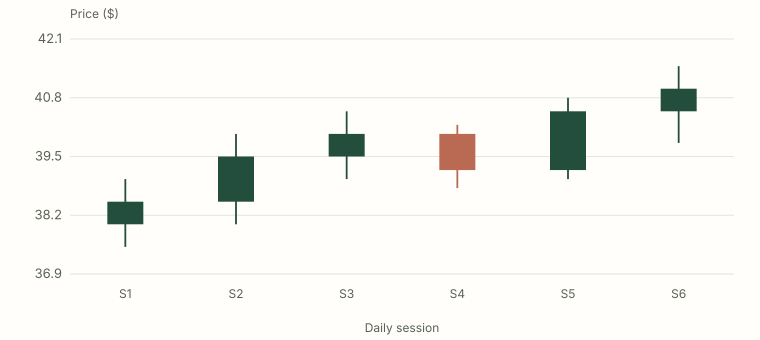

# Reader task form A

Participant code: ______  Phase (pre/post): ______  Date: ______

Use a calculator if useful. Explain your reasoning; uncertainty is a useful answer. You have 10 minutes for the pre-task or 25 minutes for the post-task. Do not open the book during these tasks. All companies, prices and performance claims on this form are fictional. Work on paper or in a separate text file.

## A. Read a chart

Settings: one candle per daily session; regular U.S. session, 09:30–16:00 America/New_York; raw prices in dollars; linear scale; no splits or dividends in this six-session interval. The last completed session is S6. There are no later observations on this form.

State the interval, session and adjustment convention. For S6, identify open, high, low and close from the chart and table. Can you determine whether its high or low occurred first? Explain.

| Session | Open ($) | High ($) | Low ($) | Close ($) |
| --- | --- | --- | --- | --- |
| S1 | 38.00 | 39.00 | 37.50 | 38.50 |
| S2 | 38.50 | 40.00 | 38.00 | 39.50 |
| S3 | 39.50 | 40.50 | 39.00 | 40.00 |
| S4 | 40.00 | 40.20 | 38.80 | 39.20 |
| S5 | 39.20 | 40.80 | 39.00 | 40.50 |
| S6 | 40.50 | 41.50 | 39.80 | 41.00 |

## B. Size and reconcile a position

This is a hypothetical long-stock order, separate from the chart. Account equity is $25,000. The cost-inclusive modeled-loss budget is $150 and cash available for this entry is $3,000. Entry is $40.00 and the planned stop execution price is $38.50. Each side costs $2.50 plus $0.05 per share; there are no other charges. Use whole shares, no borrowing and no partial fills. The loss budget includes both sides' costs; the entry cash limit includes the entry-side cost only. These are exercise limits, not allocation advice.

Compute the largest share count allowed by each constraint and select the smaller. State the binding constraint, notional, entry cash debit, planned price risk, and cost-inclusive modeled loss. Freeze 1R as shares × (entry − planned stop), excluding costs. If the actual gap exit executes at $36.00, calculate net P&L and net R using that frozen denominator. Do not assume the planned stop guarantees the exit price.

## C. Write an analysis note

Return to the six-session chart in A. Your cutoff is after S6 closes. Write four sentences: one observation with numbers, one interpretation, one testable condition that would weaken that interpretation, and one decision with its reason. Taking no position is a valid decision. Distinguish future conditions from observations already available. No trade price or future path is supplied.

## D. Evaluate an evidence claim

An author says: “I searched 60 indicator variants on the same five years of daily prices and chose the best. Its 72 trades won 61% of the time. That proves this signal works.” The five years are fictional, no costs are included, and no untouched period or comparator is reported.

Name at least two missing pieces of evidence and explain what the reported result can support. What would you request next? Treat this as a claim to investigate.

## Brief reflection

Which task was most difficult, and which assumption were you least sure of? ______
